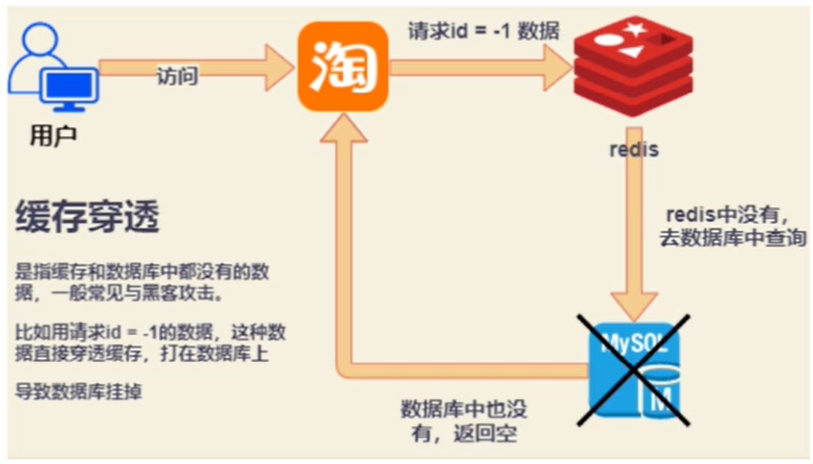
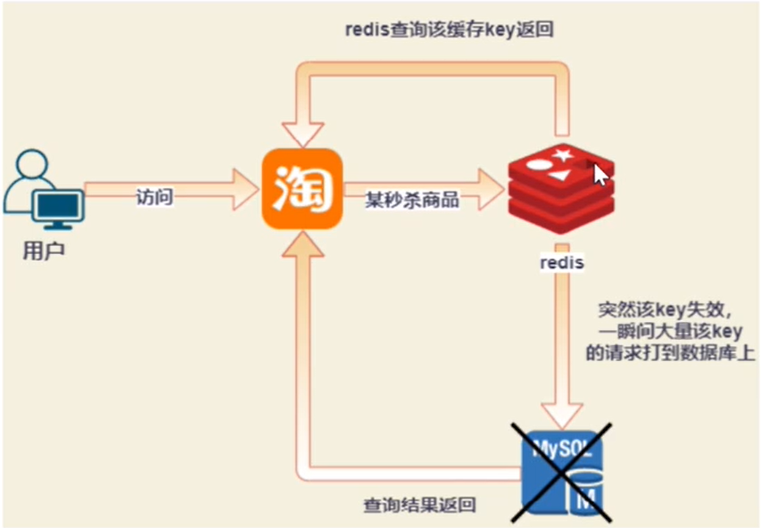
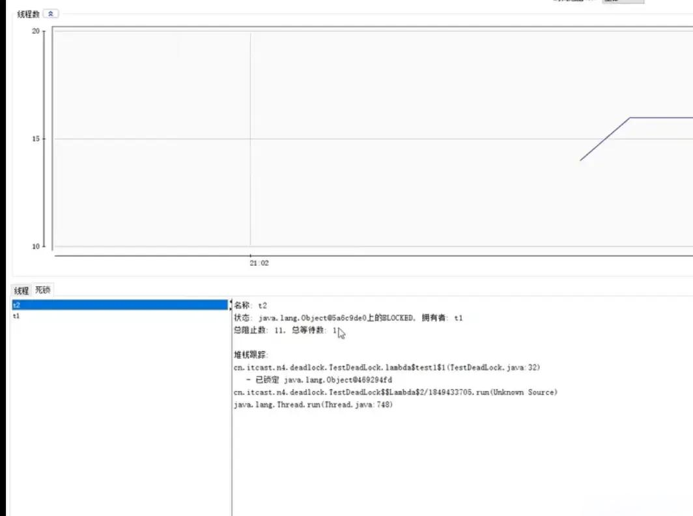
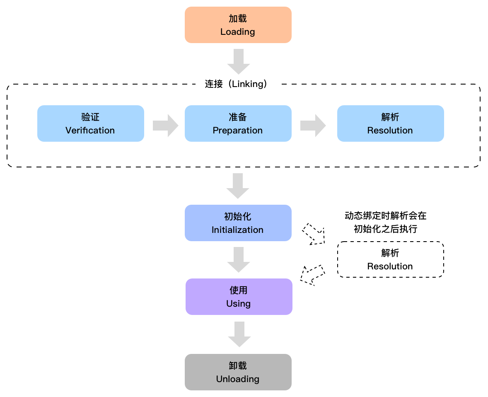
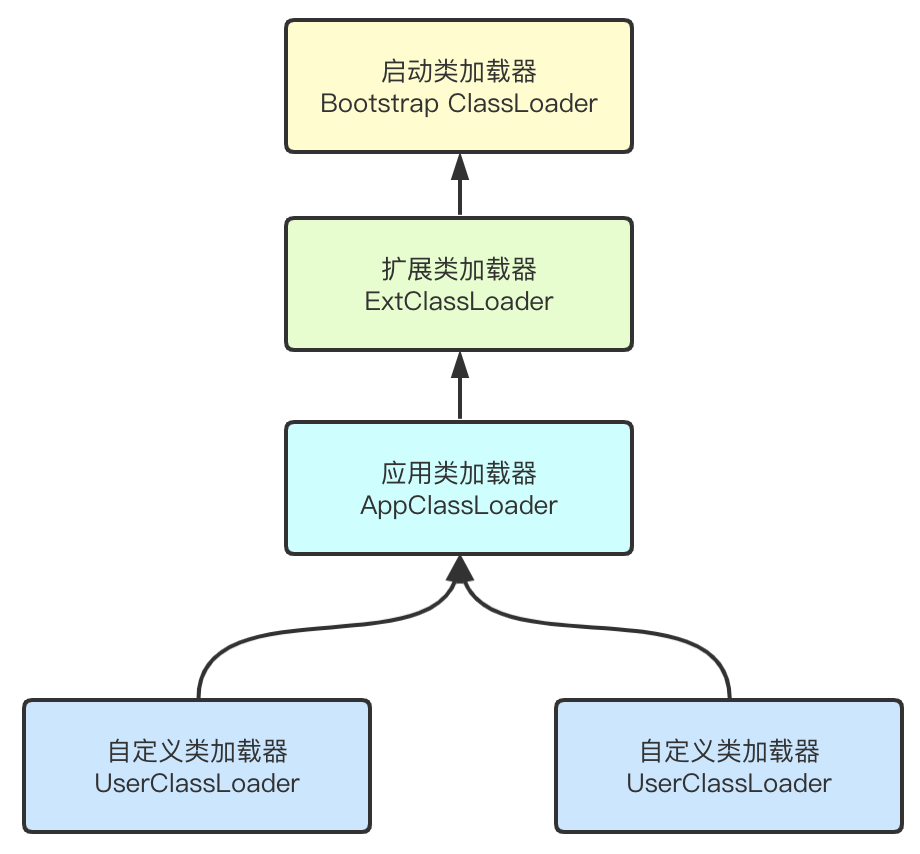
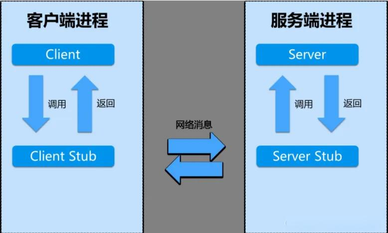
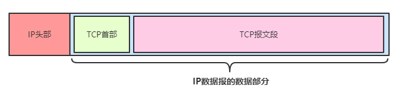
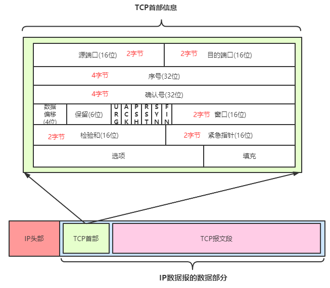
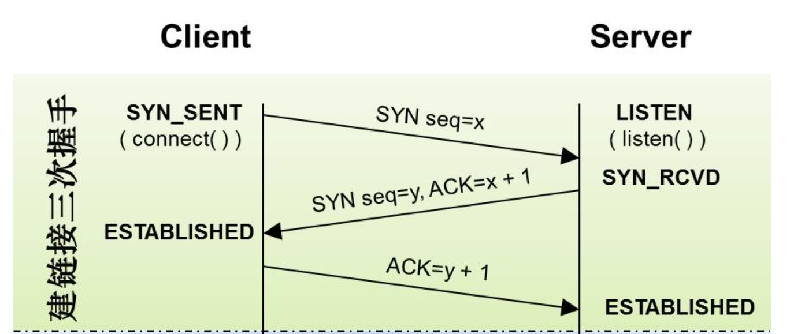

# 1.顺丰Java一面

顺丰Java一面

<https://www.nowcoder.com/feed/main/detail/4a173f4dd359459f81d48f4afea28161>

1.设计模式的实际应用，学过哪些设计模式，状态模式跟策略模式的区别

2.mysql的mvcc机制

3.redis的aof、rdb的区别是什么，缓存穿透、缓存雪崩、缓存击穿这些是什么

4.死锁是什么

5.Jvm类加载的过程

6.kafka的消息确认过程是什么

7.RabbitMq和kafka的区别什么，适用场景有哪些

8.dubbo为什么快，RPC跟http的区别是什么

9.tcp三次握手过程，为什么三次，两次行不行

其它的就是项目上的设计问题以及实习的一些东西。

无手撕。30min

## 1. 设计模式的实际应用，学过哪些设计模式，状态模式跟策略模式的区别

### 分析问题

面试官问这个问题的意图在于考察面试者对设计模式的理解和实际应用能力。具体而言，面试官希望通过这个问题了解以下几个方面：

1. **设计模式的掌握情况**：面试者是否熟悉常见的设计模式，如单例模式、工厂模式、观察者模式、装饰器模式等。
2. **实际应用能力**：面试者是否能够在实际项目中有效地应用这些设计模式来解决问题。
3. **模式的区别和适用场景**：面试者是否能够区分不同设计模式的特点和适用场景，特别是状态模式和策略模式的区别。

### 解题思路

#### 1. 常见设计模式的应用

* **单例模式**：确保一个类只有一个实例，并提供一个全局访问点。
  * **场景**：**电商** - 在电商系统中，购物车类可以使用单例模式，确保每个用户只有一个购物车实例。
  * **代码示例**：

```java
public class ShoppingCart {
    private static ShoppingCart instance;
    
    private ShoppingCart() {}
    
    public static synchronized ShoppingCart getInstance() {
        if (instance == null) {
            instance = new ShoppingCart();
        }
        return instance;
    }
}
```

* **工厂模式**：定义一个创建对象的接口，但让子类决定实例化哪一个类。
  * **场景**：**金融** - 在金融系统中，根据不同的银行类型创建相应的银行对象。
  * **代码示例**：

```java
public interface Bank {
    void createAccount();
}

public class ICICIBank implements Bank {
    public void createAccount() {
        System.out.println("ICICI Bank Account Created");
    }
}

public class HDFCBank implements Bank {
    public void createAccount() {
        System.out.println("HDFC Bank Account Created");
    }
}

public class BankFactory {
    public static Bank getBank(String bankType) {
        if ("ICICI".equalsIgnoreCase(bankType)) {
            return new ICICIBank();
        } else if ("HDFC".equalsIgnoreCase(bankType)) {
            return new HDFCBank();
        }
        return null;
    }
}
```

#### 2. 状态模式和策略模式的区别

* **状态模式**：允许对象在内部状态改变时改变其行为，对象看起来好像修改了其类。
  * **场景**：**在线教育** - 在线课程的状态（未开始、进行中、已结束）可以使用状态模式。
  * **代码示例**：

```java
public interface CourseState {
    void handle();
}

public class NotStartedState implements CourseState {
    public void handle() {
        System.out.println("Course has not started yet.");
    }
}

public class InProgressState implements CourseState {
    public void handle() {
        System.out.println("Course is in progress.");
    }
}

public class EndedState implements CourseState {
    public void handle() {
        System.out.println("Course has ended.");
    }
}

public class CourseContext {
    private CourseState state;

    public void setState(CourseState state) {
        this.state = state;
    }

    public void applyState() {
        state.handle();
    }
}
```

* **策略模式**：定义一系列算法，把它们一个个封装起来，并且使它们可以互相替换。
  * **场景**：**广告营销** - 广告投放策略（CPC、CPM、CPA）可以使用策略模式。
  * **代码示例**：

```java
public interface AdStrategy {
    void execute();
}

public class CPCStrategy implements AdStrategy {
    public void execute() {
        System.out.println("Executing CPC Strategy");
    }
}

public class CPMStrategy implements AdStrategy {
    public void execute() {
        System.out.println("Executing CPM Strategy");
    }
}

public class CPAStrategy implements AdStrategy {
    public void execute() {
        System.out.println("Executing CPA Strategy");
    }
}

public class AdContext {
    private AdStrategy strategy;

    public void setStrategy(AdStrategy strategy) {
        this.strategy = strategy;
    }

    public void applyStrategy() {
        strategy.execute();
    }
}
```

##

## 2. MySQL的MVCC机制

### 分析问题

面试官问这个问题的意图在于考察面试者对MySQL数据库内部机制的理解，特别是MVCC（多版本并发控制）机制。具体而言，面试官希望通过这个问题了解以下几个方面：

1. **基础知识掌握情况**：面试者是否了解MVCC的基本概念和原理。
2. **并发控制能力**：面试者是否理解MVCC在解决并发控制问题中的作用。
3. **实际应用能力**：面试者是否能够在实际项目中应用MVCC来提高数据库的并发性能。

### 解题思路

#### 1. MVCC概述

* **定义**：MVCC（Multi-Version Concurrency Control）是一种用于实现数据库并发控制的机制，通过保存数据的多个版本来允许并发事务读取和写入。
* **特点**：
  * **读不加锁**：读取操作不会阻塞写入操作，写入操作也不会阻塞读取操作。
  * **快照读**：每个事务读取的是数据在事务开始时的快照。
  * **版本链**：每个数据行都有多个版本，通过版本链来管理。

#### 2. MVCC的实现

* **隐藏列**：MVCC通过在每行数据中添加两个隐藏列来实现，分别是`trx_id`（事务ID）和`roll_pointer`（回滚指针）。
  * <code><font style="color:rgb(51, 51, 51);">trx_id</font></code><font style="color:rgb(51, 51, 51);">: 记录最后一次修改该行的事务的 ID。</font>
  * <code><font style="color:rgb(51, 51, 51);">roll_pointer</font></code><font style="color:rgb(51, 51, 51);">: 指向 Undo Log（回滚日志）的指针。通过该指针，可以找到该行数据的历史版本。</font>
* **快照读**：事务在读取数据时，会根据当前事务的快照版本来读取数据，而不是直接读取最新的数据。
* **版本链**：每次数据更新时，都会创建一个新的版本，并将旧版本通过回滚指针连接起来，形成一个版本链。

#### 3. MVCC在实际项目中的应用

* **场景**：**电商** - 在电商系统中，订单的并发读写操作频繁，使用MVCC可以提高系统的并发性能。
* **代码示例**：

```sql
-- 创建订单表
CREATE TABLE orders (
    id INT PRIMARY KEY,
    user_id INT,
    product_id INT,
    status VARCHAR(50),
    created_at TIMESTAMP DEFAULT CURRENT_TIMESTAMP
);

-- 开启事务
START TRANSACTION;

-- 读取订单数据（快照读）
SELECT * FROM orders WHERE user_id = 1;

-- 更新订单状态
UPDATE orders SET status = 'shipped' WHERE id = 1;

-- 提交事务
COMMIT;
```

## 3. Redis的AOF、RDB的区别是什么，缓存穿透、缓存雪崩、缓存击穿这些是什么

### 分析问题

面试官问这个问题的意图在于考察面试者对Redis持久化机制和缓存问题的理解。具体而言，面试官希望通过这个问题了解以下几个方面：

1. **持久化机制**：面试者是否了解Redis的AOF和RDB两种持久化机制的区别和优缺点。
2. **缓存问题**：面试者是否理解缓存穿透、缓存雪崩、缓存击穿等常见的缓存问题及其解决方案。
3. **实际应用能力**：面试者是否能够在实际项目中应用这些知识来优化缓存系统的性能和可靠性。

### 解题思路

#### 1. AOF和RDB的区别

**AO&#x46;****概述****（追加内容）**

Append-only file，将“操作 + 数据”以<u><font style="color:rgb(255,0,0);">格式化指令的方式追加到操作日志文件的尾部</font></u>，在append操作返回后(已经写入到文件或者即将写入)，才进行实际的数据变更，“日志文件”保存了历史所有的操作过程；当server需要数据恢复时，可以直接replay此日志文件，即可还原所有的操作过程。AOF相对可靠，它<u><font style="color:rgb(255,0,0);">和mysql中bin.log、apache.log、zookeeper中txn-log简直异曲同工</font></u>。AOF文件<u><font style="color:rgb(255,0,0);">内容是字符串</font></u>，非常容易阅读和解析。\
优点：可以<u><font style="color:rgb(255,0,0);">保持更高的数据完整性</font></u>，如果设置追加file的时间是1s，如果redis发生故障，最多会丢失1s的数据；且如果日志写入不完整支持redis-check-aof来进行日志修复；\
缺点：<u><font style="color:rgb(255,0,0);">AOF文件比RDB文件大，且恢复速度慢</font></u>。

AOF默认关闭，开启方法，修改配置文件reds.conf：appendonly yes

**RD&#x42;****概述****（快照）**

RDB是在某个时间点将数据写入一个临时文件，持久化结束后，用这个临时文件替换上次持久化的文件，达到数据恢复。 这个操作就类似于在这个时间点来保存一次Redis的所有数据，一次快照数据。所有这个持久化方法也通常叫做<u><font style="color:rgb(255,0,0);">snapshots</font></u>。\
优点：使用<u><font style="color:rgb(255,0,0);">单独子进程来进行持久化</font></u>，主进程不会进行任何IO操作，<u><font style="color:rgb(255,0,0);">保证了</font></u><u><font style="color:rgb(255,0,0);">redis</font></u><u><font style="color:rgb(255,0,0);">的高性能</font></u><u><font style="color:rgb(255,0,0);"> </font></u>\
缺点：RDB是间隔一段时间进行持久化，如果持久化之间<u><font style="color:rgb(255,0,0);">redis</font></u><u><font style="color:rgb(255,0,0);">发生故障，会发生数据丢失</font></u>。所以这种方式更适合数据要求不严谨的时候

RDB默认开启，redis.conf中的具体配置参数如下；

<font style="color:rgb(0,153,0);">#dbfilename：持久化数据存储在本地的文件</font><font style="color:rgb(0,0,0);background-color:rgb(246,248,250);"> dbfilename dump.rdb</font>

<font style="color:rgb(0,0,0);background-color:rgb(246,248,250);"></font>

**总结：**

AOF和RDB各有优缺点，这是有它们各自的特点所决定：

<u><font style="color:rgb(255,0,0);">1) AOF更加安全</font></u>，可以将数据更加及时的同步到文件中，但是AOF需要较多的磁盘IO开支，<u><font style="color:rgb(255,0,0);">AOF文件尺寸较大，文件内容恢复数度相对较慢</font></u>。

2. snapshot<u><font style="color:rgb(255,0,0);">，安全性较差</font></u>，它是“正常时期”数据备份以及master-slave数据同步的最佳手段，<u><font style="color:rgb(255,0,0);">文件尺寸较小，恢复速度较快</font></u>。

可以通过配置文件来指定它们中的一种，或者同时使用它们(不建议同时使用)，或者全部禁用，在架构良好的环境中，<u><font style="color:rgb(255,0,0);">master通常使用AOF</font></u>，<u><font style="color:rgb(255,0,0);">slave使用snapshot</font></u>，主要原因是<u><font style="color:rgb(255,0,0);">master需要首先确保数据完整性</font></u>，它作为数据备份的第一选择；slave提供只读服务(目前slave只能提供读取服务)，它的主要目的就是快速响应客户端read请求；但是如果你的redis运行在网络稳定性差/物理环境糟糕情况下，建议你master和slave均采取AOF，这个在master和slave角色切换时，可以减少“人工数据备份”/“人工引导数据恢复”的时间成本；如果你的环境一切非常良好，且服务需要接收密集性的write操作，那么建议master采取snapshot，而slave采用AOF。

**AOF（Append-Only File）**：

* **特点**：以追加的方式记录每个写操作，日志文件不断增长。
* **优点**：数据恢复更加完整，持久化频率高。
* **缺点**：日志文件较大，恢复速度较慢。
* **场景**：**金融** - 需要高数据完整性的场景，如交易记录。

**RDB（Redis Database）**：

* **特点**：定期生成数据快照，保存到磁盘。
* **优点**：数据恢复速度快，文件较小。
* **缺点**：可能会丢失最近一次快照后的数据。
* **场景**：**社交网络** - 用户状态数据，可以接受一定的数据丢失。

#### 2. 缓存穿透、缓存雪崩、缓存击穿

##### 缓存穿透

缓存穿透是指缓存和数据库中都没有的数据，导致所有的请求都落到数据库上，造成数据库短时间内承受大量请求而崩掉。



解决方案：

1. 接口层增加校验，如用户鉴权校验，id做基础校验，id<=0的直接拦截；
2. 从缓存取不到的数据，在数据库中也没有取到，这时也可以将key-value对写为key-null，缓存有效时间可以设置短点，如30秒。这样可以防止攻击用户反复用同一个id暴力攻击；
3. 采用布隆过滤器，将所有可能存在的数据哈希到一个足够大的 bitmap 中，一个一定不存在的数据会被这个 bitmap 拦截掉，从而避免了对底层存储系统的查询压力。（宁可错杀一千不可放过一人）

##### 缓存雪崩

指缓存同一时间大面积的失效，所以，后面的请求都会落到数据库上，造成数据库短时间内承受大量请求而崩掉。


解决方案：

1. Redis 高可用，主从+哨兵，Redis cluster，避免全盘崩溃
2. 本地 ehcache 缓存 + hystrix 限流&降级，避免 MySQL 被打死
3. 缓存数据的过期时间设置随机，防止同一时间大量数据过期现象发生。
4. 逻辑上永不过期给每一个缓存数据增加相应的缓存标记，缓存标记失效则更新数据缓存
5. 多级缓存，失效时通过二级更新一级，由第三方插件更新二级缓存。

##### 缓存击穿

这时由于并发用户特别多，同时读缓存没读到数据，又同时去数据库去取数据，引起数据库压力瞬间增大，造成过大压力。和缓存雪崩不同的是，缓存击穿指并发查同一条数据，缓存雪崩是不同数据都过期了，很多数据都查不到从而查数据库



解决方案：

1. 设置热点数据永远不过期，异步线程处理。
2. 加写回操作加互斥锁，查询失败默认值快速返回。
3. 缓存预热

系统上线后，将相关可预期（例如排行榜）热点数据直接加载到缓存。写一个缓存刷新页面，手动操作热点数据（例如广告推广）上下线。

##### 总结

**缓存穿透**：查询一个一定不存在的数据，导致每次查询都落到数据库。

* **解决方案**：对不存在的数据进行缓存，设置一个短时间的空值缓存。
* **场景**：**电商** - 防止恶意用户频繁查询不存在的商品。

**缓存雪崩**：缓存集中失效，导致大量请求直接访问数据库，造成数据库压力过大。

* **解决方案**：缓存失效时间加随机值，避免集中失效；使用多级缓存。
* **场景**：**在线教育** - 高峰期大量用户同时访问课程数据。

**缓存击穿**：热点数据在缓存失效的瞬间，大量请求直接访问数据库。

* **解决方案**：使用互斥锁或“永不过期”策略，热点数据提前预热。
* **场景**：**广告营销** - 热门广告数据的频繁读取。

## 4. 死锁是什么

### 分析问题

面试官问这个问题的意图在于考察面试者对并发编程中死锁问题的理解和解决能力。具体而言，面试官希望通过这个问题了解以下几个方面：

1. **基础知识掌握情况**：面试者是否了解死锁的定义和产生的条件。
2. **分析能力**：面试者是否能够分析并检测出死锁的潜在风险。
3. **解决能力**：面试者是否能够提出有效的解决方案来避免或解除死锁。

### 解题思路

#### 1. 死锁的定义和条件

* **定义**：死锁是指两个或多个进程在执行过程中因争夺资源而互相等待，导致这些进程都无法继续执行的现象。
* **产生条件**：
  1. **互斥条件**：资源不能共享，只能由一个进程占用。
  2. **占有且等待**：一个进程持有资源的同时，等待其他进程持有的资源。
  3. **不可剥夺**：进程已获得的资源在未使用完之前不能被剥夺。
  4. **循环等待**：存在一个进程循环等待的链。

#### 2. 死锁的检测和预防

* **检测**：通过资源分配图检测死锁，寻找循环等待的环。
* **预防**：破坏死锁产生的条件，例如：
  * **避免占有且等待**：进程请求资源时必须一次性全部请求。
  * **资源有序分配**：为资源编号，进程按序请求资源。
  * **使用超时机制**：设置请求资源的超时时间，超过时间则放弃请求。

#### 3. 死锁的解决

* **场景**：**物流** - 在物流系统中，多个配送任务同时请求资源（如车辆、仓库）时可能会出现死锁。

<font style="color:rgb(51, 51, 51);">有这样的情况：一个线程需要同时获取多把锁，这时就容易发生死锁</font>

<font style="color:rgb(51, 51, 51);">t1 线程 获得 A 对象 锁，接下来想获取 B 对象 的锁 t2 线程 获得 B 对象 锁，接下来想获取 A 对象 的锁</font>

```java
Object A = new Object();
Object B = new Object();
Thread t1 = new Thread(() -> {
    synchronized (A) {
        log.debug("lock A");
        sleep(1);
        synchronized (B) {
            log.debug("lock B");
            log.debug("操作...");
        }
    }
}, "t1");
Thread t2 = new Thread(() -> {
    synchronized (B) {
        log.debug("lock B");
        sleep(0.5);
        synchronized (A) {
            log.debug("lock A");
            log.debug("操作...");
        }
    }
}, "t2");
t1.start();
t2.start();
```

```plain
12:22:06.962 [t2] c.TestDeadLock - lock B 
12:22:06.962 [t1] c.TestDeadLock - lock A
```

##### <font style="color:rgb(51, 51, 51);">定位死锁</font>

<font style="color:rgb(51, 51, 51);">检测死锁可以使用 jconsole 工具，或者使用 jps 定位进程 id，再用 jstack 定位死锁：</font>

###### <font style="color:rgb(119, 119, 119);">jps</font>

```shell
cmd > jps
Picked up JAVA_TOOL_OPTIONS: -Dfile.encoding=UTF-8
12320 Jps
22816 KotlinCompileDaemon
33200 TestDeadLock // JVM 进程
11508 Main
28468 Launcher
```

```shell
cmd > jstack 33200
        Picked up JAVA_TOOL_OPTIONS: -Dfile.encoding=UTF-8
        2018-12-29 05:51:40
        Full thread dump Java HotSpot(TM) 64-Bit Server VM (25.91-b14 mixed mode):
        "DestroyJavaVM" #13 prio=5 os_prio=0 tid=0x0000000003525000 nid=0x2f60 waiting on condition
        [0x0000000000000000]
        java.lang.Thread.State: RUNNABLE
        "Thread-1" #12 prio=5 os_prio=0 tid=0x000000001eb69000 nid=0xd40 waiting for monitor entry
        [0x000000001f54f000]
        java.lang.Thread.State: BLOCKED (on object monitor)
        at thread.TestDeadLock.lambda$main$1(TestDeadLock.java:28)
        - waiting to lock <0x000000076b5bf1c0> (a java.lang.Object)
        - locked <0x000000076b5bf1d0> (a java.lang.Object)
        at thread.TestDeadLock$$Lambda$2/883049899.run(Unknown Source)
        at java.lang.Thread.run(Thread.java:745)
        "Thread-0" #11 prio=5 os_prio=0 tid=0x000000001eb68800 nid=0x1b28 waiting for monitor entry
        [0x000000001f44f000]
        java.lang.Thread.State: BLOCKED (on object monitor)
        at thread.TestDeadLock.lambda$main$0(TestDeadLock.java:15)
        - waiting to lock <0x000000076b5bf1d0> (a java.lang.Object)
        - locked <0x000000076b5bf1c0> (a java.lang.Object)
        at thread.TestDeadLock$$Lambda$1/495053715.run(Unknown Source)
        at java.lang.Thread.run(Thread.java:745)
 
// 略去部分输出
        Found one Java-level deadlock:
        =============================
        "Thread-1":
        waiting to lock monitor 0x000000000361d378 (object 0x000000076b5bf1c0, a java.lang.Object),
        which is held by "Thread-0"
        "Thread-0":
        waiting to lock monitor 0x000000000361e768 (object 0x000000076b5bf1d0, a java.lang.Object),
        which is held by "Thread-1"
        Java stack information for the threads listed above:
        ===================================================
        "Thread-1":
        at thread.TestDeadLock.lambda$main$1(TestDeadLock.java:28)
        - waiting to lock <0x000000076b5bf1c0> (a java.lang.Object)
        - locked <0x000000076b5bf1d0> (a java.lang.Object)
        at thread.TestDeadLock$$Lambda$2/883049899.run(Unknown Source)
        at java.lang.Thread.run(Thread.java:745)
        "Thread-0":
        at thread.TestDeadLock.lambda$main$0(TestDeadLock.java:15)
        - waiting to lock <0x000000076b5bf1d0> (a java.lang.Object)
        - locked <0x000000076b5bf1c0> (a java.lang.Object)
        at thread.TestDeadLock$$Lambda$1/495053715.run(Unknown Source)
        at java.lang.Thread.run(Thread.java:745)
        Found 1 deadlock
```

<font style="color:rgb(51, 51, 51);">这里是两个线程 “Thread-0” 和 “Thread-1” 在互相等待对方释放锁，从而导致了死锁。</font>

<font style="color:rgb(51, 51, 51);">线程 “Thread-1” 试图获取对象 0x000000076b5bf1c0 的监视器锁（即 synchronized 关键字保护的那个对象），但是这个锁已经被线程 “Thread-0” 持有。因此，“Thread-1” 进入了等待状态，等待 “Thread-0” 释放这个锁。</font>

<font style="color:rgb(51, 51, 51);">同时，线程 “Thread-0” 试图获取对象 0x000000076b5bf1d0 的监视器锁，但是这个锁已经被线程 “Thread-1” 持有。因此，“Thread-0” 进入了等待状态，等待 “Thread-1” 释放这个锁。</font>

###### <font style="color:rgb(119, 119, 119);">jconsole</font>




## 5. JVM类加载的过程

### 分析问题

面试官问这个问题的意图在于考察面试者对JVM（Java虚拟机）内部机制的理解，特别是类加载过程。具体而言，面试官希望通过这个问题了解以下几个方面：

1. **基础知识掌握情况**：面试者是否了解JVM类加载的基本步骤和原理。
2. **调试和优化能力**：面试者是否能够通过理解类加载过程来调试和优化Java应用程序。
3. **实际应用能力**：面试者是否能够在实际项目中应用这些知识来解决类加载相关的问题。

### 解题思路

<font style="color:rgb(34, 34, 34);">类是在运行期间第一次使用时动态加载的，而不是一次性加载所有类。因为如果一次性加载，那么会占用很多的内存。</font>



<font style="color:rgb(34, 34, 34);">包括以下 7 个阶段：</font>

* <font style="color:rgb(34, 34, 34);">加载（Loading）</font>
* <font style="color:rgb(34, 34, 34);">验证（Verification）</font>
* <font style="color:rgb(34, 34, 34);">准备（Preparation）</font>
* <font style="color:rgb(34, 34, 34);">解析（Resolution）</font>
* <font style="color:rgb(34, 34, 34);">初始化（Initialization）</font>
* <font style="color:rgb(34, 34, 34);">使用（Using）</font>
* <font style="color:rgb(34, 34, 34);">卸载（Unloading）</font>

#### 类的加载过程

<font style="color:rgb(34, 34, 34);">包含了加载、验证、准备</font>、解析<font style="color:rgb(34, 34, 34);">和初始化这 5 个阶段。</font>

##### 加载

<font style="color:rgb(34, 34, 34);">加载过程完成以下三件事：</font>

* <font style="color:rgb(34, 34, 34);">通过类的完全限定名称获取定义该类的二进制字节流。</font>
* <font style="color:rgb(34, 34, 34);">将该字节流表示的静态存储结构转换为方法区的运行时存储结构。</font>
* <font style="color:rgb(34, 34, 34);">在内存中生成一个代表该类的 Class 对象，作为方法区中该类各种数据的访问入口。</font>

<font style="color:rgb(34, 34, 34);">其中二进制字节流可以从以下方式中获取：</font>

* <font style="color:rgb(34, 34, 34);">从 ZIP 包读取，成为 JAR、EAR、WAR 格式的基础。</font>
* <font style="color:rgb(34, 34, 34);">从网络中获取，最典型的应用是 Applet。</font>
* <font style="color:rgb(34, 34, 34);">运行时计算生成，例如动态代理技术，在 java.lang.reflect.Proxy 使用 ProxyGenerator.generateProxyClass 的代理类的二进制字节流。</font>
* <font style="color:rgb(34, 34, 34);">由其他文件生成，例如由 JSP 文件生成对应的 Class 类。</font>

##### 验证

<font style="color:rgb(34, 34, 34);">JVM 会在该阶段对二进制字节流进行校验，只有符合 JVM 字节码规范的才能被 JVM 正确执行。该阶段是保证 JVM 安全的重要屏障，下面是一些主要的检查。</font>

* <font style="color:rgb(34, 34, 34);">确保二进制字节流格式符合预期（比如说是否以 cafe bene 开头）。</font>
* <font style="color:rgb(34, 34, 34);">是否所有方法都遵守访问控制关键字的限定。</font>
* <font style="color:rgb(34, 34, 34);">方法调用的参数个数和类型是否正确。</font>
* <font style="color:rgb(34, 34, 34);">确保变量在使用之前被正确初始化了。</font>
* <font style="color:rgb(34, 34, 34);">检查变量是否被赋予恰当类型的值。</font>

##### 准备

<font style="color:rgb(34, 34, 34);">JVM 会在该阶段对类变量（也称为静态变量，static 关键字修饰的）分配内存并初始化（对应数据类型的默认初始值，如 0、0L、null、false 等）。</font>

<font style="color:rgb(34, 34, 34);">此时不会分配实例变量的内存，因为实例变量是在实例化对象时一起创建在Java 堆中的。而且此时类变量是赋值为零值，即 int 类型的零值为 0，引用类型零值为 null，而不是代码中显示赋值的数值。</font>

##### 解析

<font style="color:rgb(34, 34, 34);">该阶段将常量池中的符号引用转化为直接引用。</font>

<font style="color:rgb(34, 34, 34);">在 class 文件中常量池里面存放了字面量和符号引用，符号引用包括类和接口的全限定名以及字段和方法的名称与描述符。</font>

<font style="color:rgb(34, 34, 34);">在 JVM 动态链接的时候需要根据这些符号引用来转换为直接引用存放内存使用。</font>

##### 初始化

<font style="color:rgb(34, 34, 34);">该阶段是类加载过程的最后一步。在准备阶段，类变量已经被赋过默认初始值，而在初始化阶段，类变量将被赋值为代码期望赋的值。换句话说，初始化阶段是执行类构造器方法的过程。</font>

#### 类加载时机

* <font style="color:rgb(34, 34, 34);">new、getstatic、putstatic、invokestatic 这 4 个字节码指令时对类进行初始化（即：实例化对象、读写静态对象、调用静态方法时，进行类的初始化）；</font>
* <font style="color:rgb(34, 34, 34);">使用反射机制对类进行调用时，进行类的初始化；</font>
* <font style="color:rgb(34, 34, 34);">初始化一个类，其父类没有初始化时，先初始化其父类；</font>
* <font style="color:rgb(34, 34, 34);">虚拟机启动时，初始化一个执行主类；</font>
* <font style="color:rgb(34, 34, 34);">使用 JDK1.7 的动态语言支持时，如果 MethodHandle 实例的解析结果为 REF_getstatic、REF_putstatic、REF_invokestatic 的方法句柄（即：读写静态对象或者调用静态方法），则初始化该句柄对应类。</font>

##### 类加载器分类

<font style="color:rgb(34, 34, 34);">讲到类加载不得不讲到类加载的顺序和类加载器。</font>

<font style="color:rgb(34, 34, 34);">Java 中大概有四种类加载器，分别是：启动类加载器（Bootstrap ClassLoader），扩展类加载器（Extension ClassLoader），系统类加载器（System ClassLoader），自定义类加载器（Custom ClassLoader），依次属于继承关系（注意这里的继承不是 Java 类里面的 extends）</font>



* <font style="color:rgb(34, 34, 34);">启动类加载器（Bootstrap ClassLoader）：主要负责加载存放在Java_Home/jre/lib下，或被-Xbootclasspath参数指定的路径下的，并且能被虚拟机识别的类库（如rt.jar，所有的java.\*开头的类均被Bootstrap ClassLoader加载），启动类加载器是无法被Java程序直接引用的。</font>
* <font style="color:rgb(34, 34, 34);">扩展类加载器（Extension ClassLoader）：主要负责加载器由sun.misc.Launcher$ExtClassLoader实现，它负责加载Java_Home/jre/lib/ext目录中，或者由java.ext.dirs系统变量指定的路径中的所有类库（如javax.\*开头的类），开发者可以直接使用扩展类加载器。</font>
* <font style="color:rgb(34, 34, 34);">系统类加载器（System ClassLoader）：主要负责加载器由sun.misc.Launcher$AppClassLoader来实现，它负责加载用户类路径（ClassPath）所指定的类，开发者可以直接使用该类加载器，如果应用程序中没有自定义过自己的类加载器，一般情况下这个就是程序中默认的类加载器。</font>
* <font style="color:rgb(34, 34, 34);">自定义类加载器（Custom ClassLoader：自己开发的类加载器。</font>

<font style="color:rgb(34, 34, 34);"></font>

<font style="color:rgb(34, 34, 34);"></font>

## 6. Kafka的消息确认过程是什么

### 分析问题

面试官问这个问题的意图在于考察面试者对Kafka消息系统的理解，特别是消息确认机制。具体而言，面试官希望通过这个问题了解以下几个方面：

1. **基础知识掌握情况**：面试者是否了解Kafka消息确认的基本概念和原理。
2. **可靠性和一致性**：面试者是否理解Kafka的消息确认机制在保证消息可靠性和一致性方面的作用。
3. **实际应用能力**：面试者是否能够在实际项目中应用这些知识来确保消息系统的可靠性。

### 解题思路

#### 1. 什么是 ACK 机制？

**问题**：ACK 机制到底是什么呢？

**回答**：ACK 是 "Acknowledgment" 的缩写，意思是确认。Kafka 中的 ACK 机制是用来确认消息是否被成功写入到主题（topic）的分区（partition）中。生产者发送消息后，会根据配置的 ACK 级别来决定是否需要等待确认，确保消息传递的可靠性。

#### 2. ACK 级别有几种？

**问题**：Kafka 的 ACK 级别有几种呢？它们有什么区别？

**回答**：Kafka 有三种主要的 ACK 级别，每种级别都有不同的可靠性保证哦！它们分别是：

* <code>**acks=0**</code>：**无确认**。生产者不会等待任何确认就认为消息已发送成功。这种方式最快，但可靠性最低。如果在发送过程中消息丢失了，生产者不会知道。
* <code>**acks=1**</code>：**单节点确认**。生产者会等待消息被领导者副本（leader replica）写入成功后才认为消息已发送成功。这种方式在保证一定可靠性的同时还能保持较高的吞吐量。如果领导者副本失败，可能会丢失消息。
* <code>**acks=all**</code>（或 `acks=-1`）：**所有副本确认**。生产者会等待消息被所有同步副本（ISR：In-Sync Replicas）写入成功后才认为消息已发送成功。这种方式最可靠，但延迟也最高。即使领导者副本失败，消息也不会丢失。

#### 3. 配置 ACK 级别

**问题**：如何在 Kafka 配置中设置 ACK 级别呢？

**回答**：可以在生产者配置中设置 `acks` 参数来指定 ACK 级别。例如：

```java
Properties props = new Properties();
props.put("bootstrap.servers", "localhost:9092");
props.put("key.serializer", "org.apache.kafka.common.serialization.StringSerializer");
props.put("value.serializer", "org.apache.kafka.common.serialization.StringSerializer");

// 设置ACK级别
props.put("acks", "all"); // 或 "1" 或 "0"
```

#### 4. 为什么 ACK 机制很重要？

**问题**：为什么 Kafka 的 ACK 机制这么重要呢？

**回答**：ACK 机制是 Kafka 确保消息传递可靠性的核心。它通过不同级别的确认，平衡了性能和可靠性之间的关系。根据你的应用需求，你可以选择合适的 ACK 级别来保证消息不会丢失，同时还能保持系统的高性能哦！

#### 5. ACK 机制的实际应用

**问题**：在实际应用中，ACK 机制是怎么工作的呢？

**回答**：假设你有一个在线购物平台，所有订单信息都通过 Kafka 传递。为了确保每个订单都不会丢失，你可以设置 `acks=all`，这样即使在系统故障时，订单信息也能被可靠地保存下来。但如果你在开发过程中，只想快速测试消息传递，可以设置 `acks=0` 来提高速度，但要记住，这样会有消息丢失的风险！

#### 6.Kafka消息确认过程

1. **生产者发送消息**：
   * 生产者配置`acks`参数来控制消息确认的级别。
   * 生产者发送消息到Kafka集群中的Leader分区。
   * Leader分区将消息写入本地日志，并根据`acks`参数返回确认信息。
2. **消费者处理消息**：
   * 消费者从Kafka分区中拉取消息。
   * 消费者处理消息后，提交偏移量（offset）到Kafka。
   * 提交的偏移量用于确认消息已被处理，防止重复消费。

#### 7. Kafka消息确认在实际项目中的应用

* **场景**：**广告营销** - 在广告投放系统中，确保广告投放日志的可靠传递和处理。
* **代码示例**：

生产者端代码示例：

```java
Properties props = new Properties();
props.put("bootstrap.servers", "localhost:9092");
props.put("acks", "all");
props.put("key.serializer", "org.apache.kafka.common.serialization.StringSerializer");
props.put("value.serializer", "org.apache.kafka.common.serialization.StringSerializer");

KafkaProducer<String, String> producer = new KafkaProducer<>(props);
for (int i = 0; i < 10; i++) {
    producer.send(new ProducerRecord<>("topic", Integer.toString(i), Integer.toString(i)), 
        (metadata, exception) -> {
            if (exception == null) {
                System.out.println("Message sent successfully: " + metadata.offset());
            } else {
                exception.printStackTrace();
            }
        });
}
producer.close();
```

消费者端代码示例：

```java
Properties props = new Properties();
props.put("bootstrap.servers", "localhost:9092");
props.put("group.id", "group1");
props.put("enable.auto.commit", "false");
props.put("key.deserializer", "org.apache.kafka.common.serialization.StringDeserializer");
props.put("value.deserializer", "org.apache.kafka.common.serialization.StringDeserializer");

KafkaConsumer<String, String> consumer = new KafkaConsumer<>(props);
consumer.subscribe(Arrays.asList("topic"));

try {
    while (true) {
        ConsumerRecords<String, String> records = consumer.poll(Duration.ofMillis(100));
        for (ConsumerRecord<String, String> record : records) {
            System.out.printf("offset = %d, key = %s, value = %s%n", record.offset(), record.key(), record.value());
        }
        consumer.commitSync();
    }
} finally {
    consumer.close();
}
```

## 7. RabbitMQ和Kafka的区别是什么，适用场景有哪些

### 分析问题

面试官问这个问题的意图在于考察面试者对两种常见消息队列系统RabbitMQ和Kafka的理解。具体而言，面试官希望通过这个问题了解以下几个方面：

1. **基础知识掌握情况**：面试者是否了解RabbitMQ和Kafka的基本概念和工作原理。
2. **系统设计能力**：面试者是否能够根据具体需求选择合适的消息队列系统。
3. **实际应用能力**：面试者是否能够在实际项目这些消息队列的应用场景。

### 解题思路

### <font style="color:rgb(35, 47, 62);">Kafka 和 RabbitMQ 之间有何区别？</font>

<font style="color:rgb(51, 51, 51);">Kafka 和 RabbitMQ 是可用于流处理的消息队列系统。数据流是需要高速处理的大容量、连续增量数据。例如，您必须持续收集和处理有关环境的传感器数据，以观察温度或气压的实时变化。</font>

<font style="color:rgb(51, 51, 51);">RabbitMQ 是一个分布式消息代理，从多个来源收集流式处理数据，然后将其路由到不同的目标进行处理。</font>

<font style="color:rgb(51, 51, 51);">Apache Kafka 是一个流式处理平台，用于构建实时数据管道和流式处理应用程序。Kafka 提供了一个高度可扩展、容错和持久的消息收发系统，其功能比 RabbitMQ 更多。</font>

#### <font style="color:rgb(35, 47, 62);background-color:rgb(251, 251, 251);">架构差异：Kafka 与RabbitMQ</font>

<font style="color:rgb(51, 51, 51);background-color:rgb(251, 251, 251);">RabbitMQ 和 Apache Kafka 均允许生产者向使用者发送消息。</font>*<font style="color:rgb(51, 51, 51);background-color:rgb(251, 251, 251);">生产者</font>*<font style="color:rgb(51, 51, 51);background-color:rgb(251, 251, 251);">是发布信息的应用程序，而</font>*<font style="color:rgb(51, 51, 51);background-color:rgb(251, 251, 251);">使用者</font>*<font style="color:rgb(51, 51, 51);background-color:rgb(251, 251, 251);">是订阅和处理信息的应用程序。</font>

<font style="color:rgb(51, 51, 51);background-color:rgb(251, 251, 251);">在 RabbitMQ 和 Kafka 中，生产者和使用者的互动方式有所不同。在 RabbitMQ 中，生产者发送并监控消息是否到达目标使用者。另一方面，无论使用者是否检索消息，Kafka 生产者都会向队列发布消息。</font>

<font style="color:rgb(51, 51, 51);background-color:rgb(251, 251, 251);">可以将 RabbitMQ 视为接收邮件并将其传输给预定收件人的邮局。与此同时，Kafka 类似于图书馆，它在书架上整理生产者发布的不同类型消息。然后，使用者读取相应书架上的消息，并记住他们所读取的内容。 </font>

#### <font style="color:rgb(51, 51, 51);background-color:rgb(251, 251, 251);">RabbitMQ 架构方法</font>

<font style="color:rgb(51, 51, 51);background-color:rgb(251, 251, 251);">RabbitMQ 代理允许使用以下组件进行低延迟和复杂的消息分配：</font>

* *<font style="color:rgb(51, 51, 51);background-color:rgb(251, 251, 251);">交换机</font>*<font style="color:rgb(51, 51, 51);background-color:rgb(251, 251, 251);">接收来自生产者的消息并确定应将它们路由到何处</font>
* *<font style="color:rgb(51, 51, 51);background-color:rgb(251, 251, 251);">队列</font>*<font style="color:rgb(51, 51, 51);background-color:rgb(251, 251, 251);">是接收来自交换机的消息并将其发送给使用者的存储空间</font>
* *<font style="color:rgb(51, 51, 51);background-color:rgb(251, 251, 251);">绑定</font>*<font style="color:rgb(51, 51, 51);background-color:rgb(251, 251, 251);">是连接交换机和代理的路径</font>

<font style="color:rgb(51, 51, 51);background-color:rgb(251, 251, 251);">在 RabbitMQ 中，</font>*<font style="color:rgb(51, 51, 51);background-color:rgb(251, 251, 251);">路由key</font>*<font style="color:rgb(51, 51, 51);background-color:rgb(251, 251, 251);">是一种消息属性，用于将消息从交换机路由到特定队列。当生产者向交换机发送消息时，它会将路由key作为消息的一部分包含在内。然后，交换机使用此路由key来确定消息应传输到哪个队列。</font>

#### <font style="color:rgb(51, 51, 51);background-color:rgb(251, 251, 251);">Kafka 架构方法</font>

<font style="color:rgb(51, 51, 51);background-color:rgb(251, 251, 251);">Kafka 集群通过更复杂的架构提供高吞吐量流事件处理。以下是 Kafka 的一些关键组件：</font>

* *<font style="color:rgb(51, 51, 51);background-color:rgb(251, 251, 251);">Kafka 代理</font>*<font style="color:rgb(51, 51, 51);background-color:rgb(251, 251, 251);">是 Kafka 服务器，允许生产者将数据流式传输给使用者。 Kafka 代理包含主题及其相应的分区。 </font>
* *<font style="color:rgb(51, 51, 51);background-color:rgb(251, 251, 251);">主题</font>*<font style="color:rgb(51, 51, 51);background-color:rgb(251, 251, 251);">是在 Kafka 代理中对相似数据进行分组的数据存储。 </font>
* *<font style="color:rgb(51, 51, 51);background-color:rgb(251, 251, 251);">分区</font>*<font style="color:rgb(51, 51, 51);background-color:rgb(251, 251, 251);">是使用者所订阅主题中较小的数据存储空间。 </font>
* <font style="color:rgb(51, 51, 51);background-color:rgb(251, 251, 251);">ZooKeeper 是特殊的软件，用于管理 Kafka 集群和分区以提供容错流式处理。ZooKeeper 最近被 Apache Kafka Raft（KRaft）协议所取代。</font>

<font style="color:rgb(51, 51, 51);background-color:rgb(251, 251, 251);">Kafka 中的生产者为每条消息分配一个消息key。然后，Kafka 代理将消息存储在该特定主题的前导分区中。KRaft 协议使用共识算法来确定前导分区。 </font>

#### <font style="color:rgb(35, 47, 62);">Kafka 和 RabbitMQ 如何以不同的方式处理消息？</font>

<font style="color:rgb(51, 51, 51);">RabbitMQ 和 Apache Kafka 以不同的方式将数据从生产者转移到使用者。RabbitMQ 是通用消息代理，它优先考虑端到端消息传输。Kafka 是分布式事件流式处理平台，支持持续大数据的实时交换。</font>

<font style="color:rgb(51, 51, 51);">RabbitMQ 和 Kafka 针对不同的使用案例而设计，因此它们处理消息的方式有所不同。 接下来，我们讨论一些具体的差异。</font>

**<font style="color:rgb(51, 51, 51);">消息使用</font>**

<font style="color:rgb(51, 51, 51);">在 RabbitMQ 中，代理确保使用者收到消息。使用者应用程序扮演被动角色，等待 RabbitMQ 代理将消息推送到队列中。例如，银行应用程序可能会等待来自中央交易处理软件的短信提醒。</font>

<font style="color:rgb(51, 51, 51);">然而，Kafka 使用者更积极地读取和跟踪信息。当消息加入实体日志文件时，Kafka 使用者会跟踪他们读取的最后一条消息，并相应地更新偏移跟踪器。偏移跟踪器是读取消息后递增的计数器。使用 Kafka，生产者并不知道使用者会检索消息。 </font>

**<font style="color:rgb(51, 51, 51);">消息优先级</font>**

<font style="color:rgb(51, 51, 51);">RabbitMQ 代理允许生产者软件使用优先队列升级某些消息。代理不是按</font>*<font style="color:rgb(51, 51, 51);">先入先出</font>*<font style="color:rgb(51, 51, 51);">的顺序发送消息，而是先处理更高优先级的消息，然后再处理普通消息。例如，零售应用程序可能每小时将销售交易排队一次。但是，如果系统管理员发出优先的备份数据库消息，则代理会立即发送该消息。</font>

<font style="color:rgb(51, 51, 51);">与 RabbitMQ 不同，Apache Kafka 不支持优先级队列。将所有消息分配到各自的分区时，该代理平等对待这些消息。 </font>

**<font style="color:rgb(51, 51, 51);">消息排序</font>**

<font style="color:rgb(51, 51, 51);">RabbitMQ 按特定顺序发送消息和对其进行排队。除非有更高优先级的消息排入系统，否则使用者会按照消息的发送顺序接收消息。</font>

<font style="color:rgb(51, 51, 51);">同时，Kafka 使用主题和分区对消息进行排队。当生产者发送消息时，消息会进入特定的主题和分区。由于 Kafka 不支持直接的生产者与使用者交换，因此使用者以不同的顺序从分区中拉取消息。 </font>

**<font style="color:rgb(51, 51, 51);">消息删除</font>**

<font style="color:rgb(51, 51, 51);">RabbitMQ 代理将消息路由到目标队列。读取后，使用者向代理发送确认（ACK）回复，然后代理将消息从队列中删除。</font>

<font style="color:rgb(51, 51, 51);">与 RabbitMQ 不同，Apache Kafka 将消息附加到日志文件中，该日志文件将一直留存到其保留期到期。这样，使用者可以在规定的时间内随时重新处理流式传输的数据。</font>

#### <font style="color:rgb(35, 47, 62);background-color:rgb(251, 251, 251);"> Kafka 与RabbitMQ </font><font style="color:rgb(51, 51, 51);">适用场景</font>

<font style="color:rgb(51, 51, 51);background-color:rgb(251, 251, 251);">务必了解的是，RabbitMQ 和 Kafka 不是相互竞争的消息代理。两者都旨在支持不同使用案例中的数据交换，分别有其适用场景。</font>

<font style="color:rgb(51, 51, 51);background-color:rgb(251, 251, 251);">接下来，我们将讨论考虑采用 RabbitMQ 和 Kafka 的一些使用案例。</font>

**<font style="color:rgb(51, 51, 51);background-color:rgb(251, 251, 251);">事件流重放</font>**

<font style="color:rgb(51, 51, 51);background-color:rgb(251, 251, 251);">Kafka 适用于需要重新分析所接收数据的应用程序。可以在保留期内多次处理流式数据或收集日志文件进行分析。</font>

<font style="color:rgb(51, 51, 51);background-color:rgb(251, 251, 251);">使用 RabbitMQ 进行日志聚合更具挑战性，因为消息一旦使用就会被删除。解决方法是重放来自生产者的已存储消息。</font>

**<font style="color:rgb(51, 51, 51);background-color:rgb(251, 251, 251);">实时数据流式处理</font>**

<font style="color:rgb(51, 51, 51);background-color:rgb(251, 251, 251);">Kafka 以非常低的延迟流式传输消息，适用于实时分析流式数据。例如，可以将 Kafka 用作分布式监控服务，为在线事务处理实时发出提醒。</font>

**<font style="color:rgb(51, 51, 51);background-color:rgb(251, 251, 251);">复杂的路由架构</font>**

<font style="color:rgb(51, 51, 51);background-color:rgb(251, 251, 251);">RabbitMQ 为要求模糊或路由场景复杂的客户端提供灵活性。例如，可以将 RabbitMQ 设置为将数据路由到具有不同绑定和交换机的不同应用程序。</font>

**<font style="color:rgb(51, 51, 51);background-color:rgb(251, 251, 251);">有效的消息传输</font>**

<font style="color:rgb(51, 51, 51);background-color:rgb(251, 251, 251);">RabbitMQ 采用推送模型，这意味着生产者知悉客户端应用程序是否使用消息。该方法适用于在交换和分析数据时必须遵守特定顺序和传输保证的应用程序。 </font>

**<font style="color:rgb(51, 51, 51);background-color:rgb(251, 251, 251);">语言和协议支持</font>**

<font style="color:rgb(51, 51, 51);background-color:rgb(251, 251, 251);">开发人员将 RabbitMQ 用于需要向后兼容诸如 MQTT 和 STOMP 等旧式协议的客户端应用程序。与 Kafka 相比，RabbitMQ 还支持更广泛的编程语言。</font>

#### <font style="color:rgb(35, 47, 62);background-color:rgb(251, 251, 251);">总结Kafka 与RabbitMQ 差异</font>

| <font style="color:rgb(51, 51, 51);background-color:rgb(251, 251, 251);"> </font> | <font style="color:rgb(51, 51, 51);background-color:rgb(251, 251, 251);">RabbitMQ</font> | <font style="color:rgb(51, 51, 51);background-color:rgb(251, 251, 251);">Kafka</font> |
| --- | --- | --- |
| <font style="color:rgb(51, 51, 51);background-color:rgb(251, 251, 251);">架构</font> | <font style="color:rgb(51, 51, 51);background-color:rgb(251, 251, 251);">RabbitMQ 的架构专为复杂的消息路由而设计。该代理使用推送模型。生产者使用不同的规则向使用者发送消息。 </font> | <font style="color:rgb(51, 51, 51);background-color:rgb(251, 251, 251);">Kafka 使用基于分区的设计进行实时、高吞吐量的流处理。该代理使用拉取模型。生产者向使用者订阅的主题和分区发布消息。 </font> |
| <font style="color:rgb(51, 51, 51);background-color:rgb(251, 251, 251);">消息处理</font> | <font style="color:rgb(51, 51, 51);background-color:rgb(251, 251, 251);">RabbitMQ 代理监控消息使用。此代理会在消息被使用后将其删除。它支持消息优先级。 </font> | <font style="color:rgb(51, 51, 51);background-color:rgb(251, 251, 251);">使用者使用偏移跟踪器跟踪消息检索情况。Kafka 根据保留策略保留消息。其中没有消息优先级。 </font> |
| <font style="color:rgb(51, 51, 51);background-color:rgb(251, 251, 251);">性能</font> | <font style="color:rgb(51, 51, 51);background-color:rgb(251, 251, 251);">RabbitMQ 提供低延迟。它每秒发送数千条消息。</font> | <font style="color:rgb(51, 51, 51);background-color:rgb(251, 251, 251);">Kafka 每秒可实时传输多达数百万条消息。</font> |
| <font style="color:rgb(51, 51, 51);background-color:rgb(251, 251, 251);">编程语言和协议</font> | <font style="color:rgb(51, 51, 51);background-color:rgb(251, 251, 251);">RabbitMQ 支持多种语言和旧式协议。</font> | <font style="color:rgb(51, 51, 51);background-color:rgb(251, 251, 251);">Kafka 的编程语言选择有限。该代理在 TCP 上使用二进制协议进行数据传输。 </font> |

####

## 8. Dubbo为什么快，RPC跟HTTP的区别是什么

### 分析问题

面试官问这个问题的意图在于考察面试者对分布式系统和网络通信的理解，特别是RPC（远程过程调用）和HTTP协议的区别。具体而言，面试官希望通过这个问题了解以下几个方面：

1. **基础知识掌握情况**：面试者是否了解RPC和HTTP的基本概念
2. **性能优化能力**：面试者是否理解Dubbo为什么快，以及RPC和HTTP的性能差异。
3. **实际应用能力**：面试者是否能够在实际项目中应用这些技术来提高系统性能。

### 解题思路

#### 1. Dubbo为什么快

Apache Dubbo是阿里巴巴开源的一款高性能、轻量级的开源Java RPC框架，它提供了三大核心能力：面向接口的远程方法调用，智能容错和负载均衡，以及服务自动注册和发现。

**它有如下特性：**

* **面向接口代理的高性能RPC调用**

提供高性能的基于代理的远程调用能力，服务以接口为粒度，为开发者屏蔽远程调用底层细节。

* **智能负载均衡**

内置多种负载均衡策略，智能感知下游节点健康状况，显著减少调用延迟，提高系统吞吐量。

* **服务自动注册与发现**

支持多种注册中心服务，服务实例上下线实时感知。

* **高度可扩展能力**

遵循微内核+插件的设计原则，所有核心能力如Protocol、Transport、Serialization被设计为扩展点，平等对待内置实现和第三方实现。

* **运行期流量调度**

内置条件、脚本等路由策略，通过配置不同的路由规则，轻松实现灰度发布，同机房优先等功能。

* **可视化的服务治理与运维**

提供丰富服务治理、运维工具：随时查询服务元数据、服务健康状态及调用统计，实时下发路由策略、调整配置参数。

高性能要从底层的原理说起，既然是一个 RPC 框架，主要干的就是远程过程(方法)调用， 那么提升性能就要从最关键、最耗时的两个方面入手：序列化和网络通信。

序列化：我们学习 Java 网络开发的时候知道,本地的对象要在网络上传输，必须要实现Serializable 接口，也就是必须序列化。我们序列化的方案很多：xml、json、二进制流…其中效率最高的就是二进制流(因为计算机就是二进制的)。然而 Dubbo 采用的就是效率最高的二进制。

网络通信：不同于 HTTP 需要进行 7 步走(三次握手和四次挥手)，Dubbo 采用 Socket 通信机制,一步到位,提升了通信效率,并且可以建立长连接,不用反复连接,直接传输数据

#### 2. RPC和HTTP

<font style="color:rgb(119, 119, 119);">HTTP接口和RPC接口都是生产上常用的接口，顾名思义，HTTP接口使用基于HTTP协议的URL传参调用，而RPC接口则基于远程过程调用。</font>

**<font style="color:rgb(51, 51, 51);">RPC（即Remote Procedure Call，远程过程调用）和HTTP（HyperText Transfer Protocol，超文本传输协议）</font>**<font style="color:rgb(51, 51, 51);">，两者前者是一种方法，后者则是一种协议。两者都常用于实现服务，在这个层面最本质的区别是RPC服务主要工作在</font><font style="color:rgb(0, 82, 217);">TCP</font><font style="color:rgb(51, 51, 51);">协议之上（也可以在HTTP协议），而HTTP服务工作在HTTP协议之上。由于HTTP协议基于TCP协议，所以RPC服务天然比HTTP更轻量，效率更胜一筹。</font>

<font style="color:rgb(51, 51, 51);">两者都是基于网络实现的，从这一点上，都是基于</font>**<font style="color:rgb(51, 51, 51);">Client/Server架构</font>**<font style="color:rgb(51, 51, 51);">。</font>

##### <font style="color:rgb(0, 0, 0);">RPC（Remote Procedure Call）服务</font>

<font style="color:rgb(51, 51, 51);">RPC服务基本架构包含了四个核心的组件，分别是</font><code><font style="color:rgb(10, 191, 91);background-color:rgb(243, 245, 249);">Client</font></code><font style="color:rgb(51, 51, 51);">,</font><code><font style="color:rgb(10, 191, 91);background-color:rgb(243, 245, 249);">Server</font></code><font style="color:rgb(51, 51, 51);">,</font><code><font style="color:rgb(10, 191, 91);background-color:rgb(243, 245, 249);">Clent Stub</font></code><font style="color:rgb(51, 51, 51);">以及</font><code><font style="color:rgb(10, 191, 91);background-color:rgb(243, 245, 249);">Server Stub</font></code><font style="color:rgb(51, 51, 51);">。 </font>



**<font style="color:rgb(51, 51, 51);">Client （客户端）</font>**<font style="color:rgb(51, 51, 51);">：服务调用方。 </font>

**<font style="color:rgb(51, 51, 51);">Server（服务端）</font>**<font style="color:rgb(51, 51, 51);">：服务提供方。 </font>

**<font style="color:rgb(51, 51, 51);">Client Stub（客户端存根）</font>**<font style="color:rgb(51, 51, 51);">：存放服务端的地址消息，负责将客户端的请求参数打包成网络消息，然后通过网络发送给服务提供方。 </font>

**<font style="color:rgb(51, 51, 51);">Server Stub（服务端存根）</font>**<font style="color:rgb(51, 51, 51);">：接收客户端发送的消息，再将客户端请求参数打包成网络消息，然后通过网络远程发送给服务方。</font>

<font style="color:rgb(51, 51, 51);">RPC效率优势明显，在实际开发中，客户端和服务端在技术方案中约定客户端的调用参数和服务端的返回参数之后就可以各自开发，任何客户端只要按照接口定义的规范发送入参都可以调用该RPC服务，服务端也能按接口定义的规范出参返回计算结果。这样既实现了客户端和服务端之间的解耦，也使得RPC接口可以在多个项目中重复利用。</font>

<font style="color:rgb(51, 51, 51);">RPC调用分为同步方式和异步方式。同步调用即客户端等待调用完成并返回结果；异步调用即客户端不等待调用执行完成返回结果，变成单向调用或者通过回调函数等待接收到返回结果的通知。</font>

##### <font style="color:rgb(0, 0, 0);">流行的RPC框架</font>

<font style="color:rgb(119, 119, 119);">目前流行的RPC框架有很多，下面介绍常见的三种。</font>

1. <code><font style="color:rgb(10, 191, 91);background-color:rgb(243, 245, 249);">gRPC</font></code><font style="color:rgb(51, 51, 51);">：gRPC是Google公布的开源项目，基于HTTP2.0协议，并支持常见的众多编程语言。HTTP 2.0协议是基于二进制的HTTP协议的升级版本，gRPC底层使用了Netty框架。</font>
2. <code><font style="color:rgb(10, 191, 91);background-color:rgb(243, 245, 249);">Thrift</font></code><font style="color:rgb(51, 51, 51);">：Thrift是Facebook的一个开源项目，主要是一个跨语言的服务开发框架。它有一个代码生成器来对它所定义的IDL文件自动生成服务代码框架。Thrift对于底层的RPC通讯都是透明的，用户只需要对其进行二次开发即可，省去了一系列重复的前置基础开发工作。</font>
3. <code><font style="color:rgb(10, 191, 91);background-color:rgb(243, 245, 249);">Dubbo</font></code><font style="color:rgb(51, 51, 51);">：Dubbo是阿里集团开源的一个极为出名的RPC框架，在很多互联网公司和企业应用中广泛使用。协议和序列化框架都可以插拔是及其鲜明的特色。</font>

##### <font style="color:rgb(0, 0, 0);">HTTP服务</font>

<font style="color:rgb(119, 119, 119);">通过HTTP URL调用的服务，浏览器访问本质上也算HTTP服务，不同的是需要客户端浏览器渲染服务端返回的结果。</font>

<font style="color:rgb(51, 51, 51);">HTTP服务开发即开发ERESTful风格的服务接口。在接口不多、系统之间交互较少的情况下，是一种信息传递的常用通信手段。HTTP接口的优点是简单、直接、开发方便，利用现成的HTTP协议进行传输。在服务开发的时候，约定一个接口文档，严格定义输入和输出，明确每一个接口的请求方法和需要的请求参数及其格式。</font>

<font style="color:rgb(51, 51, 51);">在内部子系统较多、接口较多的情况下，RPC框架的好处就凸显出现了，首先是长连接，不必每次通信都要像HTTP那样三次握手，减少了网络开销；其次是RPC框架一般都有</font>[<font style="color:rgb(51, 51, 51);">注册中心</font>](https://cloud.tencent.com/product/tse?from_column=20065\&from=20065)<font style="color:rgb(51, 51, 51);">，有丰富的监控发布方法；RPC接口的发布、下线、动态扩展等对调用方是无感知的、统一化的操作。</font>

##### <font style="color:rgb(0, 0, 0);">Restful</font>

**<font style="color:rgb(51, 51, 51);">Restful web service</font>**<font style="color:rgb(51, 51, 51);">是一种常见的rest应用，统一用于命名遵循rest风格的web服务。Restful服务是一种ROA（Resource-Oriented Architecture，面向资源的架构）。举一个例子就可以理解了：</font>

<font style="color:rgb(51, 51, 51);">Restful出现之前的HTTP接口：</font>

```javascript
http://127.0.0.1/user/query   GET  根据用户id查询用户数据
http://127.0.0.1/user/save    POST 新增用户
http://127.0.0.1/user/update POST 修改用户信息
http://127.0.0.1/user/delete  GET/POST 删除用户信息
```

<font style="color:rgb(51, 51, 51);">Restful式HTTP接口:</font>

```javascript
http://127.0.0.1/user  GET  根据用户id查询用户数据
http://127.0.0.1/user  POST 新增用户
http://127.0.0.1/user  PUT 修改用户信息
http://127.0.0.1/user  DELETE 删除用户信息
```

##### <font style="color:rgb(0, 0, 0);">RPC和HTTP接口区别</font>

**<font style="color:rgb(51, 51, 51);">RPC接口</font>**<font style="color:rgb(51, 51, 51);">即相当于调用本地接口一样调用远程服务的接口；</font>**<font style="color:rgb(51, 51, 51);">HTTP接口</font>**<font style="color:rgb(51, 51, 51);">是基于http协议的post接口和get接口（等等，2.0版本协议子支持更多）。</font>

###### <font style="color:rgb(0, 0, 0);">传输协议</font>

* <font style="color:rgb(51, 51, 51);">RPC：可以基于TCP协议，也可以基于HTTP协议。</font>
* <font style="color:rgb(51, 51, 51);">HTTP：基于HTTP协议。</font>

###### <font style="color:rgb(0, 0, 0);">传输效率</font>

* <font style="color:rgb(51, 51, 51);">RPC：使用自定义的TCP协议，可以让请求报文体积更小，或者使用HTTP2.0协议，也可以很好地减少报文体积，提高传输效率。</font>
* <font style="color:rgb(51, 51, 51);">HTTP：如果时基于HTTP1.1的协议，请求中会包含很多无用的内容；如果是基于HTTP2.0，那么简单地封装一下还是可以作为一个RPC使用的，这时标准RPC框架更多是服务治理。</font>

###### <font style="color:rgb(0, 0, 0);">性能消耗</font>

* <font style="color:rgb(51, 51, 51);">RPC：可以基于thrift实现高效的二进制传输</font>
* <font style="color:rgb(51, 51, 51);">HTTP：大部分是通过json实现的，字节大小和序列化耗时都比thrift要更消耗性能</font>

###### <font style="color:rgb(0, 0, 0);">负载均衡</font>

* <font style="color:rgb(51, 51, 51);">RPC：基本都自带了</font>[<font style="color:rgb(51, 51, 51);">负载均衡</font>](https://cloud.tencent.com/product/clb?from_column=20065\&from=20065)<font style="color:rgb(51, 51, 51);">策略</font>
* <font style="color:rgb(51, 51, 51);">HTTP：需要配置Nginx，HAProxy实现</font>

###### <font style="color:rgb(0, 0, 0);">服务治理（下游服务新增，重启，下线时如何不影响上游调用者）</font>

* <font style="color:rgb(51, 51, 51);">RPC：能做到自动通知，不影响上游</font>
* <font style="color:rgb(51, 51, 51);">HTTP：需要事先通知，修改Nginx/HAProxy配置</font>

**<font style="color:rgb(51, 51, 51);">RPC主要用于公司内部服务调用，性能消耗低，传输效率高，服务治理方便</font>**<font style="color:rgb(51, 51, 51);">。</font>**<font style="color:rgb(51, 51, 51);">HTTP主要用于对外的异构环境，浏览器调用，APP接口调用，第三方接口调用等等。</font>**

###### <font style="color:rgb(0, 0, 0);">RPC和HTTP都可以用于实现远程过程调用，如何选择</font>

* <font style="color:rgb(51, 51, 51);">从</font>**<font style="color:rgb(51, 51, 51);">速度</font>**<font style="color:rgb(51, 51, 51);">上看，RPC比HTTP更快，虽然底层都是TCP，但是http协议的信息往往比较臃肿，不过可以采用gzip压缩</font>
* <font style="color:rgb(51, 51, 51);">从</font>**<font style="color:rgb(51, 51, 51);">难度</font>**<font style="color:rgb(51, 51, 51);">上看，RPC实现较为复杂，http相对简单</font>
* <font style="color:rgb(51, 51, 51);">从</font>**<font style="color:rgb(51, 51, 51);">灵活性</font>**<font style="color:rgb(51, 51, 51);">上看，HTTP更胜一筹，因为它不关心实现细节，跨平台，跨语言</font>

<font style="color:rgb(51, 51, 51);">两者有不同的使用场景：</font>

* <font style="color:rgb(51, 51, 51);">如果对</font>**<font style="color:rgb(51, 51, 51);">效率</font>**<font style="color:rgb(51, 51, 51);">要求更高，并且开发过程使用</font>**<font style="color:rgb(51, 51, 51);">统一的技术栈</font>**<font style="color:rgb(51, 51, 51);">，那么RPC还是不错的</font>
* <font style="color:rgb(51, 51, 51);">如果需要更加</font>**<font style="color:rgb(51, 51, 51);">灵活</font>**<font style="color:rgb(51, 51, 51);">，</font>**<font style="color:rgb(51, 51, 51);">跨语言</font>**<font style="color:rgb(51, 51, 51);">、</font>**<font style="color:rgb(51, 51, 51);">跨平台</font>**<font style="color:rgb(51, 51, 51);">，显然HTTP更合适</font>

<font style="color:rgb(51, 51, 51);">再插一句，最近新兴的微服务概念更加强调</font>**<font style="color:rgb(51, 51, 51);">独立</font>**<font style="color:rgb(51, 51, 51);">、</font>**<font style="color:rgb(51, 51, 51);">自治</font>**<font style="color:rgb(51, 51, 51);">、</font>**<font style="color:rgb(51, 51, 51);">灵活</font>**<font style="color:rgb(51, 51, 51);">，而RPC限制较多。因此微服务框架中，一般都会采用HTTP的Restful服务，像在公司内部使用</font><code><font style="color:rgb(10, 191, 91);background-color:rgb(243, 245, 249);">hsf</font></code><font style="color:rgb(51, 51, 51);">协议，对接外部系统使用微服务。</font>

#### 3.总结

**RPC（Remote Procedure Call）**：

* **特点**：基于二进制协议，直接调用远程服务的方法，通信效率高。
* **优点**：低延迟，高性能，适合内部服务调用。
* **缺点**：协议复杂，调试和维护相对困难。
* **场景**：**金融** - 在金融系统中，内部服务之间的高性能调用。

**HTTP**：

* **特点**：基于文本协议，使用RESTful风格，易于理解和调试。
* **优点**：通用性强，易于调试和维护，适合对外提供的API。
* **缺点**：相对较高的延迟和开销，不适合高性能需求。
* **场景**：**社交网络** - 在社交网络中，对外提供的API接口。

####

## 9. TCP三次握手过程，为什么三次，两次行不行

### 分析问题

面试官问这个问题的意图在于考察面试者对网络协议，特别是TCP（传输控制协议）连接建立过程的理解。具体而言，面试官希望通过这个问题了解以下几个方面：

1. **基础知识掌握情况**：面试者是否了解TCP三次握手的基本过程和原理。
2. **网络通信能力**：面试者是否理解TCP三次握手的必要性以及为什么不能用两次握手。
3. **实际应用能力**：面试者是否能够在实际项目中应用这些知识来进行网络调试和优化。

### 解题思路

#### <font style="color:rgb(34, 34, 34);">TCP协议简介</font>

<font style="color:rgb(34, 34, 34);">TCP协议是五层协议中运输层的协议,下面依赖网络层、链路层、物理层,对于一个报文想发到另一台机器(假设是服务器)上对等层,每一个所依赖的层都会对报文进行包装,例如TCP协议就依赖网络层的IP协议,所以发送的报文会经过如下封装:\
</font>

<font style="color:rgb(34, 34, 34);">当这个数据包到达服务器时,服务器的网络层会对IP相关协议内容解封装、校验,然后运输层对TCP层进行解封,解封涉及到一系列的步骤,例如这个数据包是要干嘛?是发给我的吗?这些操作需要根据TCP报文的首部信息来判断,首部包含以下内容:\
</font>

<font style="color:rgb(34, 34, 34);">主要通过首部信息来了解这个包是干嘛的,关于首部信息,这儿需要用到的几个如下:</font>

<font style="color:rgb(34, 34, 34);">ACK ： TCP协议规定，只有ACK=1时有效，也规定连接建立后所有发送的报文的ACK必须为1</font>

<font style="color:rgb(34, 34, 34);">SYN(SYNchronization) ： 在连接建立时用来同步序号。当SYN=1而ACK=0时，表明这是一个连接请求报文。对方若同意建立连接，则应在响应报文中使SYN=1和ACK=1. 因此, SYN置1就表示这是一个连接请求或连接接受报文。</font>

<font style="color:rgb(34, 34, 34);">FIN （finis）即完，终结的意思， 用来释放一个连接。当 FIN = 1 时，表明此报文段的发送方的数据已经发送完毕，并要求释放连接。</font>

**<font style="color:rgb(34, 34, 34);">注意</font>**<font style="color:rgb(34, 34, 34);">:URG、ACK、PSH、PST、RST、SYN、FIN只有一位,也就是只有0或者1两种状态。</font>

#### <font style="color:rgb(34, 34, 34);">TCP协议三次握手</font><font style="color:rgb(85, 85, 85);background-color:rgb(247, 247, 247);">

</font>
**<font style="color:rgb(34, 34, 34);">第一次握手</font>**<font style="color:rgb(34, 34, 34);">,客户端先向服务端发送一个请求连接的报文段,这个报文段</font><code>**<font style="color:rgb(216, 59, 100);background-color:rgb(249, 242, 244) !important;">SYN</font>**</code><font style="color:rgb(34, 34, 34);">位设置为1,序列号</font><code>**<font style="color:rgb(216, 59, 100);background-color:rgb(249, 242, 244) !important;">Seq(Sequence Number)</font>**</code><font style="color:rgb(34, 34, 34);">设置为某一值,假设为X,发送出去之后客户端进入</font><code>**<font style="color:rgb(216, 59, 100);background-color:rgb(249, 242, 244) !important;">SYN_SEND</font>**</code><font style="color:rgb(34, 34, 34);">状态，等待服务器的确认；</font>

**<font style="color:rgb(34, 34, 34);">第二次握手</font>**<font style="color:rgb(34, 34, 34);">：服务器收到</font><code>**<font style="color:rgb(216, 59, 100);background-color:rgb(249, 242, 244) !important;">SYN</font>**</code><font style="color:rgb(34, 34, 34);">报文段。服务器收到客户端的</font><code>**<font style="color:rgb(216, 59, 100);background-color:rgb(249, 242, 244) !important;">SYN</font>**</code><font style="color:rgb(34, 34, 34);">报文段，需要对这个</font><code>**<font style="color:rgb(216, 59, 100);background-color:rgb(249, 242, 244) !important;">SYN</font>**</code><font style="color:rgb(34, 34, 34);">报文段进行确认，设置</font><code>**<font style="color:rgb(216, 59, 100);background-color:rgb(249, 242, 244) !important;">Acknowledgment Number为x+1(Sequence Number+1)；</font>**</code><font style="color:rgb(34, 34, 34);">同时，自己自己还要发送SYN请求信息，将</font><code>**<font style="color:rgb(216, 59, 100);background-color:rgb(249, 242, 244) !important;">SYN</font>**</code><font style="color:rgb(34, 34, 34);">位置为1，</font><code>**<font style="color:rgb(216, 59, 100);background-color:rgb(249, 242, 244) !important;">Sequence Number</font>**</code><font style="color:rgb(34, 34, 34);">为y；服务器端将上述所有信息放到一个报文段（即</font><code>**<font style="color:rgb(216, 59, 100);background-color:rgb(249, 242, 244) !important;">SYN+ACK</font>**</code><font style="color:rgb(34, 34, 34);">报文段）中，一并发送给客户端，此时服务器进入</font><code>**<font style="color:rgb(216, 59, 100);background-color:rgb(249, 242, 244) !important;">SYN_RECV</font>**</code><font style="color:rgb(34, 34, 34);">状态；</font>

**<font style="color:rgb(34, 34, 34);">第三次握手</font>**<font style="color:rgb(34, 34, 34);">：客户端收到服务器的SYN+ACK报文段。然后将</font><code>**<font style="color:rgb(216, 59, 100);background-color:rgb(249, 242, 244) !important;">Acknowledgment Number</font>**</code><font style="color:rgb(34, 34, 34);">设置为y+1，向服务器发送ACK报文段，这个报文段发送完毕以后，客户端和服务器端都进入</font><code>**<font style="color:rgb(216, 59, 100);background-color:rgb(249, 242, 244) !important;">ESTABLISHED</font>**</code><font style="color:rgb(34, 34, 34);">状态，完成TCP三次握手。\
</font><font style="color:rgb(34, 34, 34);">完成了三次握手，客户端和服务器端就可以开始传送数据。以上就是TCP三次握手的总体介绍。</font>

#### <font style="color:rgb(34, 34, 34);">为什么要三次握手而不是两次?</font>

<font style="color:rgb(34, 34, 34);">为什么非要进行三次连接呢？两次行吗?在谢希仁的《计算机网络》中是这样说的：</font>

<font style="color:rgb(34, 34, 34);">为了防止已失效的连接请求报文段突然又传送到了服务端，因而产生错误。如下：</font>

<font style="color:rgb(34, 34, 34);">“已失效的连接请求报文段”的产生在这样一种情况下：</font><code>**<font style="color:rgb(216, 59, 100);background-color:rgb(249, 242, 244) !important;">client</font>**</code><font style="color:rgb(34, 34, 34);">发出的第一个连接请求报文段并没有丢失，而是在某个网络结点长时间的滞留了，以致延误到连接释放以后的某个时间才到达</font><code>**<font style="color:rgb(216, 59, 100);background-color:rgb(249, 242, 244) !important;">server</font>**</code><font style="color:rgb(34, 34, 34);">。本来这是一个早已失效的报文段。但server收到此失效的连接请求报文段后，就误认为是client再次发出的一个新的连接请求。于是就向client发出确认报文段，同意建立连接。假设不采用“三次握手”，那么只要server发出确认，新的连接就建立了。由于现在client并没有发出建立连接的请求，因此不会理睬server的确认，也不会向server发送数据。但server却以为新的运输连接已经建立，并一直等待client发来数据。这样，server的很多资源就白白浪费掉了。采用“三次握手”的办法可以防止上述现象发生。例如刚才那种情况，client不会向server的确认发出确认。server由于收不到确认，就知道client并没有要求建立连接。”，防止了服务器端的一直等待而浪费资源。</font>

<font style="color:rgb(34, 34, 34);"></font>

#### <font style="color:rgb(34, 34, 34);">第三次握手失败了怎么办?</font>

<font style="color:rgb(34, 34, 34);">在tcp三次握手中 第二次握手完成后connect 就成功返回了 如果第三次握手的ack包丢了 此时 客户端已认为连接是成功的,如果没有应用层的心跳包,客户端会一直维护这个连接 请问如何避免这种情况？</font>

<font style="color:rgb(34, 34, 34);">第二次握手服务器收到SYN包,然后发出SYN+ACK数据包确认收到并且请求建立连接，服务器进入SYN_RECV状态。而这个时候第三次握手时客户端发送ACK给服务器失败了，服务器没办法进入ESTABLISH状态，这个时候肯定不能传输数据的，不论客户端主动发送数据与否，服务器都会有定时器发送第二步SYN+ACK数据包，如果客户端再次发送ACK成功，建立连接。</font>

<font style="color:rgb(34, 34, 34);">如果一直不成功，服务器肯定会有超时（大概64s）设置，超时之后会给客户端发</font>**<font style="color:rgb(34, 34, 34);">RTS报文</font>**<font style="color:rgb(34, 34, 34);">(连接重置)，进入CLOSED状态，防止SYN洪泛攻击，这个时候客户端应该也会关闭连接。</font>

**<font style="color:rgb(85, 85, 85);background-color:rgb(247, 247, 247);">SYN洪泛攻击:</font>**

<font style="color:rgb(85, 85, 85);background-color:rgb(247, 247, 247);">SYN攻击利用的是TCP的三次握手机制，攻击端利用伪造的IP地址向被攻击端发出请求，而被攻击端发出的响应 报文将永远发送不到目的地，那么</font>**<font style="color:rgb(85, 85, 85);background-color:rgb(247, 247, 247);">被攻击端在等待关闭这个连接的过程中消耗了资源</font>**<font style="color:rgb(85, 85, 85);background-color:rgb(247, 247, 247);">，如果有成千上万的这种连接，主机资源将被耗尽，从而达到攻击的目的。</font>

#### <font style="color:rgb(34, 34, 34);">总结</font>

**三次握手的必要性**<font style="color:rgb(34, 34, 34);">：</font>

* **确认双方接收能力**<font style="color:rgb(34, 34, 34);">：三次握手可以确认客户端和服务器双方都有接收和发送数据的能力。</font>
* **防止重复连接**<font style="color:rgb(34, 34, 34);">：三次握手可以防止因网络延迟导致的重复连接请求。</font>

**两次握手的缺陷**<font style="color:rgb(34, 34, 34);">：</font>

* **不能确认接收能力**<font style="color:rgb(34, 34, 34);">：两次握手只能确认发送能力，不能确认接收能力。</font>
* **无法防止重复连接**<font style="color:rgb(34, 34, 34);">：两次握手无法有效防止旧的重复连接请求。</font>


> 更新: 2025-04-20 22:39:00  
> 原文: <https://www.yuque.com/aaron-wecc3/dhluml/crg75y2mwrxvex2x>