# 10大MySQL高可用方案对比

## 自动故障转移高可用方案
### MMM方案（Multi Master Replication Manager）
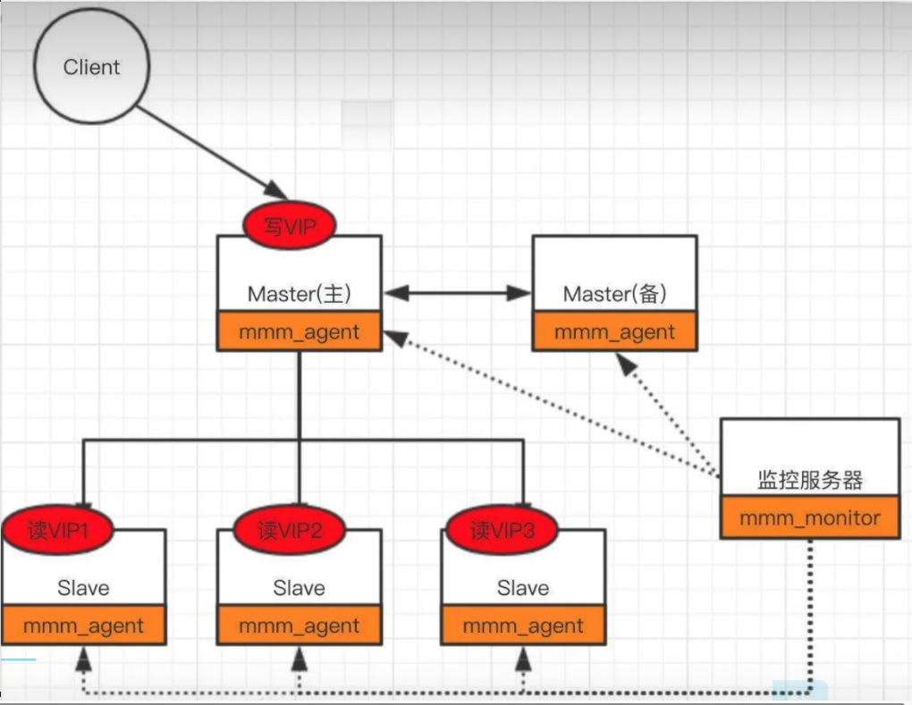

### ProxySQL 方案
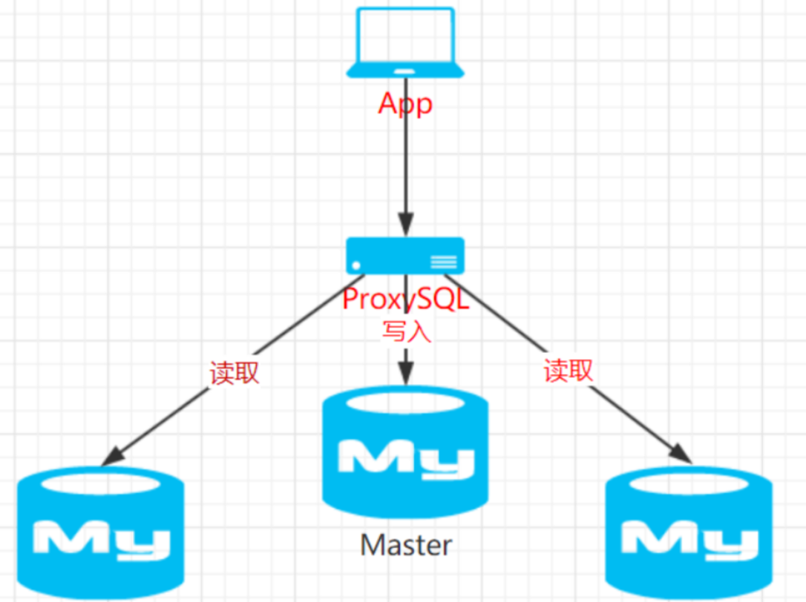

优点：

1. **高性能**：ProxySQL设计得非常快，能够处理大量的连接。
2. **可伸缩性**：ProxySQL可以通过简单的配置来处理大量的数据库后端。
3. **灵活性**：ProxySQL提供了多种路由查询到后端数据库的方法，包括简单的轮询、最少连接、读写分离等。
4. **监控**：ProxySQL内置了监控系统，可以监控后端服务器的健康状况和性能指标。
5. **配置灵活**：ProxySQL配置可以通过管理接口实时更改，不需要停机。
6. **兼容性**：ProxySQL兼容MySQL协议，因此客户端可以像连接到MySQL服务器一样连接到ProxySQL。
7. **安全性**：ProxySQL支持用户名和密码认证，并且可以设置防火墙规则来限制访问。

缺点：

1. 配置复杂：ProxySQL配置相对复杂，需要管理员具有较深的MySQL和ProxySQL知识。
2. 学习曲线：ProxySQL的学习曲线较为陡峭，需要时间去熟悉所有的配置选项和管理命令。
3. 性能损耗：虽然ProxySQL提供了很多额外的功能，但在某些情况下，可能会导致性能略微下降。
4. 维护成本：ProxySQL的维护需要专业知识，如果不正确管理，可能会导致系统故障。
5. 兼容性问题：ProxySQL与某些MySQL特性不兼容，比如某些存储过程或触发器。
6. 文档：ProxySQL的官方文档较为稀缺，社区支持不如某些开源项目丰富。

### MHA方案
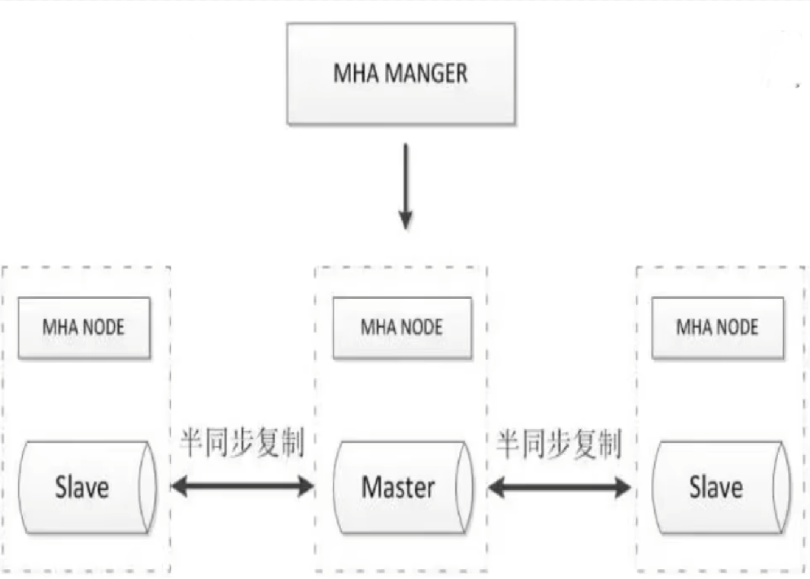

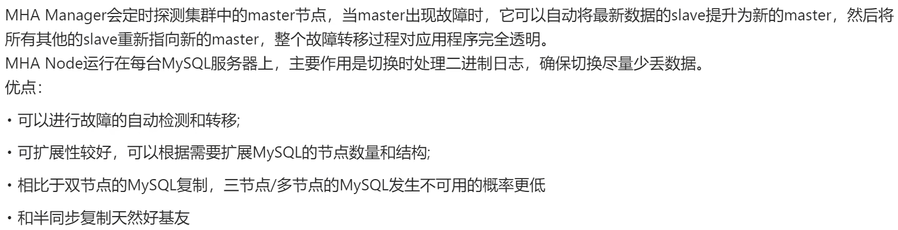

### MGR(MySQL Group Replication)方案
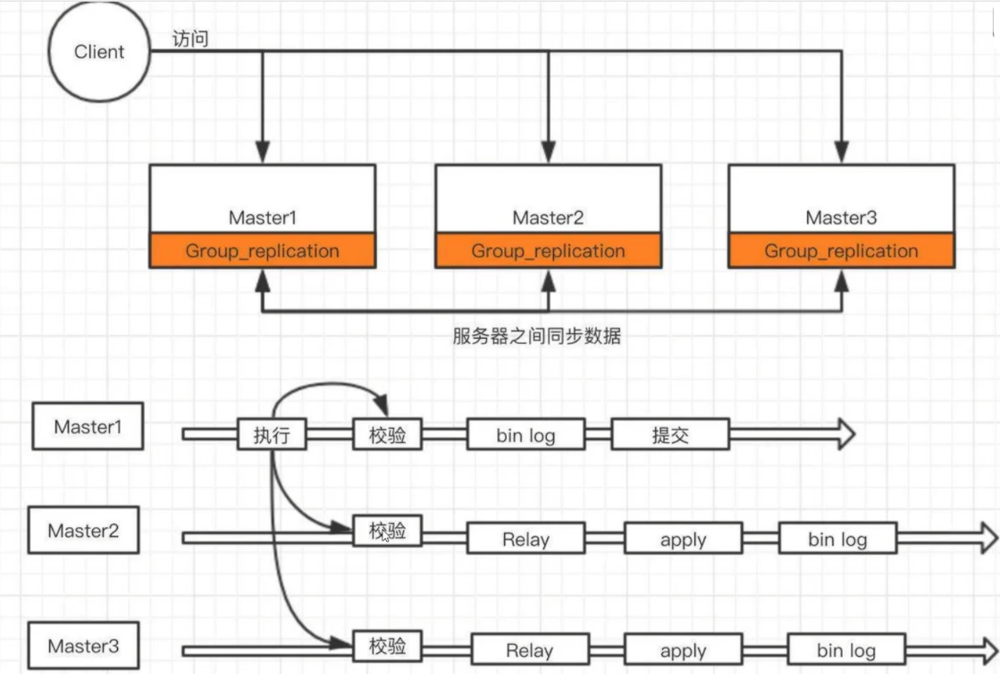

### MIC（MySQL InnoDB Cluster）
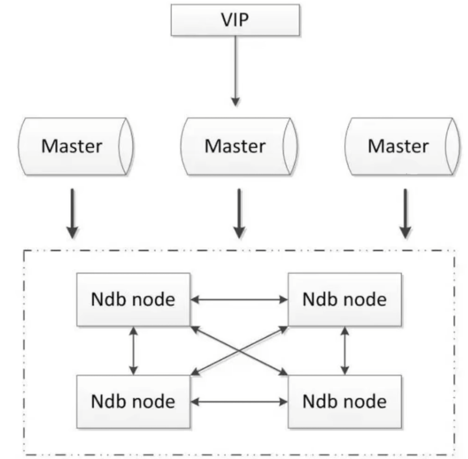

### Galera Cluster 多主

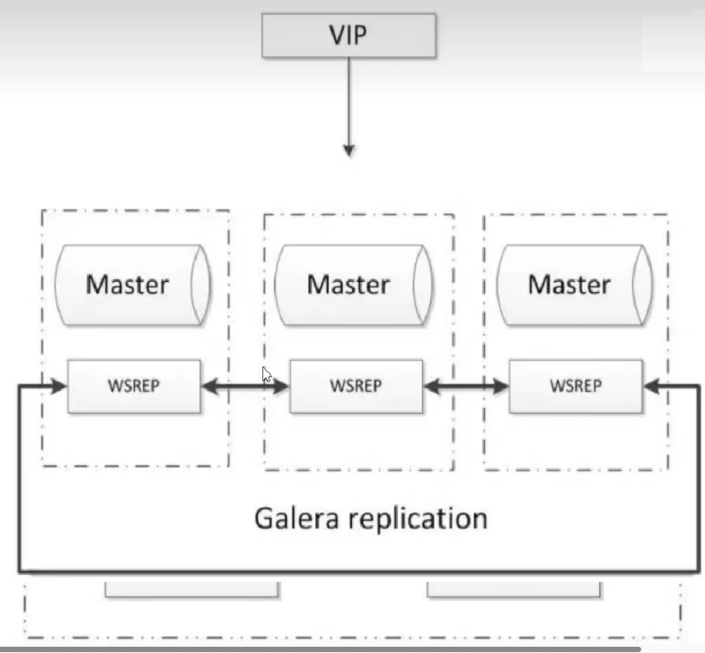

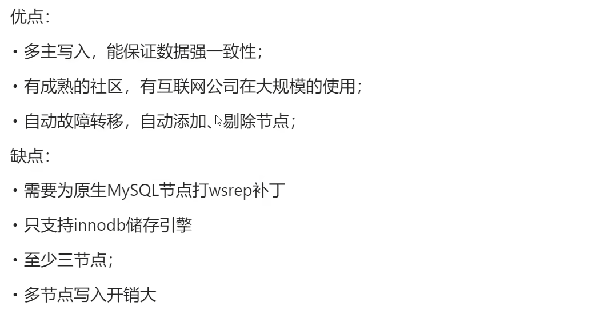

### PXC（Percona XtraDB Cluster）多主
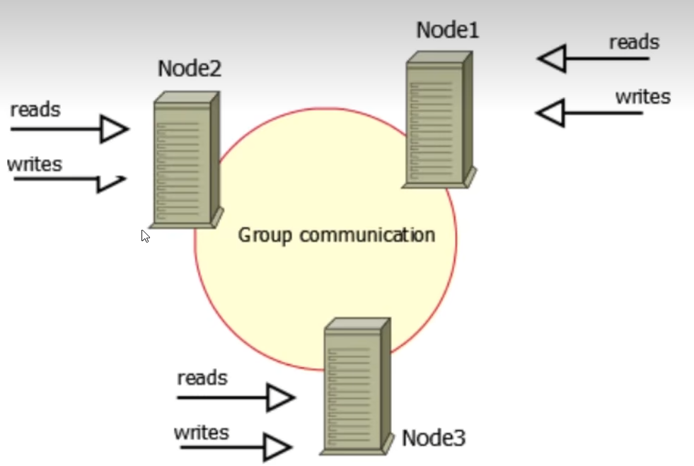

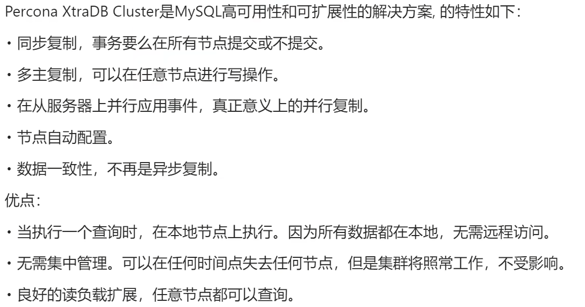

## 数据可靠性方案
### RAID10原始方案
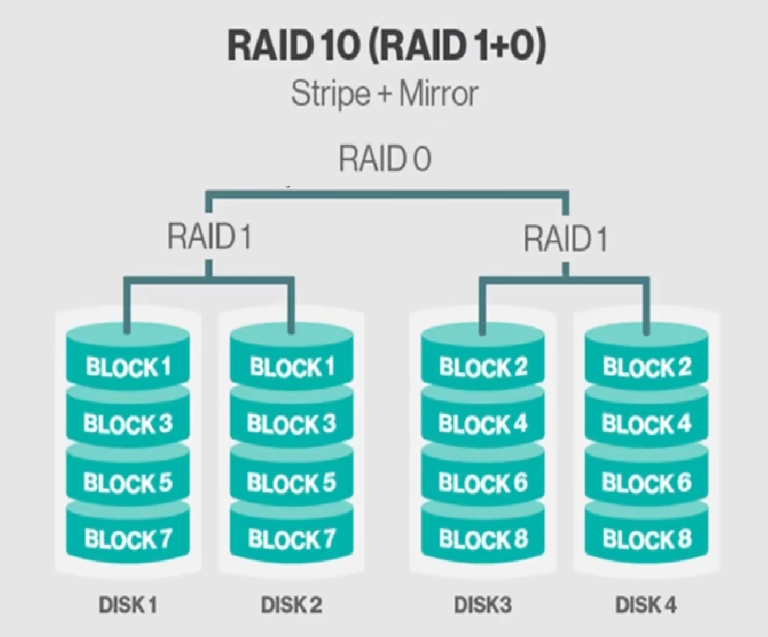

### SAN共享存储
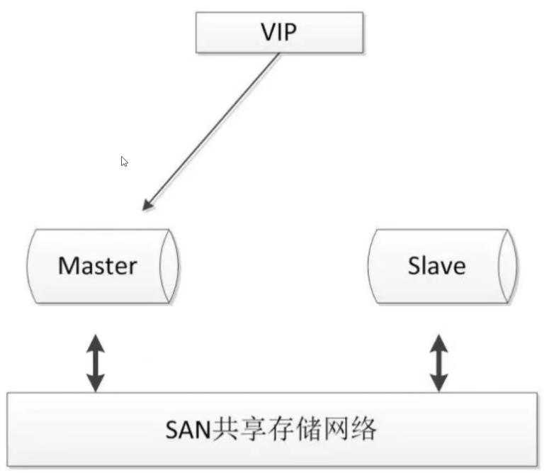

### 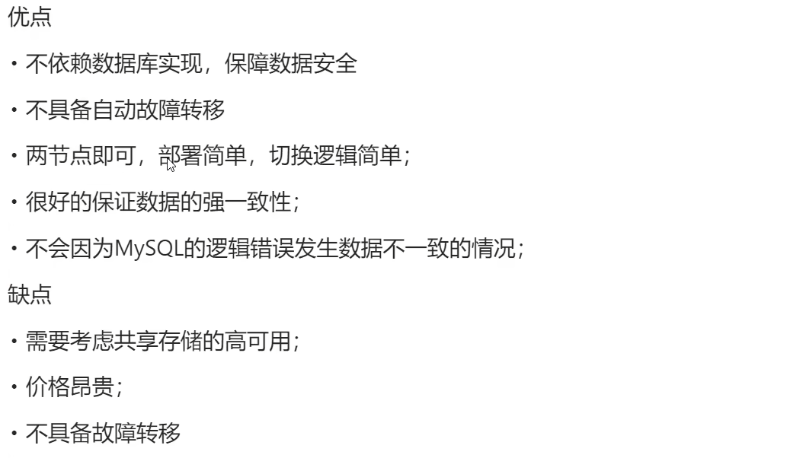DRBD磁盘复制
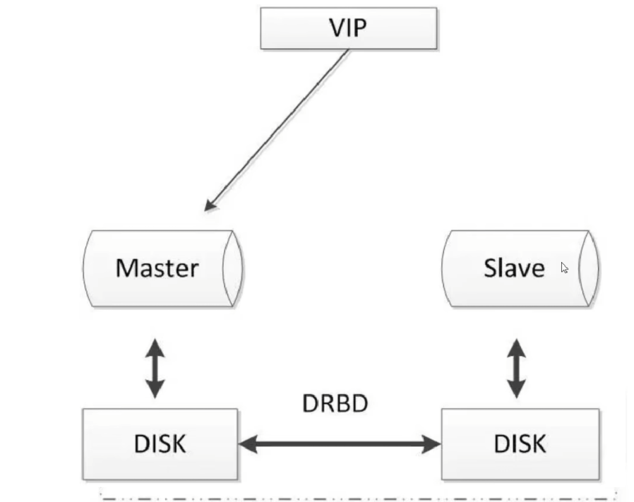

当主机出现问题，远程主机上还保留着一份相同的数据，可以继续使用，确保数据安全性。

> 更新: 2024-06-26 21:12:53  
> 原文: <https://www.yuque.com/aaron-wecc3/dhluml/ntru4adh4oztkwgz>