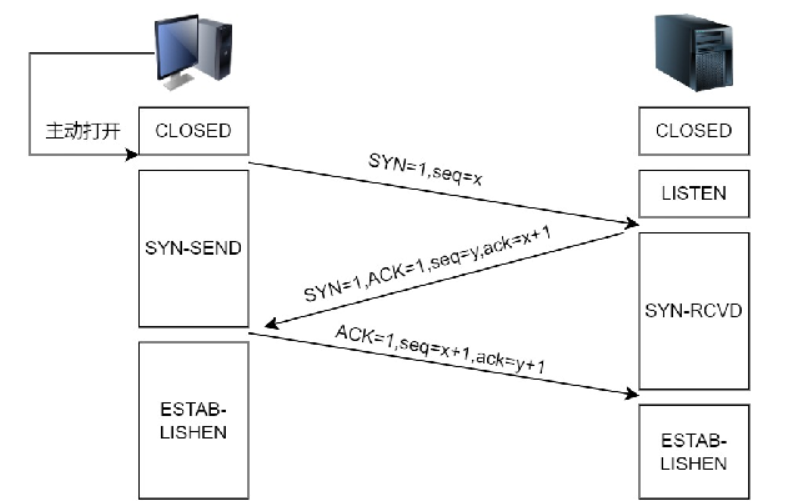
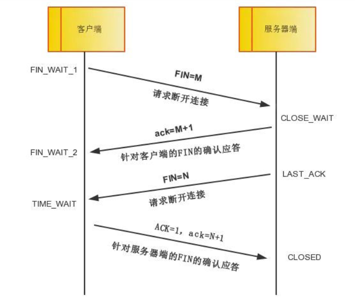

# 4.连接的底层是什么

连接的底层涉及到TCP/IP协议的底层原理，特别是TCP长连接的保持连接机制。当客户端与服务器建立TCP连接后，双方可以通过TCP协议的keep-alive机制来保持连接，通过发送特殊的数据包（keep-alive探测包）来确认对方是否仍然处于连接状态。

# TCP协议的底层实现
## 三次握手
第一次握手：客户端向服务端发送包含自身初始序号 x 的同步报文，进入 SYN-SENT 状态。

第二次握手：服务端收到连接请求报文段后，会将连接放入半连接队列中，并向客户端发送包含自身初始序号 y 的同步确认报文，进入 SYN-RECEIVED 状态。

第三次握手：客户端收到应答，向服务端发送确认报文，进入 ESTAB-LISHED 状态，此时成功建立长连接。

这样，连接就建立成功了。

## 四次挥手
第一次挥手：客户端数据发送完毕，向服务端发送终止报文请求释放连接。

第二次挥手：服务器收到连接释放请求，内核会自动发送确认报文，通知应用层释放 TCP 连接，并等待应用进程发送完数据后调用 close() 关闭连接。此时表明客户端到服务端的连接已经释放，不再接受客户端的数据。但因为 TCP 是全双工的，所以服务器仍可以发送数据。

第三次挥手：当服务端数据发送完毕，向客户端发送终止报文，发送连接释放请求，进入 LAST-ACK 状态。

第四次挥手：客户端收到连接释放请求，向服务器端发送确认报文，此时客户端进入 TIME-WAIT 状态，会等待 2MSL（最长报文段寿命），若期间没有收到服务器端的数据报文，进入 CLOSED 状态。服务器端在收到确认应答后也进入 CLOSED 态。

这样，连接就断开成功了。

> 更新: 2025-04-20 22:39:00  
> 原文: <https://www.yuque.com/aaron-wecc3/dhluml/xachlgzyyg2r32sh>