# Java-反射详细讲解

### <font style="color:rgb(34, 34, 34);">前言</font>

<font style="color:rgb(0, 0, 0);background-color:rgb(254, 254, 242);">Java的反射（reflection）机制是指在程序的运行状态中，可以构造任意一个类的对象，可以了解任意一个对象所属的类，可以了解任意一个类的成员变量和方法，可以调用任意一个对象的属性和方法。这种动态获取程序信息以及动态调用对象的功能称为Java语言的反射机制。反射被视为动态语言的关键</font>

### <font style="color:rgb(34, 34, 34);">反射引出</font>

### <font style="color:rgb(34, 34, 34);">一个需求</font>

<font style="color:rgb(0, 0, 0);background-color:rgb(254, 254, 242);">根据配置文件 re.properties 指定信息，创建 Cat 对象并调用方法 hi</font>

<font style="color:rgb(34, 34, 34);">classfullpath=com.jwt.Catmethod=hi</font>

<font style="color:rgb(0, 0, 0);background-color:rgb(254, 254, 242);">这样的需求在学习框架时很多，</font>**<font style="color:rgb(0, 0, 0);background-color:rgb(254, 254, 242);">即在通过外部文件配置，在不修改源码的情况下，来控制程序</font>**<font style="color:rgb(0, 0, 0);background-color:rgb(254, 254, 242);">。</font>

### <font style="color:rgb(34, 34, 34);">传统方法</font>

<font style="color:rgb(0, 0, 0);background-color:rgb(254, 254, 242);">传统的方法是先 new 一个对象，然后再调用它的方法。</font>

<font style="color:rgb(34, 34, 34);">Cat cat = new Cat();cat.hi();</font>

<font style="color:rgb(0, 0, 0);background-color:rgb(254, 254, 242);">通过传统方法，确实可以调用 hi() 方法，但是这和我们的需求不一样，这里我们是要根据配置文件 re.properties 指定信息来完成。可以使用 Properties 来读取配置文件。</font>

```java
Properties properties = new Properties();
properties.load(new FileInputStream("src//re.properties"));
String classfullpath = properties.getProperty("classfullpath");
//"com.jwt.Cat"String methodName = properties.getProperty("method");
//"hi"System.out.println("classfullpath=" + classfullpath);
System.out.println("method=" + methodName);
```

<font style="color:rgb(34, 34, 34);"></font>

<font style="color:rgb(0, 0, 0);background-color:rgb(254, 254, 242);">然后需要创建对象，怎么创建对象呢？直接</font><code><font style="color:rgb(232, 62, 140);background-color:rgb(246, 246, 246);">new classfullpath</font></code><font style="color:rgb(0, 0, 0);background-color:rgb(254, 254, 242);">，这样不就好了嘛？嗯，想法不错，下回不要想了。现在的 classfullpath 可是字符串类型，怎么能去</font><code><font style="color:rgb(232, 62, 140);background-color:rgb(246, 246, 246);">new</font></code><font style="color:rgb(0, 0, 0);background-color:rgb(254, 254, 242);">呢。所以现有技术是做不到这个事情的。那么这里就要引入我们要将的重点——反射机制。</font>

### <font style="color:rgb(34, 34, 34);">反射方法</font>

```java
public class ReflectionQuestion {   
    public static void main(String[] args) throws Exception { 
        //1. 使用Properties 类, 可以读取配置文件    
        Properties properties = new Properties();   
        properties.load(new FileInputStream("src//re.properties")); 
        String classfullpath = properties.getProperty("classfullpath");
        //"com.jwt.Cat"        
        String methodName = properties.getProperty("method");
        //"hi"       
        System.out.println("classfullpath=" + classfullpath);  
        System.out.println("method=" + methodName);   
        //2. 使用反射机制解决      
        //(1) 加载类, 返回Class类型的对象cls   
        Class cls = Class.forName(classfullpath);  
        System.out.println("cls = " + cls);     
        //(2) 通过cls得到你加载的类com.jwt.Cat的对象实例  
        Object o = cls.newInstance();    
        System.out.println("o 的运行类型=" + o.getClass()); 
        //运行类型       
        //(3) 通过cls得到你加载的类com.jwt.Cat的methodName "hi" 的方法对象   
        Method method = cls.getMethod(methodName);       
        //(4) 通过method 调用方法: 即通过方法对象来实现调用方法  
        method.invoke(o); 
    //传统方法对象.方法() , 反射机制：方法.invoke(对象)   
    }
}
```

<font style="color:rgb(34, 34, 34);"></font>

<font style="color:rgb(0, 0, 0);background-color:rgb(254, 254, 242);">反射机制还有一个优点，那就是可以通过外部文件配置，在不修改源码的情况下，来控制程序。比如这里，我在Cat 类下面再写一个方法，cry()方法，如果我们使用传统方法，要调用这个方法，是不是就要修改代码了，比如</font><code><font style="color:rgb(232, 62, 140);background-color:rgb(246, 246, 246);">cat.cry();</font></code><font style="color:rgb(0, 0, 0);background-color:rgb(254, 254, 242);">通过反射，只需在配置文件 re.properties 中，将 method=hi 改为 method=cry 就可以了。</font>

### <font style="color:rgb(34, 34, 34);">反射是什么</font>

### <font style="color:rgb(34, 34, 34);">简介</font>

* <font style="color:rgb(34, 34, 34);background-color:rgb(254, 254, 242);">反射机制允许程序在执行时借助于 Reflection API 取得任何类的内部信息(比如成员变量，构造器，成员方法等等)，并能操作对象的属性及方法。</font>
* <font style="color:rgb(34, 34, 34);background-color:rgb(254, 254, 242);">在运行状态中，对象可以通过反射获取他的类，类可以通过反射拿到所有⽅法(包括私有)，拿到的⽅法可以调⽤，总之通过“反射”，我们可以将Java这种静态语⾔附加上动态特性。</font>
* <font style="color:rgb(34, 34, 34);background-color:rgb(254, 254, 242);">加载完类之后，在堆中就产生了一个 Class 类型的对象(一个类只有一个Class对象) ，这个对象包含了类的完整结构信息。通过这个对象得到类的结构。这个 Class 对象就像一面镜子，透过这个镜子看到类的结构，所以，形象的称之为反射</font>

**<font style="color:rgb(0, 0, 0);background-color:rgb(254, 254, 242);">一句话总结：反射就是在运行时才知道要操作的类是什么，并且可以在运行时获取类的完整构造，并调用对应的方法。动态特性</font>**

### <font style="color:rgb(34, 34, 34);">反射机制原理示意</font>

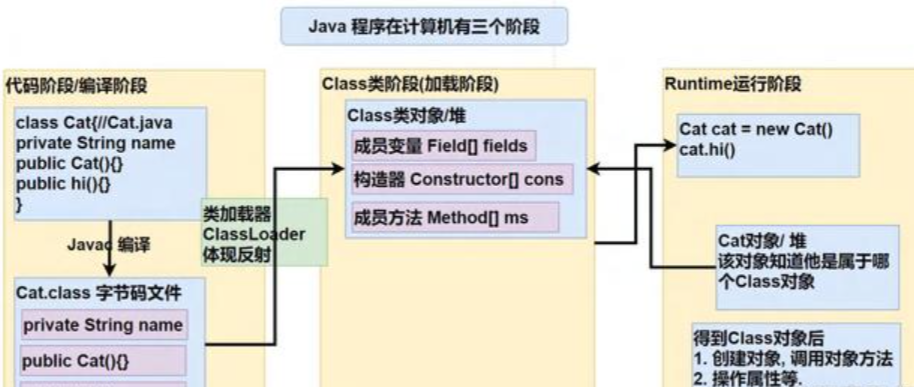

### <font style="color:rgb(34, 34, 34);">反射机制可以完成</font>

* <font style="color:rgb(34, 34, 34);background-color:rgb(254, 254, 242);">1.在运行时判断任意个对象所属的类</font>
* <font style="color:rgb(34, 34, 34);background-color:rgb(254, 254, 242);">2.在运行时构造任意一个类的对象</font>
* <font style="color:rgb(34, 34, 34);background-color:rgb(254, 254, 242);">3.在运行时得到任意一个类所具有的成员变量和方法</font>
* <font style="color:rgb(34, 34, 34);background-color:rgb(254, 254, 242);">4.在运行时调用任意一个对象的成员变量和方法</font>
* <font style="color:rgb(34, 34, 34);background-color:rgb(254, 254, 242);">5.生成动态代理</font>

### <font style="color:rgb(34, 34, 34);">反射相关的主要类</font>

* <font style="color:rgb(34, 34, 34);background-color:rgb(254, 254, 242);">java.lang.Class：代表一个类，Class 对象表示某 个类加载后在堆中的对象</font>
* <font style="color:rgb(34, 34, 34);background-color:rgb(254, 254, 242);">java.lang.reflect.Method：代表类的方法，Method 对象表示某个类的方法</font>
* <font style="color:rgb(34, 34, 34);background-color:rgb(254, 254, 242);">java.lang.reflect.Field：代表类的成员变量，Field 对象表示某个类的成员变量</font>
* <font style="color:rgb(34, 34, 34);background-color:rgb(254, 254, 242);">java.lang.reflect.Constructor：代表类的构造方法，Constructor 对象表示构造器</font>

```java
package com.jwt.reflection;
import java.io.FileInputStream;
import java.lang.reflect.Constructor;
import java.lang.reflect.Field;
import java.lang.reflect.Method;
import java.util.Properties;
public class Reflection01 {
    public static void main(String[] args) throws Exception { 
        //1. 使用Properties 类, 可以读写配置文件  
        Properties properties = new Properties();      
        properties.load(new FileInputStream("src//re.properties"));  
        String classfullpath = properties.get("classfullpath").toString();  
        String methodName = properties.get("method").toString();   
        //2. 使用反射机制解决        
        //(1) 加载类, 返回Class 类型的对象cls    
        Class cls = Class.forName(classfullpath);      
        //(2) 通过cls 得到你加载的类com.hspedu.Cat 的对象实例   
        Object o = cls.newInstance();    
        System.out.println("o 的运行类型=" + o.getClass()); 
        //运行类型      
        //java.lang.reflect.Method：代表类的方法，Method 对象表示某个类的方法 
        Method method = cls.getMethod(methodName);       
        //通过method 调用方法: 即通过方法对象来实现调用方法  
        method.invoke(o);      
        //java.lang.reflect.Field: 代表类的成员变量, Field 对象表示某个类的成员变量  
        //getField 不能得到私有的属性       
        Field nameField = cls.getField("name");    
        System.out.println(nameField.get(o)); 
        // 传统写法对象.成员变量, 反射: 成员变量对象.get(对象)    
        //java.lang.reflect.Constructor: 代表类的构造方法, Constructor 对象表示构造器 
        Constructor constructor = cls.getConstructor(); 
        //()中可以指定构造器参数类型, 返回无参构造器     
        System.out.println(constructor);//Cat()    
        Constructor constructor2 = cls.getConstructor(String.class); 
        //这里传入的String.class 就是String 类的Class 对象     
        System.out.println(constructor2);
        //Cat(String name)   
    }
}
```

<font style="color:rgb(34, 34, 34);"></font>

### <font style="color:rgb(34, 34, 34);">反射优点和缺点</font>

* <font style="color:rgb(34, 34, 34);background-color:rgb(254, 254, 242);">优点：可以动态的创建和使用对象(也是框架底层核心)，使用灵活没有反射机制，框架技术就失去底层支撑。</font>
* <font style="color:rgb(34, 34, 34);background-color:rgb(254, 254, 242);">缺点：使用反射基本是解释执行，对执行速度有影响.</font>

**<font style="color:rgb(0, 0, 0);background-color:rgb(254, 254, 242);">反射调用优化-关闭访问检查</font>**

* <font style="color:rgb(34, 34, 34);background-color:rgb(254, 254, 242);">Method、Field、 Constructor 对象都有 setAccessible() 方法</font>
* <font style="color:rgb(34, 34, 34);background-color:rgb(254, 254, 242);">setAccessible 作用是启动和禁用访问安全检查的开关</font>
  * <font style="color:rgb(34, 34, 34);background-color:rgb(254, 254, 242);">参数值为 true 表示反射的对象在使用时取消访问检查，提高反射的效率。</font>
  * <font style="color:rgb(34, 34, 34);background-color:rgb(254, 254, 242);">参数值为 false 则表示反射的对象执行访问检查</font>

```java
package com.jwt.reflection;
import com.jwt.Cat;
import java.lang.reflect.Method;
public class Reflection02 {  
    public static void main(String[] args) throws Exception {
        m1();
        //传统   
        m2();
        //反射
        m3();
        //反射优化 
    }   
    //传统方法来调用hi    
    public static void m1() { 
        Cat cat = new Cat();  
        long start = System.currentTimeMillis();  
        for (int i = 0; i < 900000000; i++) {  
            cat.hi();      
        }       
        long end = System.currentTimeMillis();   
        System.out.println("m1() 耗时=" + (end - start)+"ms");   
    }   
    //反射机制调用方法hi 
    public static void m2() throws Exception {  
        Class cls = Class.forName("com.jwt.Cat"); 
        Object o = cls.newInstance();     
        Method hi = cls.getMethod("hi");     
        long start = System.currentTimeMillis(); 
        for (int i = 0; i < 900000000; i++) {     
            hi.invoke(o);//反射调用方法  
        }       
        long end = System.currentTimeMillis();   
        System.out.println("m2() 耗时=" + (end - start)+"ms"); 
    }    
    //反射调用优化+ 关闭访问检查   
    public static void m3() throws Exception {  
        Class cls = Class.forName("com.jwt.Cat");  
        Object o = cls.newInstance();    
        Method hi = cls.getMethod("hi");     
        hi.setAccessible(true);
        //在反射调用方法时，取消访问检查  
        long start = System.currentTimeMillis(); 
        for (int i = 0; i < 900000000; i++) { 
            hi.invoke(o);//反射调用方法  
        }      
        long end = System.currentTimeMillis();   
        System.out.println("m3() 耗时=" + (end - start)+"ms"); 
    }
}
                                                                                                                                                                     }}/**m1() 耗时=2msm2() 耗时=934msm3() 耗时=769ms**/
```

<font style="color:rgb(34, 34, 34);"></font>

### <font style="color:rgb(34, 34, 34);">Class 类</font>

### <font style="color:rgb(34, 34, 34);">基本介绍</font>

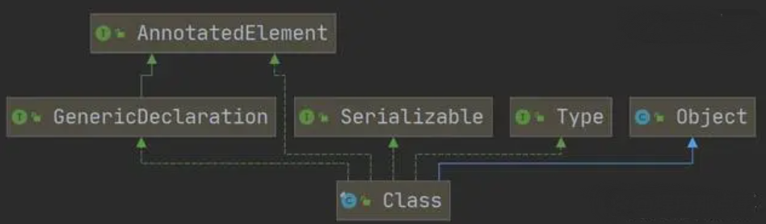

1. <font style="color:rgb(34, 34, 34);background-color:rgb(254, 254, 242);">Class 也是类，继承 Object 类</font>
2. <font style="color:rgb(34, 34, 34);background-color:rgb(254, 254, 242);">Class 类对象不是 new 出来的，而是系统创建的</font>
3. <font style="color:rgb(34, 34, 34);background-color:rgb(254, 254, 242);">对于某个类的 Class 类对象，在内存中只有一份，因为类只加载一 次</font>
4. <font style="color:rgb(34, 34, 34);background-color:rgb(254, 254, 242);">每个类的实例都会记得自己是由哪个 Class 实例所生成</font>
5. <font style="color:rgb(34, 34, 34);background-color:rgb(254, 254, 242);">通过 Class 对象可以完整地得到一个类的完整结构</font>
6. <font style="color:rgb(34, 34, 34);background-color:rgb(254, 254, 242);">Class 对象是存放在堆的，类的字节码二进制数据， 是放在方法区的，有的地方称为类的元数据(包括方法代码，变量名，方法名，访问权限等等)</font>

### <font style="color:rgb(34, 34, 34);">Class类的常用方法</font>

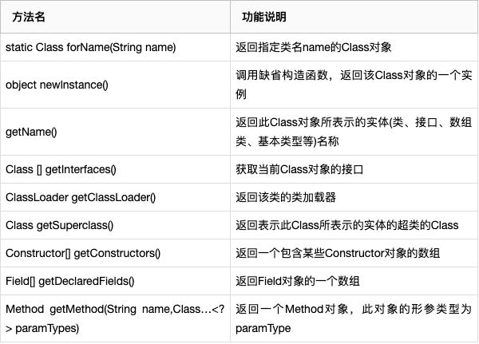

<font style="color:rgb(34, 34, 34);"> </font>

### <font style="color:rgb(34, 34, 34);">获取Class类对象</font>

<font style="color:rgb(0, 0, 0);background-color:rgb(254, 254, 242);">1、Class.forName</font>

<font style="color:rgb(0, 0, 0);background-color:rgb(254, 254, 242);">前提：已知一个类的全名称，且该类路径下，可通过 Class 类的静态方法 forName() 获取，可能抛出ClassNotFoundException 异常</font>

<font style="color:rgb(0, 0, 0);background-color:rgb(254, 254, 242);">实例：</font><code><font style="color:rgb(232, 62, 140);background-color:rgb(246, 246, 246);">Class cls1 = Class.forName(“java.lang.Cat”);</font></code>

<font style="color:rgb(0, 0, 0);background-color:rgb(254, 254, 242);">应用场景：多用于配置文件，读取类全路径，加载类</font>

<font style="color:rgb(0, 0, 0);background-color:rgb(254, 254, 242);">2、类名.class</font>

<font style="color:rgb(0, 0, 0);background-color:rgb(254, 254, 242);">前提：若已知具体的类，通过类的 class 获取，该方式最为安全可靠，程序性能最高</font>

<font style="color:rgb(0, 0, 0);background-color:rgb(254, 254, 242);">实例：</font><code><font style="color:rgb(232, 62, 140);background-color:rgb(246, 246, 246);">Class cls2 = Car.class;</font></code>

<font style="color:rgb(0, 0, 0);background-color:rgb(254, 254, 242);">应用场景：多用于参数传递，比如通过反射得到对应构造器对象</font>

<font style="color:rgb(0, 0, 0);background-color:rgb(254, 254, 242);">3、对象.getClass()</font>

<font style="color:rgb(0, 0, 0);background-color:rgb(254, 254, 242);">前提：已知某个类的实例，调用该实例的 getClass() 方法获取 Class 对象</font>

<font style="color:rgb(0, 0, 0);background-color:rgb(254, 254, 242);">实例：</font><code><font style="color:rgb(232, 62, 140);background-color:rgb(246, 246, 246);">Class cls3 = 对象.getClass();//运行类型</font></code>

<font style="color:rgb(0, 0, 0);background-color:rgb(254, 254, 242);">应用场景：通过创建好的对象，获取 Class 对象</font>

<font style="color:rgb(0, 0, 0);background-color:rgb(254, 254, 242);">4、通过类加载器</font>

<font style="color:rgb(34, 34, 34);">ClassLoader classLoader = 对象.getClass().getClassLoader();Class cls4 = classLoader.loadClass(“类的全类名”)；</font>

<font style="color:rgb(0, 0, 0);background-color:rgb(254, 254, 242);">5、基本数据（int,char,boolean,float,double,byte,long,short）按如下方式得到Class类对象</font>

<font style="color:rgb(34, 34, 34);">Class cls5 = 基本数据类型.class</font>

<font style="color:rgb(0, 0, 0);background-color:rgb(254, 254, 242);">6、基本数据类型对应的包装类，可以通过 .TYPE 得到 Class 类对象</font>

<font style="color:rgb(34, 34, 34);">Class cls6 = 包装类.TYPE</font>

<font style="color:rgb(34, 34, 34);"> </font>

### <font style="color:rgb(34, 34, 34);">哪些类型有Class对象</font>

1. <font style="color:rgb(34, 34, 34);background-color:rgb(254, 254, 242);">外部类，成员内部类，静态内部类，局部内部类，匿名内部类</font>
2. <font style="color:rgb(34, 34, 34);background-color:rgb(254, 254, 242);">interface：接口</font>
3. <font style="color:rgb(34, 34, 34);background-color:rgb(254, 254, 242);">数组</font>
4. <font style="color:rgb(34, 34, 34);background-color:rgb(254, 254, 242);">enum：枚举</font>
5. <font style="color:rgb(34, 34, 34);background-color:rgb(254, 254, 242);">annotation：注解</font>
6. <font style="color:rgb(34, 34, 34);background-color:rgb(254, 254, 242);">基本数据类型</font>
7. <font style="color:rgb(34, 34, 34);background-color:rgb(254, 254, 242);">void</font>

<font style="color:rgb(34, 34, 34);"> </font>

### <font style="color:rgb(34, 34, 34);">类加载</font>

### <font style="color:rgb(34, 34, 34);">静态加载和动态加载</font>

<font style="color:rgb(0, 0, 0);background-color:rgb(254, 254, 242);">反射机制是 Java 实现动态语言的关键，也就是通过反射实现类动态加载</font>

* <font style="color:rgb(34, 34, 34);background-color:rgb(254, 254, 242);">静态加载：编译时加载相关的类，如果没有则报错</font>

<font style="color:rgb(34, 34, 34);">Dog dog = new Dog();</font>

* <font style="color:rgb(34, 34, 34);background-color:rgb(254, 254, 242);">动态加载：运行时加载需要的类，编译不报错，降低了依赖性</font>

<font style="color:rgb(34, 34, 34);">Class cls = Class.forName("Person");Object o = cls.newInstance();Method method = cls.getMethod("hi");method.invoke(o);</font>

### <font style="color:rgb(34, 34, 34);">类加载时机</font>

* <font style="color:rgb(34, 34, 34);background-color:rgb(254, 254, 242);">当创建对象时（new） //静态加载</font>
* <font style="color:rgb(34, 34, 34);background-color:rgb(254, 254, 242);">当子类被加载时，父类也加载 //静态加载</font>
* <font style="color:rgb(34, 34, 34);background-color:rgb(254, 254, 242);">调用类中的静态成员时 //静态加载</font>
* <font style="color:rgb(34, 34, 34);background-color:rgb(254, 254, 242);">通过反射 //动态加载</font>

### <font style="color:rgb(34, 34, 34);">类加载过程图</font>

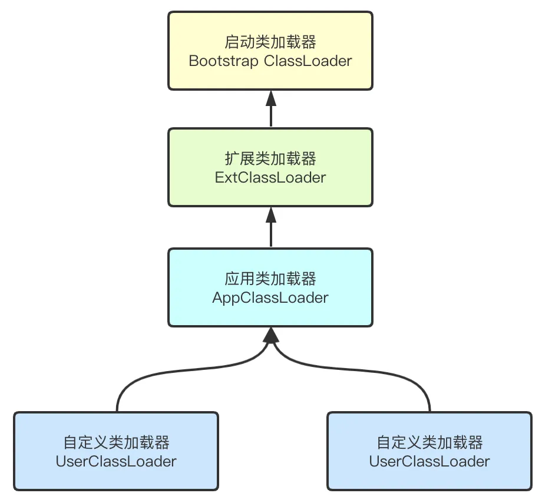

**<font style="color:rgb(34, 34, 34);">类加载各阶段完成任务</font>**

<font style="color:rgb(34, 34, 34);">类加载五个阶段</font>

<font style="color:rgb(34, 34, 34);">1、加载阶段</font>

<font style="color:rgb(34, 34, 34);">JVM在改阶段的主要目的是将字节码从不同的数据源（可能是 class 文件、也可能是 jar 包，甚至网络）转化为二进制字节流加载到内存中，并生成一个代表该类的 java.lang.Class 对象</font>

<font style="color:rgb(34, 34, 34);">2、连接阶段——验证</font>

<font style="color:rgb(34, 34, 34);">目的是为了确保 Class 文件的字节流中包含的信息符合当前虚拟机的要求，并且不会危害虚拟机自身的安全。</font>

<font style="color:rgb(34, 34, 34);">包括：文件格式验证（是否以魔数 oxcafebabe开头）、元数据验证、字节码验证和符号引用验证。</font>

<font style="color:rgb(34, 34, 34);">可以考虑使用 -Xverify:none 参数来关闭大部分的类验证措施，缩短虚拟机类加载的时间。</font>

<font style="color:rgb(34, 34, 34);">3、连接阶段——准备</font>

<font style="color:rgb(34, 34, 34);">JVM 会在该阶段对静态变量，分配内容并初始化（对应数据类型的默认初始值，如0、0L、null、false等）。这些变量所使用的内存都将在方法区中进行分配</font>

<font style="color:rgb(34, 34, 34);">class A {</font>

<font style="color:rgb(34, 34, 34);">//分析类加载的链接阶段-准备属性是如何处理</font>

<font style="color:rgb(34, 34, 34);">//1. n1 是实例属性, 不是静态变量，因此在准备阶段，是不会分配内存</font>

<font style="color:rgb(34, 34, 34);">//2. n2 是静态变量，分配内存n2 默认初始化0 ,而不是20</font>

<font style="color:rgb(34, 34, 34);">//3. n3 是static final 是常量, 他和静态变量不一样, 因为一旦赋值就不变n3 = 30</font>

<font style="color:rgb(34, 34, 34);">public int n1 = 10;</font>

<font style="color:rgb(34, 34, 34);">public static int n2 = 20;</font>

<font style="color:rgb(34, 34, 34);">public static final int n3 = 30;</font>

<font style="color:rgb(34, 34, 34);">}</font>

<font style="color:rgb(34, 34, 34);">4、连接阶段——解析</font>

<font style="color:rgb(34, 34, 34);">虚拟机将常量池内的符号引用替换为直接引用的过程。</font>

<font style="color:rgb(34, 34, 34);">5、初始化阶段</font>

<font style="color:rgb(34, 34, 34);">到初始化阶段，才真正开始执行类中定义的 Java 程序代码，此阶段是执行()方法的过程</font>

<font style="color:rgb(34, 34, 34);">() 方法是由编译器按语句在源文件中出现的顺序，依次自动收集类中的所有静态变量的赋值动作和静态代码块中的语句，并进行合并。</font>

<font style="color:rgb(34, 34, 34);">虚拟机会保证一个类的 () 方法在多线程环境中被正确的加锁、同步，如果多个线程同时去初始化一个类，那么只会有一个线程去执行这个类的 () 方法，其他线程都需要阻塞等待，直到活动线程执行 () 方法完毕</font>

**<font style="color:rgb(34, 34, 34);">反射获取类的结构信息</font>**

<font style="color:rgb(34, 34, 34);">1、java.lang.Class类</font>

<font style="color:rgb(34, 34, 34);">getName：获取全类名</font>

<font style="color:rgb(34, 34, 34);">getSimpleName：获取简单类名</font>

<font style="color:rgb(34, 34, 34);">getFields：获取所有public修饰的属性，包含本类以及父类的</font>

<font style="color:rgb(34, 34, 34);">getDeclaredFields：获取本类中所有属性</font>

<font style="color:rgb(34, 34, 34);">getMethods：获取所有public修饰的方法，包含本类以及父类的</font>

<font style="color:rgb(34, 34, 34);">getDeclaredMethods：获取本类中所有方法</font>

<font style="color:rgb(34, 34, 34);">getConstructors：获取所有public修饰的构造器，包含本类以及父类的</font>

<font style="color:rgb(34, 34, 34);">getDeclaredConstructors：获取本类中所有构造器</font>

<font style="color:rgb(34, 34, 34);">getPackage：以Package形式返回父类信息</font>

<font style="color:rgb(34, 34, 34);">getSuperClass：以Class形式返回父类信息</font>

<font style="color:rgb(34, 34, 34);">getInterfaces：以Class\[]形式返回接口信息</font>

<font style="color:rgb(34, 34, 34);">getAnnotations：以Annotation\[]形式返回注解信息</font>

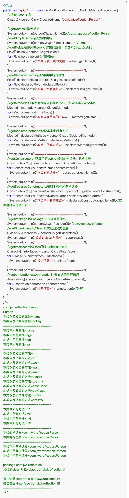

<font style="color:rgb(0, 0, 0);background-color:rgb(254, 254, 242);">测试代码</font>

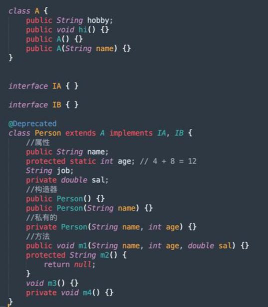

<font style="color:rgb(34, 34, 34);">2、java.lang.reflect.Field类</font>

<font style="color:rgb(34, 34, 34);">getModifiers：以int形式返回修饰符</font>

<font style="color:rgb(34, 34, 34);">说明：默认修饰符是0，public是1，private是2，protected是4，static是8，final是16</font>

<font style="color:rgb(34, 34, 34);">getType：以Class形式返回类型</font>

<font style="color:rgb(34, 34, 34);">getName：返回属性名</font>

<font style="color:rgb(34, 34, 34);">3、java.lang.reflect.Mehod类</font>

<font style="color:rgb(34, 34, 34);">getModifiers：以int形式返回修饰符</font>

<font style="color:rgb(34, 34, 34);">说明：默认修饰符是0，public是1，private是2，protected是4，static是8，final是16</font>

<font style="color:rgb(34, 34, 34);">getReturnType：以Class形式获取返回类型</font>

<font style="color:rgb(34, 34, 34);">getName：返回方法名</font>

<font style="color:rgb(34, 34, 34);">getParameterTypes：以Class\[]返回参数类型数组</font>

<font style="color:rgb(34, 34, 34);">4、java.lang.reflect.Constructor类</font>

<font style="color:rgb(34, 34, 34);">getModifiers：以int形式返回修饰符</font>

<font style="color:rgb(34, 34, 34);">getName：返回构造器名（全类名）</font>

<font style="color:rgb(34, 34, 34);">getParameterTypes：以Class\[]返回参数类型数组</font>

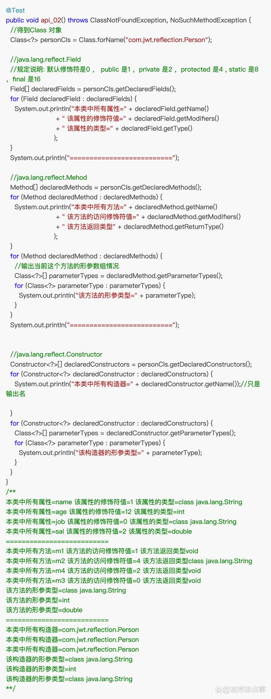

**<font style="color:rgb(34, 34, 34);">反射创建对象</font>**

<font style="color:rgb(34, 34, 34);">方式一：调用类中的public修饰的无参构造器创建对象</font>

<font style="color:rgb(34, 34, 34);">方式二：调用类中的指定构造器创建对象</font>

<font style="color:rgb(34, 34, 34);">Class类相关方法</font>

<font style="color:rgb(34, 34, 34);">newInstance() 调用类中的无参构造器，获取对应类的对象</font>

<font style="color:rgb(34, 34, 34);">getConstructor(Class..clazz) 根据参数列表，获取对应的public构造器对象</font>

<font style="color:rgb(34, 34, 34);">getDecalaredConstructor(Class.cazz) 根据参数列表，获取对应的所有构造器对象</font>

<font style="color:rgb(34, 34, 34);">Constructor类相关方法</font>

<font style="color:rgb(34, 34, 34);">setAccessible：爆破（形参填入true，即可访问私有构造方法、变量、方法等）</font>

<font style="color:rgb(34, 34, 34);">newInstance(Object…obj)：调用构造器</font>

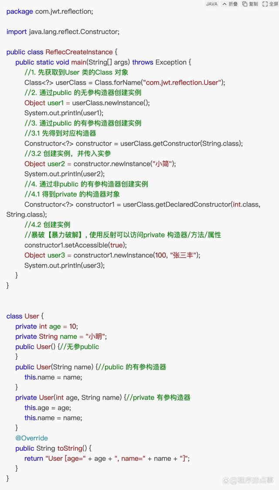

**<font style="color:rgb(34, 34, 34);">反射访问类中的成员</font>**

<font style="color:rgb(34, 34, 34);">访问属性</font>

<font style="color:rgb(34, 34, 34);">1.根据属性名获取Field对象</font>

<font style="color:rgb(34, 34, 34);">Field f = class对象.getDeclaredField(属性名);</font>

<font style="color:rgb(34, 34, 34);">2.暴破</font>

<font style="color:rgb(34, 34, 34);">f.setAccessible(true); //f是Field</font>

<font style="color:rgb(34, 34, 34);">3.访问</font>

<font style="color:rgb(34, 34, 34);">f.set(o,值); //o表示对象</font>

<font style="color:rgb(34, 34, 34);">f.get(o); //o表示对象</font>

<font style="color:rgb(34, 34, 34);">4.注意:如果是静态属性，则set和get中的参数o，可以写成null</font>

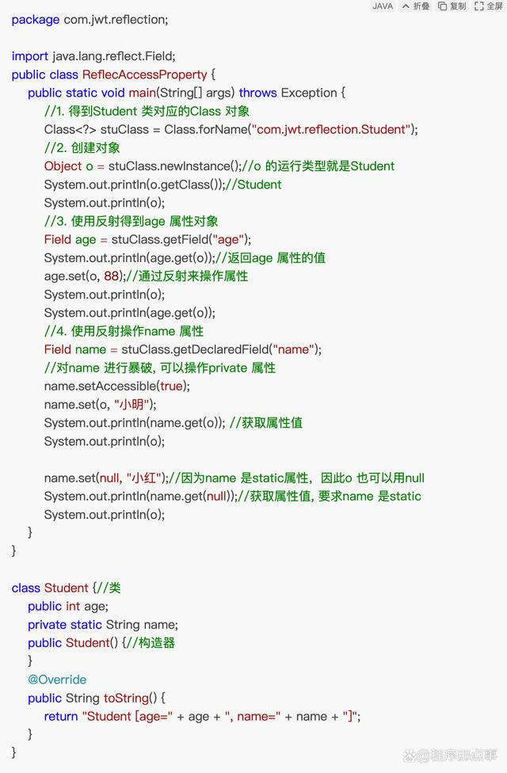

<font style="color:rgb(34, 34, 34);">访问方法</font>

<font style="color:rgb(34, 34, 34);">1.根据方法名和参数列表获取Method方法对象</font>

<font style="color:rgb(34, 34, 34);">Method m = class对象.getDeclaredMethod(方法名，XX.class);</font>

<font style="color:rgb(34, 34, 34);">2.获取对象: Object o = class对象.newlnstance();</font>

<font style="color:rgb(34, 34, 34);">3.暴破: m.setAccessible(true);</font>

<font style="color:rgb(34, 34, 34);">4.访问: Object returnValue = m.invoke(o,实参列表);</font>

<font style="color:rgb(34, 34, 34);">5.注意:如果是静态方法，则invoke的参数o，可以写成null!</font>

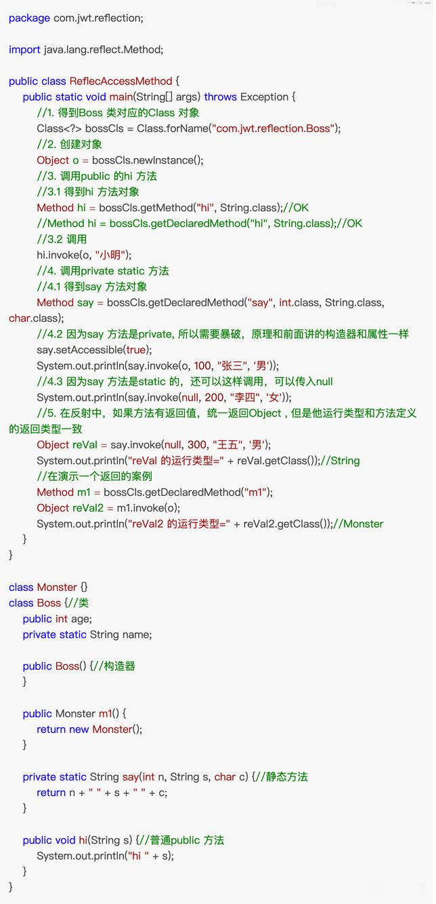

**<font style="color:rgb(34, 34, 34);">练习2</font>**

<font style="color:rgb(34, 34, 34);">利用反射和 File 完成以下功能</font>

<font style="color:rgb(34, 34, 34);">1.利用 Class 类的 forName 方法得到 File 类的 class 对象</font>

<font style="color:rgb(34, 34, 34);">2.在控制台打印 File 类的所有构造器</font>

<font style="color:rgb(34, 34, 34);">3.通过 newInstance 的方法创建 File 对象， 并创建 /Users/jianjian/Downloads/mynew.txt 文件</font>

<font style="color:rgb(34, 34, 34);">提示:创建文件的正常写法如下:</font>

<font style="color:rgb(34, 34, 34);">File file = new File(“路径”);</font>

<font style="color:rgb(34, 34, 34);">file.createNewFile();</font>

<font style="color:rgb(34, 34, 34);"></font>

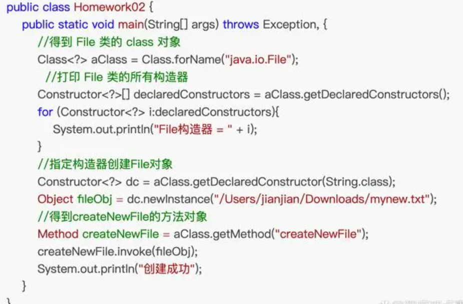


> 更新: 2025-04-20 22:38:59  
> 原文: <https://www.yuque.com/aaron-wecc3/dhluml/fikz1plmh8gdeb5n>