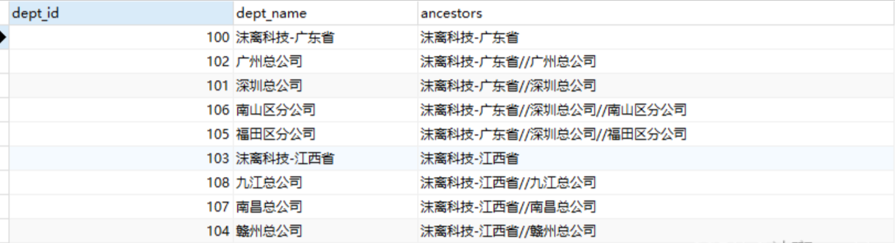

# MySQL8新特性优化父子层级关系数据CTE查询

# <font style="color:rgb(34, 34, 38);"> 引言</font>
<font style="color:rgb(34, 34, 38);">父子结构数据模型，又称为层次结构数据模型或树形结构，是一种在数据库中表示元素间具有上下级关系的数据组织方式。这种模型广泛应用于多种实际场景</font>

<font style="color:rgb(34, 34, 38);">主要包括但不限于：</font>

<font style="color:rgb(34, 34, 38);"></font>

<font style="color:rgb(34, 34, 38);">组织架构管理：企业或机构内部的部门与员工关系，其中部门可以包含子部门，形成一个多层级的管理体系。</font>

<font style="color:rgb(34, 34, 38);">商品分类：电商平台的商品按照类别和子类别分层，如电子产品下有手机、电脑等子类，手机下又有不同品牌和型号。</font>

<font style="color:rgb(34, 34, 38);">文件系统目录：计算机文件系统的目录结构，文件夹可以包含子文件夹，形成树状结构。</font>

<font style="color:rgb(34, 34, 38);">内容管理系统：博客、论坛的帖子和评论，或是文章与其所属的多个标签之间的关联。</font>

<font style="color:rgb(34, 34, 38);">权限与角色管理：用户权限模型中，角色可以继承上级角色的权限，形成权限层次。</font>

### <font style="color:rgb(34, 34, 38);">CTE基本概念</font>
<font style="color:rgb(34, 34, 38);">CTE，即Common Table Expression，是MySQL 8.0版本及以后引入的一个功能，是在SQL查询中定义的一种临时结果集，并给这个结果集命名，CTE通过WITH关键字引入，可以在SELECT、INSERT、UPDATE、DELETE语句之前定义并可以在同一查询中被多次引用。</font>

<font style="color:rgb(34, 34, 38);">CTE不是物理存储的对象，而是在查询执行期间临时存在的逻辑视图。CTE分为递归和非递归两种，其中递归CTE特别适用于处理上述父子结构数据，能够简便地实现树形结构的遍历查询。</font>

<font style="color:rgb(34, 34, 38);"></font>

### <font style="color:rgb(34, 34, 38);">语法介绍</font>
<font style="color:rgb(34, 34, 38);">非递归语法结构</font>


```java
WITH cte_name AS (
    SELECT column1, column2, ...
    FROM table_name
    WHERE condition
)
```

### <font style="color:rgb(34, 34, 38);">递归语法结构</font>
<font style="color:rgb(34, 34, 38);">递归CTE的基本语法结构包括两个部分：初始化查询（非递归部分）和递归成员（递归部分）。</font>

```java
WITH RECURSIVE cte_name AS (
    -- 初始化查询（非递归部分）
    SELECT column1, column2, ...
    FROM table_name
    WHERE condition_for_initial_rows
    
    UNION ALL
    
    -- 递归查询（递归部分）
    SELECT column1, column2, ...
    FROM cte_name
    JOIN another_table ON cte_name.some_column = another_table.related_column
    WHERE recursive_condition
)
```


 

<font style="color:rgb(34, 34, 38);">在这个结构中，首先定义一个初始化查询来确定递归的起始点，然后通过UNION ALL连接递归查询部分，递归查询部分会引用自身的cte_name来扩展结果集，直到满足停止递归的条件。递归查询必须有一个明确的终止条件，否则会导致无限循环。</font>

<font style="color:rgb(34, 34, 38);"></font>

<font style="color:rgb(34, 34, 38);">定义完CTE后，你就可以在紧接着的主要查询中像使用普通表那样使用这个cte_name。</font>

```java
SELECT ...
FROM cte_name
JOIN another_table ...
WHERE more_conditions;
```


 

### <font style="color:rgb(34, 34, 38);">父子结构示例数据</font>
<font style="color:rgb(34, 34, 38);">在数据库设计中，设计用于存储父子结构（也称为树形结构）的表时，最常见的方法是使用自引用关系，即在表中包含一个指向其父节点的外键。下面是一个简单的表设计示例：</font>

```java
CREATE TABLE `sys_company` (
  `dept_id` bigint NOT NULL COMMENT '部门id',
  `parent_id` bigint DEFAULT '0' COMMENT '父部门id',
  `dept_name` varchar(30) CHARACTER SET utf8mb4 COLLATE utf8mb4_general_ci DEFAULT '' COMMENT '部门名称',
  PRIMARY KEY (`dept_id`)
) ENGINE=InnoDB DEFAULT CHARSET=utf8mb4 COLLATE=utf8mb4_general_ci COMMENT='部门表';
```


 

<font style="color:rgb(34, 34, 38);">表示例数据</font>

```java
INSERT INTO `sys_company`(`dept_id`, `parent_id`, `dept_name`) VALUES (100, 0, '沫离科技-广东省');
INSERT INTO `sys_company`(`dept_id`, `parent_id`, `dept_name`) VALUES (101, 100, '深圳总公司');
INSERT INTO `sys_company`(`dept_id`, `parent_id`, `dept_name`) VALUES (102, 100, '广州总公司');
INSERT INTO `sys_company`(`dept_id`, `parent_id`, `dept_name`) VALUES (103, 0, '沫离科技-江西省');
INSERT INTO `sys_company`(`dept_id`, `parent_id`, `dept_name`) VALUES (104, 103, '赣州总公司');
INSERT INTO `sys_company`(`dept_id`, `parent_id`, `dept_name`) VALUES (105, 101, '福田区分公司');
INSERT INTO `sys_company`(`dept_id`, `parent_id`, `dept_name`) VALUES (106, 101, '南山区分公司');
INSERT INTO `sys_company`(`dept_id`, `parent_id`, `dept_name`) VALUES (107, 103, '南昌总公司');
INSERT INTO `sys_company`(`dept_id`, `parent_id`, `dept_name`) VALUES (108, 103, '九江总公司');
INSERT INTO `sys_company`(`dept_id`, `parent_id`, `dept_name`) VALUES (109, 104, '章贡区分公司');
```


 

## <font style="color:rgb(34, 34, 38);">CTE实战示例</font>
<font style="color:rgb(34, 34, 38);">应用场景：查询所有公司的祖级路径</font>

<font style="color:rgb(34, 34, 38);">SQL示例</font>

```java
WITH RECURSIVE cte_name as (
	-- 锚定查询：选取指定公司作为起始点,本示例中父节点为"0"即是顶级公司
	SELECT dept_id,dept_name, dept_name AS ancestors
	from sys_company
	WHERE parent_id = 0
	
	UNION ALL
	-- 递归查询：根据上一级的parentId查找更上一级的部门名称
	SELECT c.dept_id,c.dept_name, CONCAT(cte.ancestors,"//",c.dept_name) AS ancestors
	from 
	sys_company c JOIN cte_name cte on c.parent_id = cte.dept_id
)

SELECT * from cte_name ORDER BY ancestors
```


 

### <font style="color:rgb(34, 34, 38);">解析</font>
<font style="color:rgb(34, 34, 38);">初始查询（Anchor Part）:</font>

<font style="color:rgb(34, 34, 38);"></font>

<font style="color:rgb(34, 34, 38);">从sys_company表中选择所有顶层部门（即parent_id = 0的部门），这些部门没有上级部门。</font>

<font style="color:rgb(34, 34, 38);">输出列包括dept_id, dept_name, 并且ancestors列初始设置为部门自身的名称，因为它们是自己的祖先。</font>

<font style="color:rgb(34, 34, 38);">递归部分（Recursive Part）:</font>

<font style="color:rgb(34, 34, 38);"></font>

<font style="color:rgb(34, 34, 38);">对于每个非顶层部门，通过JOIN操作将其与cte_name（已在前面步骤中定义的CTE）连接起来，连接条件是当前部门的parent_id等于CTE中某个部门的dept_id。</font>

<font style="color:rgb(34, 34, 38);">递归地选择每个部门的dept_id, dept_name，并且在ancestors列中累积祖先部门名称，使用CONCAT函数将当前部门名称添加到其直接上级的ancestors后面，并以前缀//分隔。</font>

<font style="color:rgb(34, 34, 38);">最终查询</font>

<font style="color:rgb(34, 34, 38);"></font>

<font style="color:rgb(34, 34, 38);">SELECT * FROM cte_name ORDER BY ancestors</font>

<font style="color:rgb(34, 34, 38);"> </font>

<font style="color:rgb(34, 34, 38);">在递归查询完成后，从完整的cte_name中选择所有行，并按照生成的ancestors列排序，这样可以得到一个按部门层级从根到叶节点排序的列表。</font>



<font style="color:rgb(34, 34, 38);">如果你需要生成包含祖级ID而非名称的ancestors列，你可以稍微调整SQL语句，用部门ID代替部门名称来拼接祖级路径。</font>

<font style="color:rgb(34, 34, 38);"></font>

## <font style="color:rgb(34, 34, 38);">扩展阅读 </font>
<font style="color:rgb(34, 34, 38);"></font>

<font style="color:rgb(34, 34, 38);">CTE在SQL查询中的优势</font>

<font style="color:rgb(34, 34, 38);">提高可读性和可维护性：CTE使得复杂的查询逻辑可以分解为一系列较小的、逻辑上独立的步骤，每一步都可以赋予一个有意</font>

<font style="color:rgb(34, 34, 38);">义的名字，这大大增强了SQL代码的可读性和可维护性。</font>

<font style="color:rgb(34, 34, 38);"></font>

<font style="color:rgb(34, 34, 38);">简化复杂查询：通过将子查询或复杂的连接操作封装在CTE中，可以减少查询的嵌套层数，使得查询结构更加清晰，易于理解</font>

<font style="color:rgb(34, 34, 38);">和调试。</font>

<font style="color:rgb(34, 34, 38);"></font>

<font style="color:rgb(34, 34, 38);">避免代码重复：在需要多次引用相同结果集的场景中，CTE只需定义一次，之后可以在查询的不同部分被多次引用，减少了代</font>

<font style="color:rgb(34, 34, 38);">码的重复，提高了效率。</font>

<font style="color:rgb(34, 34, 38);"></font>

<font style="color:rgb(34, 34, 38);">支持递归查询：递归CTE是处理层次数据的强大工具，能够轻松实现对树形结构数据的遍历和聚合操作，而无需编写复杂的自</font>

<font style="color:rgb(34, 34, 38);">连接查询或使用其他编程逻辑。</font>

<font style="color:rgb(34, 34, 38);"></font>

<font style="color:rgb(34, 34, 38);">优化查询性能：虽然CTE的性能影响因具体实现和数据库引擎而异，但在某些场景下，通过减少中间结果集的物化（避免使用</font>

<font style="color:rgb(34, 34, 38);">临时表），CTE可以提高查询效率。此外，递归CTE相比传统的递归逻辑，有时能更有效地利用数据库引擎的优化。</font>

<font style="color:rgb(34, 34, 38);"></font>

<font style="color:rgb(34, 34, 38);">CTE与临时表、子查询的对比</font>

<font style="color:rgb(34, 34, 38);">与临时表的对比：</font>

<font style="color:rgb(34, 34, 38);">CTE是在内存中创建的临时结果集，不需要实际存储到磁盘，而临时表可能需要物理存储空间。</font>

<font style="color:rgb(34, 34, 38);">CTE的作用范围限制在单个查询语句内，而临时表可以跨多个查询使用（根据定义时使用的TEMPORARY关键字决定）。</font>

<font style="color:rgb(34, 34, 38);">CTE更侧重于逻辑分组和提高可读性，临时表则适合需要长期存在的中间结果。</font>

<font style="color:rgb(34, 34, 38);"></font>

<font style="color:rgb(34, 34, 38);">与子查询的对比：</font>

<font style="color:rgb(34, 34, 38);">CTE可以被多次引用，使得代码更简洁，提高了可读性；子查询通常只能在一处使用。</font>

<font style="color:rgb(34, 34, 38);">CTE支持递归查询，这是子查询难以直接实现的。</font>

<font style="color:rgb(34, 34, 38);">性能上，对于复杂的查询，CTE和子查询理论上相近，但优化器可能会更有效地重用CTE的结果，尤其是在多次引用时。</font>

<font style="color:rgb(34, 34, 38);"></font>

<font style="color:rgb(34, 34, 38);">CTE递归查询的性能考量</font>

<font style="color:rgb(34, 34, 38);">递归CTE虽然强大，但不当使用可能会导致性能问题，尤其是在处理大规模数据集时。关键性能考量因素包括：</font>

<font style="color:rgb(34, 34, 38);"></font>

<font style="color:rgb(34, 34, 38);">递归深度：递归深度直接影响查询性能，过深的递归可能导致查询缓慢甚至栈溢出错误。</font>

<font style="color:rgb(34, 34, 38);">数据量：递归查询的数据规模直接影响性能，大数据量下的递归查询可能非常耗时。</font>

<font style="color:rgb(34, 34, 38);">索引使用：缺乏合适的索引会显著降低查询效率，特别是在连接操作中。</font>

<font style="color:rgb(34, 34, 38);">内存使用：递归过程中可能需要大量内存来存储中间结果集。</font>

<font style="color:rgb(34, 34, 38);">优化技巧</font>

<font style="color:rgb(34, 34, 38);"></font>

<font style="color:rgb(34, 34, 38);">限制递归深度：为查询设定一个合理的最大递归深度，防止无限递归。</font>

<font style="color:rgb(34, 34, 38);">使用索引：确保涉及到的外键（如parent_id）上有索引，加快连接速度。</font>

<font style="color:rgb(34, 34, 38);">避免全表扫描：通过优化查询条件和使用索引减少不必要的全表扫描。</font>

<font style="color:rgb(34, 34, 38);">分批处理：对于极大数据集，考虑分批进行递归查询，逐步构建结果集。</font>

<font style="color:rgb(34, 34, 38);">结论</font>

<font style="color:rgb(34, 34, 38);">总之，CTE在处理父子结构数据查询中扮演着至关重要的角色，它以显著提升代码的可读性和可维护性、简化复杂查询逻辑、支持高效遍历树形结构等优势，成为现代数据库开发不可或缺的一部分。尽管存在对大数据集处理的性能考量和学习曲线等局限，通过合理的策略设计，如限制递归深度、优化索引使用、分批处理等。</font>

<font style="color:rgb(34, 34, 38);"></font>

<font style="color:rgb(34, 34, 38);">附录：参考资料</font>

<font style="color:rgb(34, 34, 38);">MySQL: Recursive Common Table Expressions (CTEs)</font>

 


> 更新: 2025-04-20 22:39:01  
> 原文: <https://www.yuque.com/aaron-wecc3/dhluml/nov5xrx857ki62bw>