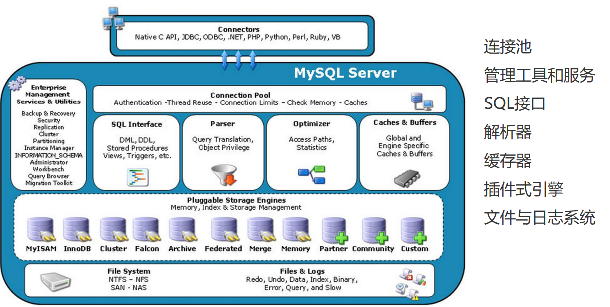
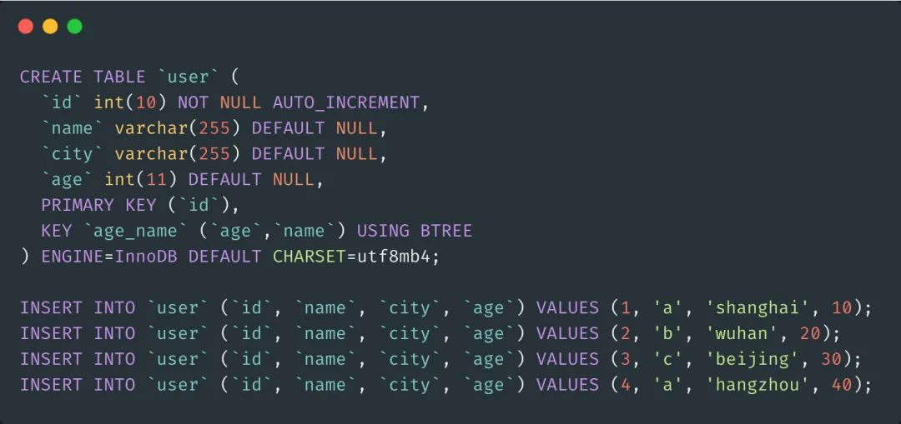
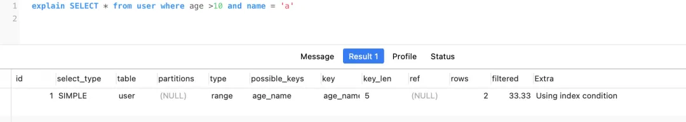
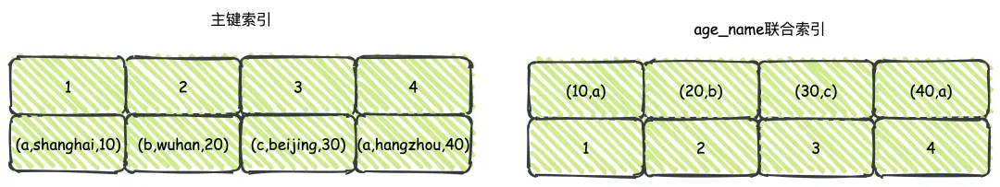
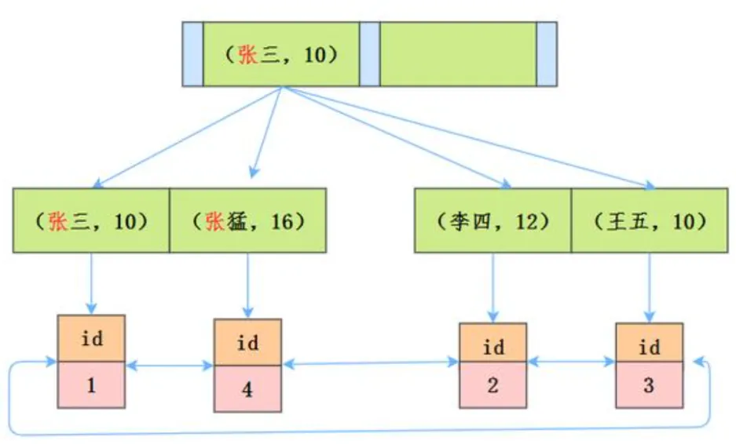
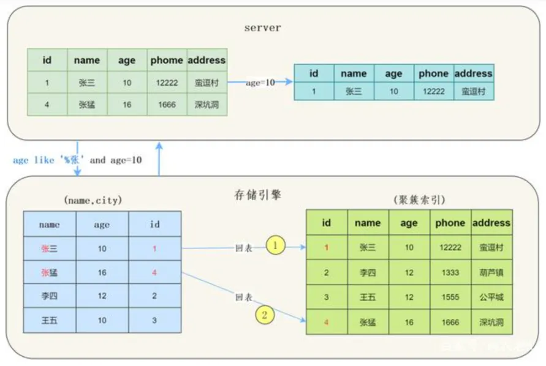
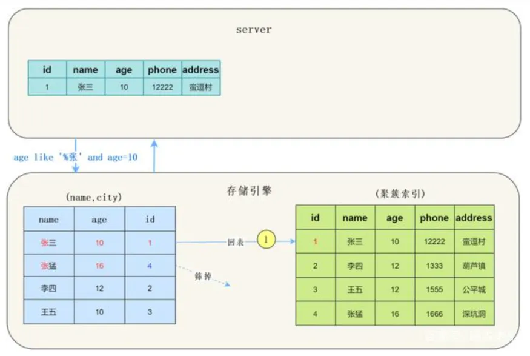

# MySQL关键特性索引下推ICP

## 前置知识：

整体架构

## MySQL 索引下推

索引下推(Index Condition Pushdown) ICP 是Mysql5.6之后新增的功能，主要的核心点就在于把数据筛选的过程放在了存储引擎层去处理，而不是像之前一样放到Server层去做过滤。

### 什么是索引下推

首先创建一张user表，同时建立age_name的联合索引，同时插入3条测试数据。

然后，执行查询<code>explain SELECT * from user where age >10 and name = 'a'</code>，如下图所示，就会看见Extra中显示了Using index condition，这表示出现了**索引下推**了。

没错，针对这个查询场景就是索引下推，那到底什么是索引下推呢？

按照上述的场景，实际上就存在两个索引树，一个是主键索引(*Clustered Index*)，存储了具体的数据的信息，另外则是age_name的联合索引(secondary index)，保存了主键的ID。

在没有ICP索引下推的时候，这个查询的流程应该是这样（略过无关的细节）：

1. Mysql Server层调用API查询存储引擎数据
2. 存储引擎根据联合索引首先通过条件找到所有age>10的数据
3. 找到的每一条数据都根据主键索引进行回表查询，直到找到不符合条件的结果
4. 返回数据给Server层，Server根据条件对结果进行过滤，流程结束

而有了ICP之后的流程则是这样：

1. Mysql Server层调用API查询存储引擎数据
2. 存储引擎根据联合索引首先通过条件找到所有age>10的数据，根据联合索引中已经存在的name数据进行过滤，找到符合条件的数据
3. 根据找到符合条件的数据，回表查询
4. 返回数据给Server层，流程结束

对比这两个流程就会很明显的发现，使用ICP之后就是简单的通过联合索引中本来就有的数据直接过滤了，不需要再查到一堆无用的数据去Server层进行过滤，这样的话减少了回表的次数和返回的数据，IO次数减少了，对性能有很好的提升。

按照官方文档所说，ICP其实也存在一定的使用限制场景，只说关键的，乱七八糟的不说。

1. 首先，ICP适用于range、ref、eq_ref和ref_or_null的场景下
2. InnoDB和MyISAM都支持ICP，Mysql partition分表的话也可以使用
3. 对于InndoDB而言，ICP只支持二级索引，因为主键索引它用不上不是吗？
4. 子查询不支持

现在基本都使用的5.6以上的版本了，默认就是开启ICP的，想关闭的话可以通过命令<code>SET optimizer_switch = 'index_condition_pushdown=off';</code>。

# 二、索引下推案例

用户表user，联合索引为（name, age）

| id | name | age |
| --- | --- | --- |
| 1 | 张三 | 10 |
| 2 | 李四 | 12 |
| 3 | 王五 | 12 |
| 4 | 张猛 | 16 |

语句\
根据最左匹配原则，只能用到索引 '张'

**未使用索引下推**\
先根据二级索引得到张三和张猛的两条记录\
根据id回表查询（id=1 id = 4）\
讲记录返回server层，判断age条件

**使用索引下推**\
先根据二级索引得到张三和张猛的两条记录\
由于是name跟age的联合索引，所以可直接根据age条件判断，得到id=1的记录\
回表查询id=1的记录返回server层

# 索引下推与覆盖索引的区别

索引下推是将在Server层的数据筛选，推到了存储引擎，让存储引擎去做这样的操作。

覆盖索引则是将要查找的数据放在一起，变成组合索引，进行查找时不需要回表操作

例如：

select name,age from user where name="张三"；

这里name与age建立组合索引，当找到张三时就能从索引树上得到name,age返回给Server层，这就是覆盖索引，即组合索引包含着我们的查询的字段。

同样

select name,age ,sex from user where name="张三"  and age=12;

组合索引当中是根据name来排序的，age是无序的。所以在不使用ICP时，组合索引树只会判断name，从而回表查找整个行数据，交给Server层

使用ICP时，会判断name和age，再去回表查找整个行数据，交给Server层，减少了回表次数。

> 更新: 2025-04-20 22:39:01  
> 原文: <https://www.yuque.com/aaron-wecc3/dhluml/as6tg55xes098npo>