# Prometheus+grafana+springboot 搭建监控平台

1、创建 SpringBoot

具体创建SpringBoot项目流程操作这里就省略了，首先在SpringBoot项目的application.yml中声明端口号、服务名等信息，配置如下：

```java
# 端口号
server:
  port: 8080

# 服务名
spring:
  application:
    name: SpringBoot Prometheus

# 端点监控指标
management:
  endpoints:
    web:
      exposure:
        include: "*"
  endpoint:
    prometheus:
      enabled: true
    health:
      show-details: always
  metrics:
    export:
      prometheus:
        enabled: true
```


 

在SpringBoot项目的pom.xml中，引入Maven依赖：

```java
<dependencies>
    <!--SpringBoot Web-->
    <dependency>
        <groupId>org.springframework.boot</groupId>
        <artifactId>spring-boot-starter-web</artifactId>
    </dependency>

    <!--Actuator：暴露端点指标数据-->
    <dependency>
        <groupId>org.springframework.boot</groupId>
        <artifactId>spring-boot-starter-actuator</artifactId>
    </dependency>

    <!--Prometheus-->
      <dependency>
            <groupId>io.micrometer</groupId>
            <artifactId>micrometer-registry-prometheus</artifactId>
            <version>1.1.4</version>
        </dependency>

</dependencies>
```


 

调整启动类：

```java
import io.micrometer.core.instrument.MeterRegistry;
import org.springframework.beans.factory.annotation.Value;
import org.springframework.boot.SpringApplication;
import org.springframework.boot.actuate.autoconfigure.metrics.MeterRegistryCustomizer;
import org.springframework.boot.autoconfigure.SpringBootApplication;
import org.springframework.context.annotation.Bean;

@SpringBootApplication
public class PrometheusProjectApplication {

    public static void main(String[] args) {
        SpringApplication.run(PrometheusProjectApplication.class, args);
    }

    @Bean
    MeterRegistryCustomizer<MeterRegistry> configurer(@Value("${spring.application.name}") String applicationName) {
        return registry -> registry.config().commonTags("application", applicationName);
    }
}
```


 

此时启动SpringBoot项目，访问以下URL，就可以看到应用的指标数据信息了：


[http://localhost:8080/actuator](http://localhost:8080/actuator)

[http://localhost:8080/actuator/prometheus](http://localhost:8080/actuator/prometheus)

2、安装 Docker

这里不详细说明如何安装，流程参考前置内容：

 


3、Docker 启动 SpringBoot

将需要被监控的 SpringBoot 项目通过 Maven 构建成 Jar 包，先在 pom.xml 加入打包构建配置：

```java
<build>
    <finalName>SpringBoot-Prometheus</finalName>
    <plugins>
        <plugin>
            <groupId>org.springframework.boot</groupId>
            <artifactId>spring-boot-maven-plugin</artifactId>
        </plugin>
    </plugins>
</build>
```


 

接着通过该命令构建 JAR 包：


mvn clean package -Dmaven.test.skip=true

 

构建完毕后，会看到 targe 目录下生成了当前项目对应的 JAR 文件：

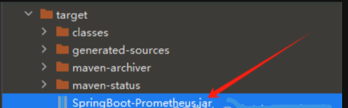

然后将 JAR 文件上传到 服务器1 的根目录（~）下，然后执行下述命令构建 Dockerfile：


```java

# 创建文件夹
mkdir /opt/springboot

# 移动 JAR 包
cd ~
mv springboot-prometheus.jar /opt/springboot/

# 构建 Dockerfile
cat > /opt/springboot/Dockerfile <<-'EOF'
FROM openjdk:17
ADD springboot-prometheus.jar /springboot-prometheus.jar
EXPOSE 8080
ENTRYPOINT ["java", "-jar", "springboot-prometheus.jar"]
EOF
```


 

配置好 Dockerfile 文件后，通过下述命令构建 SpringBoot 容器镜像：

```java
cd /opt/springboot
docker build -t springboot-prometheus .
```


 

构建完毕 Docker 镜像后，通过下述命令启动 SpringBoot 容器，应用部署完毕：

```java
docker run -d \
--name=prometheus \
-p 8080:8080 \
springboot-prometheus
```


 

最后，通过访问指标数据接口：[http://47.95.221.16:8080/actuator/prometheus](http://47.95.221.16:8080/actuator/prometheus)，可以看到指标数据，说明 SpringBoot 部署完毕：


4、Docker 搭建 Prometheus  和 grafana

拉取镜像：docker pull prom/prometheus:latest

   docker pull grafana/grafana:latest

运行镜像：docker run -d 9090:9090 -p 9100:9100 -p 3000:3000 cap1573/promethues-grafana


在服务器2上，执行下面命令，创建 Prometheus 配置文件，注意：static_configs 使用的是 SpringBoot 容器的地址信息：

```java
mkdir /etc/prometheus
cat > /etc/prometheus/prometheus.yml <<-'EOF'
# my global config
global:
  scrape_interval: 15s # Set the scrape interval to every 15 seconds. Default is every 1 minute.
  evaluation_interval: 15s # Evaluate rules every 15 seconds. The default is every 1 minute.
  # scrape_timeout is set to the global default (10s).

# Alertmanager configuration
alerting:
  alertmanagers:
    - static_configs:
        - targets:
          # - alertmanager:9093

# Load rules once and periodically evaluate them according to the global 'evaluation_interval'.
rule_files:
  # - "first_rules.yml"
  # - "second_rules.yml"

# A scrape configuration containing exactly one endpoint to scrape:
# Here it's Prometheus itself.
scrape_configs:
  # The job name is added as a label `job=<job_name>` to any timeseries scraped from this config.
  - job_name: "prometheus"

    # metrics_path defaults to '/metrics'
    # scheme defaults to 'http'.

    static_configs:
      - targets: ["localhost:9090"]

  # 以下为 SpringBoot 应用配置
  # 5秒调用一次 Spring Boot Actuator 获取指标数据
  - job_name: 'springboot_prometheus'
    scrape_interval: 5s
    metrics_path: '/actuator/prometheus'
    static_configs:
      - targets: ['172.21.180.99:8080']
EOF
```


 

整理好配置文件后，通过 Docker 部署 Prometheus，命令如下：

```java
docker run -d \
--name=prometheus \
-v /etc/prometheus/prometheus.yml:/etc/prometheus/prometheus.yml  \
-p 9090:9090 \
bitnami/prometheus:latest
```


 

部署完毕之后，通过访问：[http://39.105.202.53:9090/](http://39.105.202.53:9090/)，可以看到 Prometheus 的页面，说明部署成功了。

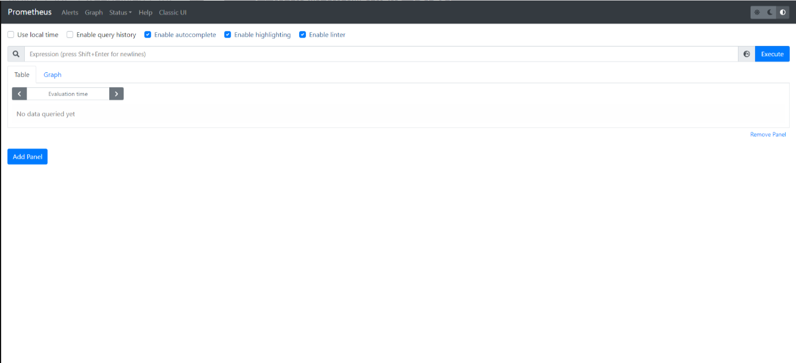

点击 Status ——> Target 可以看到监控的服务信息：

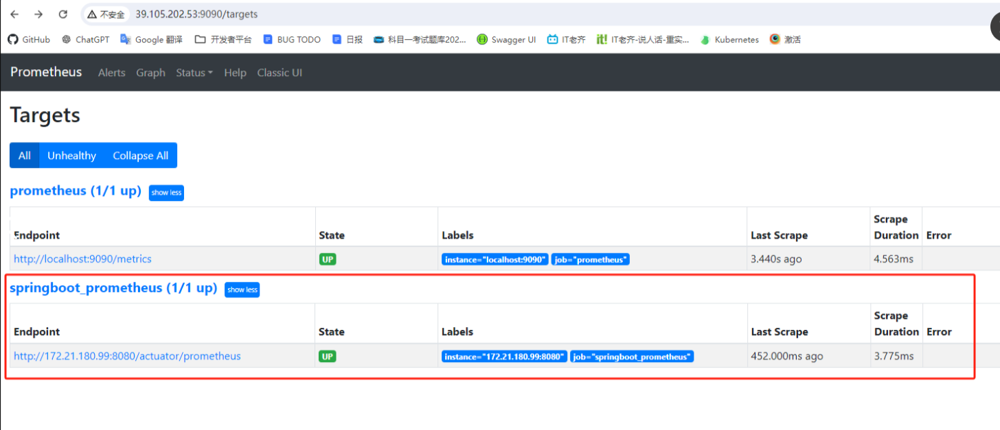


5、Docker 搭建 Grafana

最后，在服务器2上，通过 Docker 部署 Grafana，命令如下：

```java
docker run -d \
--name=grafana \
-p 3000:3000 \
grafana/grafana
```


 

此时通过 [http://39.105.202.53:3000](http://39.105.202.53:3000) 访问一下 Grafana 的页面，如下：

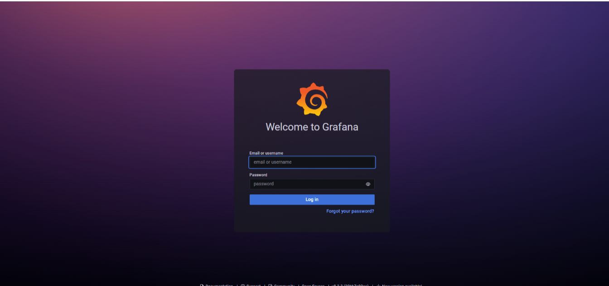

第一次登录时，默认的用户名和密码都是 admin，登录后可以看到如下页面：

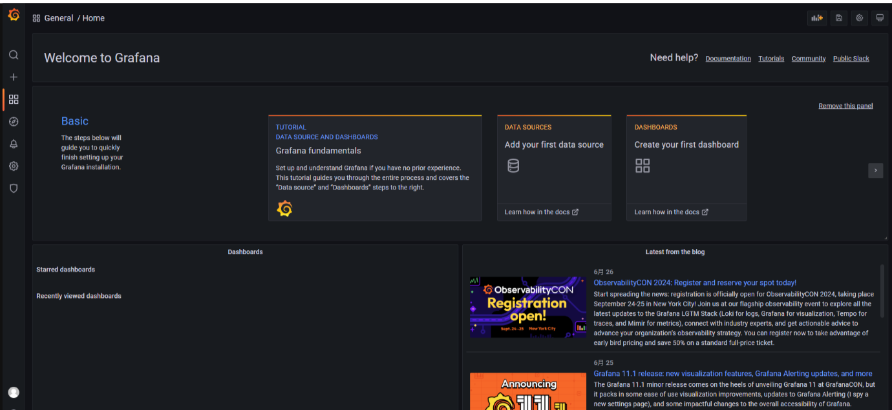

此时想要 Grafana 整合 Prometheus，完成指标数据的监控，需要先设置数据源，流程如下：

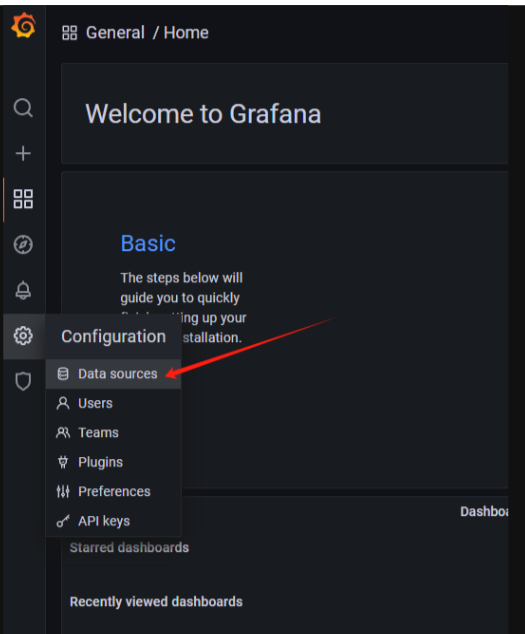


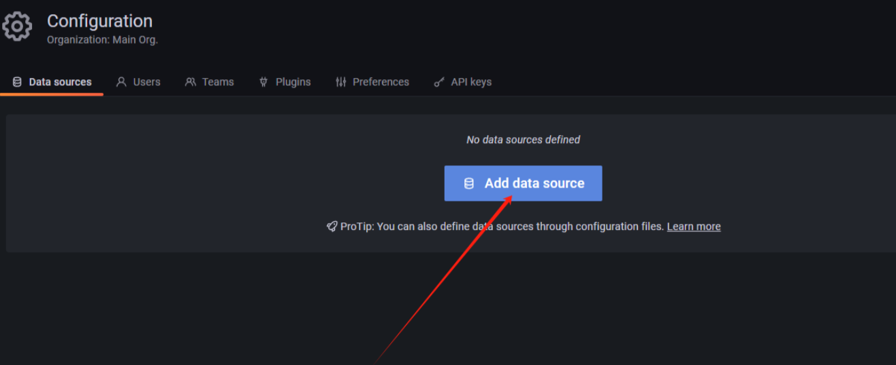

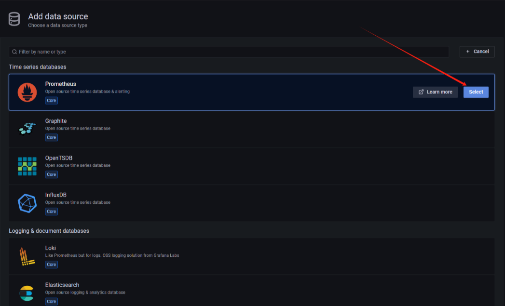

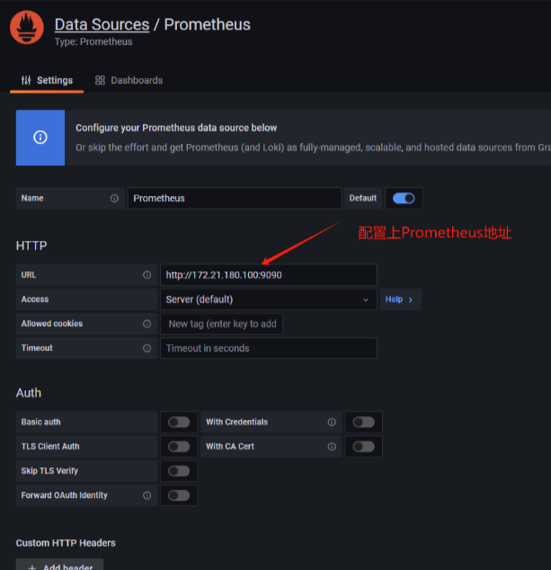

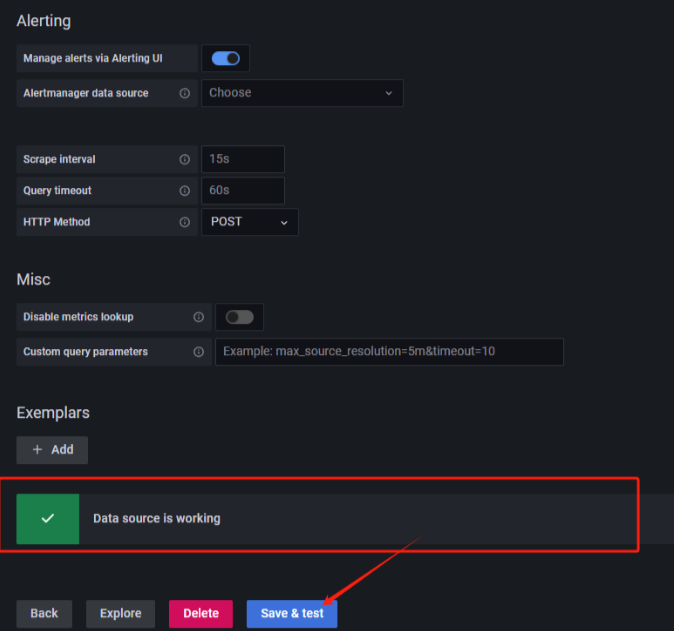

结果上述操作，配置好了数据源，接下来导入监控面板，流程如下：

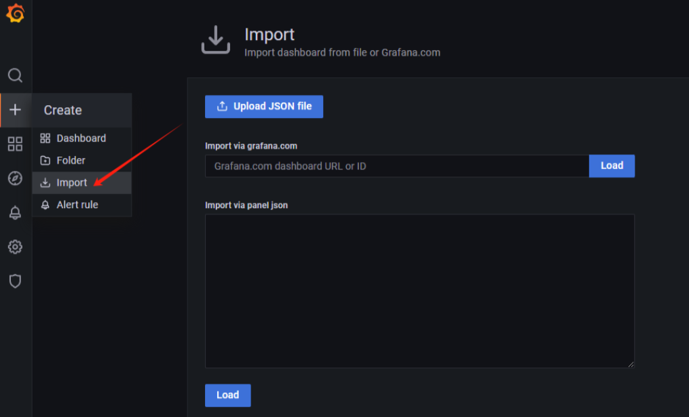

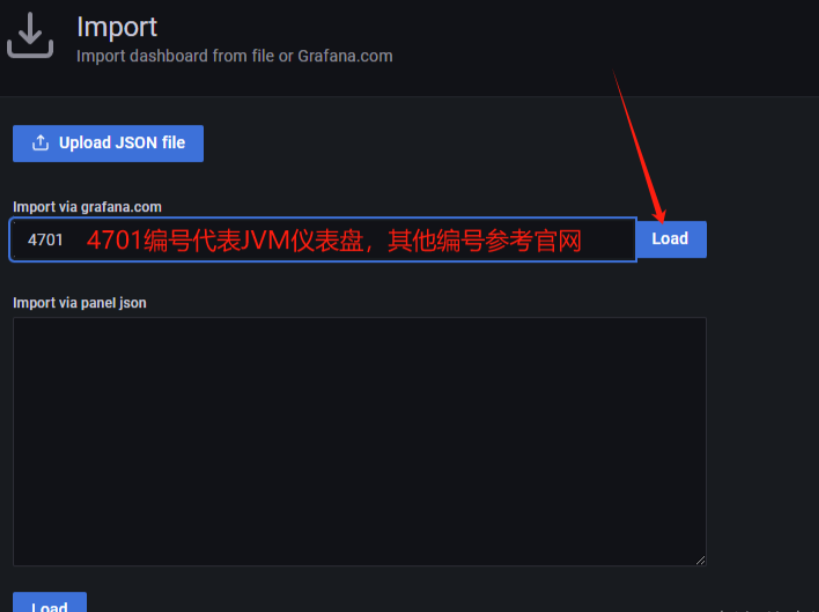

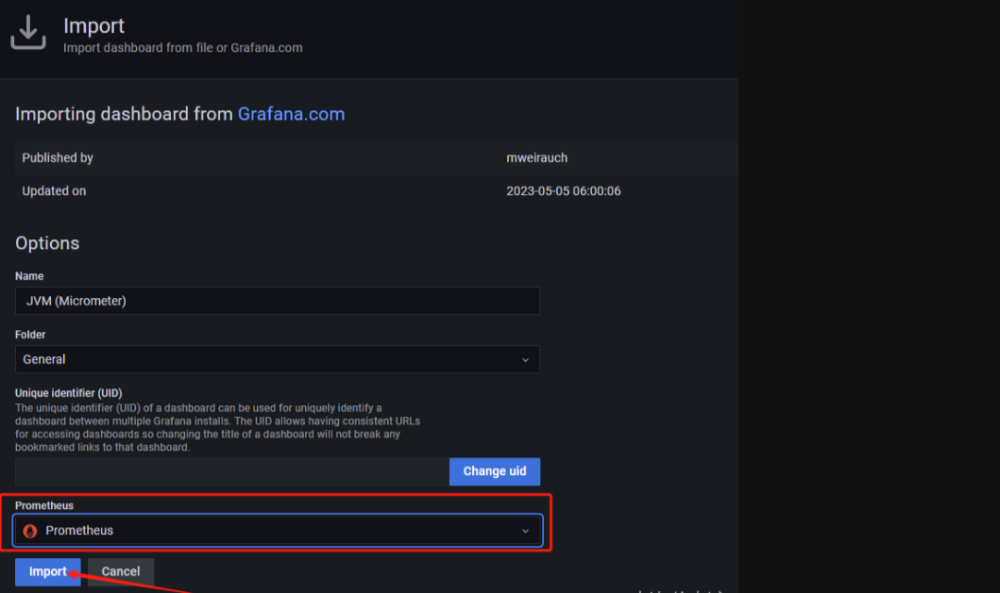


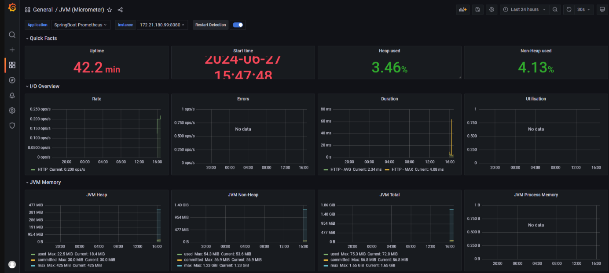


经过上述操作，Prometheus + Grafana 监控 SpringBoot 应用的搭建流程就完毕了！

 


> 更新: 2025-04-20 22:39:00  
> 原文: <https://www.yuque.com/aaron-wecc3/dhluml/bfbbi22z9yogtqgp>