# Prometheus全面监控MySQL服务

## 简介
在现代应用中，MySQL数据库的性能和稳定性对业务至关重要。有效的监控可以帮助预防问题并优化性能。Prometheus作为一款强大的开源监控系统，结合Grafana的可视化能力，可以提供全面的MySQL监控方案。


设置Prometheus

安装Prometheus

使用Docker安装Prometheus:


docker run -d --name=prometheus -p 9090:9090 prom/prometheus

 

此命令将Prometheus运行在本地的9090端口。


### 基本配置
创建一个Prometheus配置文件prometheus.yml:

```java
global:
  scrape_interval: 15s
scrape_configs:
  - job_name: 'prometheus'
    static_configs:
      - targets: ['localhost:9090']
```


 

上面是官网提供的docker命令安装方案，官方直达链接，也可在Windows的docker中安装运行演示的，下面简单记录一下Windows安装的步骤细节


在指定路径下添加一下普罗米修斯的配置文件


文件的详细信息展示

```java

# my global config
global:
  scrape_interval: 15s # Set the scrape interval to every 15 seconds. Default is every 1 minute.
  evaluation_interval: 15s # Evaluate rules every 15 seconds. The default is every 1 minute.
  # scrape_timeout is set to the global default (10s).

# Alertmanager configuration
alerting:
  alertmanagers:
    - static_configs:
        - targets:
          # - alertmanager:9093

# Load rules once and periodically evaluate them according to the global 'evaluation_interval'.
rule_files:
  # - "first_rules.yml"
  # - "second_rules.yml"

# A scrape configuration containing exactly one endpoint to scrape:
# Here it's Prometheus itself.
scrape_configs:
  # The job name is added as a label `job=<job_name>` to any timeseries scraped from this config.
  - job_name: "prometheus"

    # metrics_path defaults to '/metrics'
    # scheme defaults to 'http'.

    static_configs:
      - targets: ["127.0.0.1:9090"]
  - job_name: "mysql"

    # metrics_path defaults to '/metrics'
    # scheme defaults to 'http'.
	# 这里做一个说明就是后续的两个服务本地都是直接通过docker的方式运行在容器中，由于docker容器网络配置的原因，即使在安装部署在同一个网络空间之下，同时给网路空间起不同的名称作为区分也不能实现浏览器的ip访问，因此下面这里使用网络ip的方式进行标记
    static_configs:
      - targets: ["192.168.28.3:9104"]
```

 

执行Windows的docker命令运行服务

这里需要注意一下就是地址配置的问题，需要配置成自己的文件地址

```java
docker run -d -p 9090:9090 --network my-mysql-network -v "D:\Program_Files\prometheus\prometheus.yml:/etc/prometheus/prometheus.yml" prom/prometheus --config.file=/etc/prometheus/prometheus.yml
```


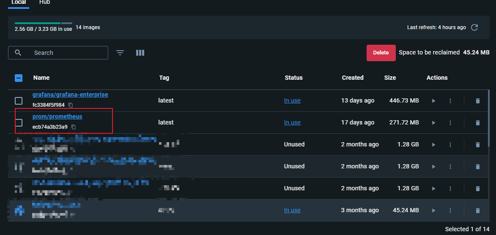


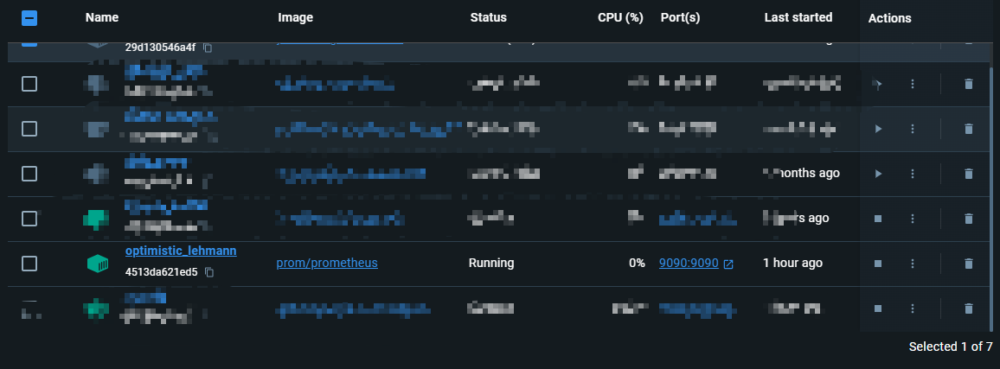

访问网址得到的页面展示信息

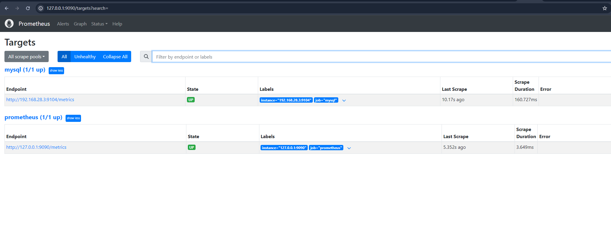


### 安装MySQL Exporter
MySQL Exporter是什么

MySQL Exporter是一个用于从MySQL数据库中收集指标并暴露给Prometheus的工具。


安装步骤

创建MySQL用户

在MySQL中创建一个专用用户:

```java
cat > /etc/mysql/init.d/schema.sql <<-'EOF'
SET NAMES utf8mb4;
SET @OLD_UNIQUE_CHECKS=@@UNIQUE_CHECKS,UNIQUE_CHECKS=0;
SET @OLD_FOREIGN_KEY_CHECKS=@@FOREIGN_KEY_CHECKS,FOREIGN_KEY_CHECKS=0;
SET @OLD_SQL_MODE=@@SQL_MODE,SQL_MODE='TRADITIONAL';
DROP SCHEMA IF EXISTS sakila;
CREATE SCHEMA sakila;
USE sakila;


CREATE TABLE actor(
actor_id SMALLINT UNSIGNED NOT NULL AUTO_INCREMENT,
first_name VARCHAR(45) NOT NULL,
last_name VARCHAR(45) NOT NULL,
last_update TIMESTAMP NOT NULL DEFAULT CURRENT_TIMESTAMP ON UPDATE CURRENT_TIMESTAMP,
PRIMARY KEY(actor_id),
KEY idx_actor_last_name (last_name)
)ENGINE=InnoDB DEFAULT CHARSET=utf8mb4;

# 创建远程的用户名和密码用于连接数据库
CREATE USER remote@'%'IDENTIFIED with mysql_native_password BY 'remote';
grant all privileges on *.* to remote@'%';
# 创建exporter需要读取数据库日志信息的登陆账户，并授予权限
CREATE USER 'exporter'@'%' IDENTIFIED BY 'exporter';
GRANT PROCESS, REPLICATION CLIENT ON *.* TO 'exporter'@'%';
GRANT SELECT ON performance_schema.* TO 'exporter'@'%';
```


docker 启动 MySQL

```java
docker run \
    -p 3306:3306 \
    --network my-bridge \
    --name db \
    -v /etc/mysql/init.d:/docker-entrypoint-initdb.d \
    -e MYSQL_ROOT_PASSWORD=root \
    -d mysql:8
```


使用Docker安装MySQL Exporter:


docker run -d -p 9104:9104 --name=mysql_exporter -e DATA_SOURCE_NAME="user:password@(hostname:3306)/" prom/mysqld-exporter


替换user和password为MySQL数据库的用户名和密码，hostname为MySQL服务器地址。

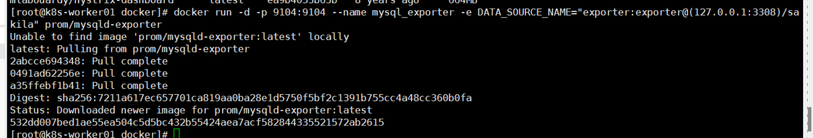

配置MySQL Exporter

<font style="color:rgb(77, 77, 77);">第 2 步: 查看运行结果</font>

```plain
docker run -d -p 9104:9104 --name mysql_exporter -e DATA_SOURCE_NAME="exporter:exporter@(127.0.0.1:3308)/sakila"  -v=/etc/mysql/my.cnf prom/mysqld-exporter

```

<font style="color:rgb(77, 77, 77);">  
</font>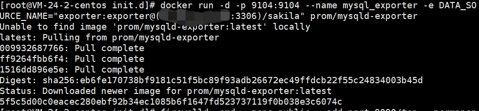

<font style="color:rgb(77, 77, 77);">  
</font><font style="color:rgb(77, 77, 77);">访问ip:9104  
</font>

### <font style="color:rgb(79, 79, 79);">🎈</font><font style="color:rgb(79, 79, 79);">Prometheus搭建</font>


将MySQL Exporter与Prometheus集成

在prometheus.yml中添加MySQL Exporter:

```java
scrape_configs:
  - job_name: 'mysql'
    static_configs:
      - targets: ['localhost:9104']
```


 

Prometheus配置

添加MySQL Exporter

在Prometheus配置文件prometheus.yml中增加MySQL Exporter的配置，确保Prometheus能够抓取MySQL Exporter暴露的指标。


抓取指标

启动Prometheus后，可以在[http://localhost:9090](http://localhost:9090)上访问Prometheus UI，检查抓取的MySQL指标。


Windows安装的步骤演示 官网 


添加配置信息

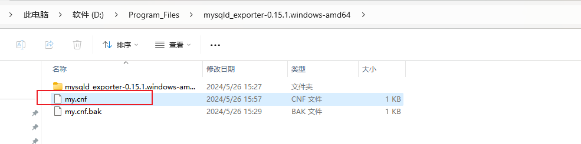

```java
[client]
user = root
password = shuyixiao666
host = 192.168.28.3
port = 3306
```


 

执行命令运行MySQL Exporter服务

```java
docker run -d -p 9104:9104 --network my-mysql-network -v "D:\Program_Files\mysqld_exporter-0.15.1.windows-amd64\my.cnf:/etc/my.cnf" prom/mysqld-exporter --config.my-cnf=/etc/my.cnf
```


 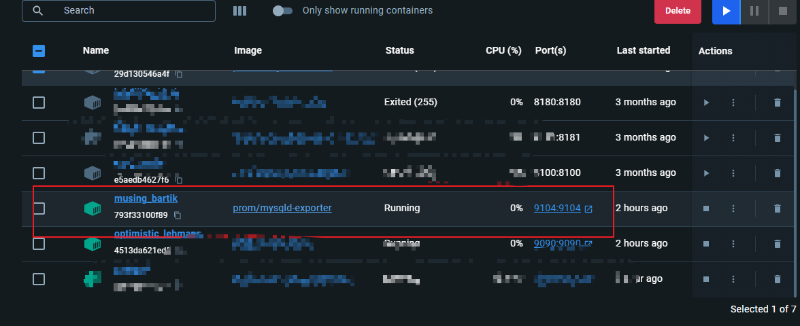

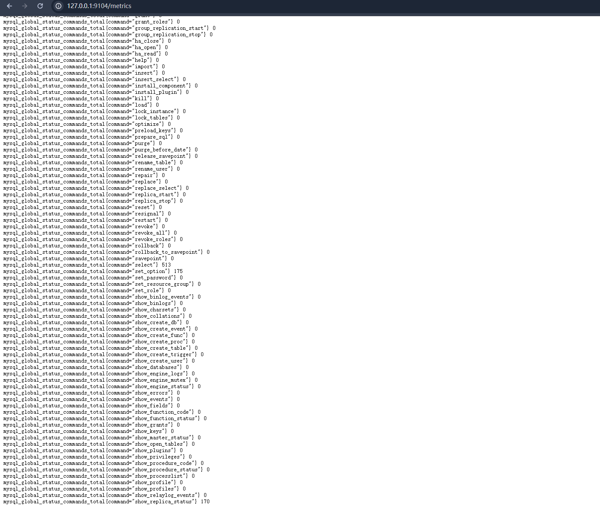


使用Grafana可视化指标

安装Grafana

使用Docker安装Grafana:

```java
docker run -d -p 3000:3000 --name=grafana grafana/grafana
```


 

导入仪表盘

在Grafana中添加Prometheus数据源，然后从Grafana官网导入MySQL监控仪表盘（ID：7362）。

 


指定docker指令启动服务

```java
docker run -d -p 3000:3000 --network my-mysql-network --name=grafana grafana/grafana-enterprise
```


初始化的账号和密码都是admin，首次登录之后会提示你修改你的密码


仪表板的简单配置

添加一个普罗米修斯的应用

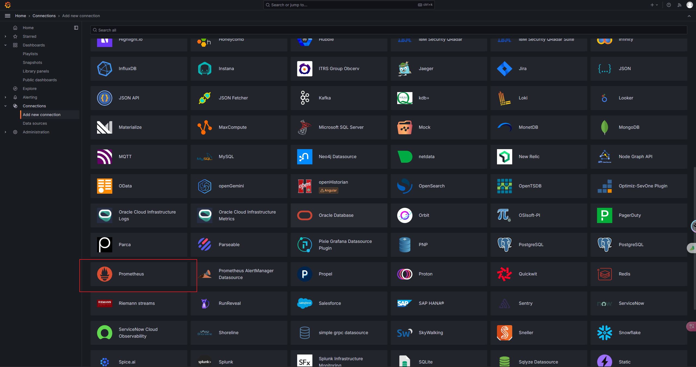


配置之前的MySQL Exporter服务信息

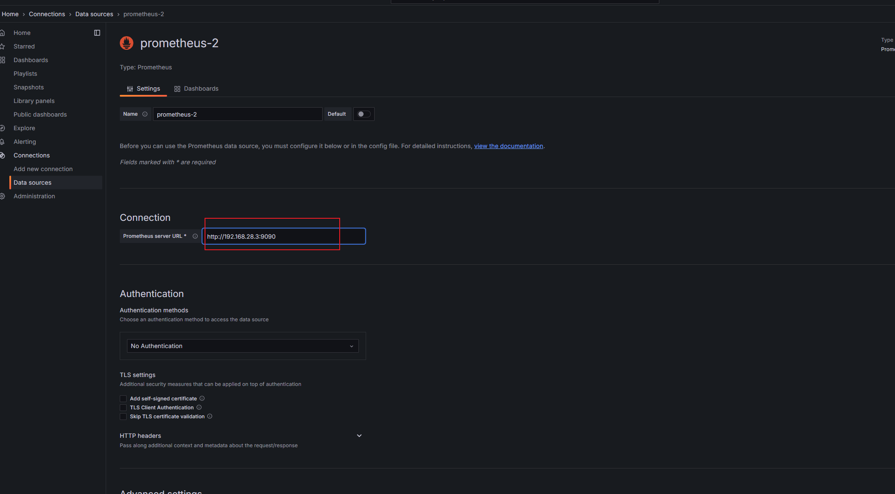


保存之后配置仪表板信息

 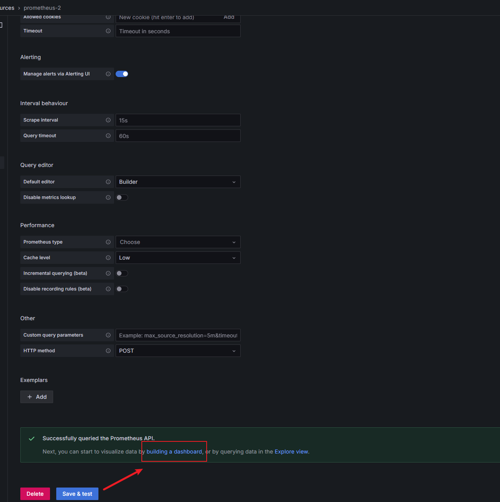

在这里选择你需要的或者你喜欢的仪表板信息，需要注意的是这里要选择普罗米修斯的数据源，不然后面的数据库选择会对应不上


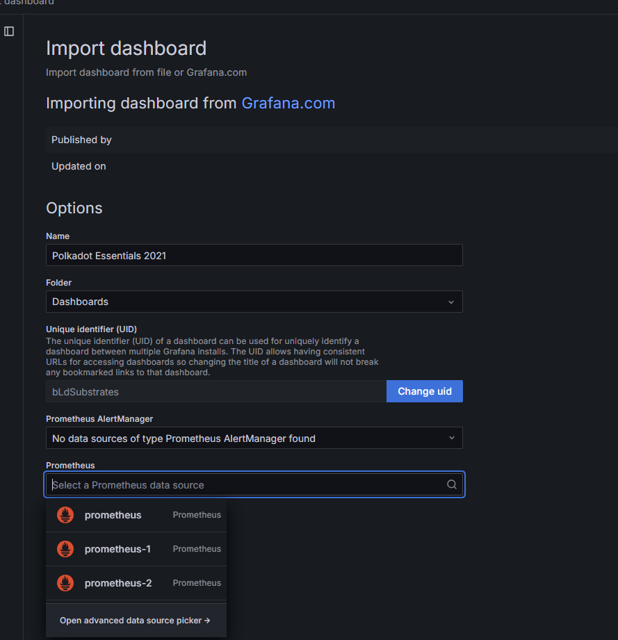


最后成品的展示


 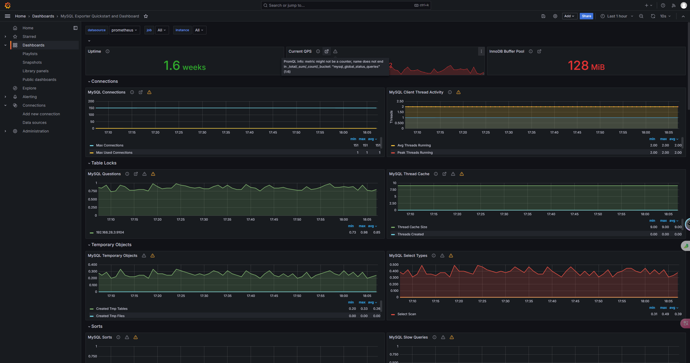


1.创建网桥

```plain
docker network create -d bridge my-bridge
```


2.构建MySQL数据库

创建MySQL用户

在MySQL中创建一个专用用户:

```java
cat > /etc/mysql/init.d/schema.sql <<-'EOF'
SET NAMES utf8mb4;
SET @OLD_UNIQUE_CHECKS=@@UNIQUE_CHECKS,UNIQUE_CHECKS=0;
SET @OLD_FOREIGN_KEY_CHECKS=@@FOREIGN_KEY_CHECKS,FOREIGN_KEY_CHECKS=0;
SET @OLD_SQL_MODE=@@SQL_MODE,SQL_MODE='TRADITIONAL';
DROP SCHEMA IF EXISTS sakila;
CREATE SCHEMA sakila;
USE sakila;


CREATE TABLE actor(
actor_id SMALLINT UNSIGNED NOT NULL AUTO_INCREMENT,
first_name VARCHAR(45) NOT NULL,
last_name VARCHAR(45) NOT NULL,
last_update TIMESTAMP NOT NULL DEFAULT CURRENT_TIMESTAMP ON UPDATE CURRENT_TIMESTAMP,
PRIMARY KEY(actor_id),
KEY idx_actor_last_name (last_name)
)ENGINE=InnoDB DEFAULT CHARSET=utf8mb4;

# 创建远程的用户名和密码用于连接数据库
CREATE USER remote@'%'IDENTIFIED with mysql_native_password BY 'remote';
grant all privileges on *.* to remote@'%';
# 创建exporter需要读取数据库日志信息的登陆账户，并授予权限
CREATE USER 'exporter'@'%' IDENTIFIED BY 'exporter';
GRANT PROCESS, REPLICATION CLIENT ON *.* TO 'exporter'@'%';
GRANT SELECT ON performance_schema.* TO 'exporter'@'%';
```


docker 启动 MySQL

```java
docker run \
    -p 3306:3306 \
    --network my-bridge \
    --name db \
    -v /etc/mysql/init.d:/docker-entrypoint-initdb.d \
    -e MYSQL_ROOT_PASSWORD=root \
    -d mysql
```


> 更新: 2025-04-20 22:38:59  
> 原文: <https://www.yuque.com/aaron-wecc3/dhluml/fh5euvrfvvv5z651>