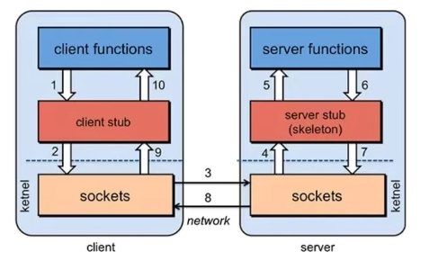
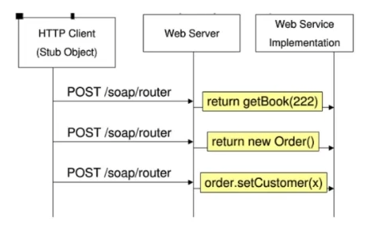
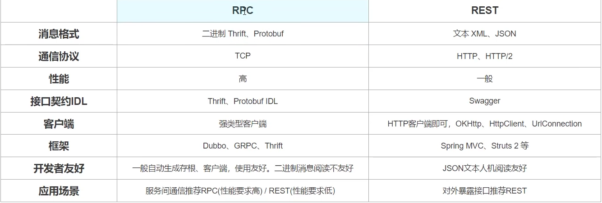

# RPC和REST两种通信方式分布式架构中该怎么选

## 背景：
当下微服务架构都面临着服务间的远程调用，常见的远程调用方式有两种：

RPC：Remote Produce Call远程过程调用，类似的还有RMI。自定义数据格式，基于原生TCP通信，速度快，效率高。早期的webservice，现在热门的dubbo，都是RPC的典型。

Rest：使用HTTP POST(或GET)进行数据交互http,请求数据和应答数据均为JSON格式（或XML）。http其实是一种网络传输协议，基于TCP，规定了数据传输的格式。现在客户端浏览器与服务端通信基本都是采用Http协议。也可以用来进行远程服务调用。缺点是消息封装臃肿。现在热门的Rest风格，就可以通过http协议来实现。

## 一. 简介
### 1. RPC(remote procedure call)

     执行远程服务器上的一个function,，像调用本地服务(方法)一样调用服务器的服务(方法)。通常的实现有 XML-RPC , JSON-RPC , 通信方式基本相同, 所不同的只是传输数据的格式.

    (1) 优点：

        设计简洁，便于理解

        轻量的payload

        很高的性能表现

    (2) 缺点：

        前后端代码高耦合

        代码可读性不好，相关代码不容易被定位

        会导致有大量被定义的函数，难以管理

    (3) 核心

        RPC是分布式架构的核心，按响应方式分如下两种：

        同步调用：客户端调用服务方方法，等待直到服务方返回结果或者超时，再继续自己的操作

        异步调用：客户端把消息发送给中间件，不再等待服务端返回，直接继续自己的操作。

        同步调用的实现方式有WebService和RMI。Web Service提供的服务是基于web容器的，底层使用http协议，因而适合不同语言异构系统间的调用。RMI实际上是Java语言的RPC实现，允许方法返回 Java 对象以及基本数据类型，适合用于JAVA语言构建的不同系统间的调用。

        异步调用的JAVA实现版就是JMS(Java Message Service)，目前开源的的JMS中间件有Apache社区的ActiveMQ、Kafka消息中间件，另外有阿里的RocketMQ。   

### 2. REST(Representational state transfer)， 表现层状态转移

在设计API时，使用路径定位资源，方法定义操作，通过Content-Type和Accept来协商资源的类型

REST是一种架构风格，指的是一组架构约束条件和原则。满足这些约束条件和原则的应用程序或设计就是 RESTful。REST规范把所有内容都视为资源，网络上一切皆资源。

REST并没有创造新的技术，组件或服务，只是使用Web的现有特征和能力。 可以完全通过HTTP协议实现，使用 HTTP 协议处理数据通信。REST架构对资源的操作包括获取、创建、修改和删除资源的操作正好对应HTTP协议提供的GET、POST、PUT和DELETE方法。

REST即表述性状态传递（Representational State Transfer，简称REST），是一种软件架构风格。REST通过HTTP协议定义的通用动词方法(GET、PUT、DELETE、POST) ，以URI对网络资源进行唯一标识，响应端根据请求端的不同需求，通过无状态通信，对其请求的资源进行表述。

    (1) 优点：

        前后端高度解耦

        便于理解，即使没有看文档，也能大概知道接口是用来做什么的；

        接口的功能有单一性，便于扩展和复用；

        利用了HTTP原本的特性

    (2) 缺点：

        有时payload会变的特别大

        同一个页面可能要调用很多个API，来获取不同的东西，在网络差的情况下会降低体验

    (3) 特征：

        资源：资源是以json(或其他Representation)为载体的、面向用户的一组数据集，资源对信息的表达倾向于概念模型中的数据

        无状态:所谓无状态的，即所有的资源，都可以通过URI定位，而且这个定位与其他资源无关，也不会因为其他资源的变化而改变。    

        统一的接口:RESTful架构风格规定，数据的元操作，即CRUD(create, read, update和delete,即数据的增删查改)操作，分别对应于HTTP方法：GET用来获取资源，POST用来新建资源（也可以用于更新资源），PUT用来更新资源，DELETE用来删除资源，这样就统一了数据操作的接口，仅通过HTTP方法，就可以完成对数据的所有增删查改工作。

        URI:可以用一个URI（统一资源定位符）指向资源，即每个URI都对应一个特定的资源。要获取这个资源，访问它的URI就可以，因此URI就成了每一个资源的地址或识别符

    (4) 设计原则：

        网络上的所有事物都被抽象为资源

        每个资源都有一个唯一的资源标识符

        同一个资源具有多种表现形式(xml,json等)

        对资源的各种操作不会改变资源标识符

        所有的操作都是无状态的

        无状态通信，是指服务端(响应端)不保存任何与特定HTTP请求相关的资源，应用状态必须由请求方在请求过程中提供。要求在网络通信过程中，任意一个Web请求必须与其他请求隔离，当请求端提出请求时，请求本身包含了响应端为响应这一请求所需的全部信息

        简单的来说就是状态信息保存在服务器的就是有状态的，而状态信息保存在客户端的就是无状态的。通过REST的无状态原则恰好有利于实现负载均衡，在分布式的Web系统上，有多个可用的服务器，每个服务器都可以处理客户端发来的请求，及时有一台服务器宕机，无状态的请求可以交给别的服务器处理，这是有状态的请求所做不到的。

        RESTful即实现REST设计风格的一种架构，如RESTful API（REST设计风格的API）

    (5) 风格

        利用HTTP方法让接口统一化

        利用HTTP状态码返回状态信息

        

## 二. 比较：
1. RPC服务提供方与调用方接口依赖方式太强，会导致编码的复杂性，而REST接口相比RPC更为轻量化，服务提供方和调用方的依赖只是依靠一纸契约，不存在代码级别的强依赖。

2. RPC服务对平台敏感，难以简单复用：REST可以实现跨平台，任何一个语言的调用方都可以根据接口定义来实现。

3. Dubbo采用的RPC的服务调用，SpringCloud采用的REST。

4. 通信协议.REST使用HTTP,RPC一般使用TCP

5. 性能,REST性能低,RPC性能高

6. 灵活度,REST灵活度高,RPC灵活度低

7. 从使用方面看，Http接口只关注服务提供方（服务端），对于客户端怎么调用，调用方式怎样并不关心，通常情况下，客户端使用Http方式进行调用时，只要将内容进行传输即可，这样客户端在使用时，需要更关注网络方面的传输，比较不适用与业务方面的开发；而RPC服务则需要客户端接口与服务端保持一致，服务端提供一个方法，客户端通过接口直接发起调用，业务开发人员仅需要关注业务方法的调用即可，不再关注网络传输的细节，在开发上更为高效。

8. 从性能角度看，使用Http时，Http本身提供了丰富的状态功能与扩展功能，但也正由于Http提供的功能过多，导致在网络传输时，需要携带的信息更多，从性能角度上讲，较为低效。而RPC服务网络传输上仅传输与业务内容相关的数据，传输数据更小，性能更高。

类比图：

## 三. 适用场景
基于RPC的API更加适用行为(也就是命令和过程)，基于REST的API更加适用于构建模型(也就是资源和实体)，处理CRUD。REST使用HTTP的方法，例如：GET,POST,PUT,DELETE,OPTIONS还有比较不常用的PATCH方法。RPC通常只会使用GET和POST方法，GET方法通常用来获取信息，POST方法可以用来进行所有的行为。

既然两种方式都可以实现远程调用，我们该如何选择呢？

(1) 速度来看，RPC要比http更快，虽然底层都是TCP，但是http协议的信息往往比较臃肿，不过可以采用gzip压缩。

(2) 难度来看，RPC实现较为复杂，http相对比较简单

(3) 灵活性来看，http更胜一筹，因为它不关心实现细节，跨平台、跨语言。

因此，两者都有不同的使用场景：

(1) 如果对效率要求更高，并且开发过程使用统一的技术栈，那么用RPC还是不错的。

(2) 如果需要更加灵活，跨语言、跨平台，显然http更合适

## 三. 总结
1. RPC：所谓的远程过程调用 (面向方法)

    REST：所谓的 Representational state transfer (面向资源)

2. 设计API时，决定使用哪种形式，得先考虑所设计的API将会被谁使用：

    如果是关注于对象和资源的项目，需要对接各种不同的端和使用者，需要便于使用和阅读文档，那么适合使用REST

    如果是面向行为动作，或者内部的一些微服务，对响应要求高，那么可以考虑RPC

    如果是需要给UI提供数据，或者需要对弱网络环境下优化而减少请求，那么可以考虑GraphQL

    

    面向终端用户的尽量用Restful HTTP。原因是认知广，直观，编程语言都支持HTTP（包括shell，这样调试起来方便），性能不是那么重要，方便用户share链接。

    面向内部系统的话如果机器不多也可以考虑用Restful HTTP，如果机器很多还是尽量用二进制的RPC吧，毕竟性能差距还是很大的。

    REST调用及测试都很方便，RPC就显得有点繁琐，但是RPC的效率是毋庸置疑的，所以建议在多系统之间的内部调用采用RPC。对外提供的服务，Rest更加合适。

    

    RESTful API和RPC是两种完全不同概念的东西，是没法放在一起比较的，如果硬要将它俩比较，我认为RESTful是RPC的一种实现，即RPC包括RESTful API，但RPC不等于RESTful API。

    RPC：我认为RPC是一种为实现远程调用而提出一种思想，至于你用什么方式去达到目的都可以（例如：用什么网络协议来传输数据看自己的选择）。

    RESTful API：符合REST设计风格的一种接口架构，它也是通过网络进行的远程调用，但是远程调用仅限于HTTP。

> 更新: 2024-05-08 20:39:42  
> 原文: <https://www.yuque.com/aaron-wecc3/dhluml/pvgkkn5snlgn2tks>