# Redis发布订阅机制实现原理

#### <font style="color:rgb(79, 79, 79);">什么是发布订阅？</font>

<font style="color:rgb(85, 86, 102);background-color:rgb(238, 240, 244);">Redis 发布订阅(pub/sub)是一种</font>[<font style="color:rgb(85, 86, 102);background-color:rgb(238, 240, 244);">消息通信</font>](https://so.csdn.net/so/search?q=%E6%B6%88%E6%81%AF%E9%80%9A%E4%BF%A1\&spm=1001.2101.3001.7020)<font style="color:rgb(85, 86, 102);background-color:rgb(238, 240, 244);">模式：发送者(pub)发送消息，订阅者(sub)接收消息。</font>

<font style="color:rgb(77, 77, 77);">Redis 的 subscribe 命令可以让客户端订阅任意数量的频道， 每当有新信息发送到被订阅的频道时， 信息就会被发送给所有订阅指定频道的客户端。</font>

<font style="color:rgb(77, 77, 77);">☛ 下图展示了频道 channel1 ， 以及订阅这个频道的三个客户端 —— client2 、 client5 和 client1 之间的关系：</font>

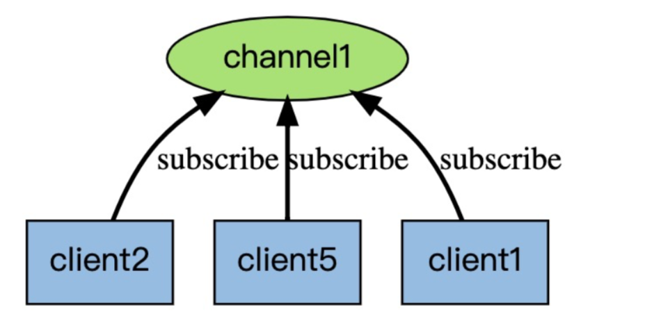

<font style="color:rgb(77, 77, 77);">☛ 当有新消息通过 publish 命令发送给频道 channel1 时， 这个消息就会被发送给订阅它的三个客户端：</font>

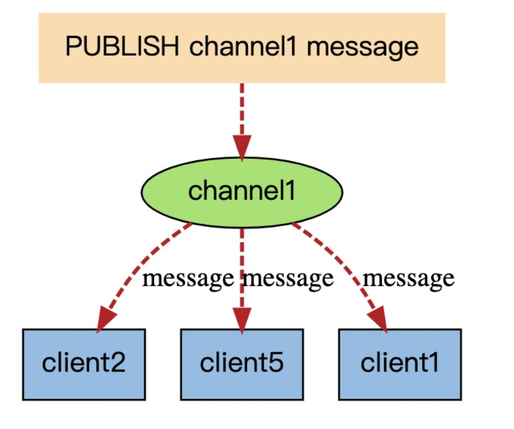

##### <font style="color:rgb(79, 79, 79);">☆ 为什么要用发布订阅？</font>

<font style="color:rgb(85, 86, 102);background-color:rgb(238, 240, 244);">熟悉</font>[<font style="color:rgb(85, 86, 102);background-color:rgb(238, 240, 244);">消息中间件</font>](https://so.csdn.net/so/search?q=%E6%B6%88%E6%81%AF%E4%B8%AD%E9%97%B4%E4%BB%B6\&spm=1001.2101.3001.7020)<font style="color:rgb(85, 86, 102);background-color:rgb(238, 240, 244);">的同学都知道，针对消息订阅发布功能，市面上很多大厂使用的是</font><code><font style="color:rgb(199, 37, 78);background-color:rgb(249, 242, 244);">kafka</font></code><font style="color:rgb(85, 86, 102);background-color:rgb(238, 240, 244);">、</font><code><font style="color:rgb(199, 37, 78);background-color:rgb(249, 242, 244);">RabbitMQ</font></code><font style="color:rgb(85, 86, 102);background-color:rgb(238, 240, 244);">、</font><code><font style="color:rgb(199, 37, 78);background-color:rgb(249, 242, 244);">ActiveMQ</font></code><font style="color:rgb(85, 86, 102);background-color:rgb(238, 240, 244);">, </font><code><font style="color:rgb(199, 37, 78);background-color:rgb(249, 242, 244);">RocketMQ等这几种，</font></code><font style="color:rgb(85, 86, 102);background-color:rgb(238, 240, 244);">redis的订阅发布功能跟这三者相比，相对轻量，针对数据准确和安全性要求没有那么高可以直接使用，适用于小公司。</font>

<font style="color:rgb(77, 77, 77);">redis 的List数据类型结构提供了 blpop 、brpop 命令结合 rpush、lpush 命令可以实现消息队列机制，基于双端链表实现的发布与订阅功能</font>

**<font style="color:rgb(77, 77, 77);">这种方式存在两个局限性：</font>**

* <font style="color:rgba(0, 0, 0, 0.75);">不能支持一对多的消息分发。</font>
* <font style="color:rgba(0, 0, 0, 0.75);">如果生产者生成的速度远远大于消费者消费的速度，易堆积大量未消费的消息</font>

**<font style="color:rgb(77, 77, 77);">◇ 双端队列图解如下：</font>**

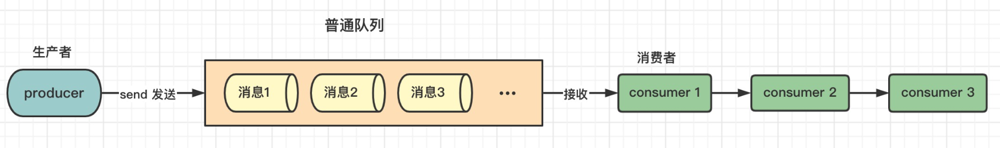

**<font style="color:rgb(77, 77, 77);">✦</font>****<font style="color:rgb(77, 77, 77);"> </font>****<font style="color:rgb(77, 77, 77);">解析：</font>**<font style="color:rgb(77, 77, 77);">双端队列模式只能有一个或多个消费者轮着去消费，却不能将消息同时发给其他消费者</font>

**<font style="color:rgb(77, 77, 77);">◇ 发布/订阅模式图解如下：</font>**

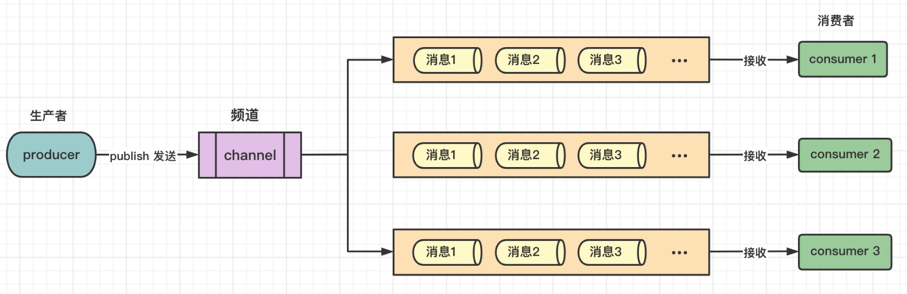

**<font style="color:rgb(77, 77, 77);">✦</font>****<font style="color:rgb(77, 77, 77);"> </font>****<font style="color:rgb(77, 77, 77);">解析：</font>**<font style="color:rgb(77, 77, 77);">redis订阅发布模式，生产者生产完消息通过频道分发消息，给订阅了该频道的所有消费 </font>

#### <font style="color:rgb(79, 79, 79);">发布/订阅如何使用？</font>

<font style="color:rgb(85, 86, 102);background-color:rgb(238, 240, 244);">Redis有两种发布/订阅模式：</font>

* <font style="color:rgba(0, 0, 0, 0.5);background-color:rgb(238, 240, 244);">基于频道(Channel)的发布/订阅</font>
* <font style="color:rgba(0, 0, 0, 0.5);background-color:rgb(238, 240, 244);">基于模式(pattern)的发布/订阅</font>

**<font style="color:rgb(77, 77, 77);">操作命令如下</font>**

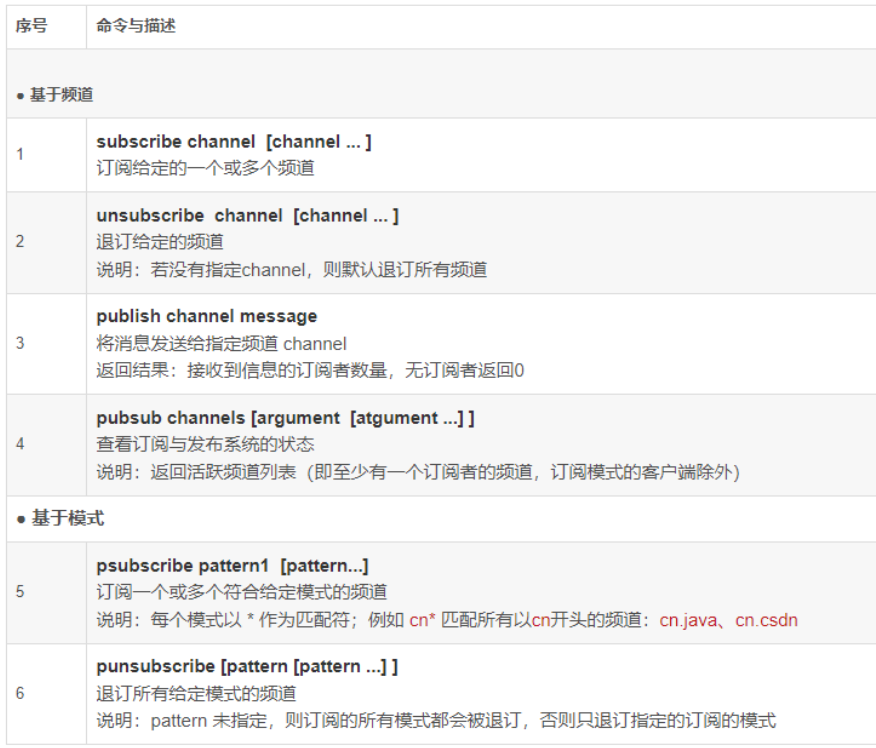

**<font style="color:rgb(77, 77, 77);">基于频道(Channel)的发布/订阅</font>**

<font style="color:rgb(85, 86, 102);background-color:rgb(238, 240, 244);">“发布/订阅” 包含2种角色：发布者和</font>[<font style="color:rgb(85, 86, 102);background-color:rgb(238, 240, 244);">订阅者</font>](https://so.csdn.net/so/search?q=%E8%AE%A2%E9%98%85%E8%80%85\&spm=1001.2101.3001.7020)<font style="color:rgb(85, 86, 102);background-color:rgb(238, 240, 244);">。发布者可以向指定的频道(channel)发送消息；订阅者可以订阅一个或者多个频道(channel)，所有订阅此频道的订阅者都会收到此消息。</font>

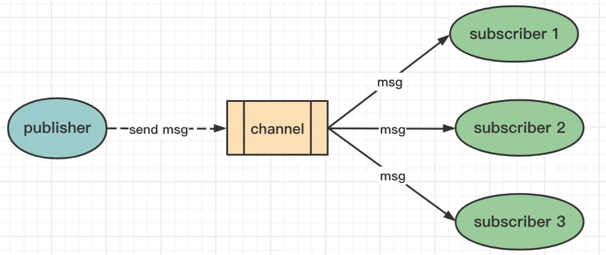

* **<font style="color:rgba(0, 0, 0, 0.75);">订阅者订阅频道   </font>\*\*\*\*<font style="color:rgba(0, 0, 0, 0.75);">subscribe</font>**<font style="color:rgba(0, 0, 0, 0.75);"> </font>**<font style="color:rgba(0, 0, 0, 0.75);">channel  \[channel ...]</font>**<font style="color:rgba(0, 0, 0, 0.75);"> </font>

```plain
--------------------------客户端1（订阅者） ：订阅频道 ---------------------
 
# 订阅 “tuling” 和 “csdn” 频道（如果不存在则会创建频道）
127.0.0.1:6379> subscribe tuling csdn 
Reading messages... (press Ctrl-C to quit)
 
1) "subscribe"    -- 返回值类型：表示订阅成功！
2) "tuling" -- 订阅频道的名称
3) (integer) 1    -- 当前客户端已订阅频道的数量
 
1) "subscribe"
2) "csdn"
3) (integer) 2
 
#注意：订阅后，该客户端会一直监听消息，如果发送者有消息发给频道，这里会立刻接收到消息
 
```

* **<font style="color:rgba(0, 0, 0, 0.75);">发布者发布消息</font>**<font style="color:rgba(0, 0, 0, 0.75);">  </font><font style="color:rgba(0, 0, 0, 0.75);"> </font>**<font style="color:rgba(0, 0, 0, 0.75);">publish channel message</font>**

```plain
--------------------------客户端2（发布者）：发布消息给频道 -------------------

# 给“tuling”这个频道 发送一条消息：“I am tuling”
127.0.0.1:6379> publish tuling "I am tuling"
(integer) 1  # 接收到信息的订阅者数量，无订阅者返回0
 
```

<font style="color:rgb(77, 77, 77);">客户端2 (发布者) 发布消息给频道后，此时我们再来观察 客户端1 (订阅者) 的客户端窗口变化：</font>

```plain
# --------------------------客户端1（订阅者） ：订阅频道 -----------------
 
127.0.0.1:6379> subscribe tuling csdn 
Reading messages... (press Ctrl-C to quit)
 
1) "subscribe"    -- 返回值类型：表示订阅成功！
2) "tuling" -- 订阅频道的名称
3) (integer) 1    -- 当前客户端已订阅频道的数量
 
1) "subscribe"
2) "csdn"
3) (integer) 2
 
 
 
 ---------------------变化如下：（实时接收到了该频道的发布者的消息）------------
 
1) "message"           -- 返回值类型：消息
2) "tuling"      -- 来源（从哪个频道发过来的）
3) "I am tuling" -- 消息内容
 
```

**<font style="color:rgb(77, 77, 77);">命令操作图解如下：</font>**

<font style="color:rgb(85, 86, 102);background-color:rgb(238, 240, 244);">注意：如果是先发布消息，再订阅频道，不会收到订阅之前就发布到该频道的消息！</font>

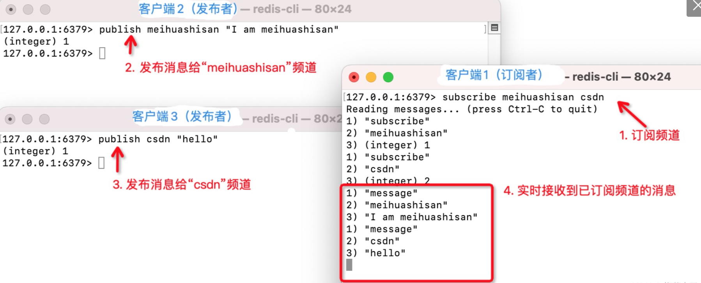

**<font style="color:rgb(85, 86, 102);background-color:rgb(238, 240, 244);">注意：</font>**<font style="color:rgb(85, 86, 102);background-color:rgb(238, 240, 244);">进入订阅状态的客户端，不能使用除了</font><code><font style="color:rgb(199, 37, 78);background-color:rgb(249, 242, 244);">subscribe</font></code><font style="color:rgb(85, 86, 102);background-color:rgb(238, 240, 244);">、</font><code><font style="color:rgb(199, 37, 78);background-color:rgb(249, 242, 244);">unsubscribe</font></code><font style="color:rgb(85, 86, 102);background-color:rgb(238, 240, 244);">、</font><code><font style="color:rgb(199, 37, 78);background-color:rgb(249, 242, 244);">psubscribe </font></code><font style="color:rgb(85, 86, 102);background-color:rgb(238, 240, 244);">和 </font><code><font style="color:rgb(199, 37, 78);background-color:rgb(249, 242, 244);">punsubscribe </font></code><font style="color:rgb(85, 86, 102);background-color:rgb(238, 240, 244);">这四个属于"发布/订阅"之外的命令，否则会报错！</font>

<font style="color:rgb(85, 86, 102);background-color:rgb(238, 240, 244);">——这里的客户端指的是 jedis、lettuce的客户端，</font>[<font style="color:rgb(85, 86, 102);background-color:rgb(238, 240, 244);">redis-cli</font>](https://so.csdn.net/so/search?q=redis-cli\&spm=1001.2101.3001.7020)<font style="color:rgb(85, 86, 102);background-color:rgb(238, 240, 244);">是无法退出订阅状态的！</font>

##### <font style="color:rgb(79, 79, 79);">★ 实现原理</font>

<font style="color:rgb(85, 86, 102);background-color:rgb(238, 240, 244);">底层通过字典实现。</font><code><font style="color:rgb(199, 37, 78);background-color:rgb(249, 242, 244);">pubsub_channels </font></code><font style="color:rgb(85, 86, 102);background-color:rgb(238, 240, 244);">是一个字典类型，保存订阅频道的信息：</font>**<font style="color:rgb(85, 86, 102);background-color:rgb(238, 240, 244);">字典的key为订阅的频道， 字典的value是一个链表， 链表中保存了所有订阅该频道的客户端</font>**

```plain
struct redisServer { 
  /* General */ 
  pid_t pid; 
 
  //省略百十行 
 
  // 将频道映射到已订阅客户端的列表(就是保存客户端和订阅的频道信息)
  dict *pubsub_channels; /* Map channels to list of subscribed clients */ 
}
 
```

<font style="color:rgb(77, 77, 77);">  
</font>**<font style="color:rgb(77, 77, 77);"> 实现图如下： </font>**

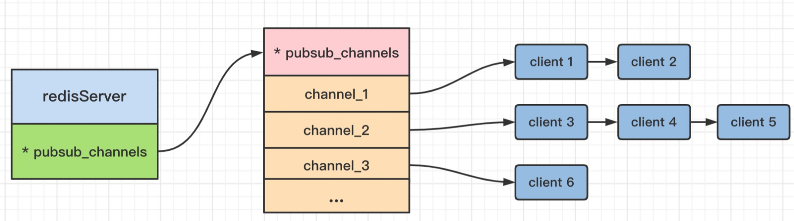

**<font style="color:rgb(77, 77, 77);">频道订阅</font>**<font style="color:rgb(77, 77, 77);">：订阅频道时先检查字段内部是否存在；不存在则为当前频道创建一个字典且创建一个链表存储客户端id；否则直接将客户端id插入到链表中。</font>

**<font style="color:rgb(77, 77, 77);">取消频道订阅</font>**<font style="color:rgb(77, 77, 77);">：取消时将客户端id从对应的链表中删除；如果删除之后链表已经是空链表了，则将会把这个频道从字典中删除。</font>

**<font style="color:rgb(77, 77, 77);">发布</font>**<font style="color:rgb(77, 77, 77);">：首先根据 channel 定位到字典的键， 然后将信息发送给字典值链表中的所有客户端</font>

##### <font style="color:rgb(79, 79, 79);">基于模式(pattern)的发布/订阅</font>

<font style="color:rgb(85, 86, 102);background-color:rgb(238, 240, 244);">如果有某个/某些模式和该频道匹配，所有订阅这个/这些频道的客户端也同样会收到信息。</font>

**<font style="color:rgb(77, 77, 77);">图解</font>**

<font style="color:rgb(77, 77, 77);">下图展示了一个带有频道和模式的例子， 其中</font><font style="color:rgb(77, 77, 77);"> </font>**<font style="color:rgb(77, 77, 77);">com.ahead.\*</font>**<font style="color:rgb(77, 77, 77);"> </font><font style="color:rgb(77, 77, 77);">频道匹配了 com.ahead.juc 频道和 com.ahead.thread 频道， 并且有不同的客户端分别订阅它们三个，如下图：</font>

<font style="color:rgb(85, 86, 102);background-color:rgb(238, 240, 244);">当有信息发送到com.ahead.thread 频道时， 信息除了发送给</font><font style="color:rgb(85, 86, 102);background-color:rgb(238, 240, 244);"> </font>**<font style="color:rgb(85, 86, 102);background-color:rgb(238, 240, 244);">client 4</font>\*\*\*\*<font style="color:rgb(85, 86, 102);background-color:rgb(238, 240, 244);"> </font>**<font style="color:rgb(85, 86, 102);background-color:rgb(238, 240, 244);">和</font><font style="color:rgb(85, 86, 102);background-color:rgb(238, 240, 244);"> </font>**<font style="color:rgb(85, 86, 102);background-color:rgb(238, 240, 244);">client 5</font>\*\*\*\*<font style="color:rgb(85, 86, 102);background-color:rgb(238, 240, 244);"> </font>**<font style="color:rgb(85, 86, 102);background-color:rgb(238, 240, 244);">之外， 还会发送给订阅 com.ahead.\*  频道模式的</font><font style="color:rgb(85, 86, 102);background-color:rgb(238, 240, 244);"> </font>**<font style="color:rgb(85, 86, 102);background-color:rgb(238, 240, 244);">client x</font>\*\*\*\*<font style="color:rgb(85, 86, 102);background-color:rgb(238, 240, 244);"> </font>**<font style="color:rgb(85, 86, 102);background-color:rgb(238, 240, 244);">和</font><font style="color:rgb(85, 86, 102);background-color:rgb(238, 240, 244);"> </font>**<font style="color:rgb(85, 86, 102);background-color:rgb(238, 240, 244);">client y</font>**

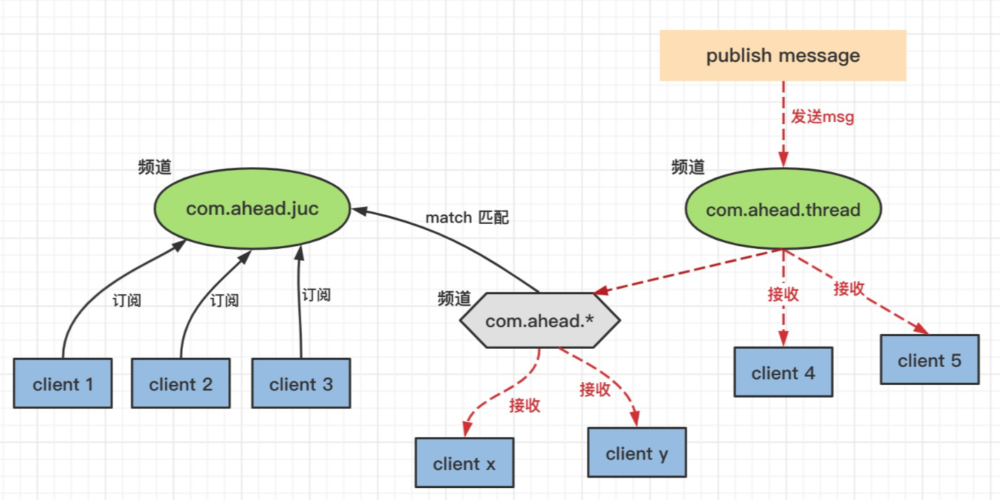

**<font style="color:rgb(77, 77, 77);">✦</font>****<font style="color:rgb(77, 77, 77);"> </font>****<font style="color:rgb(77, 77, 77);">解析：</font>**<font style="color:rgb(77, 77, 77);">反之也是，如果当有消息发送给 com.ahead.juc 频道，消息发送给订阅了 juc 频道的客户端之外，还会发送给订阅了 com.ahead.\*  频道的客户端： </font>**<font style="color:rgb(77, 77, 77);">client x 、client y</font>**

<font style="color:rgb(85, 86, 102);background-color:rgb(238, 240, 244);">通配符中?表示1个占位符，\*表示任意个占位符(包括0)，?\*表示1个以上占位符。</font>

* **<font style="color:rgba(0, 0, 0, 0.75);"> 订阅者订阅频道   </font>\*\*\*\*<font style="color:rgba(0, 0, 0, 0.75);">psubscribe</font>**<font style="color:rgba(0, 0, 0, 0.75);"> </font>**<font style="color:rgba(0, 0, 0, 0.75);">pattern  \[pattern ...]</font>**<font style="color:rgba(0, 0, 0, 0.75);"> </font>

```plain
--------------------------客户端1（订阅者） ：订阅频道 ---------------------
 
 
#  1. ------------订阅 “a?” "com.*" 2种模式频道--------------
127.0.0.1:6379> psubscribe a? com.*
# 进入订阅状态后处于阻塞，可以按Ctrl+C键退出订阅状态
Reading messages... (press Ctrl-C to quit) 
 
 
 
# 2. ---------------订阅成功-------------------
 
1) "psubscribe"  -- 返回值的类型：显示订阅成功
2) "a?"          -- 订阅的模式
3) (integer) 1   -- 目前已订阅的模式的数量
 
 
1) "psubscribe"
2) "com.*"
3) (integer) 2
 
 
 
# 3. ---------------接收消息 （已订阅 “a?” "com.*" 两种模式！）-----------------
 
# ---- 发布者第1条命令： publish ahead "hello"
结果：没有接收到消息，匹配失败，不满足 “a?” ，“？”表示一个占位符， a后面的head有4个占位符
 
 
# ---- 发布者第2条命令：  publish aa "hello" （满足 “a?”）
1) "pmessage" -- 返回值的类型：信息
2) "a?"       -- 信息匹配的模式：a?
3) "aa"       -- 信息本身的目标频道：aa
4) "hello"    -- 信息的内容："hello"
 
 
# ---- 发布者第3条命令：publish com.juc "hello2"（满足 “com.*”, *表示任意个占位符）
1) "pmessage" -- 返回值的类型：信息
2) "com.*"    -- 匹配模式：com.*
3) "com.juc"  -- 实际频道：com.juc
4) "hello2"   -- 信息："hello2"
 
# ---- 发布者第4条命令： publish com. "hello3"（满足 “com.*”, *表示任意个占位符）
1) "pmessage" -- 返回值的类型：信息
2) "com.*"    -- 匹配模式：com.*
3) "com."     -- 实际频道：com.
4) "hello3"   -- 信息："hello3"

 
```

* **<font style="color:rgba(0, 0, 0, 0.75);">发布者发布消息</font>**<font style="color:rgba(0, 0, 0, 0.75);">  </font><font style="color:rgba(0, 0, 0, 0.75);"> </font>**<font style="color:rgba(0, 0, 0, 0.75);">publish channel message</font>**

```plain
--------------------------客户端2（发布者）：发布消息给频道 -------------------
 
注意：订阅者已订阅 “a?” "com.*" 两种模式！
 
 
# 1. ahead 不符合“a?”模式，?表示1个占位符
127.0.0.1:6379> publish ahead "hello"  
(integer) 0    -- 匹配失败，0:无订阅者
 
 
# 2. aa 符合“a?”模式，?表示1个占位符
127.0.0.1:6379> publish aa "hello"      
(integer) 1
 
# 3. 符合“com.*”模式，*表示任意个占位符
127.0.0.1:6379> publish com.juc "hello2" 
(integer) 1
 
# 4. 符合“com.*”模式，*表示任意个占位符
127.0.0.1:6379> publish com. "hello3" 
(integer) 1

 
```

**<font style="color:rgb(77, 77, 77);">命令操作图解如下：</font>**

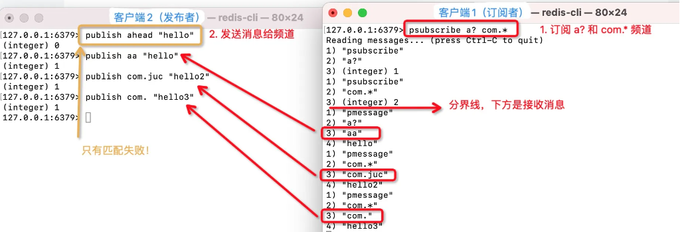

##### <font style="color:rgb(79, 79, 79);">★ 实现原理</font>

<font style="color:rgb(85, 86, 102);background-color:rgb(238, 240, 244);">底层是pubsubPattern节点的链表</font>

```plain
struct redisServer {
    //...
    list *pubsub_patterns; 
    // ...
}
 
// 1303行订阅模式列表结构：
typedef struct pubsubPattern {
    client *client;  -- 订阅模式客户端
    robj *pattern;   -- 被订阅的模式
} pubsubPattern;

 
```

<font style="color:rgb(77, 77, 77);">实现图如下：</font>

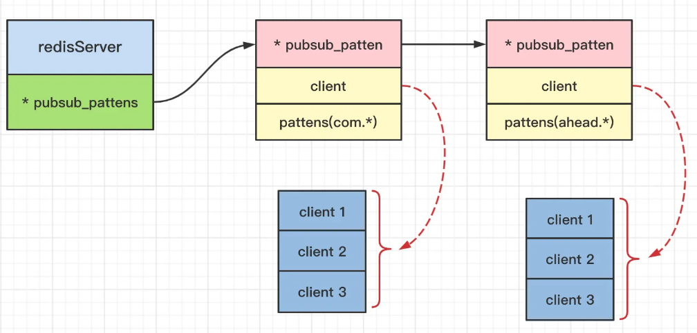

**<font style="color:rgb(77, 77, 77);">模式订阅</font>**<font style="color:rgb(77, 77, 77);">：新增一个</font><code><font style="color:rgb(199, 37, 78);background-color:rgb(249, 242, 244);">pubsub_pattern</font></code><font style="color:rgb(77, 77, 77);">数据结构添加到链表的最后尾部，同时保存</font>**<font style="color:rgb(77, 77, 77);">客户端ID</font>**<font style="color:rgb(77, 77, 77);">。</font>

**<font style="color:rgb(77, 77, 77);">取消模式订阅</font>**<font style="color:rgb(77, 77, 77);">：从当前的链表</font><code><font style="color:rgb(199, 37, 78);background-color:rgb(249, 242, 244);">pubsub_pattern</font></code><font style="color:rgb(77, 77, 77);">结构中删除需要取消的pubsubPattern结构。</font>

#### **<font style="color:rgb(79, 79, 79);">使用小结</font>**

<font style="color:rgb(77, 77, 77);">订阅者(listener)负责订阅频道(channel)；发送者(publisher)负责向频道发送二进制的字符串消息，然后频道收到消息时，推送给订阅者。</font>

**<font style="color:rgb(77, 77, 77);">✦ 使用场景</font>**

* <font style="color:rgba(0, 0, 0, 0.75);">电商中，用户下单成功之后向指定频道发送消息，下游业务订阅支付结果这个频道处理自己相关业务逻辑</font>
* <font style="color:rgba(0, 0, 0, 0.75);">粉丝关注功能</font>
* <font style="color:rgba(0, 0, 0, 0.75);">文章推送</font>

**<font style="color:rgb(77, 77, 77);">✦ 使用注意</font>**

* <font style="color:rgba(0, 0, 0, 0.75);">客户端需要及时消费和处理消息。</font><font style="color:rgb(77, 77, 77);">\
  </font><font style="color:rgb(77, 77, 77);">	客户端订阅了channel之后，如果接收消息不及时，可能导致DCS实例消息堆积，当达到消息堆积阈值（默认值为32MB），或者达到某种程度（默认8MB）一段时间（默认为1分钟）后，服务器端会自动断开该客户端连接，避免导致内部内存耗尽。</font>
* <font style="color:rgba(0, 0, 0, 0.75);">客户端需要支持重连。</font>

<font style="color:rgb(77, 77, 77);">当连接断开之后，客户端需要使用subscribe或者psubscribe重新进行订阅，否则无法继续接收消息。</font>

* <font style="color:rgba(0, 0, 0, 0.75);">不建议用于消息可靠性要求高的场景中。</font>

<font style="color:rgb(77, 77, 77);">Redis的pubsub不是一种可靠的消息系统。当出现客户端连接退出，或者极端情况下服务端发生主备切换时，未消费的消息会被丢弃。</font>


> 更新: 2024-07-24 20:48:33  
> 原文: <https://www.yuque.com/aaron-wecc3/dhluml/rhz4ttrei2ik3gw1>