# Spring Boot接入OpenTelemetry可观测零侵入

### 理论基础：

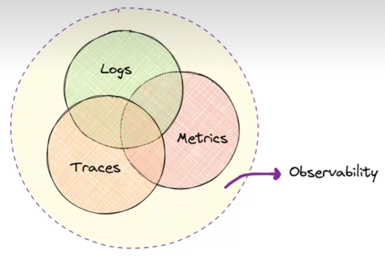

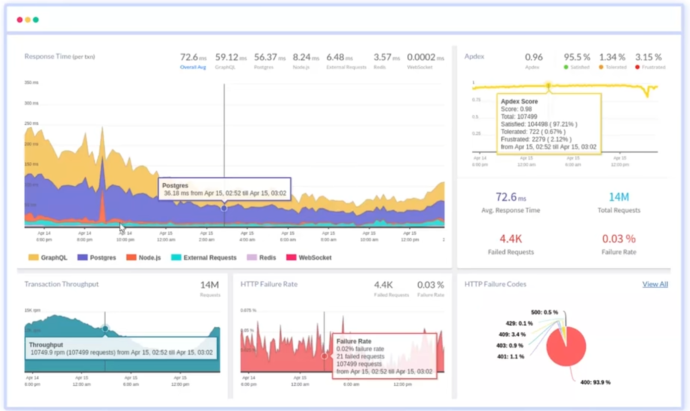

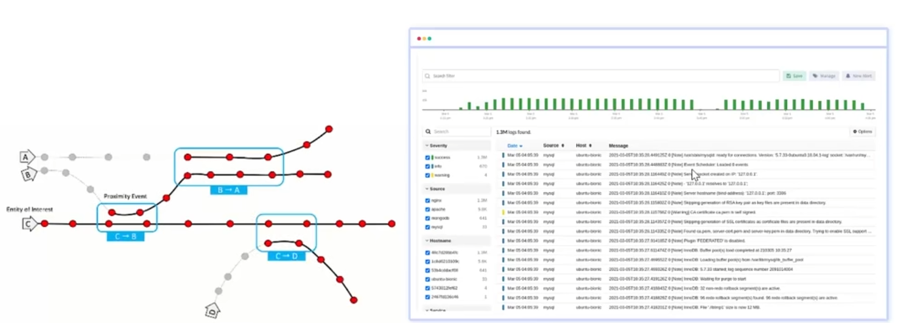

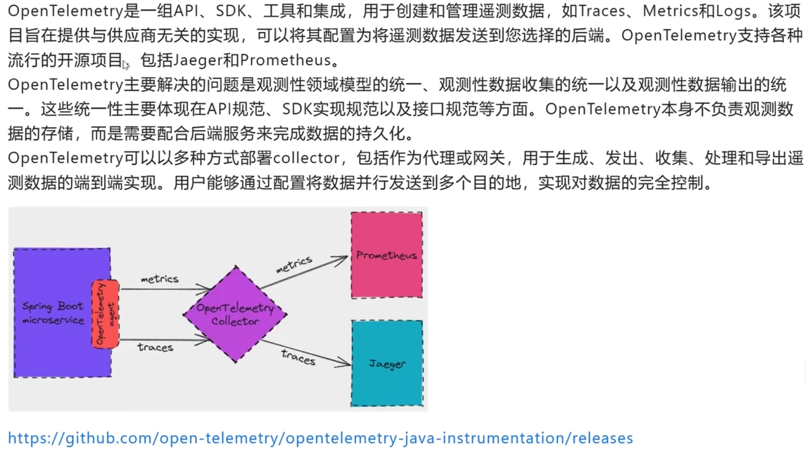

展示：

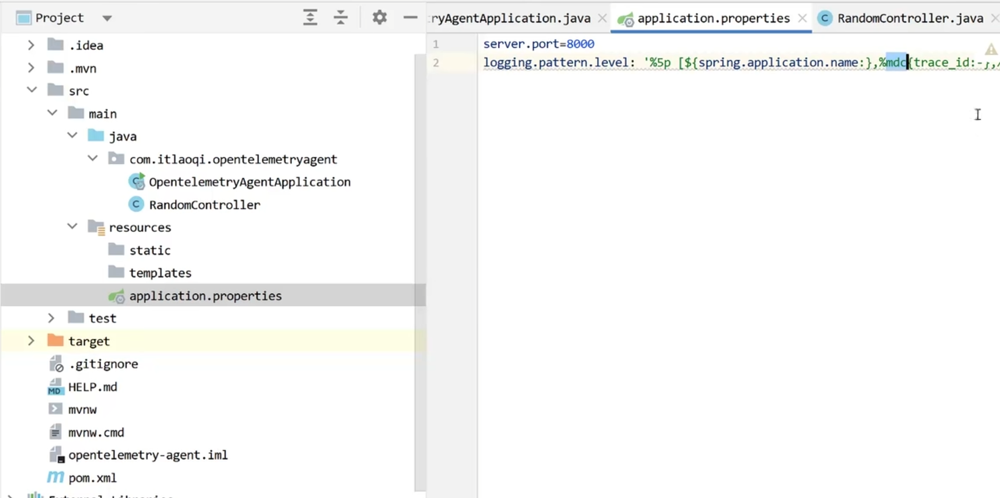

启动类：

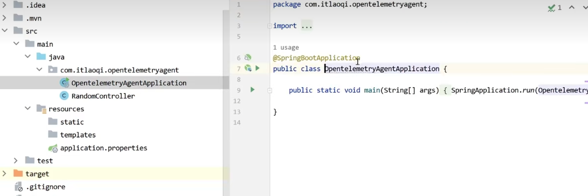

接口：

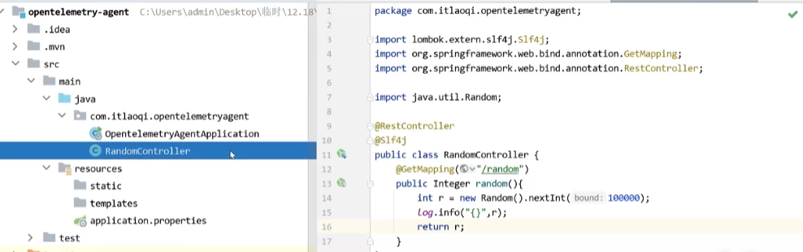

配置启动jar

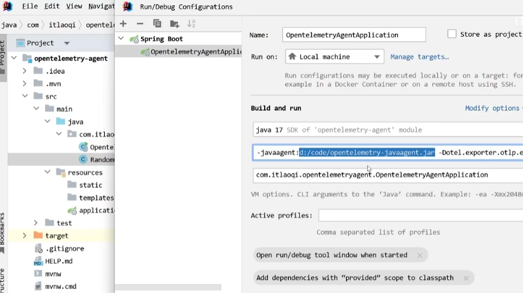

运行提示信息：

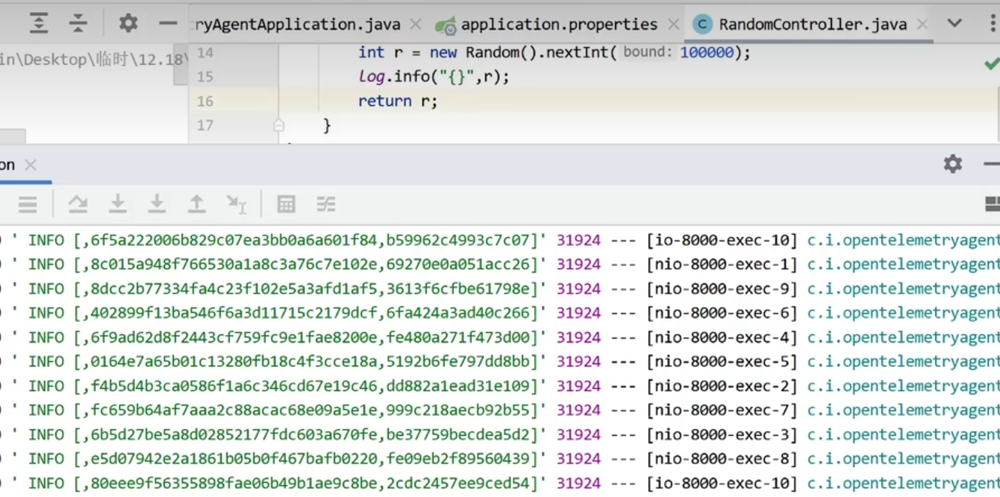

Jagger链路效果：

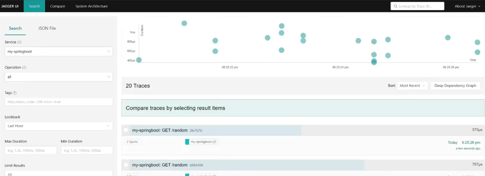

点击计入

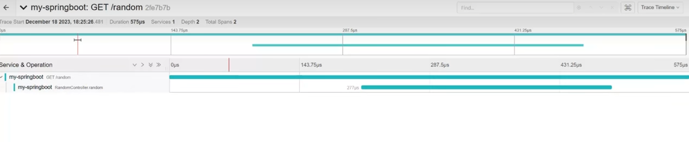

搜索traceid进入

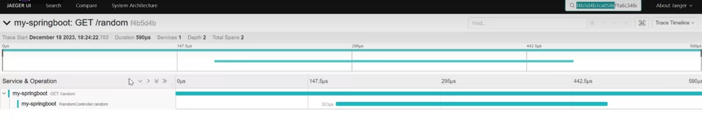

prometheus效果

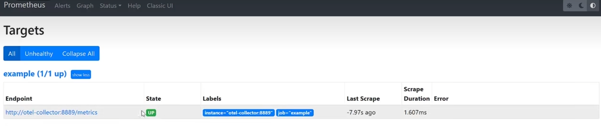

图表：

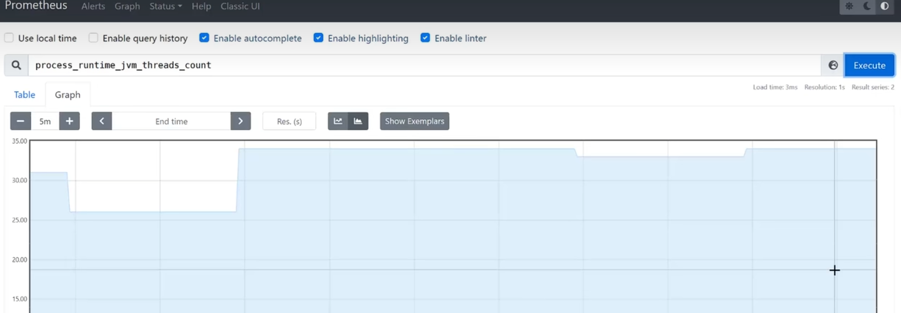

### <font style="color:rgb(0, 0, 0);">详细代码</font>

<font style="color:rgb(51, 51, 51);">我将使用相同的基准应用程序：一个用 </font><font style="color:rgb(0, 82, 217);">Kotlin</font><font style="color:rgb(51, 51, 51);"> 编写的简单 Spring Boot 应用程序。它提供一个端点。</font>

* <font style="color:rgb(51, 51, 51);">端点背后的函数名为 </font><code><font style="color:rgb(10, 191, 91);background-color:rgb(243, 245, 249);">entry()</font></code>
* <font style="color:rgb(51, 51, 51);">它调用另一个名为 </font><code><font style="color:rgb(10, 191, 91);background-color:rgb(243, 245, 249);">intermediate()</font></code><font style="color:rgb(51, 51, 51);"> 的函数</font>
* <font style="color:rgb(51, 51, 51);">后者使用 </font><code><font style="color:rgb(10, 191, 91);background-color:rgb(243, 245, 249);">WebClient</font></code><font style="color:rgb(51, 51, 51);"> 实例，替换</font><code><font style="color:rgb(10, 191, 91);background-color:rgb(243, 245, 249);">RestTemplate</font></code><font style="color:rgb(51, 51, 51);">，来调用上面的端点</font>
* <font style="color:rgb(51, 51, 51);">为了避免无限循环，我传递了一个自定义请求头：如果 </font><code><font style="color:rgb(10, 191, 91);background-color:rgb(243, 245, 249);">entry()</font></code><font style="color:rgb(51, 51, 51);">函数找到它，它转化为以下代码:</font>

**<font style="color:rgb(0, 0, 0);"></font>**

```javascript
@SpringBootApplication
  class Agent1xApplication

  @RestController
    class MicrometerController {
      private val logger = LoggerFactory.getLogger(MicrometerController::class.java)

      @GetMapping("/{message}")
      fun entry(@PathVariable message: String, @RequestHeader("X-done") done: String?) {
        logger.info("entry: $message")
        if (done == null) intermediate()
      }

      fun intermediate() {
        logger.info("intermediate")
        RestClient.builder()
          .baseUrl("http://localhost:8080/done")
          .build()
          .get()
          .header("X-done", "true")
          .retrieve()
          .toBodilessEntity()
      }
    }
```

<font style="color:rgb(51, 51, 51);">对于每种设置，我将检查两个阶段：启用 OpenTelemetry 的主要阶段，以及创建额外内部跨度的自定义阶段。</font>

### <font style="color:rgb(0, 0, 0);">Micrometer Tracing</font>

<font style="color:rgb(51, 51, 51);">Micrometer Tracing 源于 </font>[<font style="color:rgb(51, 51, 51);">Micrometer</font>](https://cloud.tencent.com/developer/tools/blog-entry?target=https%3A%2F%2Fmicrometer.io%2F\&source=article\&objectId=2442635)<font style="color:rgb(51, 51, 51);">，一个“供应商中立的应用程序可观测性门面”。</font>

<font style="color:rgb(119, 119, 119);">Micrometer Tracing 为最流行的跟踪库提供了一个简单的门面，让您可以在没有供应商锁定的情况下对基于 JVM 的应用程序代码进行检测。它旨在为您的跟踪收集活动增加很少或没有开销，同时最大限度地提高跟踪工作的可移植性。 — </font>[<font style="color:rgb(119, 119, 119);">Micrometer Tracing site</font>](https://cloud.tencent.com/developer/tools/blog-entry?target=https%3A%2F%2Fdocs.micrometer.io%2Ftracing%2Freference%2Findex.html\&source=article\&objectId=2442635)

<font style="color:rgb(51, 51, 51);">要开始使用 Micrometer Tracing，需要添加一些依赖项：</font>

* <font style="color:rgb(51, 51, 51);">Spring Boot Actuator，</font><code><font style="color:rgb(10, 191, 91);background-color:rgb(243, 245, 249);">org.springframework.boot:spring-boot-starter-actuator</font></code>
* <font style="color:rgb(51, 51, 51);">Micrometer Tracing 本身，</font><code><font style="color:rgb(10, 191, 91);background-color:rgb(243, 245, 249);">io.micrometer:micrometer-tracing</font></code>
* <font style="color:rgb(51, 51, 51);">到目标跟踪后端 </font><font style="color:rgb(0, 82, 217);">API</font><font style="color:rgb(51, 51, 51);"> 的“桥梁”。在我的例子中，它是 OpenTelemetry，因此 </font><code><font style="color:rgb(10, 191, 91);background-color:rgb(243, 245, 249);">io.micrometer:micrometer-tracing-bridge-otel</font></code>
* <font style="color:rgb(51, 51, 51);">到后端的具体导出器，</font><code><font style="color:rgb(10, 191, 91);background-color:rgb(243, 245, 249);">io.opentelemetry:opentelemetry-exporter-otlp</font></code>

<font style="color:rgb(51, 51, 51);">我们不需要 BOM，因为版本已经在 Spring Boot 父级中定义。</font>

<font style="color:rgb(51, 51, 51);">但是，我们需要两个运行时配置参数：跟踪应该发送到哪里，以及组件的名称是什么。它们由 </font><code><font style="color:rgb(10, 191, 91);background-color:rgb(243, 245, 249);">MANAGEMENT_OTLP_TRACING_ENDPOINT</font></code><font style="color:rgb(51, 51, 51);"> 和 </font><code><font style="color:rgb(10, 191, 91);background-color:rgb(243, 245, 249);">SPRING_APPLICATION_NAME</font></code><font style="color:rgb(51, 51, 51);"> 变量控制。</font>

**<font style="color:rgb(0, 0, 0);"></font>**

```javascript
services:
  jaeger:
    image: jaegertracing/all-in-one:1.55
    environment:
      - COLLECTOR_OTLP_ENABLED=true
    ports:
      - "16686:16686"
micrometer-tracing:
  build:
    dockerfile: Dockerfile-micrometer
  environment:
    MANAGEMENT_OTLP_TRACING_ENDPOINT: http://jaeger:4318/v1/traces
    SPRING_APPLICATION_NAME: micrometer-tracing
```

1. <font style="color:rgb(51, 51, 51);">启用 Jaeger 的 OpenTelemetry 收集器</font>
2. <font style="color:rgb(51, 51, 51);">Jaeger OpenTelemetry gRPC 端点的完整 URL</font>
3. <font style="color:rgb(51, 51, 51);">设置 OpenTelemetry 的服务名称</font>

<font style="color:rgb(51, 51, 51);">以下是结果：</font>

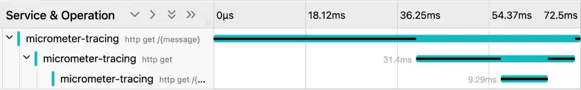

<font style="color:rgb(51, 51, 51);">在没有任何自定义的情况下，Micrometer 在接收和发送 HTTP 请求时会创建跨度。</font>

<font style="color:rgb(51, 51, 51);">框架需要将魔法注入到 </font><code><font style="color:rgb(10, 191, 91);background-color:rgb(243, 245, 249);">RestClient</font></code><font style="color:rgb(51, 51, 51);"> 中以进行发送。我们必须让前者实例化后者才能做到这一点：</font>

**<font style="color:rgb(0, 0, 0);"></font>**

```javascript
@SpringBootApplication
class MicrometerTracingApplication {
    @Bean
    fun restClient(builder: RestClient.Builder) =
        builder.baseUrl("http://localhost:8080/done").build()
}
```

<font style="color:rgb(51, 51, 51);">我们可以通过多种方式创建手动跨度，其中一种是通过 OpenTelemetry API 本身。但是，设置需要大量的样板代码。最直接的方法是 Micrometer 的 </font>[<font style="color:rgb(51, 51, 51);">Observation API</font>](https://cloud.tencent.com/developer/tools/blog-entry?target=https%3A%2F%2Fdocs.micrometer.io%2Fmicrometer%2Freference%2Fobservation.html\&source=article\&objectId=2442635)<font style="color:rgb(51, 51, 51);">。它的主要好处是使用单个 API 来管理 </font>*<font style="color:rgb(51, 51, 51);">指标</font>*<font style="color:rgb(51, 51, 51);"> 和 </font>*<font style="color:rgb(51, 51, 51);">跟踪</font>*<font style="color:rgb(51, 51, 51);">。</font>

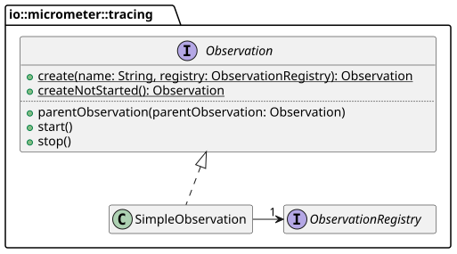

<font style="color:rgb(51, 51, 51);">以下是更新后的代码：</font>

```javascript
class MicrometerController(
    private val restClient: RestClient,
    private val registry: ObservationRegistry
) {
    @GetMapping("/{message}")
    fun entry(@PathVariable message: String, @RequestHeader("X-done") done: String?) {
        logger.info("entry: $message")
        val observation = Observation.start("entry", registry)
        if (done == null) intermediate(observation)
        observation.stop()
    }

    fun intermediate(parent: Observation) {
        logger.info("intermediate")
        val observation = Observation.createNotStarted("intermediate", registry)
            .parentObservation(parent)
            .start()
        restClient.get()
            .header("X-done", "true")
            .retrieve()
            .toBodilessEntity()
        observation.stop()
    }
}
```

<font style="color:rgb(51, 51, 51);">添加的观察调用反映在生成的跟踪中：</font>

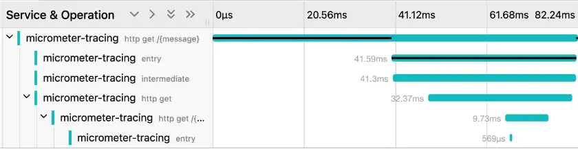

### <font style="color:rgb(0, 0, 0);">OpenTelemetry 代理 v1</font>

<font style="color:rgb(51, 51, 51);">Micrometer Tracing 的替代方案是通用的 </font>[<font style="color:rgb(51, 51, 51);">OpenTelemetry Java Agent</font>](https://cloud.tencent.com/developer/tools/blog-entry?target=https%3A%2F%2Fgithub.com%2Fopen-telemetry%2Fopentelemetry-java-instrumentation\&source=article\&objectId=2442635)<font style="color:rgb(51, 51, 51);">。 其主要优势在于它既不影响代码也不影响开发人员； 该代理纯粹是运行时范围内的关注点。</font>

```javascript
java -javaagent:opentelemetry-javaagent.jar agent-one-1.0-SNAPSHOT.jar
```

<font style="color:rgb(51, 51, 51);">该代理遵守 OpenTelemetry 的环境变量配置：</font>

```javascript
services:
  agent-1x:
    build:
      dockerfile: Dockerfile-agent1
    environment:
      OTEL_EXPORTER_OTLP_ENDPOINT: http://jaeger:4317                   
      OTEL_RESOURCE_ATTRIBUTES: service.name=agent-1x                   
      OTEL_METRICS_EXPORTER: none                                       
      OTEL_LOGS_EXPORTER: none                                          
    ports:
      - "8081:8080"
```

1. <font style="color:rgb(51, 51, 51);">设置协议、</font>[<font style="color:rgb(51, 51, 51);">域名</font>](https://cloud.tencent.com/act/pro/domain-sales?from_column=20065\&from=20065)<font style="color:rgb(51, 51, 51);">和端口。库附加 </font><code><font style="color:rgb(10, 191, 91);background-color:rgb(243, 245, 249);">/v1/traces</font></code>
2. <font style="color:rgb(51, 51, 51);">设置 OpenTelemetry 的服务名称</font>
3. <font style="color:rgb(51, 51, 51);">不导出指标或日志</font>

<font style="color:rgb(51, 51, 51);">无需更多配置，我们就可以获得以下跟踪：</font>

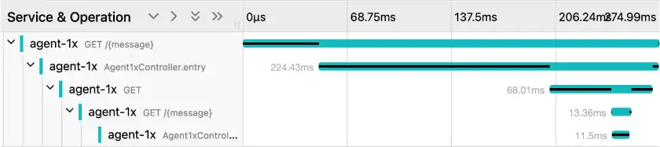

<font style="color:rgb(51, 51, 51);">该代理会自动跟踪接收和发送的请求，</font>**<font style="color:rgb(51, 51, 51);">以及使用 Spring 相关注释标记的函数</font>**<font style="color:rgb(51, 51, 51);">。跟踪根据调用堆栈正确地嵌套在彼此内部。要跟踪其他函数，我们需要在代码库中添加一个依赖项，</font><code><font style="color:rgb(10, 191, 91);background-color:rgb(243, 245, 249);">io.opentelemetry.instrumentation:opentelemetry-instrumentation-annotations</font></code><font style="color:rgb(51, 51, 51);"> 。我们现在可以使用 </font><code><font style="color:rgb(10, 191, 91);background-color:rgb(243, 245, 249);">@WithSpan</font></code><font style="color:rgb(51, 51, 51);"> 注释来注释以前未跟踪的函数。</font>

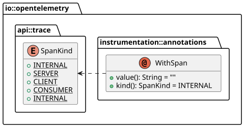

<code><font style="color:rgb(10, 191, 91);background-color:rgb(243, 245, 249);">value()</font></code><font style="color:rgb(51, 51, 51);"> 部分控制跟踪的标签，而 </font><code><font style="color:rgb(10, 191, 91);background-color:rgb(243, 245, 249);">kind</font></code><font style="color:rgb(51, 51, 51);"> 则转换为 </font><code><font style="color:rgb(10, 191, 91);background-color:rgb(243, 245, 249);">span.kind</font></code><font style="color:rgb(51, 51, 51);"> 属性。如果将值设置为空字符串（默认值），则它会输出函数的名称。就我而言，默认值就足够了。</font>

**<font style="color:rgb(0, 0, 0);"></font>**

```javascript
@WithSpan
fun intermediate() {
    logger.info("intermediate")
    RestClient.builder()
        .baseUrl("http://localhost:8080/done")
        .build()
        .get()
        .header("X-done", "true")
        .retrieve()
        .toBodilessEntity()
}
```

<font style="color:rgb(51, 51, 51);">它会生成预期的新的 </font><code><font style="color:rgb(10, 191, 91);background-color:rgb(243, 245, 249);">intermediate()</font></code><font style="color:rgb(51, 51, 51);"> 跟踪：</font>

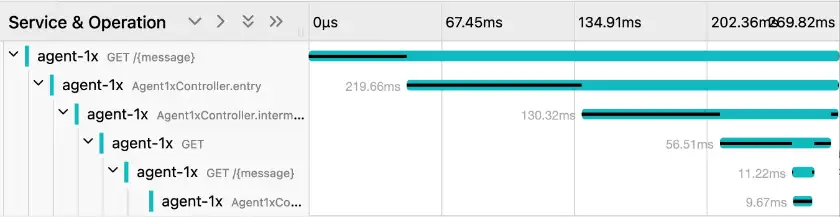

### <font style="color:rgb(0, 0, 0);">OpenTelemetry Agent v2</font>

<font style="color:rgb(51, 51, 51);">OpenTelemetry 在今年 1 月发布了代理的新主要版本。我用它更新了我的演示；现在只有在应用程序接收和发送请求时才会创建跟踪。</font>

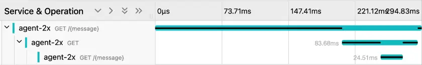

<font style="color:rgb(51, 51, 51);">与之前的版本一样，我们可以使用 </font><code><font style="color:rgb(10, 191, 91);background-color:rgb(243, 245, 249);">@WithSpan</font></code><font style="color:rgb(51, 51, 51);"> 注释添加跟踪。唯一的区别是，我们还必须注释 </font><code><font style="color:rgb(10, 191, 91);background-color:rgb(243, 245, 249);">entry()</font></code><font style="color:rgb(51, 51, 51);">函数。它默认情况下不会被跟踪。</font>

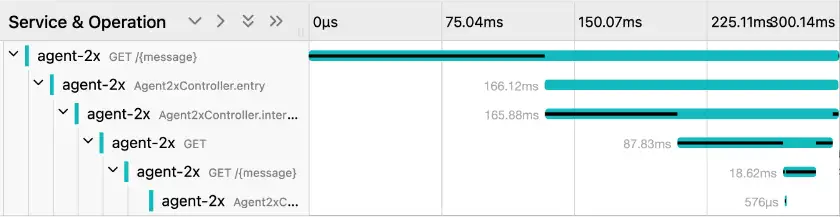


> 更新: 2025-04-20 22:39:02  
> 原文: <https://www.yuque.com/aaron-wecc3/dhluml/fl79xbbdtq1m545g>