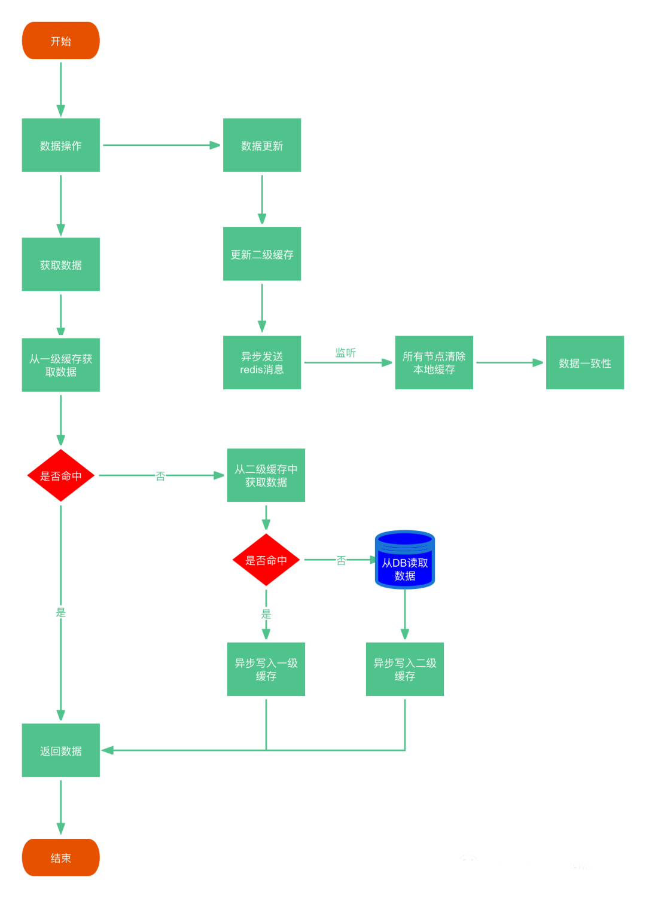
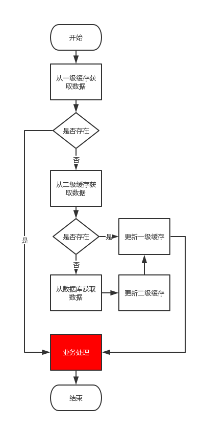
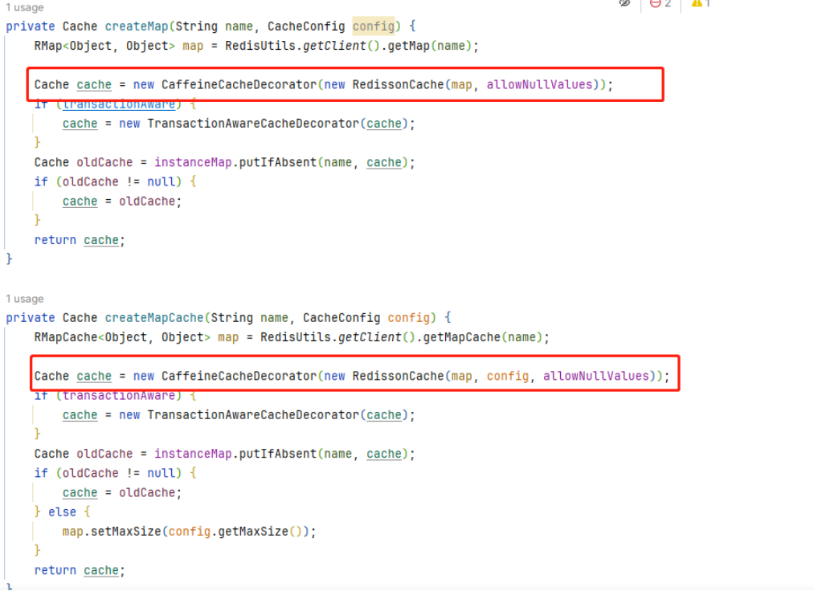
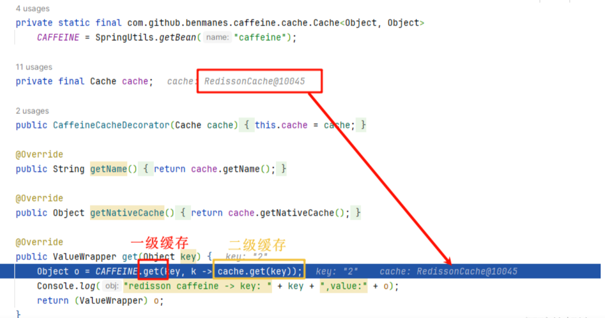
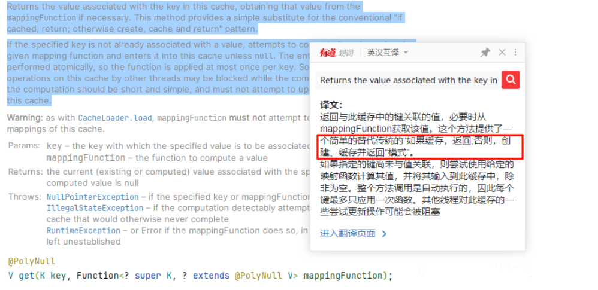

# SpringBoot整合Caffeine、Redisson多级缓存架构实战

# SpringBoot ,Caffeine,Redisson两级缓存


## 问题说明


在高性能的服务架构设计中，缓存是一个不可或缺的环节。在实际的项目中，我们通常会将一些热点数据存储到Redis或MemCache这类缓存中间件中，只有当缓存的访问没有命中时再查询数据库。在提升访问速度的同时，也能降低数据库的压力。


如果只用一种缓存，要么会有较大的网络消耗（如Redis），要么就是内存占用太大（如Caffeine这种应用内存缓存）。在很多场景下，可以结合起来实现一、二级缓存的方式，能够很大程度提高应用的处理效率。  
随着不断的发展，这一架构也产生了改进，在一些场景下可能单纯使用Redis类的远程缓存已经不够了，还需要进一步配合本地缓存使用，例如Guava cache或Caffeine，从而再次提升程序的响应速度与服务性能。于是，就产生了使用本地缓存作为一级缓存，再加上远程缓存作为二级缓存的两级缓存架构。  



## 简介


## 缓存、两级缓存


一级缓存：  
Caffeine是一个一个高性能的 Java 缓存库；使用 Window TinyLfu 回收策略，提供了一个近乎最佳的命中率。优点数据就在应用内存所以速度快。缺点受应用内存的限制，所以容量有限；没有持久化，重启服务后缓存数据会丢失；在分布式环境下缓存数据数据无法同步；


二级缓存：  
redis是一高性能、高可用的key-value数据库，支持多种数据类型，支持集群，和应用服务器分开部署易于横向扩展。优点支持多种数据类型，扩容方便；有持久化，重启应用服务器缓存数据不会丢失；他是一个集中式缓存，不存在在应用服务器之间同步数据的问题。缺点每次都需要访问redis存在IO浪费的情况。


当使用缓存的时候，一般是如下的流程：  



从流程图中可以看出，为了使用缓存，在原有业务处理的基础上，增加了很多对于缓存的操作，如果将这些耦合到业务代码当中，开发起来就有很多重复性的工作，并且不太利于根据代码去理解业务。


## Caffeine


Caffeine是一个基于Google开源的Guava设计理念的一个高性能内存缓存，使用java8开发，spring boot引入Caffeine后已经逐步废弃Guava的整合了。Caffeine源码及介绍地址：caffeine


caffeine提供了多种缓存填充策略、值回收策略，同时也包含了缓存命中次数等统计数据，对缓存的优化能够提供很大帮助


caffeine的介绍可以参考：详细介绍高性能Java缓存库Caffeine_java_脚本之家


这里简单说下caffeine基于时间的回收策略有以下几种：


expireAfterAccess：访问后到期，从上次读或写发生后的过期时间  
expireAfterWrite：写入后到期，从上次写入发生之后的过期时间  
自定义策略：到期时间由实现Expiry接口后单独计算


## 准备


集成Redission：SpringBoot 整合Redisson重写cacheName支持多参数


```java
<!--caffeine-->
<dependency>
    <groupId>com.github.ben-manes.caffeine</groupId>
    <artifactId>caffeine</artifactId>
</dependency>
```


## 配置文件


增加本地缓存是为了解决高并发下频繁查询Redis的问题，配置了expireAfterWrite最后一次写入或访问后经过固定时间过期为30秒，例如一次访问一个页面一直刷新，在30秒内无论怎么刷新都会走本地缓存，而且就算在29秒重新获取了缓存，也会重新计算30秒


@EnableCaching开启缓存功能，也可以加在启动类上


```java

package com.tuling.redisson.config;

import com.tuling.redisson.manager.PlusSpringCacheManager;
import com.github.benmanes.caffeine.cache.Cache;
import com.github.benmanes.caffeine.cache.Caffeine;
import lombok.extern.slf4j.Slf4j;
import org.springframework.boot.autoconfigure.AutoConfiguration;
import org.springframework.cache.CacheManager;
import org.springframework.cache.annotation.EnableCaching;
import org.springframework.context.annotation.Bean;
import org.springframework.context.annotation.Configuration;

import java.util.concurrent.TimeUnit;

/**
 * 缓存配置
 *
 * @author TianMing
 */
@Configuration
@EnableCaching
public class CacheConfig {

    /**
     * caffeine 本地缓存处理器
     */
    @Bean
    public Cache<Object, Object> caffeine() {
        return Caffeine.newBuilder()
            // 设置最后一次写入或访问后经过固定时间过期
            .expireAfterWrite(30, TimeUnit.SECONDS)
            // 初始的缓存空间大小
            .initialCapacity(100)
            // 缓存的最大条数
            .maximumSize(1000)
            .build();
    }

    /**
     * 自定义缓存管理器 整合spring-cache
     */
    @Bean
    public CacheManager cacheManager() {
        return new PlusSpringCacheManager();
    }

}
```


## 装饰器


put方法是cache使用的也就是Redission ，会自动加上cacheNames  
而caffeine不使用cacheNames ，get方法的key是哪个就会缓存哪个key  
所以为了解决key相同，cacheNames 不同的问题增加了getUniqueKey方法 getName( ) = cacheNames


一个CacheNams对应一个Cache对象


```java
package org.dromara.common.redis.manager;

import cn.hutool.core.lang.Console;
import org.dromara.common.core.utils.SpringUtils;
import org.springframework.cache.Cache;

import java.util.concurrent.Callable;

/**
 * Cache 装饰器模式(用于扩展 Caffeine 一级缓存)
 *
 * @author TianMing
 */
public class CaffeineCacheDecorator implements Cache {

    private static final com.github.benmanes.caffeine.cache.Cache<Object, Object>
            CAFFEINE = SpringUtils.getBean("caffeine");

    private final Cache cache;

    public CaffeineCacheDecorator(Cache cache) {
        this.cache = cache;
    }

    @Override
    public String getName() {
        return cache.getName();
    }

    @Override
    public Object getNativeCache() {
        return cache.getNativeCache();
    }

    public String getUniqueKey(Object key) {
        return cache.getName() + ":" + key;
    }

    @Override
    public ValueWrapper get(Object key) {
        Object o = CAFFEINE.get(getUniqueKey(key), k -> cache.get(key));
        Console.log("redisson caffeine -> key: " + getUniqueKey(key) + ",value:" + o);
        return (ValueWrapper) o;
    }

    @SuppressWarnings("unchecked")
    public <T> T get(Object key, Class<T> type) {
        Object o = CAFFEINE.get(getUniqueKey(key), k -> cache.get(key, type));
        Console.log("redisson caffeine -> key: " + getUniqueKey(key) + ",value:" + o);
        return (T) o;
    }

    @Override
    public void put(Object key, Object value) {
        cache.put(key, value);
    }

    public ValueWrapper putIfAbsent(Object key, Object value) {
        return cache.putIfAbsent(key, value);
    }

    @Override
    public void evict(Object key) {
        evictIfPresent(key);
    }

    public boolean evictIfPresent(Object key) {
        boolean b = cache.evictIfPresent(key);
        if (b) {
            CAFFEINE.invalidate(getUniqueKey(key));
        }
        return b;
    }

    @Override
    public void clear() {
        cache.clear();
    }

    public boolean invalidate() {
        return cache.invalidate();
    }

    @SuppressWarnings("unchecked")
    @Override
    public <T> T get(Object key, Callable<T> valueLoader) {
        Object o = CAFFEINE.get(getUniqueKey(key), k -> cache.get(key, valueLoader));
        Console.log("redisson caffeine -> key: " + getUniqueKey(key) + ",value:" + o);
        return (T) o;
    }

}
```


修改自定义PlusSpringCacheManager，注入装饰器  



## 使用


```java
@Cacheable(cacheNames = "demo:cache#60s#10m#20", key = "#key", condition = "#key != null")
@GetMapping("/test1")
public R<String> test1(String key, String value) {
    System.out.println("test1-->调用方法体");
    return R.ok("操作成功", value);
}
```


因为@Cacheable注解上来就会调用get方法，所以可以触发本地缓存，@CachePut注解则不行  



查看源码可知，如果一级没有获取到，则获取二级





## 缓存工具类


```java
package com.tuling.redisson.utils;

import lombok.AccessLevel;
import lombok.NoArgsConstructor;
import org.redisson.api.RMap;
import org.springframework.cache.Cache;
import org.springframework.cache.CacheManager;

import java.util.Set;

/**
 * 缓存操作工具类 {@link }
 *
 * @author TianMing
 * @date 2022/8/13
 */
@NoArgsConstructor(access = AccessLevel.PRIVATE)
@SuppressWarnings(value = {"unchecked"})
public class CacheUtils {

    private static final CacheManager CACHE_MANAGER = SpringUtils.getBean(CacheManager.class);

    /**
     * 获取缓存组内所有的KEY
     *
     * @param cacheNames 缓存组名称
     */
    public static Set<Object> keys(String cacheNames) {
        RMap<Object, Object> rmap = (RMap<Object, Object>) CACHE_MANAGER.getCache(cacheNames).getNativeCache();
        return rmap.keySet();
    }

    /**
     * 获取缓存值
     *
     * @param cacheNames 缓存组名称
     * @param key        缓存key
     */
    public static <T> T get(String cacheNames, Object key) {
        Cache.ValueWrapper wrapper = CACHE_MANAGER.getCache(cacheNames).get(key);
        return wrapper != null ? (T) wrapper.get() : null;
    }

    /**
     * 保存缓存值
     *
     * @param cacheNames 缓存组名称
     * @param key        缓存key
     * @param value      缓存值
     */
    public static void put(String cacheNames, Object key, Object value) {
        CACHE_MANAGER.getCache(cacheNames).put(key, value);
    }

    /**
     * 删除缓存值
     *
     * @param cacheNames 缓存组名称
     * @param key        缓存key
     */
    public static void evict(String cacheNames, Object key) {
        CACHE_MANAGER.getCache(cacheNames).evict(key);
    }

    /**
     * 清空缓存值
     *
     * @param cacheNames 缓存组名称
     */
    public static void clear(String cacheNames) {
        CACHE_MANAGER.getCache(cacheNames).clear();
    }
```


> 更新: 2024-04-25 13:35:21  
> 原文: <https://www.yuque.com/aaron-wecc3/dhluml/eawhs35eqsf0aekg>