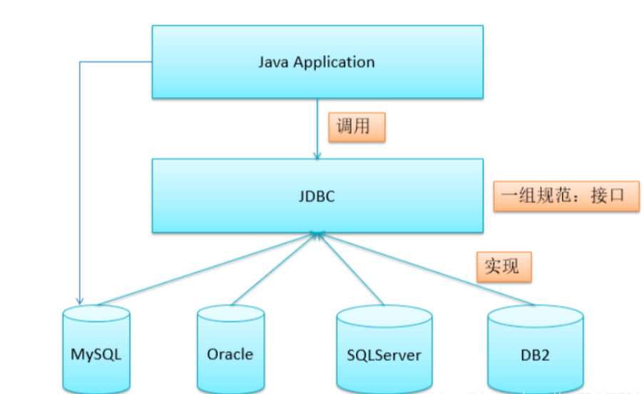
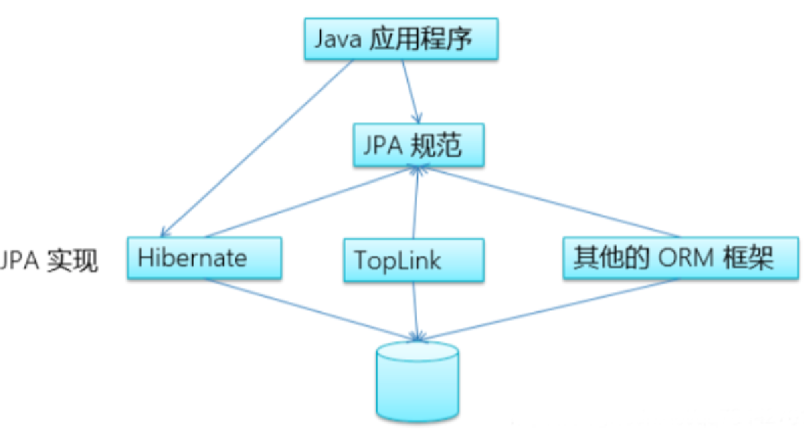
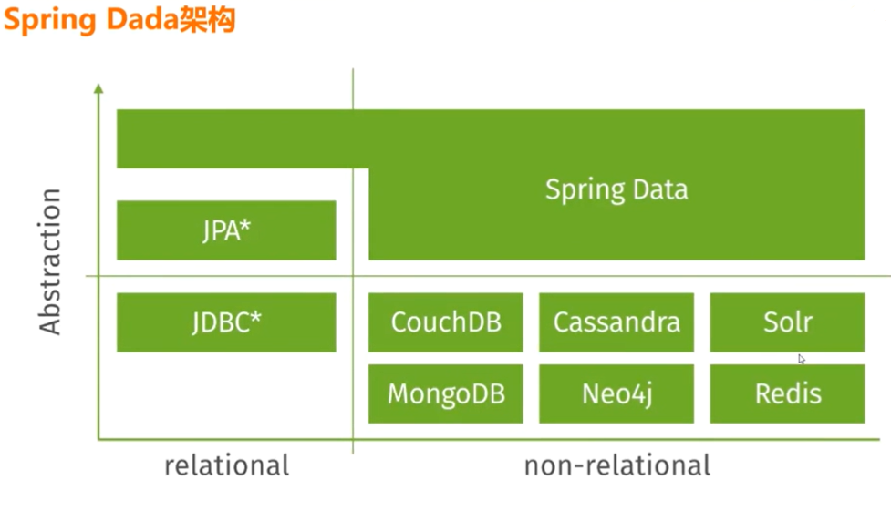

# Spring Data JPA访问MySQL数据

JPA（Java Persistence API）用于对象持久化的 API，是 Java EE 5.0 平台标准的 ORM 规范，使得应用程序以统一的方式访问持久层。


JDBC 也是一种规范和接口，不过 JDBC 是面向 SQL 的，使用起来比较繁琐。所以就有了 ORM 框架，建立了 Java 对象与数据库表之间的映射关系，可以通过直接操作对象来实现持久化，简化了操作的繁杂度。而 JPA 就是 ORM 框架的规范，值得一提的是 Hibernate 是符合 JPA 规范的，而 MyBatis 却不符合，因为 MyBatis 还是需要写 SQL 的。

 

虽然HIbernate用的人越来越少了，但是JPA这种统一的标准化接口在我们开发工作中仍然有重要意义。我们首先看下JDBC示意图：



JPA示意图





### Spring Data JPA使用：
在开始使用Spring Data JPA之前，我们需要进行一些配置。首先，我们需要添加Spring Data JPA的依赖项。打开项目的pom.xml文件，并在<dependencies>标签中添加以下依赖：


```java

<dependencies>
    <!-- Spring Data JPA依赖 -->
    <dependency>
        <groupId>org.springframework.boot</groupId>
        <artifactId>spring-boot-starter-data-jpa</artifactId>
    </dependency>
</dependencies>
```


接下来，我们需要在项目的配置文件中进行数据源和JPA的相关配置。打开application.properties文件（或者application.yml文件），并添加以下配置：


```java

# 数据库连接配置
spring.datasource.url=jdbc:mysql://localhost:3306/mydatabase
spring.datasource.username=root
spring.datasource.password=password

# JPA配置
spring.jpa.show-sql=true
spring.jpa.hibernate.ddl-auto=update
```


在这里，我们配置了数据库的连接信息以及JPA的一些属性。确保将spring.datasource.url中的mydatabase替换为你自己的数据库名称，并根据实际情况修改用户名和密码。


定义实体类和Repository接口

在使用Spring Data JPA进行数据访问之前，我们需要定义实体类和Repository接口。


首先，我们需要定义实体类，它们代表了数据库中的表。在这个示例中，我们创建一个名为"User"的实体类：


```java

import javax.persistence.Entity;
import javax.persistence.GeneratedValue;
import javax.persistence.GenerationType;
import javax.persistence.Id;

@Entity
public class User {
    @Id
    @GeneratedValue(strategy = GenerationType.IDENTITY)
    private Long id;
    private String username;
    private String password;

    // 构造函数、Getter和Setter方法
}
```


在这里，我们使用了@Entity注解将这个类标记为JPA实体，@Id注解表示该属性为主键，@GeneratedValue注解指定了主键的生成策略。


接下来，我们需要定义Repository接口，它是用于进行数据库操作的接口。在这个示例中，我们创建一个名为"UserRepository"的接口：


```java

import org.springframework.data.jpa.repository.JpaRepository;
import com.example.model.User;

public interface UserRepository extends JpaRepository<User, Long> {
    User findByUsername(String username);
}
```

****

在这里，我们继承了JpaRepository接口，并指定了实体类类型和主键的类型。通过继承JpaRepository接口，我们就拥有了许多常用的数据访问方法，例如插入、查询、更新和删除等。


使用Spring Data JPA进行数据访问

一旦我们完成了Spring Data JPA的配置和Repository接口的定义，我们就可以使用它进行数据访问了。


以下是一些示例代码，展示了如何使用Spring Data JPA进行数据库操作：


查询数据


```java
@Autowired
private UserRepository userRepository;

public User getUserByUsername(String username) {
    return userRepository.findByUsername(username);
}
```


在这个示例中，我们通过自动装配的方式获取了UserRepository实例，并使用它的findByUsername方法根据用户名查询用户信息。


插入数据


```java
@Autowired
private UserRepository userRepository;

public void addUser(User user) {
    userRepository.save(user);
}
```


这个示例展示了如何使用save方法插入用户数据。


更新数据


```java
@Autowired
private UserRepository userRepository;

public void updateUser(User user) {
    userRepository.save(user);
}
```


使用save方法同样可以更新已有的用户数据。


删除数据

```java
@Autowired
private UserRepository userRepository;

public void deleteUser(Long id) {
    userRepository.deleteById(id);
}
```


### <font style="color:rgb(0,0,0);">Spring Data新特性 </font>
1. 快速数据访问框架，提供统一的编程模型 
2. 强大的repository仓储和自定义对象映射ORM抽象 
3. 从repository方法名称派生动态查询接口 
4. 实现Domain域基类提供基本属性 
5. 支持透明审计日志（创建，最后更改） 
6. 可以自定义repository代码 
7. 通过JavaConfig和自定义XML命名空间轻松实现Spring集成 
8. 与Spring MVC控制器的高级集成 
9. 跨库持久性的实验支持

### <font style="color:rgb(0,0,0);">Spring Data架构</font>


### Spring Data核心模块
1. Spring Data Commons -支持每个Spring Data模块的Core Spring概念。
2. Spring Data JDBC -对JDBC函Spring Data存储库支持。
3. Spring Data JDBC Ext -支持标准JDBC的数据库特定扩展，包括对Oracle RAC快速连接故障转移的支持，AQ JMS支持以及对使用高级数据类型的支持。
4. Spring Data JPA - JPA的Spring Data存储库支持。
5. Spring Data KeyValue -基于映射的存储库和SPI,可轻松构建用于键值存储的Spring Data模块
6. Spring Data LDAP -对Spring LDAP的Spring Data存储库支持。
7. Spring Data MongoDB -基于Spring的攵寸象文档支持和MongoDB的存储库。
8. Spring Data Redis -从Spring应用程由轻松配置和访问Redis。
9. Spring Data REST -将Spring Data存储库导出为超媒体驱动的RESTful资源。
10. Spring Data Apache Cassandra-轻松酉己置和访问Apache Cassandra或大规模，高可 用性
11. Spring Data Apache Geode -轻松配置和访问Apache Geode,
12. Spring Data Apache Solr-为面向搜索的Spring应用程序轻松配置和访问Apache Solro
13. Spring Data Pivotal GemFire-轻松配置和访问Pivotal GemFire。

### SpringDataJPA结合MySQL
1. Spring JDBC and JdbcTemplate
2. Spring Data JPA and Hibernate framework
3. Spring Data简化连接不同的数据库
4. 使用Spring Data JPA框架连接MySQL
5. 当然也可以使用原始的J DBC
6. 默认底层使用Hibernate框架
7. 支持Repository仓储模式
8. 引入最重要的2个包
9. spring-boot-starter-data-jpa
10. mysql-connector-java


### 1.5 Spring Data JPA框架
1. Spring Data J PA简化数据访问层的开发工作
2. 其于Spring和JPA构建存储库的完美支持
3. 支持Querydsl谓词，从而支持类型安全的JPA查询
4. Domain类的透明审核
5. 分页支持，动态查询执行，集成自定义数据访问代码的能力
6. 在引导时验证 @Query 带注释的查询
7. 支持基于XML的实体映射
8. 引入 @EnableJpaRepositories，基于JavaConfig的存储库配置。


> 更新: 2025-04-20 22:38:59  
> 原文: <https://www.yuque.com/aaron-wecc3/dhluml/kvaylirzf6p2725d>