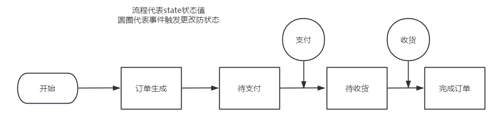
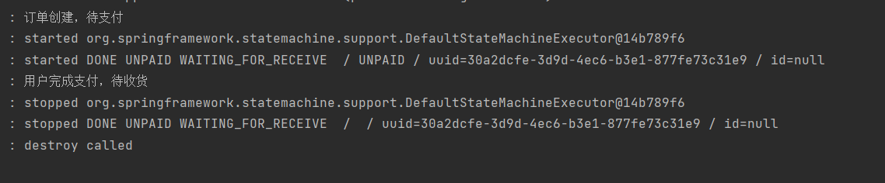
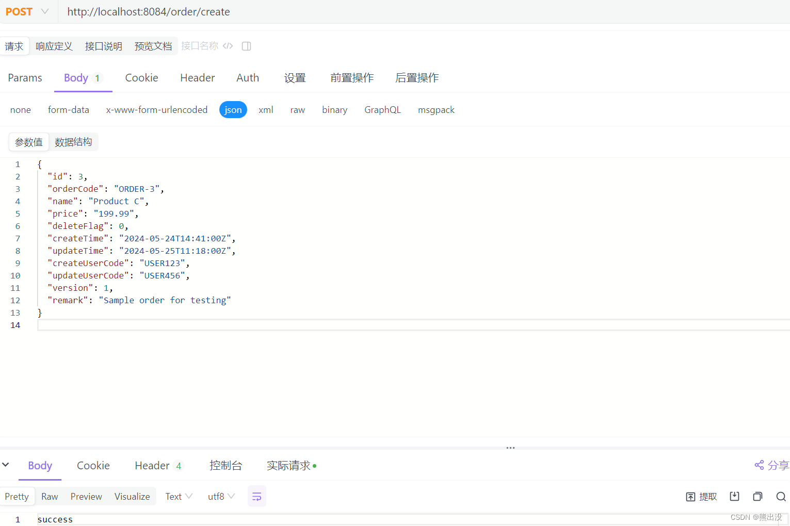
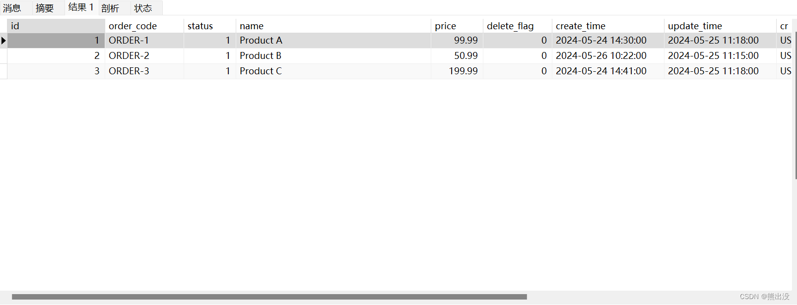
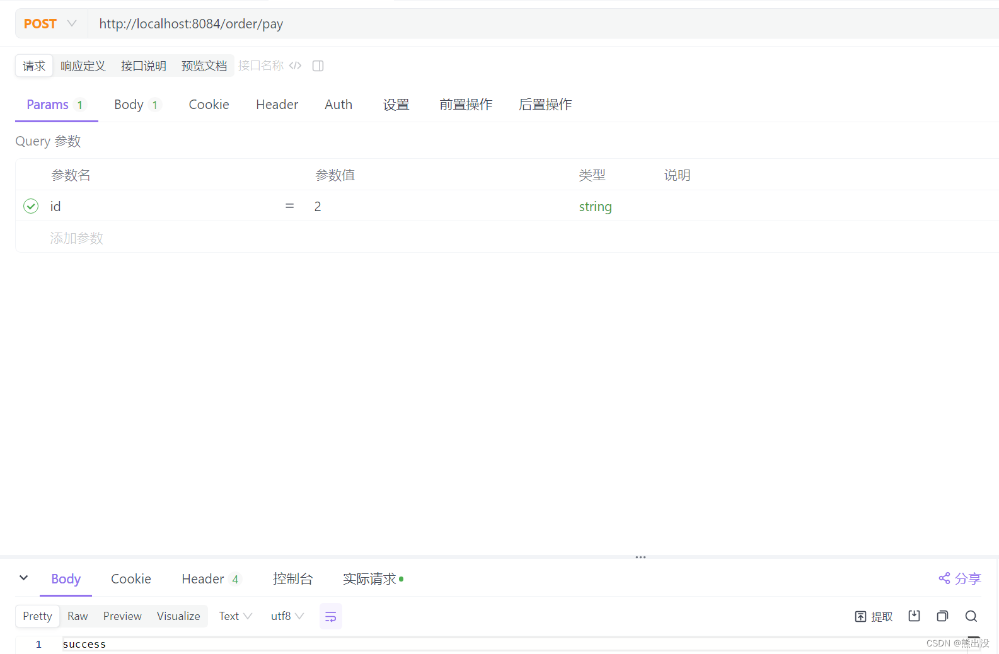
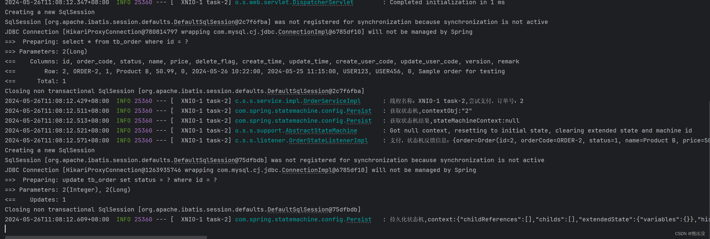
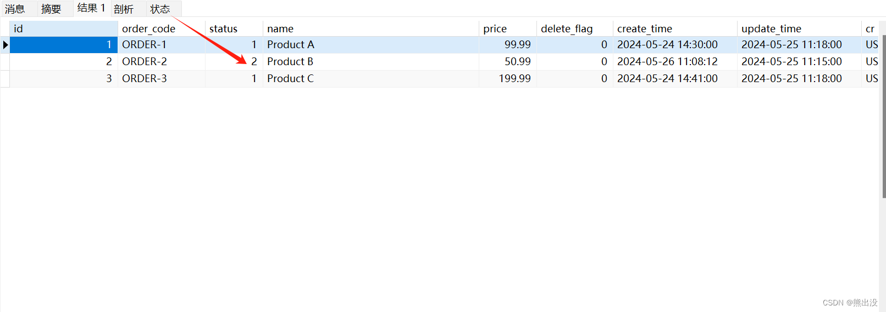
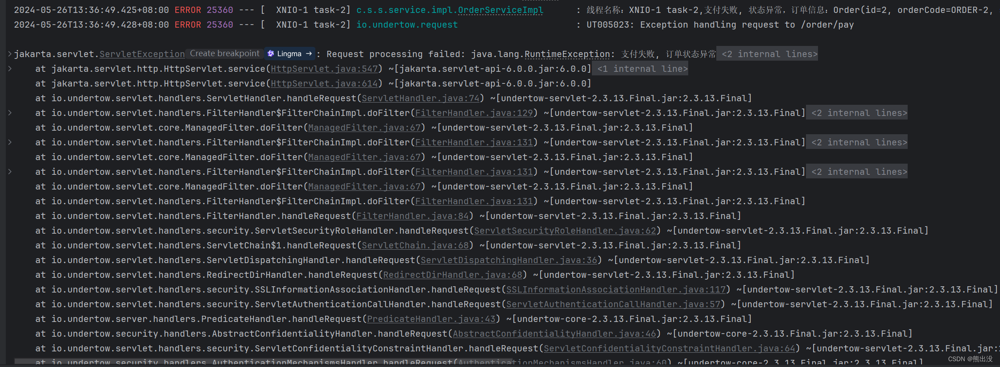

# Spring状态机最佳实践

## <font style="color:#000000;">什么是Spring的状态机</font>
+ <font style="color:#000000;">Spring 状态机（Spring State Machine）是 Spring Framework 提供的一个模块，用于支持有限状态机（Finite State Machine，FSM）的实现。有限状态机是一个数学模型，描述了一个系统在不同状态之间的转换以及触发这些转换的事件。</font>
+ <font style="color:#000000;">Spring 状态机主要用于处理对象的状态变化和状态之间的转换。它提供了一种以声明性的方式定义状态和状态之间转换的机制，并能够处理各种事件触发的状态迁移。这在某些应用中非常有用，比如工作流、订单处理、游戏引擎等领域。</font>
+ <font style="color:#000000;">Spring StatsMachine主要涉及到两个重要的概念，一个是State(状态)、一个是Event(事件)。</font>



<font style="color:#000000;">  
</font><font style="color:#000000;"> </font>

<font style="color:#000000;"></font>

## <font style="color:#000000;">Spring 状态机快速上手</font>
+ **<font style="color:#000000;">场景：商城项目中对于订单状态的层层转换。</font>**

**<font style="color:#000000;">1.使用Spring状态机先引入它的Maven依赖</font>**

<font style="color:#000000;"></font>

```xml
<!--        状态机-->
<dependency>
  <groupId>org.springframework.statemachine</groupId>
  <artifactId>spring-statemachine-starter</artifactId>
  <version>2.2.0.RELEASE</version>
</dependency>
<!-- Spring State Machine Redis -->
<dependency>
  <groupId>org.springframework.statemachine</groupId>
  <artifactId>spring-statemachine-redis</artifactId>
</dependency>
```

<font style="color:#000000;"></font>

<font style="color:#000000;">2.生成状态机的状态与事件：（OrderState，OrderEvents）</font>

+ <font style="color:#000000;">OrderState：</font>

```java
public enum OrderState {
    UNPAID,                 // 待支付
    WAITING_FOR_RECEIVE,    // 待收货
    DONE                    // 结束
}
```

+ <font style="color:#000000;">OrderEvents</font>

```java
public enum OrderEvents {
    PAY,        // 支付
    RECEIVE     // 收货
}
```

<font style="color:#000000;">3.将状态与事件进行绑定：（StateMachineConfig）</font>

<font style="color:#000000;"></font>

```java
@Configuration
@EnableStateMachine(name = "StateMachineConfig")
public class StateMachineConfig extends EnumStateMachineConfigurerAdapter<TestState, TestEvents> {

    private Logger logger = LoggerFactory.getLogger(getClass());
    //定义初始状态
    @Override
    public void configure(StateMachineStateConfigurer<TestState, TestEvents> states)
    throws Exception {
        states
        .withStates()
        .initial(TestState.UNPAID)
        .states(EnumSet.allOf(TestState.class));
    }
    //状态转换过程 触发什么事件就转换为什么状态
    @Override
    public void configure(StateMachineTransitionConfigurer<TestState, TestEvents> transitions)
    throws Exception {
        transitions
        .withExternal()
        .source(TestState.UNPAID).target(TestState.WAITING_FOR_RECEIVE)
        .event(TestEvents.PAY)
        .and()
        .withExternal()
        .source(TestState.WAITING_FOR_RECEIVE).target(TestState.DONE)
        .event(TestEvents.RECEIVE);
    }
}
```

<font style="color:#000000;"></font>

<font style="color:#000000;">4.将事件监听触发与配置类进行配置：（EventListener）</font>

<font style="color:#000000;"></font>

```java
@Component
@WithStateMachine(name = "StateMachineConfig")
public class EventListener {

    private Logger logger = LoggerFactory.getLogger(getClass());

    @OnTransition(target = "UNPAID")
    public boolean create(Message<Order> order) {
        // 创建订单逻辑
        logger.info("订单创建，待支付");
        return true;
    }

    @OnTransition(source = "UNPAID", target = "WAITING_FOR_RECEIVE")
    public boolean pay(Message<Order> order) {
        // 支付逻辑 从redis根据order 来进行处理
        logger.info("用户完成支付，待收货");
        return true;
    }

    @OnTransition(source = "WAITING_FOR_RECEIVE", target = "DONE")
    public boolean receive(Message<Order> order) {
        //从redis中根据传入的order 来查询当前订单 并业务处理
        logger.info("用户已收货，订单完成");
        return true;
    }

}
```

<font style="color:#000000;"></font>

<font style="color:#000000;">最后测试：</font>

<font style="color:#000000;"></font>

```java
@SpringBootApplication
public class DemoApplication implements CommandLineRunner {
    public DemoApplication(StateMachine<TestState, TestEvents> stateMachine) {
        this.stateMachine = stateMachine;
    }

    public static void main(String[] args) {
        SpringApplication.run(DemoApplication.class, args);
    }
    private final StateMachine<TestState, TestEvents> stateMachine;

    @Override
    public void run(String... args) throws Exception {
        Order order=new Order("测试",0);
        // 使用 MessageBuilder 创建消息并设置负载和头信息
        Message message = MessageBuilder
        .withPayload(TestEvents.PAY)
        .setHeader("order", order)
        .build();
        // 发送消息给状态机
        stateMachine.start();
        stateMachine.sendEvent(message);
    }
}
```

<font style="color:#000000;"></font>

<font style="color:#000000;">测试结果：</font>



<font style="color:#000000;">结论：在一些工作流、订单处理的时候可以使用状态机这种设计模式，将状态和事件进行绑定，然后对状态改变进行监听，最后只需要在监听内部对业务代码进行处理。</font>

<font style="color:#000000;"></font>

<font style="color:#000000;"></font>

**<font style="color:#000000;">补充知识和详细实战：</font>**

## <font style="color:#000000;">状态机</font>
<font style="color:#000000;">是有限状态自动机的简称，是现实事物运行规则抽象而成的一个数学模型，是一种概念性机器，它能采取某种操作来响应一个外部事件。这种操作不仅能取决于接收到的事件，还能取决于各个事件的相对发生顺序。状态机能够跟踪一个内部状态，这个状态会在收到事件后进行更新。因此，为一个事件而响应的行动不仅取决于事件本身，还取决于机器的内部状态。此外，采取的行动还会决定并更新机器的状态，这样一来，任何逻辑都可建模成一系列事件/状态组合。</font>

<font style="color:#000000;"></font>

<font style="color:#000000;">状态机由以下几部分构成：</font>

<font style="color:#000000;"></font>

<font style="color:#000000;">状态（States）：描述了系统可能存在的所有情况。</font>

<font style="color:#000000;">事件（Events）：触发状态转换的动作或者条件。</font>

<font style="color:#000000;">动作（actions）：当事件发生时，系统执行的动作或操作。</font>

<font style="color:#000000;">转换（Transitions）：描述了系统从一个状态到另一个状态的变化过程。</font>

<font style="color:#000000;">状态机的类型主要有两种：有限状态机（Finite State Machine, FSM）和推进自动机（Pushdown Automata）。有限状态机是最基本的状态机类型，它只能处于有限个状态中的一个。状态机的应用非常广泛，包括但不限于协议设计、游戏开发、硬件设计、用户界面设计和软件工程等领域。</font>

<font style="color:#000000;"></font>

<font style="color:#000000;">状态机图包含了六种元素：起始、终止、现态、条件、动作、次态（目标状态）。以下是一个订单的状态机图，以从待支付状态转换为待发货状态为例：</font>

<font style="color:#000000;"></font>

<font style="color:#000000;"></font>

<font style="color:#000000;"></font>

<font style="color:#000000;">现态：是指当前所处的状态。待支付</font>

<font style="color:#000000;">条件：又称为“事件”，当一个条件被满足，将会触发一个动作，或者执行一次状态的迁移。支付事件</font>

<font style="color:#000000;">动作：条件满足后执行的动作。动作执行完毕后，可以迁移到新的状态，也可以仍旧保持原状态。动作不是必需的，当条件满足后，也可以不执行任何动作，直接迁移到新状态。状态转换为待发货</font>

<font style="color:#000000;">次态：条件满足后要迁往的新状态。“次态”是相对于“现态”而言的，“次态”一旦被激活，就转变成新的“现态”了，待发货。</font>

<font style="color:#000000;">有两点需要我们注意区分的事项：</font>

<font style="color:#000000;"></font>

<font style="color:#000000;">避免把某个“程序动作”当作是一种“状态”来处理。那么如何区分“动作”和“状态”？“动作”是不稳定的，即使没有条件的触发，“动作”一旦执行完毕就结束了；而“状态”是相对稳定的，如果没有外部条件的触发，一个状态会一直持续下去。</font>

<font style="color:#000000;"></font>

<font style="color:#000000;">状态划分时漏掉一些状态，导致跳转逻辑不完整。所以在设计状态机时，我们需要反复的查看设计的状态图或者状态表，最终达到一种牢不可破的设计方案。</font>

<font style="color:#000000;"> </font>

<font style="color:#000000;"></font>

<font style="color:#000000;"></font>

## <font style="color:#000000;">spring状态机</font>
<font style="color:#000000;">spring官方为我们提供了一个状态机框架 Spring Statemachine。Spring Statemachine 是 Spring 框架中的一个模块，专门用于实现状态机模式。它提供了丰富的功能来简化状态机的创建、配置和管理，特别适合于那些需要复杂状态管理和转换的应用场景。以下是 Spring Statemachine 的一些核心特点和优势：</font>

<font style="color:#000000;"></font>

<font style="color:#000000;">高度集成：</font>

<font style="color:#000000;">Spring Statemachine 与 Spring 生态系统紧密集成，可以方便地利用 Spring 的依赖注入、事件发布/订阅等功能。</font>

<font style="color:#000000;">支持与 Spring Boot 应用无缝集成，简化配置和部署过程。</font>

<font style="color:#000000;">配置灵活：</font>

<font style="color:#000000;">支持基于 Java API 和 XML 配置两种方式来定义状态机模型，包括状态、事件、转换和动作。</font>

<font style="color:#000000;">提供了状态机构建器（StateMachineBuilder），允许以编程方式构建状态机模型。</font>

<font style="color:#000000;">事件驱动：</font>

<font style="color:#000000;">基于事件驱动模型，当状态机接收到外部事件时，会根据配置自动执行状态转换和关联的动作。</font>

<font style="color:#000000;">支持内部事件和外部事件，便于解耦状态机逻辑与其他组件。</font>

<font style="color:#000000;">状态监听和动作：</font>

<font style="color:#000000;">允许在状态进入、退出时执行自定义逻辑（动作），以及在状态转换前后执行动作。</font>

<font style="color:#000000;">支持状态改变监听器，可以监控状态机的运行时状态变化。</font>

<font style="color:#000000;">并发支持：</font>

<font style="color:#000000;">支持多线程环境下的状态机实例管理，可以为每个会话或请求创建独立的状态机实例。</font>

<font style="color:#000000;">提供并发策略配置，以适应不同的并发需求。</font>

<font style="color:#000000;">可视化和调试：</font>

<font style="color:#000000;">可以生成状态机的可视化模型，帮助开发者和业务人员理解状态机逻辑。</font>

<font style="color:#000000;">支持状态机执行跟踪，便于调试和分析状态机行为。</font>

<font style="color:#000000;">扩展性：</font>

<font style="color:#000000;">提供了丰富的扩展点，允许开发者根据需要定制状态机的行为，如自定义决策逻辑、动作执行器等。</font>

<font style="color:#000000;">支持与Spring Integration等其他Spring项目集成，进一步扩展应用功能。</font>

<font style="color:#000000;">持久化和恢复：</font>

<font style="color:#000000;">支持状态机状态的持久化，可以在应用重启后恢复到之前的状态。对于需要长期运行并保持状态的应用尤为重要。</font>

<font style="color:#000000;">通过使用 Spring Statemachine，开发者可以高效地构建和管理复杂的状态逻辑，同时保持代码的清晰度和可维护性。</font>

<font style="color:#000000;"> </font>

## <font style="color:#000000;">完整订单演示代码</font>
<font style="color:#000000;">订单流转为例，使用springboot应用，简单展示spring状态机的用法。</font>

<font style="color:#000000;">下面展示的是主要核心代码，部分代码笔者没有展示了，请从gitee上拉取</font>

<font style="color:#000000;"></font>

<font style="color:#000000;">3.1 建表tb_order</font>

```java
CREATE TABLE `tb_order` (
      `id` bigint(20) unsigned NOT NULL AUTO_INCREMENT COMMENT '主键ID',
      `order_code` varchar(128) COLLATE utf8mb4_bin DEFAULT NULL COMMENT '订单编码',
      `status` smallint(3) DEFAULT NULL COMMENT '订单状态',
      `name` varchar(64) COLLATE utf8mb4_bin DEFAULT NULL COMMENT '订单名称',
      `price` decimal(12,2) DEFAULT NULL COMMENT '价格',
      `delete_flag` tinyint(2) NOT NULL DEFAULT '0' COMMENT '删除标记，0未删除  1已删除',
      `create_time` timestamp NOT NULL DEFAULT CURRENT_TIMESTAMP ON UPDATE CURRENT_TIMESTAMP COMMENT '创建时间',
      `update_time` timestamp  COMMENT '更新时间',
      `create_user_code` varchar(32) COLLATE utf8mb4_bin DEFAULT NULL COMMENT '创建人',
      `update_user_code` varchar(32) COLLATE utf8mb4_bin DEFAULT NULL COMMENT '更新人',
      `version` int(11) NOT NULL DEFAULT '0' COMMENT '版本号',
      `remark` varchar(64) COLLATE utf8mb4_bin DEFAULT NULL COMMENT '备注',
      PRIMARY KEY (`id`)
    ) ENGINE=InnoDB AUTO_INCREMENT=6 DEFAULT CHARSET=utf8mb4 COLLATE=utf8mb4_bin COMMENT='订单表';
 
```

<font style="color:#000000;"></font>

<font style="color:#000000;">3.2 建立Spring Statemachine项目</font>

<font style="color:#000000;">新建一个spring-machine的springboot项目，因为要操作数据库，引入了jdbc和mybatis依赖。</font>

<font style="color:#000000;"></font>

<font style="color:#000000;">yaml配置</font>

```java
server:
  port: 4455

spring:
  datasource:
    hikari:
      connection-timeout: 6000000 # 设置为60000毫秒，即60秒
    # 数据库连接信息
    driver-class-name: com.mysql.cj.jdbc.Driver
    url: jdbc:mysql://localhost:3306/spring-machine?useSSL=false&serverTimezone=UTC
    username: root
    password: root
  data:
    redis:
      # Redis服务器地址
      host: localhost
      # Redis服务器端口号
      port: 6379
      # 使用的数据库索引，默认是0
      database: 0
      # 连接超时时间
      timeout: 1800000
      # 设置密码
      password:
      lettuce:
        pool:
          # 最大阻塞等待时间，负数表示没有限制
          max-wait: -1
          # 连接池中的最大空闲连接
          max-idle: 5
          # 连接池中的最小空闲连接
          min-idle: 0
          # 连接池中最大连接数，负数表示没有限制
          max-active: 20
mybatis:
  # MyBatis配置
  mapper-locations: classpath:mapper/*.xml
  type-aliases-package: com.spring.statemachine.mapper
  configuration:
    map-underscore-to-camel-case: true
    log-impl: org.apache.ibatis.logging.stdout.StdOutImpl
```

<font style="color:#000000;"></font>

<font style="color:#000000;"> </font>

<font style="color:#000000;">引入依赖</font>

<font style="color:#000000;">注意，使用的jdk是21，源码下载后根据个人环境版本配置做相应版本修改，直至不报错</font>

```java
 <dependency>
            <groupId>org.springframework.boot</groupId>
            <artifactId>spring-boot-starter-web</artifactId>
            <exclusions>
                <exclusion>
                    <groupId>org.springframework.boot</groupId>
                    <artifactId>spring-boot-starter-tomcat</artifactId>
                </exclusion>
            </exclusions>
        </dependency>
        <dependency>
            <groupId>org.springframework.boot</groupId>
            <artifactId>spring-boot-starter-undertow</artifactId>
        </dependency>
        <dependency>
            <groupId>org.projectlombok</groupId>
            <artifactId>lombok</artifactId>
            <optional>true</optional>
        </dependency>
        <dependency>
            <groupId>org.springframework.boot</groupId>
            <artifactId>spring-boot-starter-test</artifactId>
            <scope>test</scope>
        </dependency>
        <dependency>
            <groupId>com.mysql</groupId>
            <artifactId>mysql-connector-j</artifactId>
            <scope>runtime</scope>
        </dependency>
        <dependency>
            <groupId>org.mybatis.spring.boot</groupId>
            <artifactId>mybatis-spring-boot-starter</artifactId>
            <version>3.0.3</version>
        </dependency>
        <dependency>
            <groupId>org.springframework.boot</groupId>
            <artifactId>spring-boot-starter-data-jdbc</artifactId>
        </dependency>
        <!-- redis持久化状态机 -->
        <dependency>
            <groupId>org.springframework.statemachine</groupId>
            <artifactId>spring-statemachine-redis</artifactId>
            <version>1.2.14.RELEASE</version>
        </dependency>
        <!--状态机-->
        <!--spring statemachine-->
        <dependency>
            <groupId>org.springframework.statemachine</groupId>
            <artifactId>spring-statemachine-core</artifactId>
            <version>4.0.0</version>
        </dependency>
        <dependency>
            <groupId>com.alibaba</groupId>
            <artifactId>fastjson</artifactId>
            <version>2.0.50</version> <!-- 确保使用最新的版本 -->
        </dependency>
        <!-- Spring AOP -->
        <dependency>
            <groupId>org.springframework</groupId>
            <artifactId>spring-aop</artifactId>
            <version>6.1.8</version> <!-- 替换为实际使用的Spring版本 -->
        </dependency>

        <!-- AspectJ -->
        <dependency>
            <groupId>org.aspectj</groupId>
            <artifactId>aspectjrt</artifactId>
            <version>1.9.22</version> <!-- 替换为实际使用的AspectJ版本 -->
        </dependency>
        <dependency>
            <groupId>org.aspectj</groupId>
            <artifactId>aspectjweaver</artifactId>
            <version>1.9.22</version> <!-- 替换为实际使用的AspectJ版本 -->
        </dependency>
```

<font style="color:#000000;">       </font>

<font style="color:#000000;"> </font>

<font style="color:#000000;">订单状态枚举类</font>

```java
package com.spring.statemachine.orderEnum;

public enum OrderStatus {
    // 待支付，待发货，待收货，已完成
    WAIT_PAYMENT(1, "待支付"),
    WAIT_DELIVER(2, "待发货"),
    WAIT_RECEIVE(3, "待收货"),
    FINISH(4, "已完成");
    private final Integer key;
    private final String desc;

    OrderStatus(Integer key, String desc) {
        this.key = key;
        this.desc = desc;
    }

    public Integer getKey() {
        return key;
    }

    public String getDesc() {
        return desc;
    }

    public static OrderStatus getByKey(Integer key) {
        for (OrderStatus e : values()) {
            if (e.getKey().equals(key)) {
                return e;
            }
        }
        throw new RuntimeException("enum not exists.");
    }
}
```

<font style="color:#000000;"></font>

<font style="color:#000000;"> </font>

<font style="color:#000000;">事件枚举</font>

```java
package com.spring.statemachine.orderEnum;

public enum OrderStatusChangeEvent {
        // 支付，发货，确认收货
        PAYED, DELIVERY, RECEIVED;
}
```

<font style="color:#000000;"></font>

<font style="color:#000000;"></font>

<font style="color:#000000;">定义状态机规则和配置状态机</font>

```java
package com.spring.statemachine.config;

import com.spring.statemachine.orderEnum.OrderStatus;
import com.spring.statemachine.orderEnum.OrderStatusChangeEvent;
import org.springframework.context.annotation.Configuration;
import org.springframework.statemachine.config.EnableStateMachine;
import org.springframework.statemachine.config.StateMachineConfigurerAdapter;
import org.springframework.statemachine.config.builders.StateMachineStateConfigurer;
import org.springframework.statemachine.config.builders.StateMachineTransitionConfigurer;

import java.util.EnumSet;


/**
 * 订单状态机规则配置
 */
@Configuration
@EnableStateMachine(name = "orderStateMachine")
public class OrderStateMachineConfig extends StateMachineConfigurerAdapter<OrderStatus, OrderStatusChangeEvent> {
    /**
     * 配置状态
     */
    public void configure(StateMachineStateConfigurer<OrderStatus, OrderStatusChangeEvent> states) throws Exception {
        states.withStates()
                .initial(OrderStatus.WAIT_PAYMENT)
                .states(EnumSet.allOf(OrderStatus.class));
    }

    /**
     * 配置状态转换事件关系
     */
    public void configure(StateMachineTransitionConfigurer<OrderStatus, OrderStatusChangeEvent> transitions) throws Exception {
        transitions
                //支付事件:待支付-》待发货
                .withExternal().source(OrderStatus.WAIT_PAYMENT).target(OrderStatus.WAIT_DELIVER).event(OrderStatusChangeEvent.PAYED)
                .and()
                //发货事件:待发货-》待收货
                .withExternal().source(OrderStatus.WAIT_DELIVER).target(OrderStatus.WAIT_RECEIVE).event(OrderStatusChangeEvent.DELIVERY)
                .and()
                //收货事件:待收货-》已完成
                .withExternal().source(OrderStatus.WAIT_RECEIVE).target(OrderStatus.FINISH).event(OrderStatusChangeEvent.RECEIVED);
    }
}
```

<font style="color:#000000;"></font>

<font style="color:#000000;"> </font>

<font style="color:#000000;">配置持久化</font>

```java
package com.spring.statemachine.config;

import com.alibaba.fastjson.JSON;
import jakarta.annotation.Resource;
import lombok.extern.slf4j.Slf4j;
import org.springframework.context.annotation.Bean;
import org.springframework.context.annotation.Configuration;
import org.springframework.data.redis.connection.RedisConnectionFactory;
import org.springframework.statemachine.StateMachineContext;
import org.springframework.statemachine.StateMachinePersist;
import org.springframework.statemachine.persist.DefaultStateMachinePersister;
import org.springframework.statemachine.persist.RepositoryStateMachinePersist;
import org.springframework.statemachine.persist.StateMachinePersister;
import org.springframework.statemachine.redis.RedisStateMachineContextRepository;
import org.springframework.statemachine.redis.RedisStateMachinePersister;

import java.util.HashMap;
import java.util.Map;

@Configuration
@Slf4j
public class Persist<E, S> {

    @Resource
    private RedisConnectionFactory redisConnectionFactory;

    /**
     * 持久化到内存map中
     */
    @Bean(name = "stateMachineMemPersister")
    @SuppressWarnings("all")
    public static StateMachinePersister getPersister() {
        return new DefaultStateMachinePersister(new StateMachinePersist() {
            private final Map<Object, StateMachineContext> map = new HashMap<>();
            @Override
            public void write(StateMachineContext context, Object contextObj) throws Exception {
                log.info("持久化状态机,context:{},contextObj:{}", JSON.toJSONString(context), JSON.toJSONString(contextObj));
                map.put(contextObj, context);
            }

            @Override
            public StateMachineContext read(Object contextObj) throws Exception {
                log.info("获取状态机,contextObj:{}", JSON.toJSONString(contextObj));
                StateMachineContext stateMachineContext = map.get(contextObj);
                log.info("获取状态机结果,stateMachineContext:{}", JSON.toJSONString(stateMachineContext));
                return stateMachineContext;
            }


        });
    }

    /**
     * 持久化到redis中，在分布式系统中使用
     */
    @Bean(name = "stateMachineRedisPersister")
    public RedisStateMachinePersister<E, S> getRedisPersister() {
        RedisStateMachineContextRepository<E, S> repository = new RedisStateMachineContextRepository<>(redisConnectionFactory);
        RepositoryStateMachinePersist<E, S> p = new RepositoryStateMachinePersist<>(repository);
        return new RedisStateMachinePersister<>(p);
    }
}
```

<font style="color:#000000;"></font>

<font style="color:#000000;"> </font>

<font style="color:#000000;">业务系统controller</font>

```java
package com.spring.statemachine.controller;

import com.spring.statemachine.domain.Order;
import com.spring.statemachine.service.OrderService;
import jakarta.annotation.Resource;
import org.springframework.web.bind.annotation.RequestBody;
import org.springframework.web.bind.annotation.RequestMapping;
import org.springframework.web.bind.annotation.RequestParam;
import org.springframework.web.bind.annotation.RestController;

@RestController
@RequestMapping("/order")
public class OrderController {
    @Resource
    private OrderService orderService;

    /**
     * 根据id查询订单
     */
    @RequestMapping("/getById")
    public Order getById(@RequestParam("id") Long id) {
        //根据id查询订单
        return orderService.getById(id);
    }

    /**
     * 创建订单
     */
    @RequestMapping("/create")
    public String create(@RequestBody Order order) {
        //创建订单
        orderService.create(order);
        return "success";
    }

    /**
     * 对订单进行支付
     */
    @RequestMapping("/pay")
    public String pay(@RequestParam("id") Long id) {
        //对订单进行支付
        orderService.pay(id);
        return "success";
    }

    /**
     * 对订单进行发货
     */
    @RequestMapping("/deliver")
    public String deliver(@RequestParam("id") Long id) {
        //对订单进行确认收货
        orderService.deliver(id);
        return "success";
    }

    /**
     * 对订单进行确认收货
     */
    @RequestMapping("/receive")
    public String receive(@RequestParam("id") Long id) {
        //对订单进行确认收货
        orderService.receive(id);
        return "success";
    }
}
```

<font style="color:#000000;"></font>

<font style="color:#000000;"> </font>

<font style="color:#000000;">service服务</font>

```java
package com.spring.statemachine.service.impl;

import com.spring.statemachine.domain.Order;
import com.spring.statemachine.interfaceVariable.CommonConstants;
import com.spring.statemachine.mapper.OrderMapper;
import com.spring.statemachine.orderEnum.OrderStatus;
import com.spring.statemachine.orderEnum.OrderStatusChangeEvent;
import com.spring.statemachine.service.OrderService;
import jakarta.annotation.Resource;
import lombok.extern.slf4j.Slf4j;
import org.springframework.messaging.Message;
import org.springframework.messaging.support.MessageBuilder;
import org.springframework.statemachine.StateMachine;
import org.springframework.statemachine.persist.StateMachinePersister;
import org.springframework.stereotype.Service;

import java.util.Objects;

@Service("orderService")
@Slf4j
public class OrderServiceImpl implements OrderService {
    @Resource
    private StateMachine<OrderStatus, OrderStatusChangeEvent> orderStateMachine;
    @Resource
    private StateMachinePersister<OrderStatus, OrderStatusChangeEvent, String> stateMachineMemPersister;
    @Resource
    private StateMachinePersister<OrderStatus, OrderStatusChangeEvent, String> stateMachineRedisPersister;
    @Resource
    private OrderMapper orderMapper;

    /**
     * 创建订单
     */
    public Order create(Order order) {
        order.setStatus(OrderStatus.WAIT_PAYMENT.getKey());
        orderMapper.insert(order);
        return order;
    }

    /**
     * 对订单进行支付
     */
    public void pay(Long id) {
        Order order = orderMapper.selectById(id);
        log.info("线程名称：{},尝试支付，订单号：{}", Thread.currentThread().getName(), id);
        if (!sendEvent(OrderStatusChangeEvent.PAYED, order,CommonConstants.payTransition)) {
            log.error("线程名称：{},支付失败, 状态异常，订单信息：{}", Thread.currentThread().getName(), order);
            throw new RuntimeException("支付失败, 订单状态异常");
        }
    }

    /**
     * 对订单进行发货
     */
    public void deliver(Long id) {
        Order order = orderMapper.selectById(id);
        log.info("线程名称：{},尝试发货，订单号：{}", Thread.currentThread().getName(), id);
        if (!sendEvent(OrderStatusChangeEvent.DELIVERY, order,CommonConstants.deliverTransition)) {
            log.error("线程名称：{},发货失败, 状态异常，订单信息：{}", Thread.currentThread().getName(), order);
            throw new RuntimeException("发货失败, 订单状态异常");
        }
    }

    @Override
    public Order getById(Long id) {
        return orderMapper.selectById(id);
    }

    /**
     * 对订单进行确认收货
     */
    public void receive(Long id) {
        Order order = orderMapper.selectById(id);
        log.info("线程名称：{},尝试收货，订单号：{}", Thread.currentThread().getName(), id);
        if (!sendEvent(OrderStatusChangeEvent.RECEIVED, order,CommonConstants.receiveTransition)) {
            log.error("线程名称：{},收货失败, 状态异常，订单信息：{}", Thread.currentThread().getName(), order);
            throw new RuntimeException("收货失败, 订单状态异常");
        }
    }

    /**
     * 发送订单状态转换事件
     * synchronized修饰保证这个方法是线程安全的
     */
    private synchronized boolean sendEvent(OrderStatusChangeEvent changeEvent, Order order,String key) {
        boolean result = false;
        try {
            //启动状态机
            orderStateMachine.startReactively();
            
            //内存持久化状态机尝试恢复状态机状态,单机环境下使用
            //stateMachineMemPersister.restore(orderStateMachine, String.valueOf(order.getId()));
            
            //redis持久化状态机尝试恢复状态机状态,分布式环境下使用
            stateMachineRedisPersister.restore(orderStateMachine, String.valueOf(order.getId()));
            
            Message<OrderStatusChangeEvent> message = MessageBuilder.withPayload(changeEvent).setHeader(CommonConstants.orderHeader, order).build();
            result = orderStateMachine.sendEvent(message);
            if(!result){
                return false;
            }
            //获取到监听的结果信息
            Integer o = (Integer) orderStateMachine.getExtendedState().getVariables().get(key + order.getId());
            //操作完成之后,删除本次对应的key信息
            orderStateMachine.getExtendedState().getVariables().remove(key+order.getId());
            //如果事务执行成功，则持久化状态机
            if(Objects.equals(1, o)){
                //使用内存持久化状态机状态,单机环境下使用
                //stateMachineMemPersister.persist(orderStateMachine, String.valueOf(order.getId()));
                //使用redis持久化状态机状态机状态,分布式环境下使用
                stateMachineRedisPersister.persist(orderStateMachine, String.valueOf(order.getId()));
            }else {
                //订单执行业务异常
                return false;
            }
        } catch (Exception e) {
            log.error("订单操作失败:{}", e.getMessage(),e);
        } finally {
            orderStateMachine.stopReactively();
        }
        return result;
    }
}
```

<font style="color:#000000;"></font>

<font style="color:#000000;"> </font>

<font style="color:#000000;">注解和切面类</font>

<font style="color:#000000;">注解</font>

```java
package com.spring.statemachine.aspect;

import java.lang.annotation.Retention;
import java.lang.annotation.RetentionPolicy;

@Retention(RetentionPolicy.RUNTIME)
public @interface LogResult {
    /**
     * 执行的业务key
     *
     * @return String
     */
    String key();
}
```

<font style="color:#000000;"></font>

<font style="color:#000000;"></font>

<font style="color:#000000;">切面类</font>

```java
package com.spring.statemachine.aspect;

import com.spring.statemachine.domain.Order;
import com.spring.statemachine.interfaceVariable.CommonConstants;
import com.spring.statemachine.orderEnum.OrderStatus;
import com.spring.statemachine.orderEnum.OrderStatusChangeEvent;
import jakarta.annotation.Resource;
import lombok.extern.slf4j.Slf4j;
import org.aspectj.lang.ProceedingJoinPoint;
import org.aspectj.lang.annotation.Around;
import org.aspectj.lang.annotation.Aspect;
import org.aspectj.lang.annotation.Pointcut;
import org.aspectj.lang.reflect.MethodSignature;
import org.springframework.messaging.Message;
import org.springframework.statemachine.StateMachine;
import org.springframework.stereotype.Component;

import java.lang.reflect.Method;

/**
 * 本注解主要是把OrderStateListener中注释的重复代码提取出来
 */
@Component
@Aspect
@Slf4j
public class LogResultAspect {

    @Pointcut("@annotation(com.spring.statemachine.aspect.LogResult)")
    private void logResultPointCut() {
        //logResultPointCut 日志注解切点
    }

    @Resource
    private StateMachine<OrderStatus, OrderStatusChangeEvent> orderStateMachine;

    @Around("logResultPointCut()")
    @SuppressWarnings("all")
    public Object logResultAround(ProceedingJoinPoint pjp) throws Throwable {
        //获取参数
        Object[] args = pjp.getArgs();
        log.info("参数args:{}", args);
        Message message = (Message) args[0];
        Order order = (Order) message.getHeaders().get(CommonConstants.orderHeader);
        //获取方法
        Method method = ((MethodSignature) pjp.getSignature()).getMethod();
        LogResult logResult = method.getAnnotation(LogResult.class);
        String key = logResult.key();
        Object returnVal;
        try {
            //执行方法
            returnVal = pjp.proceed();
            //如果业务执行正常，则保存信息
            //成功 则为1
            assert order != null;
            orderStateMachine.getExtendedState().getVariables().put(key + order.getId(), 1);
        } catch (Throwable e) {
            log.error("e:{}", e.getMessage());
            //如果业务执行异常，则保存信息
            //将异常信息变量信息中，失败则为0
            assert order != null;
            orderStateMachine.getExtendedState().getVariables().put(key + order.getId(), 0);
            throw e;
        }
        return returnVal;
    }
}
```

<font style="color:#000000;"></font>

<font style="color:#000000;"> </font>

<font style="color:#000000;">状态变化监听</font>

```java
package com.spring.statemachine.listener;

import com.spring.statemachine.aspect.LogResult;
import com.spring.statemachine.domain.Order;
import com.spring.statemachine.interfaceVariable.CommonConstants;
import com.spring.statemachine.mapper.OrderMapper;
import com.spring.statemachine.orderEnum.OrderStatus;
import com.spring.statemachine.orderEnum.OrderStatusChangeEvent;
import jakarta.annotation.Resource;
import lombok.extern.slf4j.Slf4j;
import org.springframework.messaging.Message;
//import org.springframework.statemachine.StateMachine;
import org.springframework.statemachine.annotation.OnTransition;
import org.springframework.statemachine.annotation.WithStateMachine;
import org.springframework.stereotype.Component;
import org.springframework.transaction.annotation.Transactional;

/**
 * 订单事件监听器(注释调的代码替换为aop拦截实现LogResultAspect)
 */
@Component("orderStateListener")
@WithStateMachine(name = "orderStateMachine")
@Slf4j
public class OrderStateListener {
    @Resource
    private OrderMapper orderMapper;
//    @Resource
//    private StateMachine<OrderStatus, OrderStatusChangeEvent> orderStateMachine;

    /**
     * 支付事件监听
     */
    @OnTransition(source = "WAIT_PAYMENT", target = "WAIT_DELIVER")
    @Transactional(rollbackFor = Exception.class)
    @LogResult(key = CommonConstants.payTransition)
    public void payTransition(Message<OrderStatusChangeEvent> message) {
        Order order = (Order) message.getHeaders().get(CommonConstants.orderHeader);
        log.info("支付，状态机反馈信息：{}", message.getHeaders());
        //更新订单
        assert order != null;
        order.setStatus(OrderStatus.WAIT_DELIVER.getKey());
        orderMapper.updateById(order);
//        try {
//            //更新订单
//            assert order != null;
//            order.setStatus(OrderStatus.WAIT_DELIVER.getKey());
//            orderMapper.updateById(order);
//            //成功 则为1
//            orderStateMachine.getExtendedState().getVariables().put(CommonConstants.payTransition+order.getId(),1);
//        } catch (Exception e) {
//            //如果出现异常，则进行回滚
//            log.error("payTransition 出现异常：{}",e.getMessage(),e);
//            //将异常信息变量信息中，失败则为0
//            orderStateMachine.getExtendedState().getVariables().put(CommonConstants.payTransition+order.getId(), 0);
//            throw e;
//        }
    }

    /**
     * 发货事件监听
     */
    @OnTransition(source = "WAIT_DELIVER", target = "WAIT_RECEIVE")
    @LogResult(key = CommonConstants.deliverTransition)
    public void deliverTransition(Message<OrderStatusChangeEvent> message) {
        Order order = (Order) message.getHeaders().get(CommonConstants.orderHeader);
        log.info("发货，状态机反馈信息：{}", message.getHeaders());
        //更新订单
        assert order != null;
        order.setStatus(OrderStatus.WAIT_RECEIVE.getKey());
        orderMapper.updateById(order);
//        try {
//            //更新订单
//            assert order != null;
//            order.setStatus(OrderStatus.WAIT_RECEIVE.getKey());
//            orderMapper.updateById(order);
//            //成功 则为1
//            orderStateMachine.getExtendedState().getVariables().put(CommonConstants.deliverTransition+order.getId(),1);
//        } catch (Exception e) {
//            //如果出现异常，则进行回滚
//            log.error("payTransition 出现异常：{}",e.getMessage(),e);
//            //将异常信息变量信息中，失败则为0
//            orderStateMachine.getExtendedState().getVariables().put(CommonConstants.deliverTransition+order.getId(), 0);
//            throw e;
//        }
    }

    /**
     * 确认收货事件监听
     */
    @OnTransition(source = "WAIT_RECEIVE", target = "FINISH")
    @LogResult(key = CommonConstants.receiveTransition)
    public void receiveTransition(Message<OrderStatusChangeEvent> message) {
        Order order = (Order) message.getHeaders().get(CommonConstants.orderHeader);
        log.info("确认收货，状态机反馈信息：{}", message.getHeaders());
        //更新订单
        assert order != null;
        order.setStatus(OrderStatus.FINISH.getKey());
        orderMapper.updateById(order);
//        try {
//            //更新订单
//            assert order != null;
//            order.setStatus(OrderStatus.FINISH.getKey());
//            orderMapper.updateById(order);
//            //成功 则为1
//            orderStateMachine.getExtendedState().getVariables().put(CommonConstants.receiveTransition+order.getId(),1);
//        } catch (Exception e) {
//            //如果出现异常，则进行回滚
//            log.error("payTransition 出现异常：{}",e.getMessage(),e);
//            //将异常信息变量信息中，失败则为0
//            orderStateMachine.getExtendedState().getVariables().put(CommonConstants.receiveTransition+order.getId(), 0);
//            throw e;
//        }
    }
}
```

<font style="color:#000000;"></font>

<font style="color:#000000;"> </font>

<font style="color:#000000;">四、验证修改</font>

<font style="color:#000000;">主体流程</font>

<font style="color:#000000;">新增一个订单</font>

<font style="color:#000000;"> </font>[<font style="color:#000000;">http://localhost:8084/order/create</font>](http://localhost:8084/order/create)

<font style="color:#000000;"></font>

<font style="color:#000000;">对订单进行支付</font>

[<font style="color:#000000;">http://localhost:8084/order/pay?id=2</font>](http://localhost:8084/order/pay?id=2)

<font style="color:#000000;"></font>

<font style="color:#000000;">对订单进行发货</font>

<font style="color:#000000;"> </font>[<font style="color:#000000;">http://localhost:8084/order/deliver?id=2</font>](http://localhost:8084/order/deliver?id=2)

<font style="color:#000000;"></font>

<font style="color:#000000;">对订单进行确认收货</font>

[<font style="color:#000000;">http://localhost:8084/order/receive?id=2</font>](http://localhost:8084/order/receive?id=2)

<font style="color:#000000;"></font>

<font style="color:#000000;">具体实施步骤如下：</font>

<font style="color:#000000;"></font>

<font style="color:#000000;">新增订单</font>

<font style="color:#000000;">工具为postman（一款非常强大好用的接口测试工具，地址：postman官网）</font>

<font style="color:#000000;"></font>

<font style="color:#000000;">json格式的数据</font>

```java
{
  "id": 3,
  "orderCode": "ORDER-3",
  "name": "Product C",
  "price": "199.99",
  "deleteFlag": 0,
  "createTime": "2024-05-24T14:41:00Z",
  "updateTime": "2024-05-25T11:18:00Z",
  "createUserCode": "USER123",
  "updateUserCode": "USER456",
  "version": 1,
  "remark": "Sample order for testing"
}
```



<font style="color:#000000;"> </font>

<font style="color:#000000;"></font>

<font style="color:#000000;">使用新增订单接口</font>[<font style="color:#000000;">http://localhost:8084/order/create</font>](http://localhost:8084/order/create)<font style="color:#000000;">创建了几个订单</font>



<font style="color:#000000;">支付订单</font>

<font style="color:#000000;">对id为2的订单进行支付</font>



<font style="color:#000000;">控制台信息如下</font>



<font style="color:#000000;"></font>

<font style="color:#000000;">查看数据库，id为2的订单状态，已被修改为2待发货状态</font>



<font style="color:#000000;"></font>

<font style="color:#000000;">对于这个id为2的订单，我们再次调用支付，会发生什么？</font>



<font style="color:#000000;">可以看到已经支付的订单，无法再次支付了。</font>

<font style="color:#000000;"></font>

<font style="color:#000000;">持久化方式</font>

<font style="color:#000000;">笔者选择的是redis的方式持久化状态机，当然也有内存持久化的方式，前者适用于分布式，后者适用于单机环境。比如同一个订单支付操作，第二次再重复支付，二者都会报错，但是redis持久化方式，服务重启重复支付会继续报错，而内存持久化方式，服务重启后，再进行重复支付操作，却不会报错了，因为内存中缓存的状态机状态随着服务重启重置了，而redis缓存仍然存在。</font>

<font style="color:#000000;"></font>

<font style="color:#000000;">redis持久化的key即为订单的id</font>


<font style="color:#000000;"></font>

<font style="color:#000000;">总结：以上就是spring statemachine的一个简单示例，对于复杂流程控制和处理的业务逻辑很有用处，应该通过这个案例掌握使用方法。</font>

<font style="color:#000000;"></font>

<font style="color:#000000;"></font>

<font style="color:#000000;"></font>

<font style="color:#000000;"></font>

<font style="color:#000000;"></font>

<font style="color:#000000;"></font>

<font style="color:#000000;"></font>

<font style="color:#000000;"></font>

<font style="color:#000000;"></font>

<font style="color:#000000;"></font>


> 更新: 2024-08-24 19:57:12  
> 原文: <https://www.yuque.com/aaron-wecc3/dhluml/fhuxcn8qu5g98cy9>