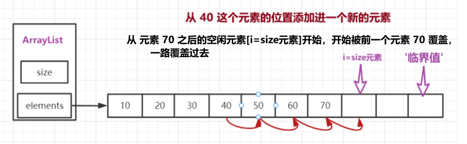
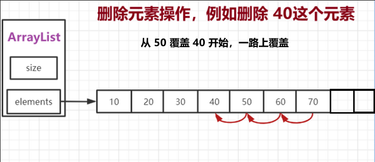
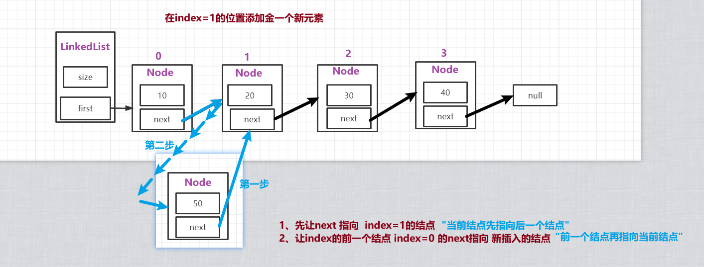
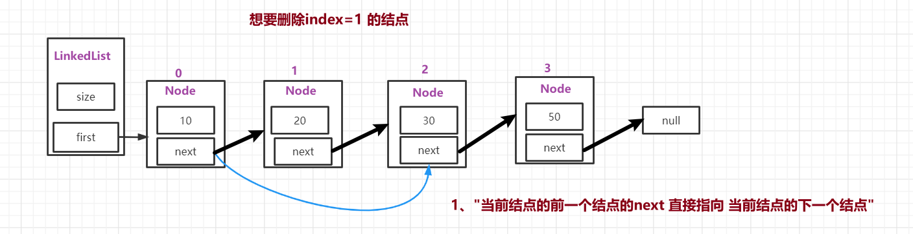
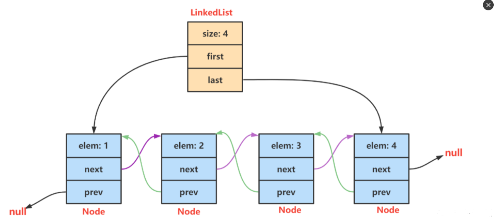
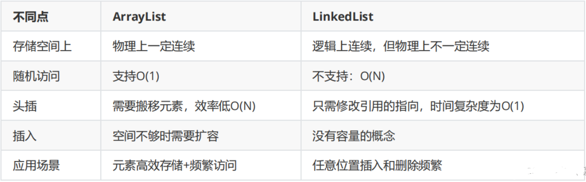
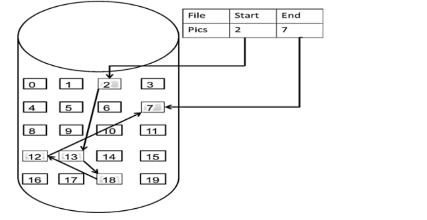
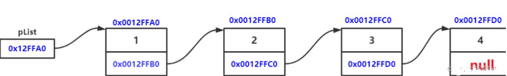
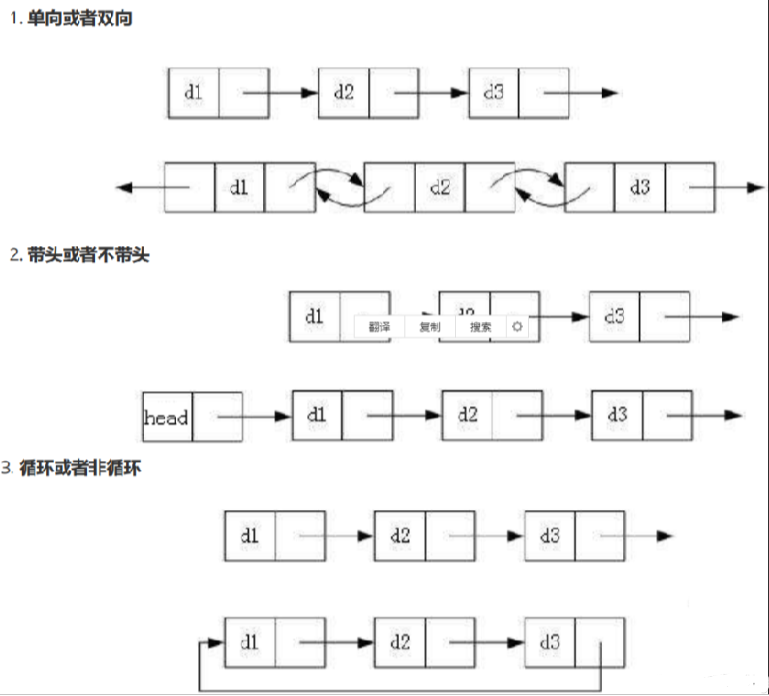

# arraylist和linklist原理，区别

### 一、ArrayList实现原理


ArrayList就是动态数组，ArrayList并不是线程安全的，允许 null 的存在，是有序的，初始容量大小为10，当超过容量后，会进行扩容，以原来容量的1.5倍来扩容，如之前的容量为10，下次扩容扩大到10 + 5，ArrayList的最大长度为 2^32 .当删除数组中间的元素，后面的元素都会向前移动。随着向ArrayList中不断添加元素，其容量也自动增长。自动增长会带来数据向新数组的重新拷贝，这种操作的代价是很高的，因此，如果可预知数据量的多少，可在构造ArrayList时指定其容量。在添加大量元素 前，应用程序也可以使用ensureCapacity操作来增加ArrayList实例的容量，这可以减少递增式再分配的数量。


注意：注释是说构造一个容量大小为 10 的空的 list 集合，但构造函数了只是给 elementData 赋值了一个空的数组，其实是在第一次添加元素时容量扩大至 10 的。


二、LinkedList底层实现和原理


LinkedList类是List接口的实现类，它是一个集合，可以根据索引来随机的访问集合中的元素，还实现了Deque接口，它还是一个队列，可以被当成双端队列来使用。虽然LinkedList是一个List集合，但是它的实现方式和ArrayList是完全不同的，ArrayList的底层是通过一个动态的Object[]数组来实现的，而LinkedList的底层是通过链表来实现的，因此它的随机访问速度是比较差的，但是它的删除，插入操作会很快。


实现接口


Serializable, Cloneable, Iterable, Collection, Deque, List, Queue

 源码：

```java
public class LinkedList<E>extends AbstractSequentialList<E>
    implements List<E>, Deque<E>, Cloneable, java.io.Serializable
{
    transient int size = 0;   //LinkedList中存放的元素个数

    transient Node<E> first;  //头节点
    
    transient Node<E> last;   //尾节点

    //构造方法，创建一个空的列表
    public LinkedList() {
    }

    //将一个指定的集合添加到LinkedList中，先完成初始化，在调用添加操作
    public LinkedList(Collection<? extends E> c) {
        this();
        addAll(c);
    }
    。。。。。。
}

```

构造方法：


LinkedList()


LinkedList(Collection c)


LinkedList没有长度的概念，所以不存在容量不足的问题，也不存在扩容的问题，因此不需要提供初始化大小的构造方法，因此值提供了两个方法，一个是无参构造方法，初始一个LinkedList对象，和将指定的集合元素转化为LinkedList构造方法。


添加方法：默认尾部

 

```java
public boolean add(E e) {
     linkLast(e);
     return true;
}
void linkLast(E e) {
     final Node<E> l = last;
     final Node<E> newNode = new Node<>(l, e, null);
     last = newNode;
     if (l == null)
         first = newNode;
     else
          l.next = newNode;
     size++;
     modCount++;
}

```

删除方法：


先循环遍历列表，找到item == o 的节点，在调用unlink()方法删除。


总结：


LinkedList是一个功能很强大的类，可以被当作List集合，双端队列和栈来使用。LinkedList底层使用链表来保存集合中的元素，因此随机访问的性能较差，但是插入删除时性能非常的出色。

 

### LinkList 以链表作为底层。


使用无参构造创建集合后，第一次添加元素会将该元素记录为first节点和last节点；


当不是第一次添加元素且集合中有元素时，会默认将元素添加到最后位置；


当插入元素时，会先判断插入的元素是否为最后一个，是最后一个则直接调用addLast，若不是则底层会先得到插入之前该位置的节点，然后创建新节点（插入的元素节点），新节点的上一节点地址记录插入之前该位置的节点的上一节点地址，新节点的下一节点地址记录插入之前该位置的节点；然后将插入之前该位置的节点的上一节点地址改为新节点；将插入之前该位置的节点的上一节点的下一节点地址改为新节点；（简单来说就是将插入位置的上一节点地址记录新的节点，将插入位置的上一个节点的下一节点地址记录新的节点，新节点的上一节点地址记录插入前该位置的上一节点地址，下一节点地址记录插入前该位置节点。）


当删除节点时，会先判断删除节点是否为第一个或最后一个，若是第一个或者最后一个就只需要将first或last记录删除节点的下一节点或上一节点即可；若不是第一个则会将删除节点的上一节点地址所记录的下一节点地址改为删除节点的下一节点地址，将删除节点的下一节点地址所记录的上一节点地址改为删除节点的上一节点地址，让链表都不记录删除的节点地址，然后后将删除的节点置为空，便于GC垃圾回收。


源码

```java
//部分源码
 
//元素个数
transient int size = 0;
//第一个节点
transient Node<E> first;
//最后一个节点
transient Node<E> last;
 
//节点
private static class Node<E> {
    //item存放元素值
    E item;
    //next存放下一个节点地址
    Node<E> next;
    //上一个节点地址
    Node<E> prev;
 
    //传入参数为上一节点地址，该节点元素值，下一节点
    Node(Node<E> prev, E element, Node<E> next) {
        this.item = element;
        this.next = next;
        this.prev = prev;
    }
}
 
//无参构造
public LinkedList() {
}
//有参构造（传入集合）
public LinkedList(Collection<? extends E> c) {
    this();
    //将传入的集合所有元素添加到新集合中
    addAll(c);
}
 
//添加元素
public boolean add(E e) {
    //在最后添加
    linkLast(e);
    return true;
}
 
void linkLast(E e) {
    //将添加前的最后一个节点赋值给l
    final Node<E> l = last;
    //创建一个新节点（上一节点地址为l，新节点元素值为新添加的元素，下一节点为空）
    final Node<E> newNode = new Node<>(l, e, null);
    //新创建的节点为最后一个节点（相当于默认从最后追加）
    last = newNode;
    //判断添加前的最后一个节点是否为null
    if (l == null)
        //当一个节点都没有时会执行这部分
        //将新添加的置为第一个节点
        first = newNode;
    else
        //当添加前有节点时会执行这部分
        //添加前最后一个节点的next记录新添加的最后一个节点的地址
        l.next = newNode;
    //元素个数+1
    size++;
    //修改次数+1
    modCount++;
}
 
//插入元素
public void add(int index, E element) {
    //判断插入的索引值是否规范（不能大于此时的元素个数且不能小于0）
    checkPositionIndex(index);
 
    //判断插入的元素是否放到最后
    if (index == size)
        linkLast(element);
    else
        //不放到最后就执行该方法（传入插入元素值和计算后的该索引值的节点地址）
        linkBefore(element, node(index));
}
//根据插入的索引值得到该索引值的节点地址，传入参数为插入的位置（索引值）
Node<E> node(int index) {
    // assert isElementIndex(index);
    //判断插入的位置处于整个元素一半的左边还有右边（相当于二叉树，提升代码效率）
    //左边为true，右边为false
    if (index < (size >> 1)) {
        Node<E> x = first;
        //从前往后循环遍历直到插入元素的位置
        for (int i = 0; i < index; i++)
            //用来变换节点到下一个地址
            x = x.next;
        return x;
    } else {
        Node<E> x = last;
        //从后往前循环遍历到插入元素的位置
        for (int i = size - 1; i > index; i--)
            //用来变换节点到上一个地址
            x = x.prev;
        return x;
    }
}
//传入参数为插入的元素值和插入位置的地址
void linkBefore(E e, Node<E> succ) {
    // assert succ != null;
    final Node<E> pred = succ.prev;
    //创建一个新节点，新节点为插入的元素值节点（上一节点为传入的插入位置的上一节点，元素值，下一节点为传入的插入位置的地址）
    final Node<E> newNode = new Node<>(pred, e, succ);
    //将传入的插入位置的地址上一节点处记录新节点地址
    succ.prev = newNode;
    //判断插入的这个元素是否处于第一个位置
    if (pred == null)
        first = newNode;
    else
        //将插入位置的上一节点地址的下一节点处记录新节点地址
        pred.next = newNode;
    //元素个数+1
    size++;
    modCount++;
}
 
//删除
public boolean remove(Object o) {
    //判断删除的对象是否为null
    if (o == null) {
        //从第一个节点开始遍历判断是否为null
        for (Node<E> x = first; x != null; x = x.next) {
            if (x.item == null) {
                unlink(x);
                return true;
            }
        }
    } else {
        for (Node<E> x = first; x != null; x = x.next) {
            if (o.equals(x.item)) {
                unlink(x);
                return true;
            }
        }
    }
    return false;
}
 
E unlink(Node<E> x) {
    // assert x != null;
    final E element = x.item;
    final Node<E> next = x.next;
    final Node<E> prev = x.prev;
 
    //判断删除元素的上一节点是否为null（删除的节点是否为第一个节点）
    if (prev == null) {
        //是第一个节点后，修改第一个节点记录为删除元素的下一节点地址
        first = next;
    } else {
        //若不是第一个节点
        //将删除的节点的上一节点地址的下一节点处 记录 删除的节点的下一节点地址
        prev.next = next;
        //将删除节点的上一节点置为null
        x.prev = null;
    }
 
    //判断删除的节点是否为最后一个节点
    if (next == null) {
        //将最后一个节点地址重新赋值为删除节点的上一节点地址
        last = prev;
    } else {
        //若不是最后一个节点
        //将删除节点的下一节点的上一节点处 记录 删除节点的上一节点
        next.prev = prev;
        //将删除节点的下一节点置为null
        x.next = null;
    }
 
    //将删除节点的元素值置为null（便于GC垃圾回收）
    x.item = null;
    //元素个数-1
    size--;
    modCount++;
    //返回删除的元素值
    return element;
}
 
//修改
public E set(int index, E element) {
    //判断修改的索引值是否符合规范（不能小于0或者不能大于此时元素的总个数）
    checkElementIndex(index);
    //得到修改前该节点的地址
    Node<E> x = node(index);
    //得到修改前该节点的元素值
    E oldVal = x.item;
    //修改该节点的元素值
    x.item = element;
    //返回修改前节点的元素值
    return oldVal;
}
//查询
public E get(int index) {
    //判断修改的索引值是否符合规范    
    checkElementIndex(index);
    //返回该索引节点的元素值
    return node(index).item;
}
 
//返回元素个数
public int size() {
    return size;
}
```


区别：list接口中ArrayList、LinkedList都不是线程安全，Vector是线程安全


### 1、数据结构不同
ArrayList是Array(动态数组)的数据结构，LinkedList是Link(链表)双向链表的数据结构。


### 2、空间灵活性
ArrayList最好指定初始容量

LinkedList是比ArrayList灵活的，是根本不需要指定初始容量的


### 3、效率不同
当随机访问List（get和set操作）时，ArrayList比LinkedList的效率更高，因为LinkedList是线性的数据存储方式，所以需要移动指针从前往后依次查找。ArrayList对于数据查询非常快，但是插入与删除元素比较慢；

当对数据进行增加和删除的操作(add和remove操作)时，LinkedList速度非常快。


### 4、主要控件开销不同
ArrayList主要控件开销在于需要在List列表预留一定空间；


而LinkList主要控件开销在于需要存储节点信息以及节点指针。


其他

ArrayList是实现了基于动态数组的数据结构，LinkedList基于链表的数据结构。


对于随机访问get和set，ArrayList觉得优于LinkedList，因为LinkedList要移动指针。


对于新增和删除操作add和remove，LinedList比较占优势，因为ArrayList要移动数据。


ArrayList：内部使用数组的形式实现了存储，实现了RandomAccess接口，利用数组的下面进行元素的访问，因此对元素的随机访问速度非常快。


因为是数组，所以ArrayList在初始化的时候，有初始大小10，插入新元素的时候，会判断是否需要扩容，扩容的步长是0.5倍原容量，扩容方式是利用数组的复制，因此有一定的开销；


 另外，ArrayList在进行元素插入的时候，需要移动插入位置之后的所有元素，位置越靠前，需要位移的元素越多，开销越大，相反，插入位置越靠后的话，开销就越小了，如果在最后面进行插入，那就不需要进行位移。







 


LinkedList：内部使用双向链表的结构实现存储，每一个节点有两个指针域，一个指向下一个节点，一个指向上一个节点。，LinkedList有一个内部类作为存放元素的单元Node，里面有三个属性，用来存放元素本身以及前后2个单元的引用，另外LinkedList内部还有一个header属性，用来标识起始位置，LinkedList的第一个单元和最后一个单元都会指向header，因此形成了一个双向的链表结构,如下：注：这个是旧版本的

```java
private transient Entry<E> header = new Entry<E>(null, null, null);
public LinkedList() {
    header.next = header.previous = header;
}

public E getFirst() {
    if (size==0)
        throw new NoSuchElementException();

    return header.next.element;
}

public E getLast()  {
    if (size==0)
        throw new NoSuchElementException();

    return header.previous.element;
}

public E removeFirst() {
    return remove(header.next);
}
```


LinkedList是采用双向链表实现的。所以它也具有链表的特点，每一个元素（结点）的地址不连续，通过引用找到当前节点的上一个节点和下一个节点，即插入和删除效率较高，只需要常数时间，而get和set则较为低效。


LinkedList的方法和使用和ArrayList大致相同，由于LinkedList是链表实现的，所以额外提供了在头部和尾部添加/删除元素的方法，也没有ArrayList扩容的问题了。另外，ArrayList和LinkedList都可以实现栈、队列等数据结构，但LinkedList本身实现了队列的接口，所以更推荐用LinkedList来实现队列和栈。


下面简单看一下linkedlist add 方法的源码,方便理解，注：这个是新版本java，已经没有header

```java
public cTass LinkedList<E> extendsimpTements...{
    transient int size = 0; // 链表长度
    transient Node<E> first; // 指向链表第一个节点
    transient Node<E> last; // 指向链表最后一个节点
    ...
	public boolean add(E e) { // 添加元素
    	linkLast(e); // 向链表末尾添加元素e
   		return true; 
    }
    ...
}
 
 
void linkLast(E e) { // 向链表未尾添加元素 
    fina1 Node<E> 1 = last; // 暂时保存最后一个元素的指针
    fina1 Node<E> newNode = new Node<>(1, e, nu11);
    last = newNode; // newNode 作为最后一个节点
    if (1 == nu11) // 当前链表为空
		first = newNode; // 第一个添加的节点，即为 first
    else // 链表不空
		1.next = newNode; // 当前链表的最后一个节点next 指向newNode
    size++;
	modCount++;
}
 
 
// LinkedList 底层是一个双向链表
private static class Node<E> { // LinkedList 的节点静态内部类 Node
    E item;
    Node<E> next; // 后继
    Node<E> prev; // 前驱
 
    Node(Node<E> prev，E element， Node<E> next) {
        this.item = element;
        this.next = next;
        this.prev = prev;
    }
}
```







 


使用场景：

（1）如果应用程序对数据有较多的随机访问，ArrayList对象要优于LinkedList对象；


( 2 ) 如果应用程序有更多的插入或者删除操作，较少的随机访问，LinkedList对象要优于ArrayList对象；


（3）不过ArrayList的插入，删除操作也不一定比LinkedList慢，如果在List靠近末尾的地方插入，那么ArrayList只需要移动较少的数据，而LinkedList则需要一直查找到列表尾部，反而耗费较多时间，这时ArrayList就比LinkedList要快。




2.链表

2.1 链表的概念及结构

链表是一种物理存储结构上非连续存储结构，数据元素的逻辑顺序是通过链表中的引用链接次序实现的 。

实际存储图：




理解逻辑图：



 


实际中链表的结构非常多样，以下情况组合起来就有8种链表结构： 



 


 


虽然有这么多的链表的结构，但是我们重点掌握两种:


无头单向非循环链表（就是我们常说的单链表）：结构简单，一般不会单独用来存数据。实际中更多是作为其他数据结构的子结构，如 哈希桶、图的邻接表等等。另外这种结构在笔试面试中出现很多。

无头双向链表：在Java的集合框架库中LinkedList底层实现就是无头双向循环链表。

 


> 更新: 2025-04-20 22:39:02  
> 原文: <https://www.yuque.com/aaron-wecc3/dhluml/epfzxkygvg5nppvr>