# 为什么微服务架构需要聚合

### 前言：

<font style="color:rgb(0, 0, 0);background-color:rgb(254, 254, 242);">微服务可以将我们的东西组织成一个考虑周到且定义明确的单元。</font>

<font style="color:rgb(0, 0, 0);background-color:rgb(254, 254, 242);">一体式架构通常意味着组织中的每个工程师都会涉及到应用的每一部分，且业务体与其他实体紧密耦合，微服务让我们朝着不同的方向迈进。工程师团队应该专注于自身的业务领域，业务实体应该只和同领域的实体相耦合。</font>

<font style="color:rgb(0, 0, 0);background-color:rgb(254, 254, 242);">对领域的描述总是说起来容易，做起来难。例如</font>[<font style="color:rgb(0, 0, 0);background-color:rgb(254, 254, 242);">有界上下文</font>](https://martinfowler.com/bliki/BoundedContext.html)<font style="color:rgb(0, 0, 0);background-color:rgb(254, 254, 242);">就是一个最近流行的模式，可以帮助我们组织工程师团队，并在更高层面对业务领域进行划分。</font>

<font style="color:rgb(0, 0, 0);background-color:rgb(254, 254, 242);">类似地，</font>[<font style="color:rgb(0, 0, 0);background-color:rgb(254, 254, 242);">聚合模式</font>](https://martinfowler.com/bliki/DDD_Aggregate.html)<font style="color:rgb(0, 0, 0);background-color:rgb(254, 254, 242);">可以帮助我们在更低的层面聚合数据。最初将这种模式定义为按照事务对相关实体进行分组的方式。</font>

<font style="color:rgb(0, 0, 0);background-color:rgb(254, 254, 242);">此外，它还为我们提供了分解一体式数据架构的蓝图，本质上是将高内聚的实体划分为单一的、原子性的组。</font>

<font style="color:rgb(0, 0, 0);background-color:rgb(254, 254, 242);">当然好处还远不止此。有趣的是，聚合模式似乎不像其他分布式软件设计模式那样广为人知，被广泛讨论或普遍实现。但它是构建微服务的基本单元。</font>

<font style="color:rgb(0, 0, 0);background-color:rgb(254, 254, 242);">预先进行聚合设计可以帮助我们避免各种问题，如例如实体之间的偶然依赖关系或引用泄漏，这些问题通常会妨碍对系统的扩展。下面看下什么是聚合。</font>

### <font style="color:rgb(0, 0, 0);background-color:rgb(254, 254, 242);">聚合</font>

<font style="color:rgb(0, 0, 0);background-color:rgb(254, 254, 242);">聚合是Eric Evans在他的书中</font>[<font style="color:rgb(0, 0, 0);background-color:rgb(254, 254, 242);">Domain-Driven Design</font>](https://domainlanguage.com/ddd/)<font style="color:rgb(0, 0, 0);background-color:rgb(254, 254, 242);">提出的一种设计模式，尽管书中没有明确地讨论微服务体系结构或分布式系统，但已经对这些话题进行了阐述。</font>

<font style="color:rgb(0, 0, 0);background-color:rgb(254, 254, 242);">一个聚合定义为一个自包含的实体组，作为一个独立的原子的单元。对任意实体的修改都可能会影响到整个聚合。每个聚合的构成如下：</font>

* <font style="color:rgb(0, 0, 0);background-color:rgb(254, 254, 242);">边界。这是实体之间的界限，界定了哪些实体属于聚合，哪些不属于。</font>
* <font style="color:rgb(0, 0, 0);background-color:rgb(254, 254, 242);">实体。组中包含的业务对象实体。</font>
* <font style="color:rgb(0, 0, 0);background-color:rgb(254, 254, 242);">根。每个聚合会向外部暴露一个实体。聚合外部的对象仅可以引用聚合根，不能直接访问其他聚合内部的实体。</font>

<font style="color:rgb(0, 0, 0);background-color:rgb(254, 254, 242);">示意图如下：</font>

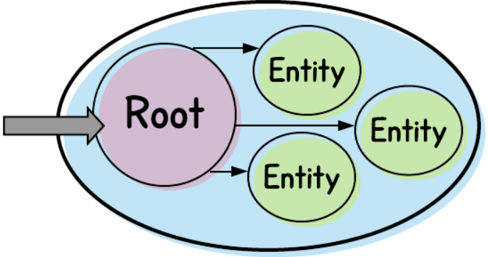

<font style="color:rgb(0, 0, 0);background-color:rgb(254, 254, 242);">上图中最外层的椭圆表示聚合的边界，里面是聚合根(紫色圆形)以及其他实体(绿色圆形)。</font>

<font style="color:rgb(0, 0, 0);background-color:rgb(254, 254, 242);">由于外部只能通过根来访问聚合，因此在聚合内部，</font>**<font style="color:rgb(0, 0, 0);background-color:rgb(254, 254, 242);">只有根才能引用其他实体</font>**<font style="color:rgb(0, 0, 0);background-color:rgb(254, 254, 242);">(</font>*<font style="color:rgb(0, 0, 0);background-color:rgb(254, 254, 242);">非根实体之间不能相互引用</font>*<font style="color:rgb(0, 0, 0);background-color:rgb(254, 254, 242);">)。</font>

#### <font style="color:rgb(51, 51, 51);background-color:rgb(254, 254, 242);">聚合根</font>

<font style="color:rgb(0, 0, 0);background-color:rgb(254, 254, 242);">换句话说，根服务是聚合与外界交互的代表，因此应该选择最合适的实体作为根。幸运的是，实体的选择通常比较简单。很多聚合都拥有一个清晰的、主要的实体，该实体上附加了很多其他实体。</font>

<font style="color:rgb(0, 0, 0);background-color:rgb(254, 254, 242);">下面展示一个简化的例子：</font>*<font style="color:rgb(0, 0, 0);background-color:rgb(254, 254, 242);">用户聚合</font>*<font style="color:rgb(0, 0, 0);background-color:rgb(254, 254, 242);">。</font>

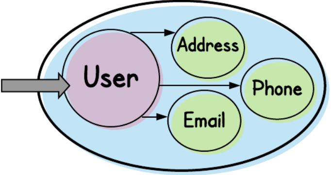

<font style="color:rgb(0, 0, 0);background-color:rgb(254, 254, 242);">注意我们的聚合及其根的名称都叫"User"。User实体可能包含的属性，如名和姓，性别，出生日期，可能还会包括国民身份以及其他少量标量字段。</font>

<code><font style="color:rgb(192, 52, 29);background-color:rgb(251, 229, 225);">User</font></code><font style="color:rgb(0, 0, 0);background-color:rgb(254, 254, 242);">和它关联的信息(</font><code><font style="color:rgb(192, 52, 29);background-color:rgb(251, 229, 225);">Email</font></code><font style="color:rgb(0, 0, 0);background-color:rgb(254, 254, 242);"> </font><font style="color:rgb(0, 0, 0);background-color:rgb(254, 254, 242);">(address),</font><font style="color:rgb(0, 0, 0);background-color:rgb(254, 254, 242);"> </font><code><font style="color:rgb(192, 52, 29);background-color:rgb(251, 229, 225);">Phone</font></code><font style="color:rgb(0, 0, 0);background-color:rgb(254, 254, 242);"> </font><font style="color:rgb(0, 0, 0);background-color:rgb(254, 254, 242);">(number), 和(mailing)</font><font style="color:rgb(0, 0, 0);background-color:rgb(254, 254, 242);"> </font><code><font style="color:rgb(192, 52, 29);background-color:rgb(251, 229, 225);">Address</font></code><font style="color:rgb(0, 0, 0);background-color:rgb(254, 254, 242);">)是一对多的关系。除了上面描述的内容外，在外面的聚合中可能还会包含其他用于代表用户偏好的实体。</font>

<font style="color:rgb(0, 0, 0);background-color:rgb(254, 254, 242);">很显然，</font><code><font style="color:rgb(192, 52, 29);background-color:rgb(251, 229, 225);">User</font></code><font style="color:rgb(0, 0, 0);background-color:rgb(254, 254, 242);">实体作为了聚合的根。除了名称相同外，User实体包含了有关用户的核心信息。此外，它还是聚合中产生其他实体的实体。即，如果移除了</font><code><font style="color:rgb(192, 52, 29);background-color:rgb(251, 229, 225);">Phone</font></code><font style="color:rgb(0, 0, 0);background-color:rgb(254, 254, 242);">，则聚合本身会被保留下来。这种场景下，脱离了</font><code><font style="color:rgb(192, 52, 29);background-color:rgb(251, 229, 225);">User</font></code><font style="color:rgb(0, 0, 0);background-color:rgb(254, 254, 242);">上下文的</font><code><font style="color:rgb(192, 52, 29);background-color:rgb(251, 229, 225);">Phone</font></code><font style="color:rgb(0, 0, 0);background-color:rgb(254, 254, 242);">是毫无意义的。但如果移除了</font><code><font style="color:rgb(192, 52, 29);background-color:rgb(251, 229, 225);">User</font></code><font style="color:rgb(0, 0, 0);background-color:rgb(254, 254, 242);">实体，那么聚合中的其他实体就会变得没有意义，成为微服务架构中没有目的性的孤儿实体。</font>

<font style="color:rgb(0, 0, 0);background-color:rgb(254, 254, 242);">User实体是可以从外部直接访问聚合的唯一实体。以ReST为例，意味着我们可以提供如下路径：</font>

```bash
/users/{user-identifier}
```

<font style="color:rgb(0, 0, 0);background-color:rgb(254, 254, 242);">但不能提供如下路径(</font>*<font style="color:rgb(0, 0, 0);background-color:rgb(254, 254, 242);">不能直接访问电话实体</font>*<font style="color:rgb(0, 0, 0);background-color:rgb(254, 254, 242);">)：</font>

```bash
/users/phones/{phone-identifier}
```

<font style="color:rgb(0, 0, 0);background-color:rgb(254, 254, 242);">其他聚合可以保存到</font><code><font style="color:rgb(192, 52, 29);background-color:rgb(251, 229, 225);">User</font></code><font style="color:rgb(0, 0, 0);background-color:rgb(254, 254, 242);">的引用，如</font><code><font style="color:rgb(192, 52, 29);background-color:rgb(251, 229, 225);">Order</font></code><font style="color:rgb(0, 0, 0);background-color:rgb(254, 254, 242);">聚合可能会保存每个发起</font><code><font style="color:rgb(192, 52, 29);background-color:rgb(251, 229, 225);">Order</font></code><font style="color:rgb(0, 0, 0);background-color:rgb(254, 254, 242);">的</font><code><font style="color:rgb(192, 52, 29);background-color:rgb(251, 229, 225);">User</font></code><font style="color:rgb(0, 0, 0);background-color:rgb(254, 254, 242);">，每个</font><code><font style="color:rgb(192, 52, 29);background-color:rgb(251, 229, 225);">User</font></code><font style="color:rgb(0, 0, 0);background-color:rgb(254, 254, 242);">必须分配一个</font>[<font style="color:rgb(0, 0, 0);background-color:rgb(254, 254, 242);">全局唯一标识符</font>](https://en.wikipedia.org/wiki/Universally_unique_identifier)<font style="color:rgb(0, 0, 0);background-color:rgb(254, 254, 242);">。</font>

#### <font style="color:rgb(51, 51, 51);background-color:rgb(254, 254, 242);">值对象</font>

<font style="color:rgb(0, 0, 0);background-color:rgb(254, 254, 242);">相比之下，其他实体仅需要本地标识符，聚合可以通过标识符消除其自身的歧义。如可以使用</font><code><font style="color:rgb(192, 52, 29);background-color:rgb(251, 229, 225);">1</font></code><font style="color:rgb(0, 0, 0);background-color:rgb(254, 254, 242);">，</font><code><font style="color:rgb(192, 52, 29);background-color:rgb(251, 229, 225);">2</font></code><font style="color:rgb(0, 0, 0);background-color:rgb(254, 254, 242);">，</font><code><font style="color:rgb(192, 52, 29);background-color:rgb(251, 229, 225);">3</font></code><font style="color:rgb(0, 0, 0);background-color:rgb(254, 254, 242);">来标识</font><code><font style="color:rgb(192, 52, 29);background-color:rgb(251, 229, 225);">User</font></code><font style="color:rgb(0, 0, 0);background-color:rgb(254, 254, 242);">的</font><code><font style="color:rgb(192, 52, 29);background-color:rgb(251, 229, 225);">Phone</font></code><font style="color:rgb(0, 0, 0);background-color:rgb(254, 254, 242);">。</font>

<font style="color:rgb(0, 0, 0);background-color:rgb(254, 254, 242);">这是因为Phone对外并无意义，其他任何聚合都不会单纯地请求</font><code><font style="color:rgb(192, 52, 29);background-color:rgb(251, 229, 225);">Phone</font></code><font style="color:rgb(0, 0, 0);background-color:rgb(254, 254, 242);"> </font><code><font style="color:rgb(192, 52, 29);background-color:rgb(251, 229, 225);">2</font></code><font style="color:rgb(0, 0, 0);background-color:rgb(254, 254, 242);">，仅会检索用户</font><code><font style="color:rgb(192, 52, 29);background-color:rgb(251, 229, 225);">b4664e12–2b5b-47c8-b349–41e81848758f</font></code><font style="color:rgb(0, 0, 0);background-color:rgb(254, 254, 242);">使用的</font><code><font style="color:rgb(192, 52, 29);background-color:rgb(251, 229, 225);">Phone</font></code><font style="color:rgb(0, 0, 0);background-color:rgb(254, 254, 242);"> </font><code><font style="color:rgb(192, 52, 29);background-color:rgb(251, 229, 225);">2</font></code><font style="color:rgb(0, 0, 0);background-color:rgb(254, 254, 242);">。</font>

<font style="color:rgb(0, 0, 0);background-color:rgb(254, 254, 242);">但即使这样，也应该限制发生的范围，其他聚合不能永久保存到用户手机的引用。</font>

<font style="color:rgb(0, 0, 0);background-color:rgb(254, 254, 242);">回到ReST的例子，我们认为对一个手机的可以接受的引用如下(通过用户来访问其手机)：</font>

```bash
/users/{user-identifier}/phones/{phone-identifier}
```

<font style="color:rgb(0, 0, 0);background-color:rgb(254, 254, 242);">但很多支持的实体其实都是</font>[<font style="color:rgb(0, 0, 0);background-color:rgb(254, 254, 242);">值对象</font>](https://martinfowler.com/bliki/ValueObject.html)<font style="color:rgb(0, 0, 0);background-color:rgb(254, 254, 242);">，即基于它们的值，而不是引用来标识对象。</font>

<font style="color:rgb(0, 0, 0);background-color:rgb(254, 254, 242);">比如</font><code><font style="color:rgb(192, 52, 29);background-color:rgb(251, 229, 225);">Email</font></code><font style="color:rgb(0, 0, 0);background-color:rgb(254, 254, 242);">，我们可能考虑给每个邮件地址分配一个数字ID，但实际上me@myaddress.com本身就可以作为一个实体对象，如果该字符串发生了变化，则它就变成了一个全新的邮件地址。</font>

<font style="color:rgb(0, 0, 0);background-color:rgb(254, 254, 242);">上述方式也同样适用于</font><code><font style="color:rgb(192, 52, 29);background-color:rgb(251, 229, 225);">Phone</font></code><font style="color:rgb(0, 0, 0);background-color:rgb(254, 254, 242);">(由未格式化的数组构成)以及(邮寄)</font><code><font style="color:rgb(192, 52, 29);background-color:rgb(251, 229, 225);">Address</font></code><font style="color:rgb(0, 0, 0);background-color:rgb(254, 254, 242);">，但由于一个(邮寄)地址可以有多种表示形式(例如，34 N. Main St. 和34 North Main Street)，这种情况可能会有些棘手。实际上，为了使用</font><code><font style="color:rgb(192, 52, 29);background-color:rgb(251, 229, 225);">Address</font></code><font style="color:rgb(0, 0, 0);background-color:rgb(254, 254, 242);">来表示一个值对象，我们需要用某种规范化的地址组件格式来作为其标识。</font>

<font style="color:rgb(0, 0, 0);background-color:rgb(254, 254, 242);">再回到ReST示例中，我们可能完全不需要联系信息实体的ID，而是像这样简单地将它们作为一个组来进行访问：</font>

```bash
/users/{user-identifier}/phones
```

<font style="color:rgb(0, 0, 0);background-color:rgb(254, 254, 242);">注意此处并没有统一的答案，具体取决于对实体的处理行为。</font>

<font style="color:rgb(0, 0, 0);background-color:rgb(254, 254, 242);">本节展示了如何使用值对象来检索实体，值对象可以使用单独的标识符体系，也可以根据实体的性质，使用其名称作为标识符。甚至可以在索引时忽略标识符，具体情况具体解决。同时注意</font>**<font style="color:rgb(0, 0, 0);background-color:rgb(254, 254, 242);">非根实体之间不能相互引用</font>**

#### <font style="color:rgb(51, 51, 51);background-color:rgb(254, 254, 242);">聚合，事务边界以及不变量(invariants)</font>

<font style="color:rgb(0, 0, 0);background-color:rgb(254, 254, 242);">早先我们提到，应该将聚合视为一个原子单元。对任何包含的实体的改动，都可能会影响到整个聚合。因此，聚合定义了对包含的实体进行更改的事务边界。</font>

<font style="color:rgb(0, 0, 0);background-color:rgb(254, 254, 242);">这意味着什么？通常我们会建立规则来管理在修改一个实体时发生的事情。在很多场景下，如果以某种特定的方式修改某种类型的某个实体，则必须同时修改另一个实体。或者，可能只能在特定环境下才能修改某个给定的实体。我们将这种规则称为</font>*<font style="color:rgb(0, 0, 0);background-color:rgb(254, 254, 242);">不变量</font>*<font style="color:rgb(0, 0, 0);background-color:rgb(254, 254, 242);">。不变量必须独立存在于一个聚合的上下文中。如果修改实体X需要同时修改实体Y，则实体X和实体Y必须包含在相同的聚合中。</font>

<font style="color:rgb(0, 0, 0);background-color:rgb(254, 254, 242);">类似地，如果基于实体Y和Z的运算结果可能会导致拒绝对实体X进行编辑，则这三个实体必须包含到相同的聚合中。</font>

<font style="color:rgb(0, 0, 0);background-color:rgb(254, 254, 242);">或者更准确地说，如果将一个不变量散布到多个聚合中，那么我们将无法保证不变量执行的一致性。</font>

<font style="color:rgb(0, 0, 0);background-color:rgb(254, 254, 242);">以前面的</font><code><font style="color:rgb(192, 52, 29);background-color:rgb(251, 229, 225);">User</font></code><font style="color:rgb(0, 0, 0);background-color:rgb(254, 254, 242);">聚合为例，假设我们允许用户选择一种首选的沟通方式：可能是特定的邮件地址，电话号码或邮寄地址。</font>

<font style="color:rgb(0, 0, 0);background-color:rgb(254, 254, 242);">这样，我们就可以给三种实体类型添加"best-contact"的布尔字段。如果一个用户一开始将邮件地址作为最佳联系方式，并在后续将电话号码作为最佳联系方式，此时会发生两件事：</font>

* <font style="color:rgb(0, 0, 0);background-color:rgb(254, 254, 242);">邮件地址的</font><code><font style="color:rgb(192, 52, 29);background-color:rgb(251, 229, 225);">best-contact</font></code><font style="color:rgb(0, 0, 0);background-color:rgb(254, 254, 242);">设置为</font><code><font style="color:rgb(192, 52, 29);background-color:rgb(251, 229, 225);">false</font></code><font style="color:rgb(0, 0, 0);background-color:rgb(254, 254, 242);">。</font>
* <font style="color:rgb(0, 0, 0);background-color:rgb(254, 254, 242);">电话号码的</font><code><font style="color:rgb(192, 52, 29);background-color:rgb(251, 229, 225);">best-contact</font></code><font style="color:rgb(0, 0, 0);background-color:rgb(254, 254, 242);">设置为</font><code><font style="color:rgb(192, 52, 29);background-color:rgb(251, 229, 225);">true</font></code><font style="color:rgb(0, 0, 0);background-color:rgb(254, 254, 242);">。</font>

<font style="color:rgb(0, 0, 0);background-color:rgb(254, 254, 242);">显然，</font><code><font style="color:rgb(192, 52, 29);background-color:rgb(251, 229, 225);">Email</font></code><font style="color:rgb(0, 0, 0);background-color:rgb(254, 254, 242);">和</font><code><font style="color:rgb(192, 52, 29);background-color:rgb(251, 229, 225);">Phone</font></code><font style="color:rgb(0, 0, 0);background-color:rgb(254, 254, 242);">实体必须归属于</font><code><font style="color:rgb(192, 52, 29);background-color:rgb(251, 229, 225);">User</font></code><font style="color:rgb(0, 0, 0);background-color:rgb(254, 254, 242);">聚合。如果它们分别属于不同的聚合，那么"更新最佳联系方式"的操作就不能在一条事务中完成(相反，会涉及两个聚合，两条调用)</font>

<font style="color:rgb(0, 0, 0);background-color:rgb(254, 254, 242);">注意术语"事务"，它并不指代数据库事务。很多场景中，会通过数据库来对实体进行变更，但也可以通过内存或其他机制。同时所有必需的更改都是通过对聚合执行</font>**<font style="color:rgb(0, 0, 0);background-color:rgb(254, 254, 242);">单次</font>**<font style="color:rgb(0, 0, 0);background-color:rgb(254, 254, 242);">调用而发生的。因此，这里隐含的是我们已经定义了相应的API。</font>

<font style="color:rgb(0, 0, 0);background-color:rgb(254, 254, 242);">在上述例子中，我们不期望调用者显示地更新best-contact字段，因此不能使用如下ReST路径：</font>

```bash
PUT /users/{user-identifier}/phones/{id}/isBestContact // boolean passed in the body
```

<font style="color:rgb(0, 0, 0);background-color:rgb(254, 254, 242);">而应该使用如下路径：</font>

```bash
PUT /users/{user-identifier}/bestContact // ID passed in the body
```

<font style="color:rgb(0, 0, 0);background-color:rgb(254, 254, 242);">通过这种方式，我们可以认为聚合和不变量体现了高内聚的概念：将可能会同时变动的元素分为一组。</font>

### <font style="color:rgb(0, 0, 0);background-color:rgb(254, 254, 242);">如何定义聚合</font>

<font style="color:rgb(0, 0, 0);background-color:rgb(254, 254, 242);">正确定义聚合可以帮助我们拆分历史数据模型，界定边界为灰色(最好情况)或根本不存在边界的主要实体，以及组合那些需要一前一后发生变更的实体。</font>

<font style="color:rgb(0, 0, 0);background-color:rgb(254, 254, 242);">但如何定义自己的聚合呢？有一些可以采用的方法，但都遵循如下基本步骤：</font>

#### <font style="color:rgb(51, 51, 51);background-color:rgb(254, 254, 242);">确定系统中的主要实体</font>

<font style="color:rgb(0, 0, 0);background-color:rgb(254, 254, 242);">首先需要结合业务知识和常识来确定高级实体，这些高级实体是我们业务领域的基本组成部分。在我们的系统中，用户是主要实体，而不是电话号码。其他例子如：</font>

* <font style="color:rgb(0, 0, 0);background-color:rgb(254, 254, 242);">订单</font>
* <font style="color:rgb(0, 0, 0);background-color:rgb(254, 254, 242);">产品</font>
* <font style="color:rgb(0, 0, 0);background-color:rgb(254, 254, 242);">分类账簿</font>
* <font style="color:rgb(0, 0, 0);background-color:rgb(254, 254, 242);">库存</font>

<font style="color:rgb(0, 0, 0);background-color:rgb(254, 254, 242);">如果无法确定一个给定的实体否是足够"高级"来代表一个聚合，则可以思考一下：是否需要确保该实体的</font>**<font style="color:rgb(0, 0, 0);background-color:rgb(254, 254, 242);">全局身份</font>**<font style="color:rgb(0, 0, 0);background-color:rgb(254, 254, 242);">；是否需要全局地将该实体的实例与所有其他实例进行区分(甚至在实例具有相同值的情况下)？或者仅仅关心实体的值。</font>

<font style="color:rgb(0, 0, 0);background-color:rgb(254, 254, 242);">一旦确定了系统中的关键实体，就可以确定聚合中其他可能的候选者，再确认与根实体紧密关联的实体。</font>

<font style="color:rgb(0, 0, 0);background-color:rgb(254, 254, 242);">为了实现上述目的，需要牢记如下内容：</font>

* <font style="color:rgb(0, 0, 0);background-color:rgb(254, 254, 242);">如果没有根实体，其他实体将没有任何意义。</font>
* <font style="color:rgb(0, 0, 0);background-color:rgb(254, 254, 242);">此外，其他实体通常都是值对象</font>
* <font style="color:rgb(0, 0, 0);background-color:rgb(254, 254, 242);">在确定属于聚合的实体时，应该查找不变量(管理不同实体交互的规则)。我们应该尽量将涉及相同不变量的实体归为一组。</font>

<font style="color:rgb(0, 0, 0);background-color:rgb(254, 254, 242);">一些聚合比较明显，可以很容易通过实体形成聚合，其他则不那么直接。例如两个参与者：</font><code><font style="color:rgb(192, 52, 29);background-color:rgb(251, 229, 225);">Order</font></code><font style="color:rgb(0, 0, 0);background-color:rgb(254, 254, 242);"> </font><font style="color:rgb(0, 0, 0);background-color:rgb(254, 254, 242);">和</font><code><font style="color:rgb(192, 52, 29);background-color:rgb(251, 229, 225);">Order Item</font></code><font style="color:rgb(0, 0, 0);background-color:rgb(254, 254, 242);">。</font><code><font style="color:rgb(192, 52, 29);background-color:rgb(251, 229, 225);">Order</font></code><font style="color:rgb(0, 0, 0);background-color:rgb(254, 254, 242);">s 代表客户在线上的采购总数，而</font><code><font style="color:rgb(192, 52, 29);background-color:rgb(251, 229, 225);">Order Item</font></code><font style="color:rgb(0, 0, 0);background-color:rgb(254, 254, 242);">(代表订单中的特定产品的采购)又构成了</font><code><font style="color:rgb(192, 52, 29);background-color:rgb(251, 229, 225);">Order</font></code><font style="color:rgb(0, 0, 0);background-color:rgb(254, 254, 242);"> </font><font style="color:rgb(0, 0, 0);background-color:rgb(254, 254, 242);">。毫无疑问，我们会将</font><code><font style="color:rgb(192, 52, 29);background-color:rgb(251, 229, 225);">Order</font></code><font style="color:rgb(0, 0, 0);background-color:rgb(254, 254, 242);">s 作为聚合，以此跟踪发生的</font><code><font style="color:rgb(192, 52, 29);background-color:rgb(251, 229, 225);">Order</font></code><font style="color:rgb(0, 0, 0);background-color:rgb(254, 254, 242);">，并通过请求该聚合随时对组件进行检查。</font>

<font style="color:rgb(0, 0, 0);background-color:rgb(254, 254, 242);">那么是否可以将</font><code><font style="color:rgb(192, 52, 29);background-color:rgb(251, 229, 225);">Order Item</font></code><font style="color:rgb(0, 0, 0);background-color:rgb(254, 254, 242);">作为聚合呢？这取决于我们的设计，</font><code><font style="color:rgb(192, 52, 29);background-color:rgb(251, 229, 225);">Order Item</font></code><font style="color:rgb(0, 0, 0);background-color:rgb(254, 254, 242);">可能会将许多其他实体组合在一起，且其他聚合可能会保存到</font><code><font style="color:rgb(192, 52, 29);background-color:rgb(251, 229, 225);">Order Item</font></code><font style="color:rgb(0, 0, 0);background-color:rgb(254, 254, 242);">的引用。</font>

<font style="color:rgb(0, 0, 0);background-color:rgb(254, 254, 242);">一个</font><code><font style="color:rgb(192, 52, 29);background-color:rgb(251, 229, 225);">Order</font></code><font style="color:rgb(0, 0, 0);background-color:rgb(254, 254, 242);"> </font><font style="color:rgb(0, 0, 0);background-color:rgb(254, 254, 242);">可能会具有与</font><code><font style="color:rgb(192, 52, 29);background-color:rgb(251, 229, 225);">Order Item</font></code><font style="color:rgb(0, 0, 0);background-color:rgb(254, 254, 242);">相关的不变量，即当添加一条</font><code><font style="color:rgb(192, 52, 29);background-color:rgb(251, 229, 225);">Order Item</font></code><font style="color:rgb(0, 0, 0);background-color:rgb(254, 254, 242);">时，可能需要重新计算订单的总价。</font>

<font style="color:rgb(0, 0, 0);background-color:rgb(254, 254, 242);">或者必须限制采购项目的数目或类型，这表明</font><code><font style="color:rgb(192, 52, 29);background-color:rgb(251, 229, 225);">Order</font></code><font style="color:rgb(0, 0, 0);background-color:rgb(254, 254, 242);"> </font><font style="color:rgb(0, 0, 0);background-color:rgb(254, 254, 242);">应该是一个包含</font><code><font style="color:rgb(192, 52, 29);background-color:rgb(251, 229, 225);">OrderItem</font></code><font style="color:rgb(0, 0, 0);background-color:rgb(254, 254, 242);">s的聚合。</font>

<font style="color:rgb(0, 0, 0);background-color:rgb(254, 254, 242);">对聚合的划分取决于具体的业务，通常在确定聚合根之前会进行几次迭代，遍历各种场景。</font>

<font style="color:rgb(0, 0, 0);background-color:rgb(254, 254, 242);">对根实体的确认是比较难的，本节提供了一种确认思路，即：是否需要保证某个实体是全局性地，意味着该实体需要与外部进行交互。但有些情况取决于具体的业务，通过不断的迭代和尝试来确定一个聚合是否合理。</font>

### <font style="color:rgb(0, 0, 0);background-color:rgb(254, 254, 242);">为什么聚合</font>

<font style="color:rgb(0, 0, 0);background-color:rgb(254, 254, 242);">下面让我们更深刻地理解什么是聚合，以及探索确定聚合的方式。显然，在设计聚合前需要做一些期工作。 那么，为什么要关心这些准备动作呢？</font>

<font style="color:rgb(0, 0, 0);background-color:rgb(254, 254, 242);">当定义领域驱动设计模型时，埃文斯(Evans)几乎完全聚焦于聚合，并将其作为不变量事务的执行机制。但这种模式(使用一个外部可访问的引用来标识实体的原子集合)也适用于微服务架构的其他方面。</font>

<font style="color:rgb(0, 0, 0);background-color:rgb(254, 254, 242);">除了提供不变量的执行，聚合还可以帮助我们避免如下问题：</font>

* <font style="color:rgb(0, 0, 0);background-color:rgb(254, 254, 242);">实体间不必要的依赖</font>
* <font style="color:rgb(0, 0, 0);background-color:rgb(254, 254, 242);">对象的引用泄露</font>
* <font style="color:rgb(0, 0, 0);background-color:rgb(254, 254, 242);">数据组之间缺少明显的边界</font>

<font style="color:rgb(0, 0, 0);background-color:rgb(254, 254, 242);">下面看下这些问题对应的例子，以及如何使用聚合来解决这些问题。</font>

#### <font style="color:rgb(51, 51, 51);background-color:rgb(254, 254, 242);">微服务和数据模式设计</font>

<font style="color:rgb(0, 0, 0);background-color:rgb(254, 254, 242);">首先看下典型的一体式数据库。过去很多年中，我们开发了一个大型的数据库模式，且到处都是外键引用。</font>

<font style="color:rgb(0, 0, 0);background-color:rgb(254, 254, 242);">从任意表开始跟踪所有的外键引用，都可能会遍历整个模式。</font>

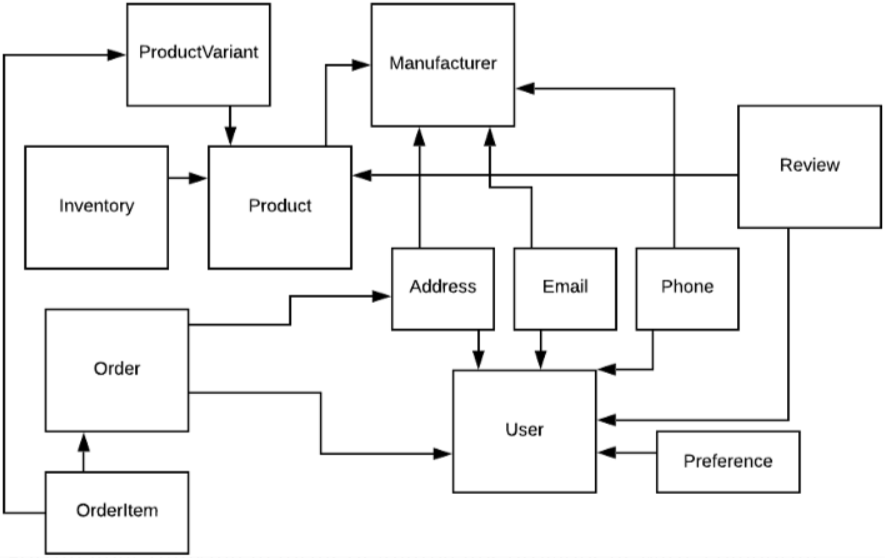

*<font style="color:rgb(0, 0, 0);background-color:rgb(254, 254, 242);">A small but very monolithic database schema</font>*

<font style="color:rgb(0, 0, 0);background-color:rgb(254, 254, 242);">即使使用单一的代码库，这样做也是不对的。</font>

<font style="color:rgb(0, 0, 0);background-color:rgb(254, 254, 242);">例如，当通过数据库调用检索一个</font><code><font style="color:rgb(192, 52, 29);background-color:rgb(251, 229, 225);">Order</font></code><font style="color:rgb(0, 0, 0);background-color:rgb(254, 254, 242);">时，应该返回多少数据？显然，</font><code><font style="color:rgb(192, 52, 29);background-color:rgb(251, 229, 225);">Order</font></code><font style="color:rgb(0, 0, 0);background-color:rgb(254, 254, 242);">详情包含状态、ID和下单日期。那么是否需要返回所有的</font><code><font style="color:rgb(192, 52, 29);background-color:rgb(251, 229, 225);">Order</font></code><font style="color:rgb(0, 0, 0);background-color:rgb(254, 254, 242);">物品？物品从哪里寄出以及寄到哪里？是否需要</font><code><font style="color:rgb(192, 52, 29);background-color:rgb(251, 229, 225);">User</font></code><font style="color:rgb(0, 0, 0);background-color:rgb(254, 254, 242);">对象来表示下单者和接收者？如果是，那么应该需要与</font><code><font style="color:rgb(192, 52, 29);background-color:rgb(251, 229, 225);">User</font></code><font style="color:rgb(0, 0, 0);background-color:rgb(254, 254, 242);">一同返回多少数据？</font>

<font style="color:rgb(0, 0, 0);background-color:rgb(254, 254, 242);">在转向微服务的过程中，我们将对代码库和数据模式一并进行拆分，这将是面临的最困难的一步。幸运的是，聚合思维为我们设计数据微服务和关联的数据库模型提供了蓝图和坚实的指导方针，相比漫无目的地对服务进行组合，聚合模式可以帮助我们确认：</font>

* <font style="color:rgb(0, 0, 0);background-color:rgb(254, 254, 242);">根实体</font>
* <font style="color:rgb(0, 0, 0);background-color:rgb(254, 254, 242);">附加到根实体的值对象</font>
* <font style="color:rgb(0, 0, 0);background-color:rgb(254, 254, 242);">用于跨实体维护数据一致性的不变量</font>

<font style="color:rgb(0, 0, 0);background-color:rgb(254, 254, 242);">虽然后续仍然有很多工作要做，且通常需要很多次迭代才能确定聚合，但为我们提供了一个很好的指导方针，一旦形成聚合，就可以更加自信地做到这一点(微服务化)。</font>

#### <font style="color:rgb(51, 51, 51);background-color:rgb(254, 254, 242);">共享</font>

<font style="color:rgb(0, 0, 0);background-color:rgb(254, 254, 242);">大多数数据库都支持大流量处理。但即使是最高性能的数据库，其处理能力也是有限的。当数据库中的数据流太多时，可以有如下选择：</font>

<font style="color:rgb(0, 0, 0);background-color:rgb(254, 254, 242);">一个常见的方式是</font>[<font style="color:rgb(0, 0, 0);background-color:rgb(254, 254, 242);">分片</font>](https://www.digitalocean.com/community/tutorials/understanding-database-sharding)<font style="color:rgb(0, 0, 0);background-color:rgb(254, 254, 242);">，描述了一种水平扩展数据库的方法。当对数据库进行分片时，会创建多个数据库模式副本，并将数据切分到这些副本中。</font>

<font style="color:rgb(0, 0, 0);background-color:rgb(254, 254, 242);">例如，如果创建了4个分片，则每个分配大概会保存四分之一的数据。所有分配的模式都是相同的，即包含相同的表，外键以及其他约束等。</font>

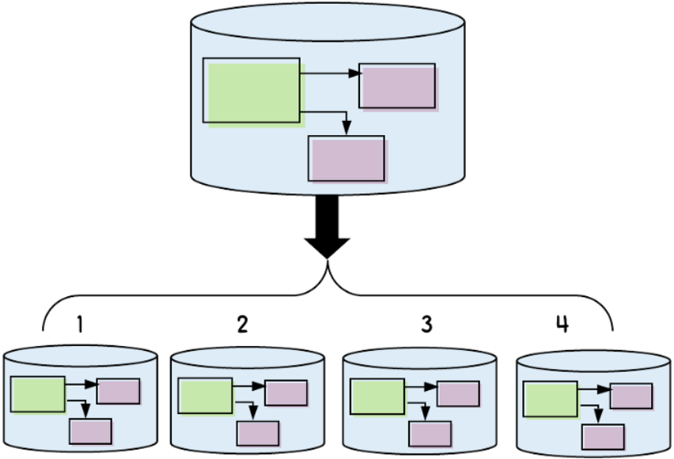

*<font style="color:rgb(0, 0, 0);background-color:rgb(254, 254, 242);">With sharding, we horizontally scale by splitting a large schema into multiple smaller, identical schemas</font>*

<font style="color:rgb(0, 0, 0);background-color:rgb(254, 254, 242);">高效分片的关键是分片键。分片键是一个通用标识符，通过哈希或模数函数来确定其归属于哪个分片。</font>

<font style="color:rgb(0, 0, 0);background-color:rgb(254, 254, 242);">例如，如果我们尝试更新一个用户，我们可以对用户的ID进行哈希，然后对4取模(假设有4个分片)来确定从哪个分片来查找该用户。</font>

<font style="color:rgb(0, 0, 0);background-color:rgb(254, 254, 242);">如果对一个典型的一体式数据库模式进行分片，这将是一个几乎不可能的任务。为什么？是因为在我们的一体式模式中包含大量关联的外键。例如，我们可能有一个从</font><code><font style="color:rgb(192, 52, 29);background-color:rgb(251, 229, 225);">ORDER</font></code><font style="color:rgb(0, 0, 0);background-color:rgb(254, 254, 242);">表到</font><code><font style="color:rgb(192, 52, 29);background-color:rgb(251, 229, 225);">USER</font></code><font style="color:rgb(0, 0, 0);background-color:rgb(254, 254, 242);">表的外键（代表下订单的用户）。</font>

<font style="color:rgb(0, 0, 0);background-color:rgb(254, 254, 242);">现在我们使用一个</font><code><font style="color:rgb(192, 52, 29);background-color:rgb(251, 229, 225);">User</font></code><font style="color:rgb(0, 0, 0);background-color:rgb(254, 254, 242);"> </font><code><font style="color:rgb(192, 52, 29);background-color:rgb(251, 229, 225);">ID</font></code><font style="color:rgb(0, 0, 0);background-color:rgb(254, 254, 242);"> </font><code><font style="color:rgb(192, 52, 29);background-color:rgb(251, 229, 225);">12345</font></code><font style="color:rgb(0, 0, 0);background-color:rgb(254, 254, 242);">来确定从哪个分片查找该用户，12345 % 4 = 1, 因此可以在Shard 1中查找</font><code><font style="color:rgb(192, 52, 29);background-color:rgb(251, 229, 225);">User</font></code><font style="color:rgb(0, 0, 0);background-color:rgb(254, 254, 242);">。但如果</font><code><font style="color:rgb(192, 52, 29);background-color:rgb(251, 229, 225);">ORDER</font></code><font style="color:rgb(0, 0, 0);background-color:rgb(254, 254, 242);">记录(ID为</font><code><font style="color:rgb(192, 52, 29);background-color:rgb(251, 229, 225);">6543</font></code><font style="color:rgb(0, 0, 0);background-color:rgb(254, 254, 242);">)保存了的到该</font><code><font style="color:rgb(192, 52, 29);background-color:rgb(251, 229, 225);">USER</font></code><font style="color:rgb(0, 0, 0);background-color:rgb(254, 254, 242);">记录的外键，6543 % 4 = 3，因此会在Shard 3中查找该</font><code><font style="color:rgb(192, 52, 29);background-color:rgb(251, 229, 225);">ORDER</font></code><font style="color:rgb(0, 0, 0);background-color:rgb(254, 254, 242);">记录。由于存在外键，因此不可能使用这种方式实现(</font>*<font style="color:rgb(0, 0, 0);background-color:rgb(254, 254, 242);">会订单和下订单的用户不在同一个分片中</font>*<font style="color:rgb(0, 0, 0);background-color:rgb(254, 254, 242);">)。</font>

<font style="color:rgb(0, 0, 0);background-color:rgb(254, 254, 242);">上面是一个一体式数据库示例，我们可以使用微服务的数据模式来将我们从中解放出来。</font>

<font style="color:rgb(0, 0, 0);background-color:rgb(254, 254, 242);">假设我们创建了一个</font><code><font style="color:rgb(192, 52, 29);background-color:rgb(251, 229, 225);">User</font></code><font style="color:rgb(0, 0, 0);background-color:rgb(254, 254, 242);">服务(类似之前的例子)，一个User实体关联了0..n个邮件地址，邮寄地址以及电话号码。底层数据模式如下：</font>

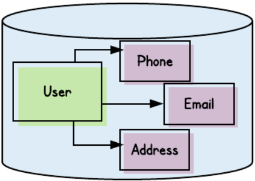

<font style="color:rgb(0, 0, 0);background-color:rgb(254, 254, 242);">现在，假设我们没有采用聚合的概念，直接提供了访问所有实体的方法：</font>

```bash
GET /users/{user-id}
GET /users/phones/{phone-id}
GET /users/emails/{email-id}
GET /users/emails/{email-id}
```

<font style="color:rgb(0, 0, 0);background-color:rgb(254, 254, 242);">一年之后，由于数据库中的数据过多，我们需要对其进行分片。那么可以吗？</font>

<font style="color:rgb(0, 0, 0);background-color:rgb(254, 254, 242);">下例展示了我们的4个</font><code><font style="color:rgb(192, 52, 29);background-color:rgb(251, 229, 225);">USER</font></code><font style="color:rgb(0, 0, 0);background-color:rgb(254, 254, 242);">分片，一个ID为</font><code><font style="color:rgb(192, 52, 29);background-color:rgb(251, 229, 225);">12345</font></code><font style="color:rgb(0, 0, 0);background-color:rgb(254, 254, 242);">的</font><code><font style="color:rgb(192, 52, 29);background-color:rgb(251, 229, 225);">USER</font></code><font style="color:rgb(0, 0, 0);background-color:rgb(254, 254, 242);">记录(12345 % 4 = Shard 1)，以及关联的</font><code><font style="color:rgb(192, 52, 29);background-color:rgb(251, 229, 225);">PHONE_NUMBER</font></code><font style="color:rgb(0, 0, 0);background-color:rgb(254, 254, 242);">记录(ID为</font><code><font style="color:rgb(192, 52, 29);background-color:rgb(251, 229, 225);">235</font></code><font style="color:rgb(0, 0, 0);background-color:rgb(254, 254, 242);">，235 % 4 = Shard 3)</font>

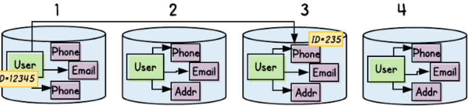

<font style="color:rgb(0, 0, 0);background-color:rgb(254, 254, 242);">我们遇到了与一体式数据模式相同的问题(</font>*<font style="color:rgb(0, 0, 0);background-color:rgb(254, 254, 242);">本应在同一个分片中进行查找的用户和用户的手机号，被分散到了分片1和3中</font>*<font style="color:rgb(0, 0, 0);background-color:rgb(254, 254, 242);">)。</font>

<font style="color:rgb(0, 0, 0);background-color:rgb(254, 254, 242);">由于没有提供一个根，并将根作为对外暴露的唯一实体，导致可能在后续数据库分片后出现数据不一致的问题。使用聚合时，可以看作聚合中所有的实体使用了同一个ID，后续数据库分片后，聚合中的实体也会存在相同的数据库中。</font>

<font style="color:rgb(0, 0, 0);background-color:rgb(254, 254, 242);">如果我们正确定义了User 聚合，就可以保证每个请求会经过根实体，这样根实体的ID就决定了每个实体的位置(包括电话号码)。</font>

<font style="color:rgb(0, 0, 0);background-color:rgb(254, 254, 242);">在我们上面的例子中，与user ID</font><font style="color:rgb(0, 0, 0);background-color:rgb(254, 254, 242);"> </font><code><font style="color:rgb(192, 52, 29);background-color:rgb(251, 229, 225);">12345</font></code><font style="color:rgb(0, 0, 0);background-color:rgb(254, 254, 242);">关联的所有的实体(邮件地址，邮寄地址，电话号码和根实体本身)都存储到了分片1。</font>

#### <font style="color:rgb(51, 51, 51);background-color:rgb(254, 254, 242);">消息传递</font>

<font style="color:rgb(0, 0, 0);background-color:rgb(254, 254, 242);">现在讨论一下</font>[<font style="color:rgb(0, 0, 0);background-color:rgb(254, 254, 242);">有界上下文</font>](https://medium.com/datadriveninvestor/if-youre-building-microservices-you-need-to-understand-what-a-bounded-context-is-30cbe51d5085)<font style="color:rgb(0, 0, 0);background-color:rgb(254, 254, 242);">，它是域驱动设计中另一个非常有用的模式。此外，它可以帮助我们理解如何在微服务架构使用消息传递(而不是同步API调用)。</font>

<font style="color:rgb(0, 0, 0);background-color:rgb(254, 254, 242);">在有界上下文中任意时间发生的事件将会被发布到像Kafka这样的事件总线中，然后由其他有界上下文中的服务消费。</font>

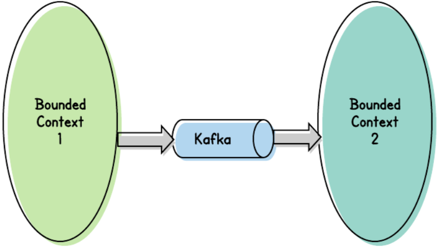

<font style="color:rgb(0, 0, 0);background-color:rgb(254, 254, 242);">那么问题来了，"消息中应该包含哪些内容"？例如，一个</font><code><font style="color:rgb(192, 52, 29);background-color:rgb(251, 229, 225);">User</font></code><font style="color:rgb(0, 0, 0);background-color:rgb(254, 254, 242);">添加了一个电话号码。一旦该修改提交到了数据库，我们将会把这次编辑作为一个消息进行发布。</font>

<font style="color:rgb(0, 0, 0);background-color:rgb(254, 254, 242);">但什么才会被发布呢？通常，我们会发布被修改的数据的状态。因此仅需要简单地发布新的电话号码即可：</font>

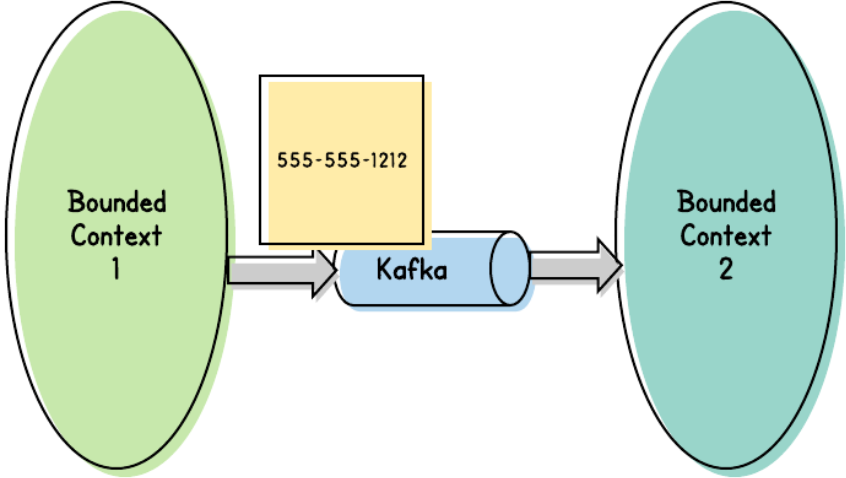

<font style="color:rgb(0, 0, 0);background-color:rgb(254, 254, 242);">上述可能就够了，但很难判断消息的消费者可能还需要哪些信息。例如有些消费则可能会需要了解是否新的电话号码是</font><code><font style="color:rgb(192, 52, 29);background-color:rgb(251, 229, 225);">User</font></code><font style="color:rgb(0, 0, 0);background-color:rgb(254, 254, 242);">的主电话号码。</font>

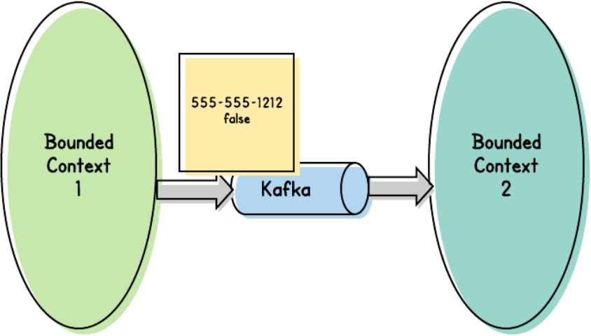

<font style="color:rgb(0, 0, 0);background-color:rgb(254, 254, 242);">但如果已经给出了主电话号码为</font>*<font style="color:rgb(0, 0, 0);background-color:rgb(254, 254, 242);">false</font>*<font style="color:rgb(0, 0, 0);background-color:rgb(254, 254, 242);">，但消费者又需要知道哪个才是主电话号码？我们可能会发送所有的电话号码，但如果另一个消费者需要通过电子邮件通知该</font><code><font style="color:rgb(192, 52, 29);background-color:rgb(251, 229, 225);">User</font></code><font style="color:rgb(0, 0, 0);background-color:rgb(254, 254, 242);">已经对该修改进行了处理，那么是否应该发送</font><code><font style="color:rgb(192, 52, 29);background-color:rgb(251, 229, 225);">User</font></code><font style="color:rgb(0, 0, 0);background-color:rgb(254, 254, 242);">的所有电子邮件?</font>

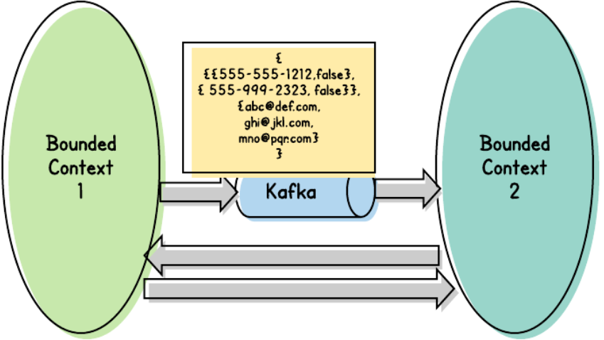

<font style="color:rgb(0, 0, 0);background-color:rgb(254, 254, 242);">如果这样的化，处理将永远不会结束，且永远不会得到正确的处理方式。</font>

<font style="color:rgb(0, 0, 0);background-color:rgb(254, 254, 242);">一种可选方式是简单地在消息中发送被修改的实体的ID。任何消费者可以调用事件发送者来获取具体的事件内容。</font>

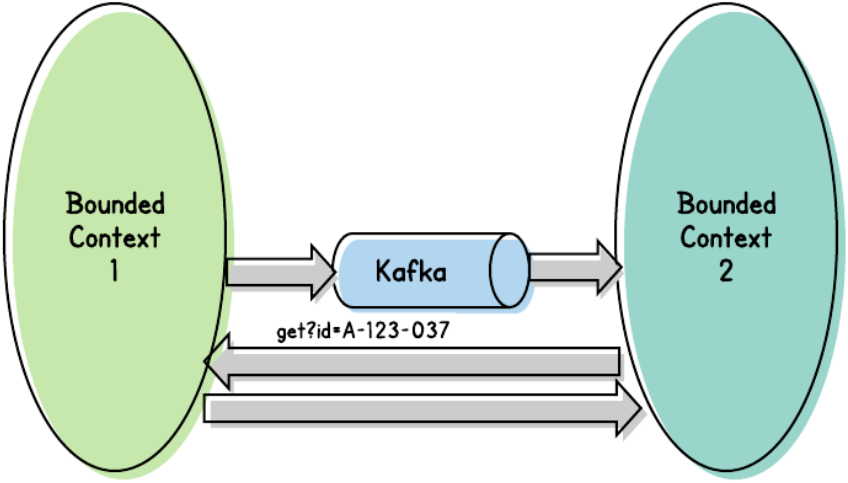

<font style="color:rgb(0, 0, 0);background-color:rgb(254, 254, 242);">不幸的是，这种方式有两个问题：</font>

* <font style="color:rgb(0, 0, 0);background-color:rgb(254, 254, 242);">有时会导致检索到错误的数据。假设修改了实体123，并发布了对应的消息，然后又对该实体进行了修改。之后，某个消费者消费了第一个事件，并请求实体123。该消费者将不会获得首次修改。如果消费者仅关心最新的修改，则这么实现可能是没有问题的。但作为生产者事件，我们无法知道消费者是否需要(在现在和未来)跟踪单个变更。</font>
* <font style="color:rgb(0, 0, 0);background-color:rgb(254, 254, 242);">更糟糕的是，它使得已解耦的事件驱动架构(因为跨有界上下文的调用而)变为了一个强耦合的系统。</font>

<font style="color:rgb(0, 0, 0);background-color:rgb(254, 254, 242);">那么应该如何传递我们的消息呢？</font>

<font style="color:rgb(0, 0, 0);background-color:rgb(254, 254, 242);">事实证明，如果我们接受了聚合，就会有明确的答案。 每当更改聚合时，都应将该聚合作为消息传递。由于聚合作为一个原子单元，任何对聚合的一部分的修改都会被认为对整个聚合进行了修改。</font>

<font style="color:rgb(0, 0, 0);background-color:rgb(254, 254, 242);">消息中是如何表示聚合的，具体取决于所在的组织。可能是一个简单的JSON结构，或可能使用</font>[<font style="color:rgb(0, 0, 0);background-color:rgb(254, 254, 242);">Avro</font>](https://avro.apache.org/)<font style="color:rgb(0, 0, 0);background-color:rgb(254, 254, 242);">模式表达。聚合的数据可能是加密的。不管数据格式如何，在“聚合”的思考和设计中都会遇到诸如此类的问题。</font>

<font style="color:rgb(0, 0, 0);background-color:rgb(254, 254, 242);">总的思路就是将"聚合"作为一个原子单元进行传递。如果仅仅使用全局标识符来传递消息(本质上类似一个指针)，则可能会遇到读写不一致的问题。</font>

#### <font style="color:rgb(51, 51, 51);background-color:rgb(254, 254, 242);">重试</font>

<font style="color:rgb(0, 0, 0);background-color:rgb(254, 254, 242);">消息传递的概念通常会涉及重试。基于消息的事件驱动架构的一个亮点就是恢复能力(以自动重试的方式)。</font>

<font style="color:rgb(0, 0, 0);background-color:rgb(254, 254, 242);">这意味着什么？当发布消息到如Kafka这样的事件总线时，就可以被下游消费者所消费。大多数情况下会顺利进行。但有些情况下，消费者可能会遇到消息消费的问题：</font>

* <font style="color:rgb(0, 0, 0);background-color:rgb(254, 254, 242);">可能是因为消费者的数据库暂时不可用，导致消费者无法正确处理事件。</font>
* <font style="color:rgb(0, 0, 0);background-color:rgb(254, 254, 242);">或者可能是因为暂时无法使用安全设备，导致消费者无法解密消息。</font>

<font style="color:rgb(0, 0, 0);background-color:rgb(254, 254, 242);">这类情况下，消费者在当前消息处理完之前将无法继续处理下一个消息，且消费者能够对处理的消息进行确认。这些行为默认会发生在Kafka等系统上。 实际上，消费者将继续尝试，直到成功为止。</font>

<font style="color:rgb(0, 0, 0);background-color:rgb(254, 254, 242);">通常这是期望的行为，一般也能够相对快速地解决相应的问题。同时，对下一条消息进行处理是没有意义的，因为该消息也很可能会发生相同的问题。</font>

<font style="color:rgb(0, 0, 0);background-color:rgb(254, 254, 242);">但还是会存在第二类问题：当消息本身存在问题时(可能是因为消息在传递中出现了损坏，或包含一个特殊的字符，或没能通过某些有效性校验)。这种情况下，消费者会多次尝试消费消息，但永远不会成功。</font>

<font style="color:rgb(0, 0, 0);background-color:rgb(254, 254, 242);">当检测到这类问题时，消费者可能会把当前消息放到一边，例如将其放到一个特殊的队列中，并继续处理后续的消息。</font>

<font style="color:rgb(0, 0, 0);background-color:rgb(254, 254, 242);">但这种方式也存在问题。我们期望确保最终能够处理掉"坏的"消息，即使需要一些手动操作。但如果在消费者处理一个消息的同时，消息中的数据发生了变化，新的变更将会因为重新处理"坏的"消息而被覆盖掉。</font>

<font style="color:rgb(0, 0, 0);background-color:rgb(254, 254, 242);">下图展示了这个问题：</font>

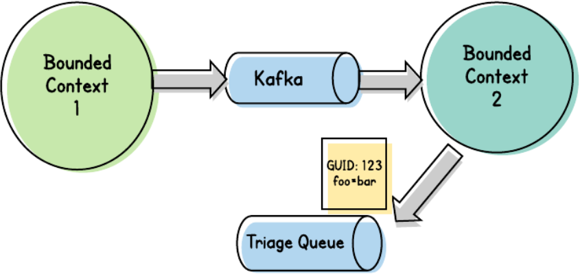

<font style="color:rgb(0, 0, 0);background-color:rgb(254, 254, 242);">Bounded Context 1中实体123的"foo"的值变为了"bar"，然后发布了一个表示此次变更的消息，由于Bounded Context 2中的消费者无法解析该消息，因此将其放到了一个特殊的队列中。</font>

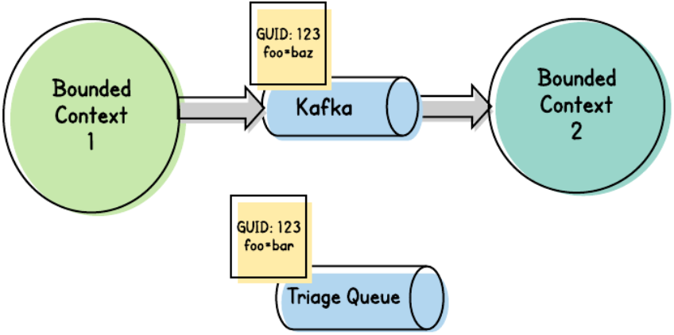

<font style="color:rgb(0, 0, 0);background-color:rgb(254, 254, 242);">后来Bounded Context 1中的实体123的"foo"的值变为了"baz"，然后发布一个从"bar"变为"baz"的消息，此时Bounded Context 2消费的消息中的实体123的值为"baz"。</font>

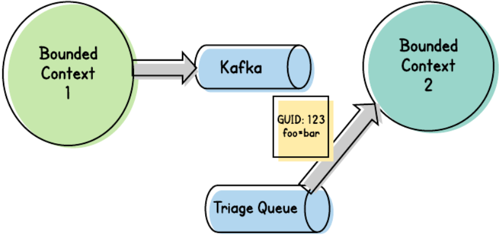

<font style="color:rgb(0, 0, 0);background-color:rgb(254, 254, 242);">再后来修复了初始的消息(如移除了一个错误字符)，然后重新发送到Bounded Context 2，该消息中的实体123的值为"bar"。</font>

<font style="color:rgb(0, 0, 0);background-color:rgb(254, 254, 242);">这是一个处理顺序的问题。通常，我们需要保证按照事件发送的顺序进行处理。但在上述场景下，则无法按序处理事件。</font>

<font style="color:rgb(0, 0, 0);background-color:rgb(254, 254, 242);">如果我们围绕聚合来定义数据，则可以知道知道消费者可能收到的消息的变更范围。换句话说，接收到的任何消息都描述了一个新版本的聚合。且可以通过根实体的全局唯一标识符(GUID)来确认聚合。因此，如果消费者在确认无法在没有人工介入的情况下无法处理某个消息时，就可以将该消息放到一个独立的队列中，它可以使用该GUID来表示被搁置的消息。如果碰到了更多包含相同聚合的消息，则可以将这些消息放到相同的队列中。然后可以在原始问题解决(例如可能需要更新消费者来处理奇怪的Microsoft Word特殊字符)前继续按照上述逻辑处理消息。如果问题解决，消费者就可以处理这些被搁置的消息。</font>

<font style="color:rgb(0, 0, 0);background-color:rgb(254, 254, 242);">可以肯定地说，构建这些重试机制并不容易，但使用聚合，最起码是可行的。</font>

<font style="color:rgb(0, 0, 0);background-color:rgb(254, 254, 242);">本节展示了如何使用聚合的GUID作为全局唯一标识符来缓存来自特定聚合的(无法继续处理的)消息。这样就可以继续处理来自其他聚合的消息。在聚合的问题解决之后，就可以继续处理该聚合之前被搁置的消息。</font>

#### <font style="color:rgb(51, 51, 51);background-color:rgb(254, 254, 242);">缓存</font>

<font style="color:rgb(0, 0, 0);background-color:rgb(254, 254, 242);">如果没有很好地定义有界数据结构，缓存可能会因此变得笨重。大多数缓存操作，如哈希映射，它们允许使用一个标识符来关联一堆数据，并通过传递该标识符来对这些数据进行检索。</font>

<font style="color:rgb(0, 0, 0);background-color:rgb(254, 254, 242);">如果我们没有围绕聚合来定义数据结构，则可能会很难确定需要缓存的数据类型。假设一个经常被访问，但很少被修改的系统，在这种系统中，我们可能会期望缓存请求结果来最大程度地减少对数据库的访问次数，但应该缓存哪些内容呢？</font>

<font style="color:rgb(0, 0, 0);background-color:rgb(254, 254, 242);">我们可能会简单地对每次请求的结果进行缓存。回到User的例子，这意味着我们会缓存如下结果：</font>

* <font style="color:rgb(0, 0, 0);background-color:rgb(254, 254, 242);">对特定用户的查询</font>
* <font style="color:rgb(0, 0, 0);background-color:rgb(254, 254, 242);">对特定电话号码的查询</font>
* <font style="color:rgb(0, 0, 0);background-color:rgb(254, 254, 242);">对一组邮件地址的查询</font>
* <font style="color:rgb(0, 0, 0);background-color:rgb(254, 254, 242);">对特定用户的婚姻状况的查询</font>

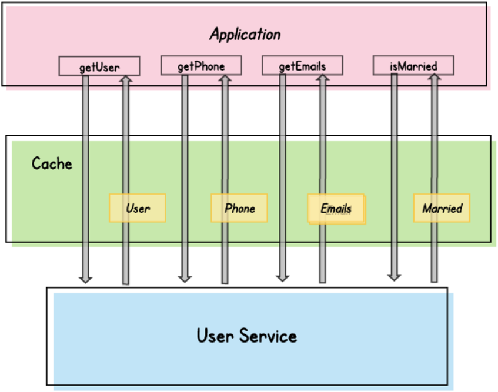

<font style="color:rgb(0, 0, 0);background-color:rgb(254, 254, 242);">注意缓存会复制数据。假设我们缓存了一个用户对象，但同时也缓存了独立的联系信息和联系信息组，以及用户独立的对象字段。最终会需要大量内存来保存这些数据。当缓存了无效的数据时，可能会出现严重问题。</font>

<font style="color:rgb(0, 0, 0);background-color:rgb(254, 254, 242);">例如缓存的电话号码发生了变化，如假设在先前的例子中，"best contact"标志从</font>*<font style="color:rgb(0, 0, 0);background-color:rgb(254, 254, 242);">false</font>*<font style="color:rgb(0, 0, 0);background-color:rgb(254, 254, 242);">变为了</font>*<font style="color:rgb(0, 0, 0);background-color:rgb(254, 254, 242);">true</font>*<font style="color:rgb(0, 0, 0);background-color:rgb(254, 254, 242);">，此时需要校验缓存的电话号码。但是否需要校验缓存的用户对象，以及其他联系方式的"best contact"是否由</font>*<font style="color:rgb(0, 0, 0);background-color:rgb(254, 254, 242);">true</font>*<font style="color:rgb(0, 0, 0);background-color:rgb(254, 254, 242);">变为了</font>*<font style="color:rgb(0, 0, 0);background-color:rgb(254, 254, 242);">fasle</font>*<font style="color:rgb(0, 0, 0);background-color:rgb(254, 254, 242);">。</font>

<font style="color:rgb(0, 0, 0);background-color:rgb(254, 254, 242);">如果我们使用聚合，则不需要担心这些问题。使用聚合，我们只需要缓存一个缓存key：聚合的GUID。当检索聚合时，我们会对其进行缓存。当聚合的任何属性发生变化时，对整个聚合进行校验即可。</font>*<font style="color:rgb(0, 0, 0);background-color:rgb(254, 254, 242);">(此时缓存的不是内容，而是索引方式，当然也可以缓存整个聚合</font>*<font style="color:rgb(0, 0, 0);background-color:rgb(254, 254, 242);">)</font>

#### <font style="color:rgb(51, 51, 51);background-color:rgb(254, 254, 242);">服务授权</font>

<font style="color:rgb(0, 0, 0);background-color:rgb(254, 254, 242);">在我之前所在的公司向微服务迈进时，我领导了一个团队，负责实施服务到服务的数据级别的授权。换句话说，我们已经解决了"是否允许服务A允许访问服务B"的问题，还需要解决"是否允许服务A从服务B请求实体123"的问题。</font>

<font style="color:rgb(0, 0, 0);background-color:rgb(254, 254, 242);">这意味着我们需要了解当前的用户代理(例如，哪个客户发起的请求)，像</font>[<font style="color:rgb(0, 0, 0);background-color:rgb(254, 254, 242);">JWTs</font>](https://jwt.io/)<font style="color:rgb(0, 0, 0);background-color:rgb(254, 254, 242);">这类认证代理就是这么做的。我们可以在执行服务到服务的调用时，在一个token中传入用户ID。</font>

<font style="color:rgb(0, 0, 0);background-color:rgb(254, 254, 242);">同时我们也需要了解是否允许该用户代理查看特定的实体。在我们的场景中，可能存在大量潜在的实体。此外，一个用户可能需要查看他们拥有的文档，或可能通过其他用户的授权来访问文档(例如，通过第三方授权方式)。</font>

<font style="color:rgb(0, 0, 0);background-color:rgb(254, 254, 242);">我们的目的是提供一个通用的、插件化的解决方案，同时需要避免通过重复(同步)调用某个独立的服务来确定一个用户是否有权限访问某个特定的实体。</font>

<font style="color:rgb(0, 0, 0);background-color:rgb(254, 254, 242);">出于上述原因，我们决定在启动过程中，对允许给定用户访问的项目做一次确定，并在用户token中包含这些商品的ID。</font>

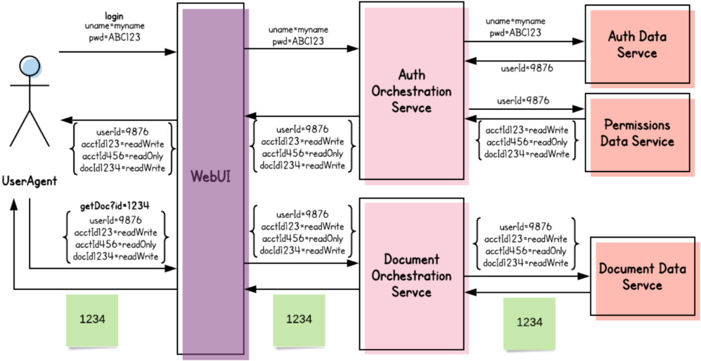

<font style="color:rgb(0, 0, 0);background-color:rgb(254, 254, 242);">对于上述情况来说，如果不围绕聚合来设计我们的微服务，则有可能是行不通的(有可能无法访问潜在的实体列表)。</font>

<font style="color:rgb(0, 0, 0);background-color:rgb(254, 254, 242);">但是由于我们已经在使用聚合方面进行了前期规划，因此我们通过聚合根的ID来约束可以查找任何实体。这样我们仅需要授权给特定用户的聚合。</font>

<font style="color:rgb(0, 0, 0);background-color:rgb(254, 254, 242);">上例使用userId作为GUID，聚合了与用户相关的所有信息。并以此来检索该用户的其他信息(如可以访问的文档)。</font>

#### <font style="color:rgb(51, 51, 51);background-color:rgb(254, 254, 242);">跟踪变更</font>

<font style="color:rgb(0, 0, 0);background-color:rgb(254, 254, 242);">有时候，我们需要对变更的数据进行跟踪。过去，我们通过实现数据库活动触发的变更数据捕获(CDC)系统来记录数据的变更。最近，组织倾向于捕获业务实体的变更，而不是数据库行的变更。此时我们面临着一个问题："哪些数据需要快照，以及以后如何使用"？</font>

<font style="color:rgb(0, 0, 0);background-color:rgb(254, 254, 242);">你可能已经猜到了，答案是围绕聚合来设计数据。任何时间对任何实体进行变更时，都会记录一个新版本的聚合，这个过程并不简单，但更加准确。</font>

<font style="color:rgb(0, 0, 0);background-color:rgb(254, 254, 242);">回想一下，聚合的最初目的是在事务上强制执行不变量(invariants)。因此聚合的每个快照都表示此类事务的执行结果。</font>

<font style="color:rgb(0, 0, 0);background-color:rgb(254, 254, 242);">后续对变更的检索也更直接。如果需要查找历史</font><code><font style="color:rgb(192, 52, 29);background-color:rgb(251, 229, 225);">User</font></code><font style="color:rgb(0, 0, 0);background-color:rgb(254, 254, 242);">的联系方式，我们不需要跨多CDS表来收集变更。相反，只需要访问聚合表，各个聚合之间的差异也变得无关紧要。 我们只是将一个版本的聚合与另一个版本进行比较。</font>

#### <font style="color:rgb(51, 51, 51);background-color:rgb(254, 254, 242);">其他方面</font>

<font style="color:rgb(0, 0, 0);background-color:rgb(254, 254, 242);">上述并没有详尽地列出围绕聚合设计实体可以帮助我们解决的各类挑战。毫无疑问， 应用聚合模式会使我们以系统的方式预先思考哪些实体属于同一实体。最终，我们会将操作约束到具有单个访问点的，定义明确的原子组。 我们不会因实体之间的偶然依赖关系而感到厌烦，也不会各种引用泄漏而妨碍我们实施扩展方案。</font>

<font style="color:rgb(0, 0, 0);background-color:rgb(254, 254, 242);">需要注意的一点就是，聚合是与业务息息相关的，且对一个聚合的确认也不是一蹴而就的，有时需要进行多次协商和迭代才能达到一个满意的结果。但架构就是一个软件的骨架，不好的架构将可能后患无穷。</font>


> 更新: 2025-04-20 22:39:01  
> 原文: <https://www.yuque.com/aaron-wecc3/dhluml/zedzezwx8y8wbvam>