# 京东到家应用架构设计分享

#### 前言
商品系统是电商系统最基础、最核心的系统之一。商品数据遍布所有业务，首页、门店页、购物车、订单、结算、售后、库存、价格等，都离不开商品。商品信息要稳定提供至到家供应链的每个节点，所以必须要有一套稳定的、高性能的商品服务体系支撑。

随着京东到家商品业务的快速发展，业务从单一转变为多元化，系统功能设计上也从最初的大而全的功能支持，向微功能、领域化演变。

商品系统也在高可用、高并发的持续冲击下，经历了多个架构版本的演进。最初1.0版本，采用合适简单的设计思路，满足了业务快速迭代上线；随着业务量级的快速增长，针对高可用、高性能的提升，演进出了2.0版本。随后业务复杂度的提升，导致了系统复杂度的提升，为了解决系统复杂度带来的问题，孕育出了3.0商品体系领域建设。

#### 到家商品架构初始模型1.0 合适、简单原则设计思想
商品系统雏形

到家商品系统创建之初，为了贴合业务的快速发展，设计并且上线了到家商品1.0系统。商品系统服务本着大而全的思想，用一套服务提供给上游业务方聚合的商品数据，无论是B端业务还是C端业务均耦合在一起，在应对业务快速迭代上线、节省开发成本上 充分体现出了简单的优势。

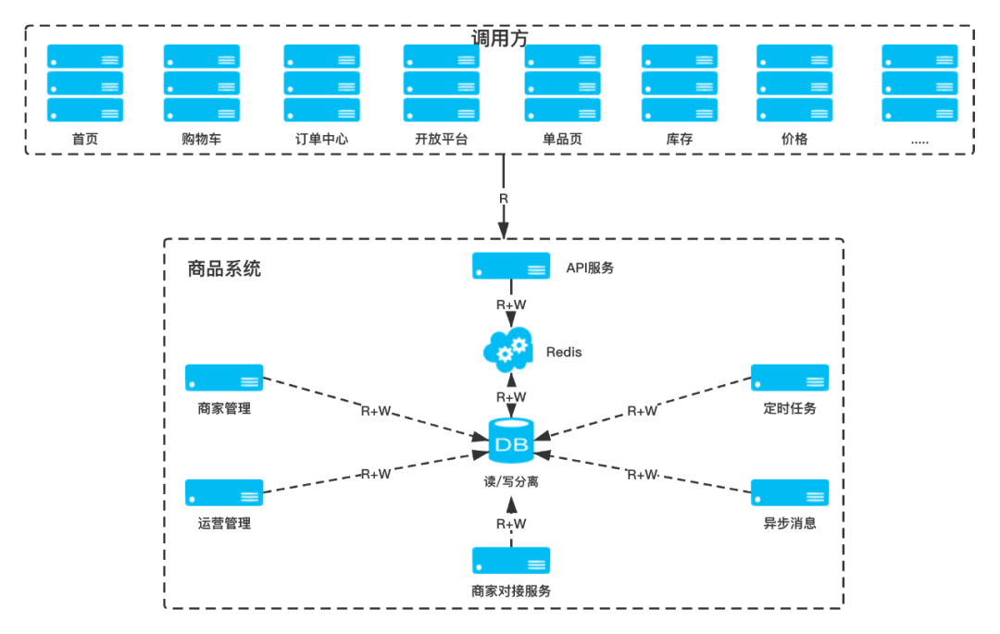

随着业务量级的增加，最初设计的劣势也突显了出来，主要体现在以下几点：

**·线上B/C端业务耦合在一起，导致线上读/写业务相互影响，特别是大促期间 大量修改商品导致 C端服务不稳定，只能通过不断横向扩容来提高稳定性，继而导致了严重的资源浪费；**

**·服务端性能波动较大；**

**·简易的缓存架构，在高并发下Redis缓存击穿问题；**

**·监控不全面，无法及时预警；**

针对上述问题，商品系统从高可用、高性能的出发点进行了架构2.0演进；

#### 到家商品架构-2.0 高可用、高性能架构模式演进
商品系统经历了1.0快速迭代的阶段后，线上流量也随着业务的增长翻倍，B/C端服务的高耦合导致了商品服务的波动大，而且监控的不全面也导致了不能及时发现系统异常。

为了提高商品系统服务的高可用，商品系统制定了以下迭代方案。

**·AP原则 + 最终一致性思路**

**·B/C服务分离**

**·异地多活、双机架构**

**·Sentinel限流**

**·监控平台**

高可用演进

（1）AP原则 + 最终一致性思路

为了提高商品C端读服务的高可用，采用了AP原则 + 最终一致性的设计思路,引入了分布式缓存Redis集群提高读服务可用性,并通过异步消息保证数据的最终一致性。

AP原则贴合商品系统C端服务的业务场景，比如：因为网络延迟等问题,数据库没有及时同步数据至[Redis缓存](https://so.csdn.net/so/search?q=Redis%E7%BC%93%E5%AD%98&spm=1001.2101.3001.7020),导致当前读取的商品数据和数据库的数据不一致,这种短暂的不一致,在业务上是可以接受的。

引入分布式Redis集群后，商品C端读服务能力不仅提高了可用性，而且在性能上表现也非常出色。

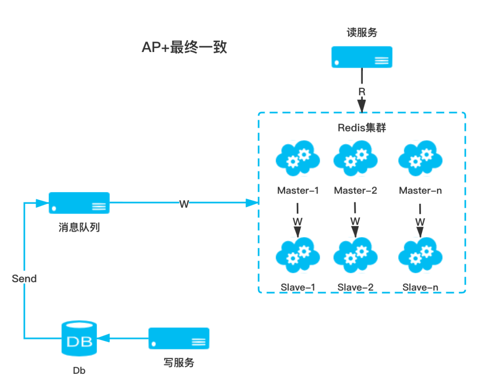

（2）B/C服务分离

商家会通过对接开放平台接口，定期修改商品的信息、图片等属性。例如：我们在一次大促中遇到商家集中修改商品信息，结果写服务占用了大量的系统资源，导致了读服务可用受损。

为了提高商品服务B/C端各自的可用性，独立部署了B/C端服务，分别对外提供服务。B/C服务拆分后，商品系统在后续的各种大促中，B/C服务各自表现平稳，极大提升了商品服务的可用性。商家后续写操作，商品系统再也没有出现过读服务受损的情况。

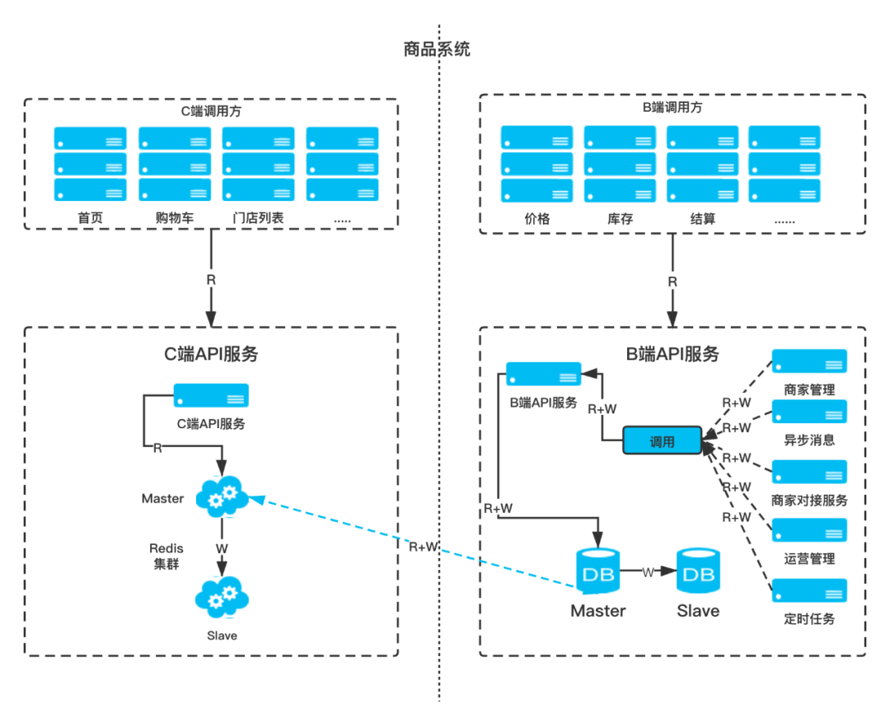

（3）异地多活、双机架构

**异地多活**-到家商品服务docker所在的物理机机房，采用了异地多活的方式进行部署，机房分布在多个不同地区，遵循“鸡蛋不要放在一个篮子里”原则。在一个机房出现问题的时候，还有另外两个机房提供服务，极大提高了商品系统应对黑天鹅事件的处理的可伸缩性。

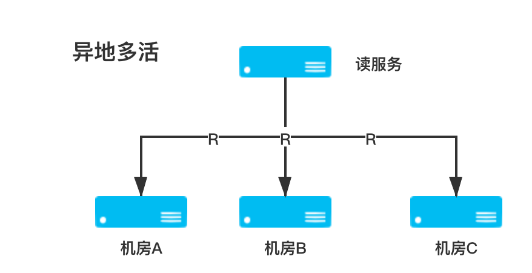

**双机架构**-作为商品核心读服务的支撑中间件Redis集群，使用了主-从模式， 并且主分片和从分片分属不同的机房，在主分片异常的时候主从自动切换。

Mongodb采用了1主2备的方式进行数据备份，主库异常可通过域名快速切换主备节点，整个切换过程平滑无感知。

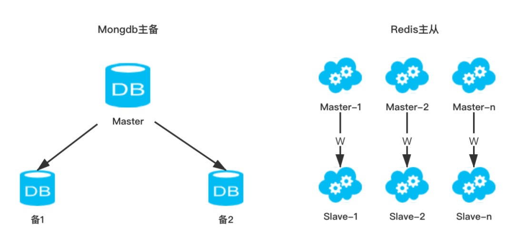

（4）Sentinel限流

商品读服务引入了Sentinel流控组件，可以通过Zookeeper根据调用源实时配置不同的流控策略，在极端流量出现后，可以对非核心的调用源进行限流、熔断，为线上扩容争取足够的时间，避免了突如其来的异常流量导致商品整体服务不可用，提升了商品读服务的可用性。

商品服务通过配置方法名以及调用来源，对边缘业务调用、方法进行定向限流。在极限情况下，通过牺牲边缘业务的可用，起到保障核心方法的高可用的目的。

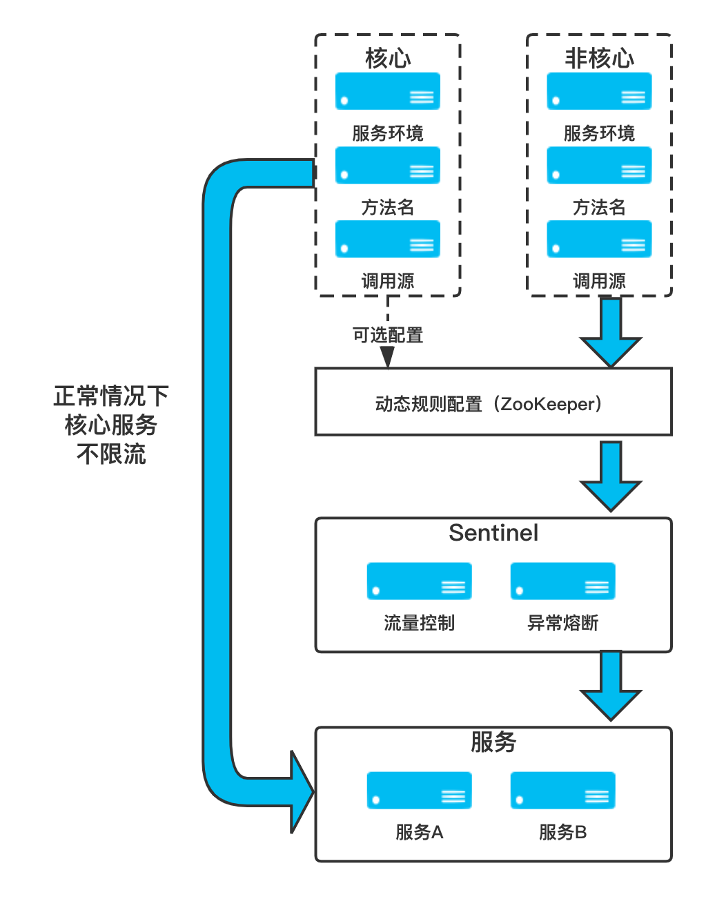

（5）监控平台

商品服务采用了京东的监控报警平台。商品接口API，可以通过UMP监控不同时间段性能分布，实时统计TP99、TP999、AVG、MAX等维度指标。可以监控服务器docker的系统、网络、磁盘、容器等指标，并且通过设定报警阈值实时通知指定负责人。

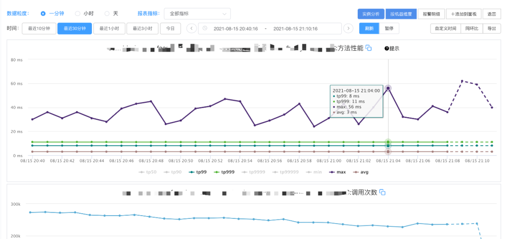

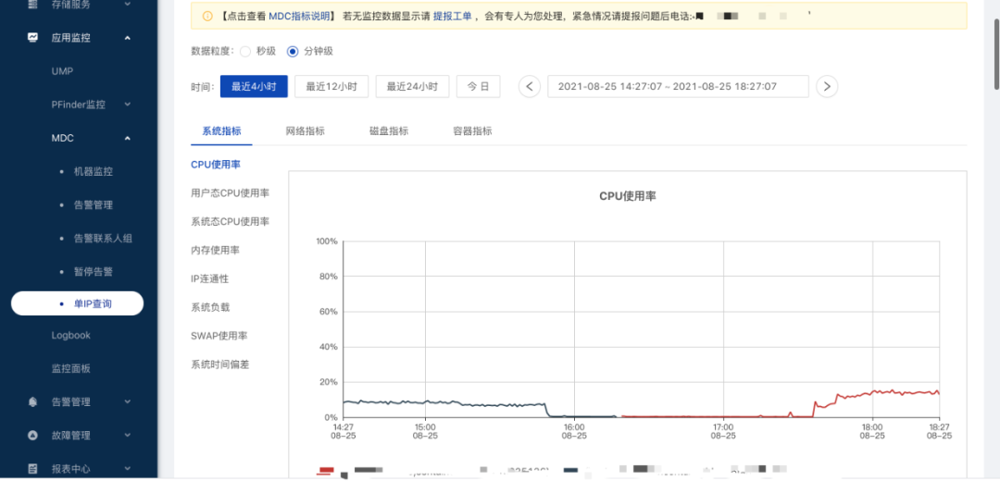

高性能演进

商品系统服务通过高可用的演进后，为我们提升商品服务的性能争取了时间。由于1.0版本商品C端服务的降级查询、以及缓存Redis击穿等问题，对商品系统的性能影响非常大。

例如：在促销期间，高并发的场景下经常会因为降级查询性能损耗->响应线程等待->线程池等待队列打满->拒绝策略，继而引发商品的整体服务性能变慢。

为了提高商品系统服务的性能，商品系统制订了以下迭代方案。

**·C端查询去MongoDb依赖**

**·Redis持久化缓存**

**·数据异步处理服务**

**·内存缓存ehcache**

（1）C端去MongoDb依赖

商品1.0版本，C端的请求未命中redis缓存，则会降级查询Mongodb数据库并把数据回写到redis中。单次请求在商品系统内部经历了多次交互，且部分逻辑是与用户行为无关的比如反写redis，同时存在着比较严重的缓存穿透的风险，商品服务端API性能上波动较大，风险也相对较高。

商品C端读服务移除了降级查询Mongodb的操作，且在B端处理了对Redis缓存的写操作，移除Mongodb依赖之后，商品C端读服务能力性能得到了极大改善。

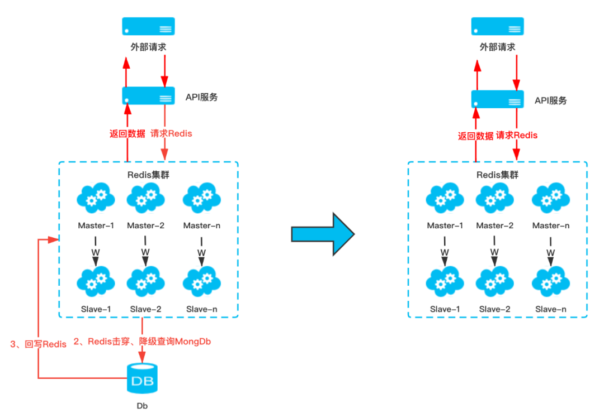

（2）Redis持久化缓存

商品系统经过C端查询去降级的改造后，Redis集群存储的KV，由之前的1个月过期时间，转换为持久化KV存储。

去掉Redis的KV过期时间，关键问题在于如何保证MongoDb数据库和Redis集群的数据一致性。B端商品信息修改 通过异步任务的方式，将数据持久化刷新到redis缓存中，C端请求Redis未命中的KV则视为不存在，不仅减少了商品系统内部请求的交互次数，而且有效防止了缓存穿透问题，最终降低了服务端响应时间。

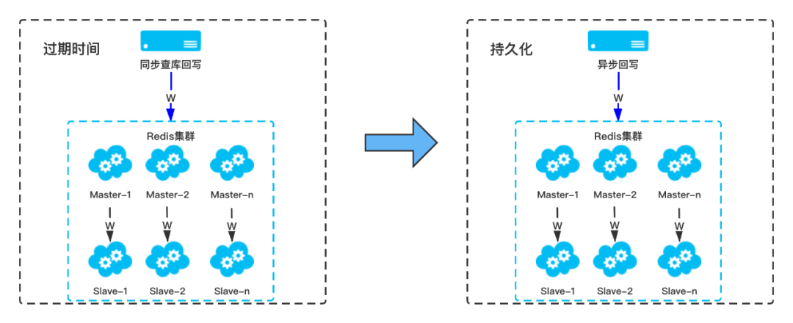

（3）数据异步处理服务

商品最初的B/C/异步任务 耦合在一起，B/C服务经历拆分后各自耦合了异步任务，当商品在修改信息、图片、属性、状态业务的时候，会异步回写Redis缓存来确保MongDb和Redis缓存KV数据的最终一致性，但是大量的异步任务会占用服务资源，从而拖慢B/C服务性能。

所以商品系统搭建了一套独立的数据异步处理服务，包含了异步任务以及消息队列，承载了商品B/C端服务所有的异步写、回写等数据操作。

拆分出的异步任务平台，不仅保障了异步任务功能的完整性，而且根除了异步任务大量写的情况下造成的B/C服务性能波动。

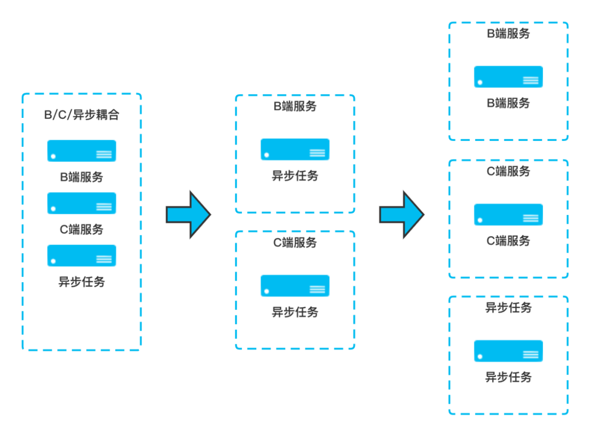

（4）内存缓存ehcache

商品服务存在很多字典数据，比如类目字典、商家分类字典，这些字典往往都是商家维度的大key。而且商家维度的key hash到分片相对集中，大流量的情况下容易出现热点key的问题，导致某几个分片输入输出缓冲区溢出，影响整个redis集群。

商品系统引入了ehcache内存缓存，通过客户端服务器内存存储这类数据，不仅解决了大key、热key 的问题 ，而且减少了与redis中间件的网络请求交互，请求响应速度大幅提升。

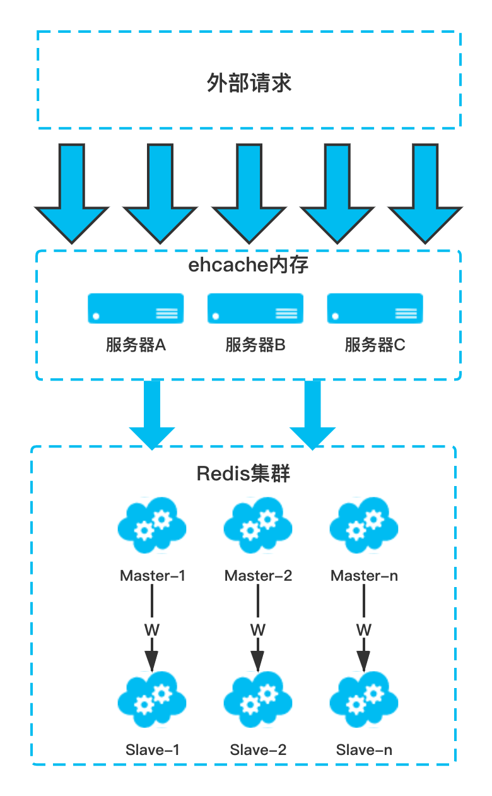

#### 小结：
商品系统经过高性能、高可用的系统演进后，商品系统稳定高可用，在后续的大促流量验证下表现出色。

随着商品业务的迭代、以及系统的复杂度的增加，业务耦合度高、系统扩展困难、维护成本高的问题突显出来。

#### 到家商品架构-3.0 商品体系领域建设
商品业务由最初是线性的，随着业务的复杂度提升，商品的业务由线性逐渐转变为非线性。

例如：商家在建品后，由于操作不当，维护错了商品的信息，导致了异常品类商品数据产生，需要想办法实时监控、处理数据。

又例如：商家入驻到家平台，想把自己的商品快速同步至到家，我们如何提供一个快而全的建品体系供商家使用。

随着需求复杂度的提高，带动了商品系统的复杂度提高，我们在业务开发、扩展、维护的成本也随之提高。

而且系统复杂度提升也带来了以下几个问题：

**·系统错误隔离性差，可用性差，任何一个模块的错误可能导致整个系统的宕机；**

**·可伸缩性差，扩容只能对整个应用扩容，无法做到对整个功能点进行扩容；**

**·所有的服务共用一套体系，某个方法的流量穿透会导致所有的服务不可用；**

为了提高系统扩展性、减少业务开发周期、节约维护成本、降低系统风险，在保障商品系统服务的稳定、高可用的前提下，开始启动了商品系统的3.0版本架构演进：商品体系领域建设。

商品体系建设

首先要明确商品业务的需求点，然后根据不同业务的需求点，从聚合的业务上划分出领域，基于业务领域对系统进行垂直拆分，用分而治之的理念进行商品体系的建设，继而拆分并独立部署以下几个业务领域系统。

**·标库系统**

到家独有的UPC模板系统，提供给商家一键建品的商品模板以及对商家的标品进行规范，更好的赋能商家建品。

**·拓品系统**

通过大数据分析，根据商家类型、经营范围等 补充、提供商家缺失的商品清单，协助商家进行拓宽商品。

**·治理系统**

根据到家商品规则，治理商品的各项基本信息，规范正确数据，制定商品规范。

**·限购系统**

针对商品用户端和手机端进行了商品数量的限购活动支持，协助商家维护单品的限购。

**·属性系统**

商品上的类目属性、特殊属性等边缘属性系统的拆分。

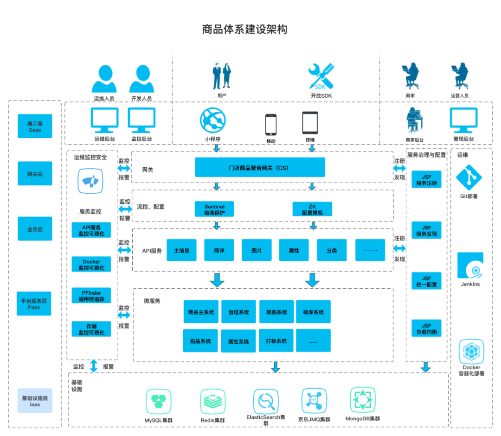

商品体系领域划分后，我们接下来要考虑如何在原有系统的基础上，把系统拆分出去。

商品系统拆分主要面临以下几个问题：从哪开始入手拆分？数据按照什么维度拆分？服务按照什么维度拆分？怎么保障拆分中的系统稳定？

针对上述问题，我们进行了以下几个点的操作：

**·自上而下逻辑分层**

**·自下而上方法分解**

**·业务领域拆分**

**·Redis缓存拆分**

（1）自上而下逻辑分层

**首先**，选择逻辑分层，目的在于隔离关注点-每个层中的组件只处理本层的逻辑。业务层中只需要处理业务逻辑，这样我们在扩展某层时，其他层是不受影响的，通过这种方式可以支撑系统在某层上快速扩展。

**其次**，在原有层级上进行拆分，会对商品原有的逻辑功能造成很多不确定性的影响。新增加的业务聚合层，可以起到对上聚合入口、对下拆分方法的作用。自上而下的结构化分解极大程度上保证了系统升级迭代的风险可控，同时保持有更好的节奏进行后续的业务拆分；

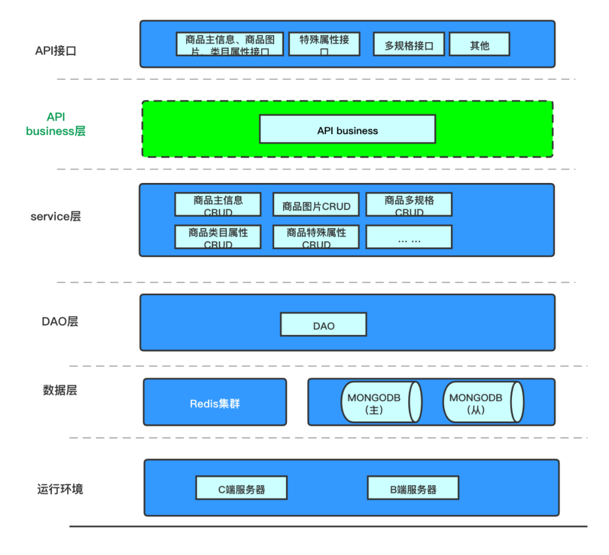

（2）自下而上方法分解

方法分解：

经过自上而下逻辑分层后，所有的业务方法全部抽取到business层进行聚合，接下来就是自下而上方法逻辑拆。保持原有service方法逻辑不变，并行一套全新的serivce层级并且保证方法遵循单一职责原则。这个过程耗费很多的时间和精力，所以尽量按照业务聚合层来决定拆分方向的优先级（优先次要业务），避免和正常业务需求开发的冲突，解耦本身就是一个小步慢跑的过程，不可能一步到位。拆分出的方法一定经过充分的测试验证，确保前后业务逻辑没发生改变。

方法切换开关：

在business聚合层增加Zookeeper开关，用来切换新老方法调用，新方法如果有问题随时切换到老方法上，保障线上稳定。在线上充分稳定一段时间后，可以在后续的上线中去掉方法切换开关以及废弃的老方法。

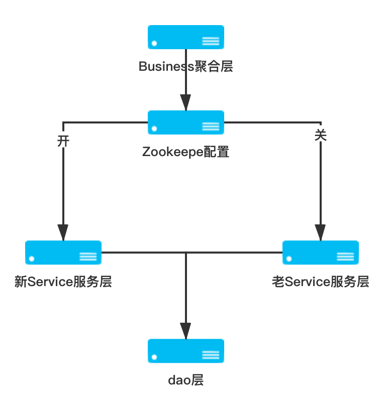

（3）业务领域拆分

在逻辑分层的基础上，按照商品业务进行垂直拆分，拆分出品牌、属性、分类、信息、图片等业务模块，对业务模块进行了解耦合。此时的业务以及代码层级结构已经很清晰了，可以根据模块按照优先级进行系统微服务领域拆分。

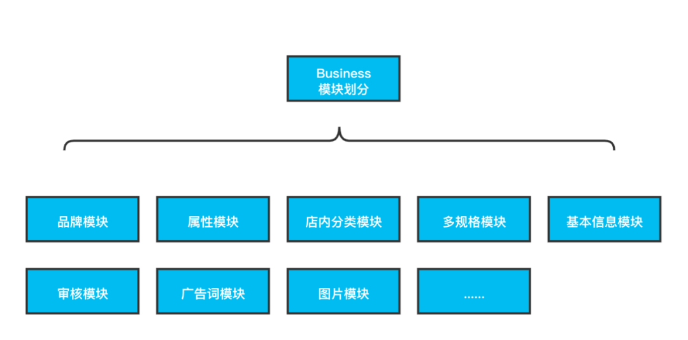

（4）Redis缓存拆分

商品系统数据存储在一个Redis集群中，在持续高并发请求下，Redis的输入、输出缓冲区流量会触达峰值，导致服务端、客户端连接中断，从而影响读服务的稳定。虽然可以通过横向扩容分片来解决燃眉之急，但是随着数据量级的不断增长，Redis单集群的风险也越来越大。

商品基于Redis集群里不同的数据KV，拆分出了主信息KV、详情KV、属性KV等独立的Redis集群，并且通过异步任务增量更新Redis集群数据。

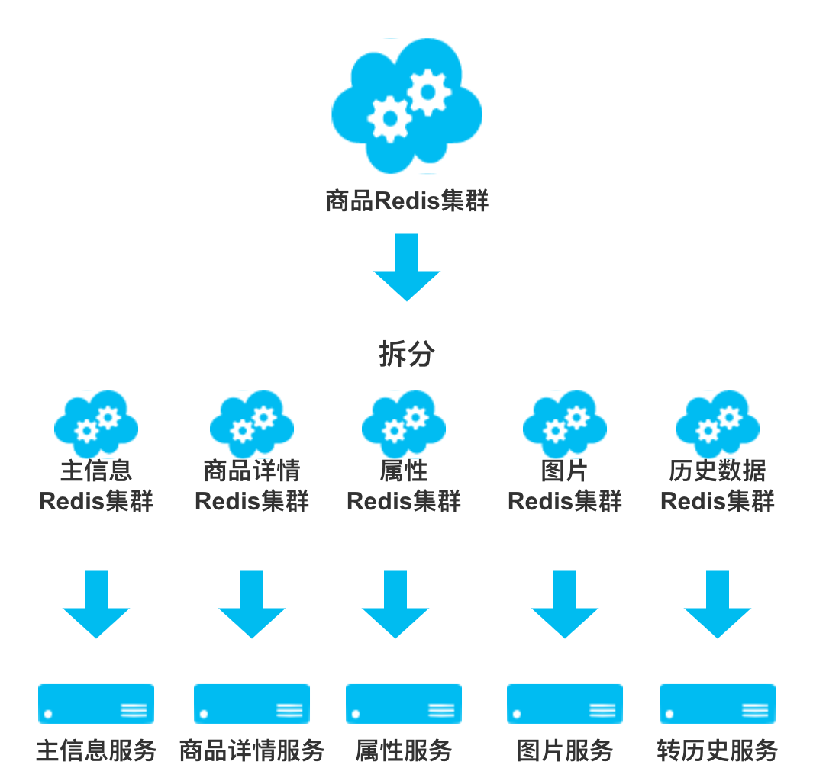

（5）微服务架构演进-面向服务

根据业务领域,拆分出独立Redis缓存集群后，紧接着按照业务领域拆分服务,拆出了主信息系统服务、图片系统服务、图文系统服务、属性系统服务等。

拆出的业务服务独立部署，根据自身业务功能点分配合理的机器资源。服务体系之间垂直隔离，提高了服务整体的可用性、可伸缩性，解决了因为某个模块导致的整体服务不可用的问题。

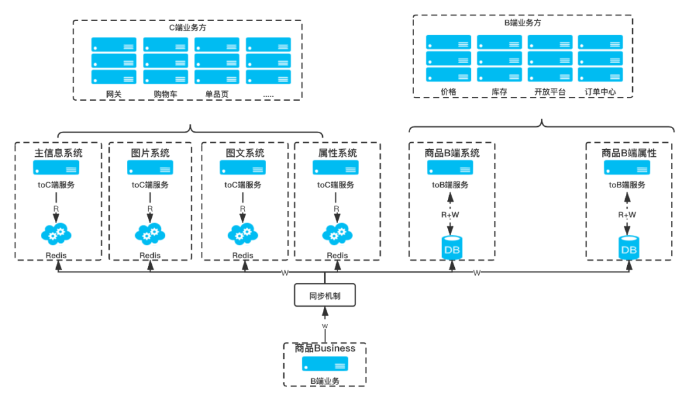

展望

商品系统体系化建设正在持续完善中，展望未来，到家商品系统在智能化、自动化、服务化的建设上，以及和算法、大数据领域的交互上，还有很多可拓展的方向。

比如：

**·商品标库如何打造出一套智能化数据**收集、筛选、审核、录入体系；

**·商品治理如何借助算法的领域**去实现智能化的商品纠错、敏感图、敏感词的快速识别；

上述举例，我们有以下几个思路：

**·扩充标库商品数据**，打造商品样板间，目的是为了打造到家商品核心竞争力-快速建品的能力，以如何智能化收集、筛选、审核、录入的目的，制订了如下设计流程框架。通过多个渠道去获取原始商品数据，首先经过系统过滤，清理掉垃圾数据，然后按照到家规则进行数据筛选、分拣，接着进行数据异构，把符合要求打散的数据拼接组合成到家预审核数据，经过大数据、数据比对、算法估分等操作进行分值加权，最后实现自动智能快审、录入的目的。

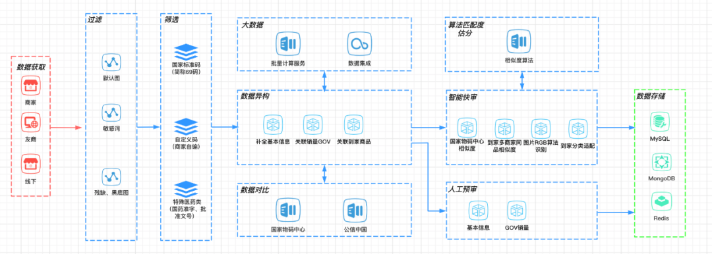

**·商品治理的力度决定一个平台商品的质量**，所以如何借助系统、算法来解决人力成本是我们设计考虑的方向。主要设计思路是借助算法的领域，通过算法以及分值的加权来实现治理商品的最终目的。

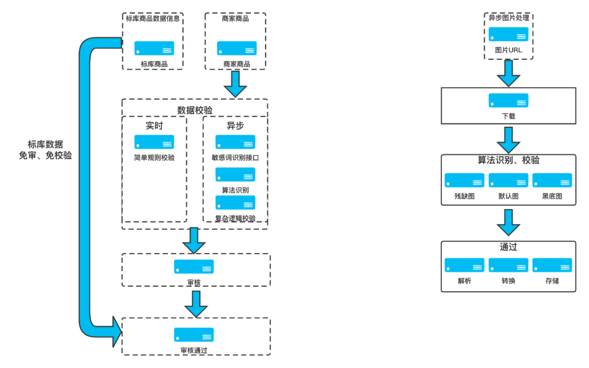

#### 总结
京东到家商品系统架构的每次演进，都是贴合业务的发展，目的都是解决业务系统复杂度带来的各种问题。1.0阶段应对业务系统的快速迭代，2.0阶段应对业务系统的稳定、高可用，3.0阶段应对业务系统体系建设。每一个阶段尽量使用合适、简单的设计，防止过度设计产生更多的复杂度问题。

本着架构是顶层设计，并且贴合业务的思想，在系统优化设计的道路上，保持合适、简单原则的本心，以及持续可演进的方向，对到家商品系统进行不断的迭代和优化。在未来的日子里，还会遇到更多的挑战，更多的业务场景，更多未发现的隐患，相信没有最好的设计，只有最贴合业务的设计！

> 更新: 2025-04-20 22:39:01  
> 原文: <https://www.yuque.com/aaron-wecc3/dhluml/lwkpcqrecvz53kmq>