# 京东双十一十万级商品接口15则优化方案

# 缓存为王：
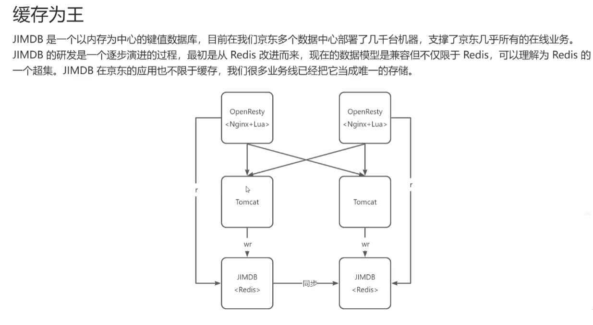

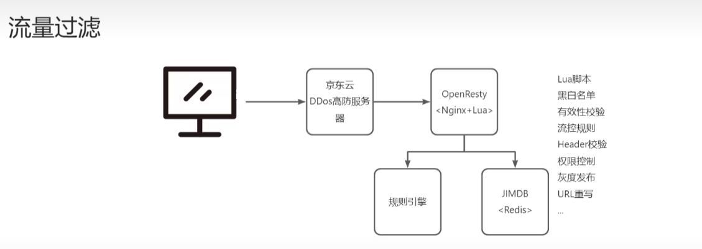

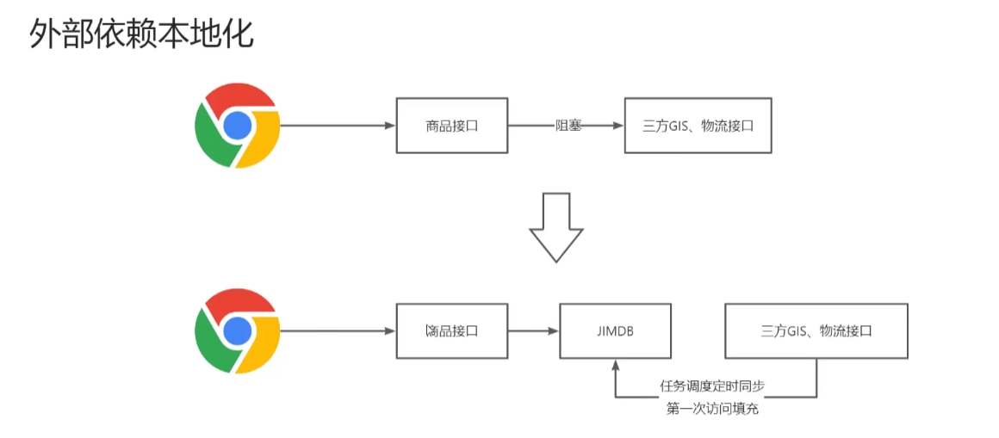

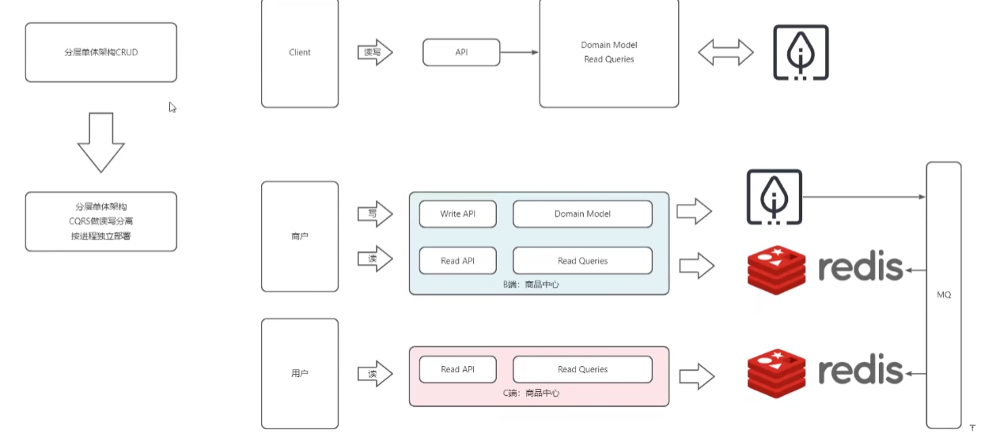

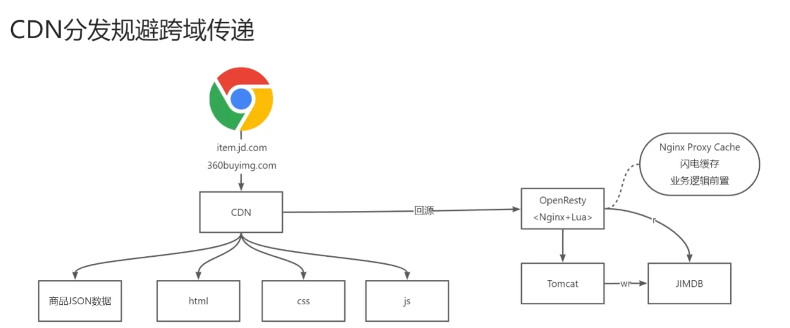

# 多级缓存
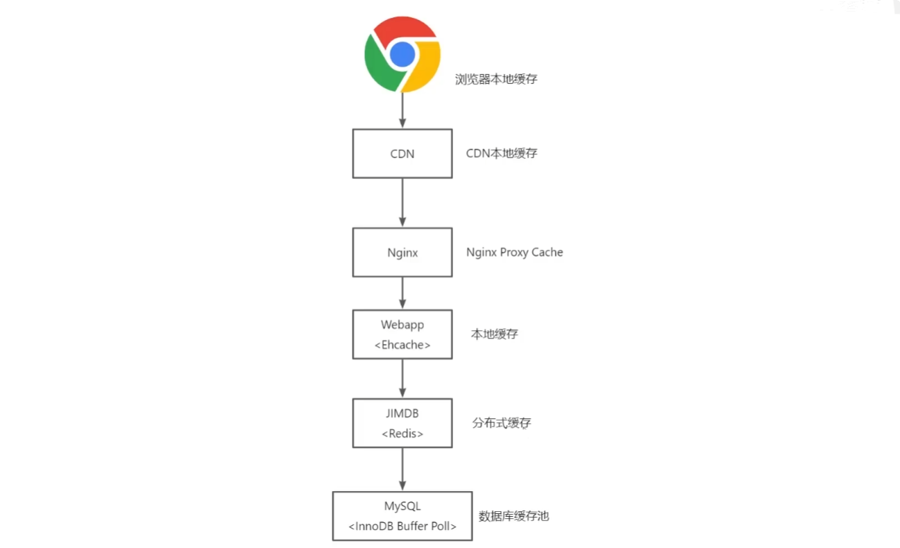

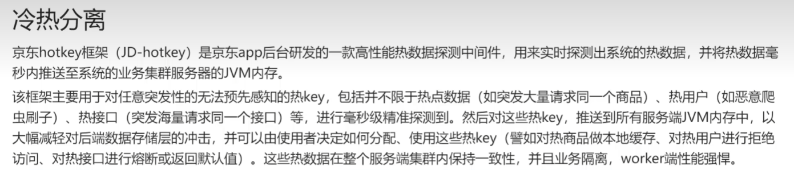

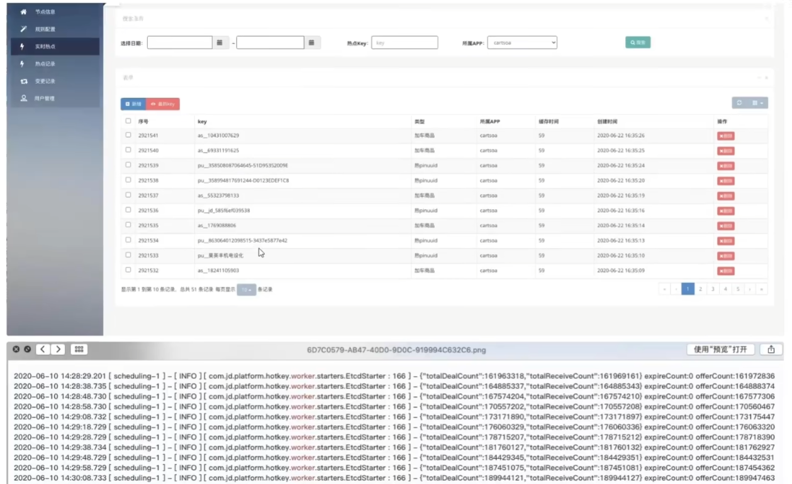

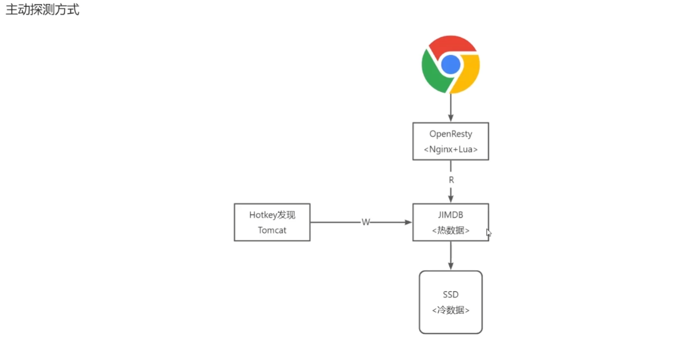

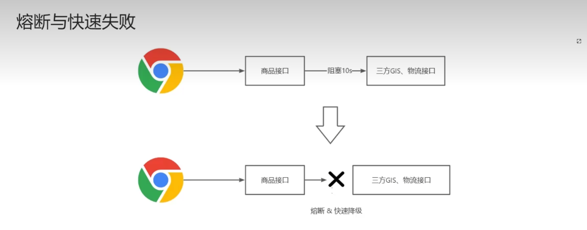

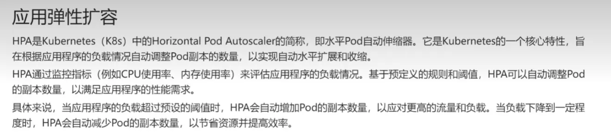

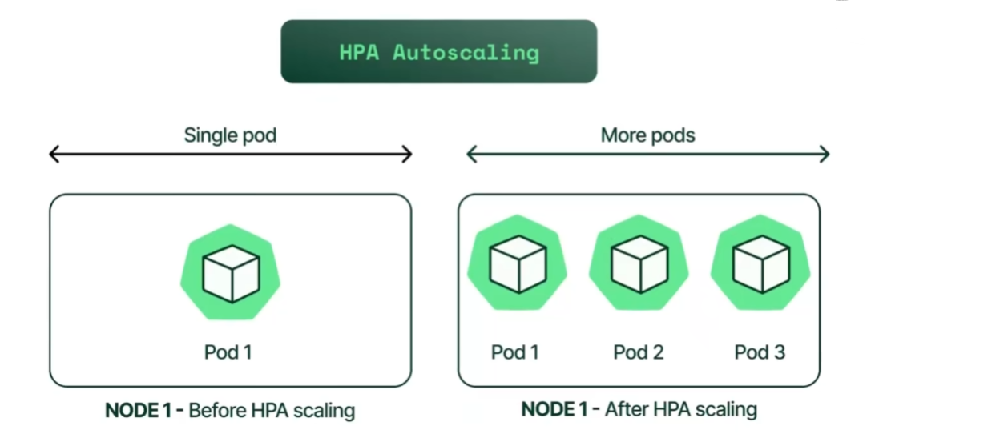

# 多机房多活分片
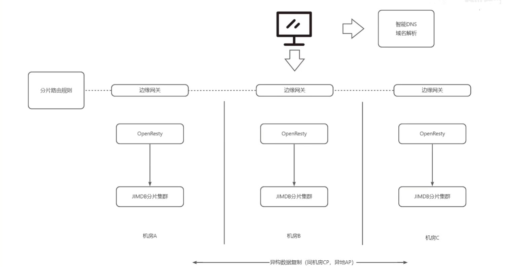

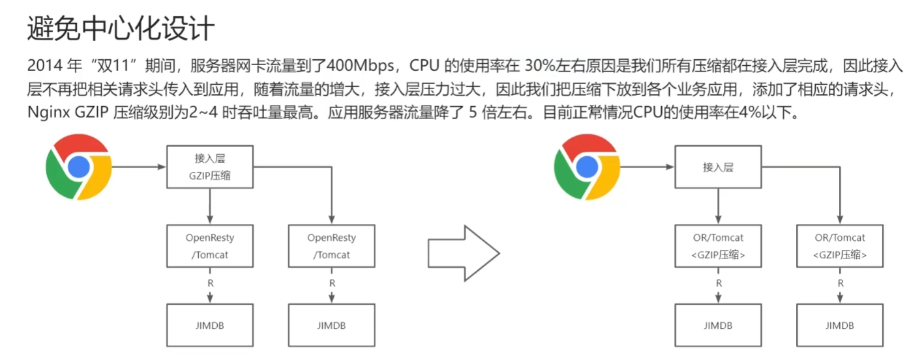

#  数据原子化与MGet优化 
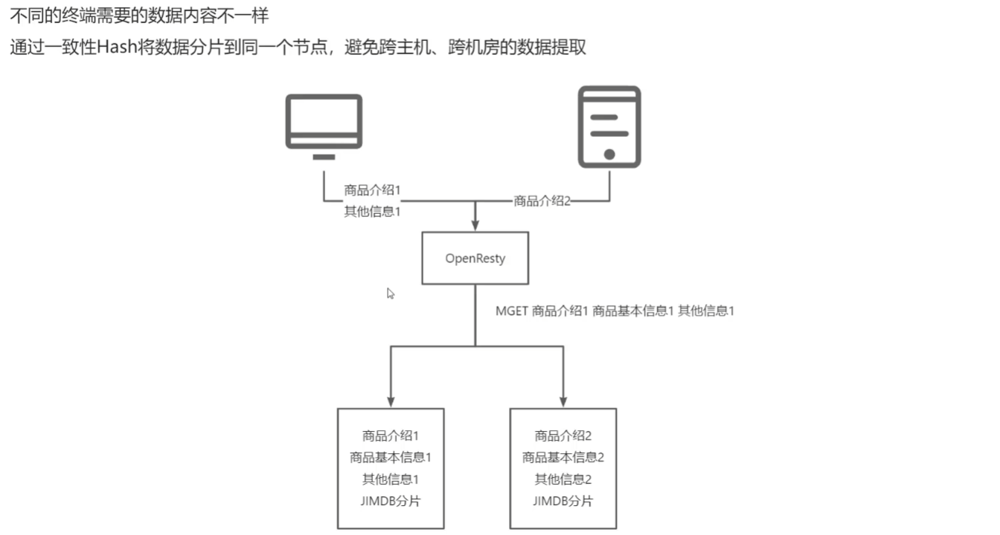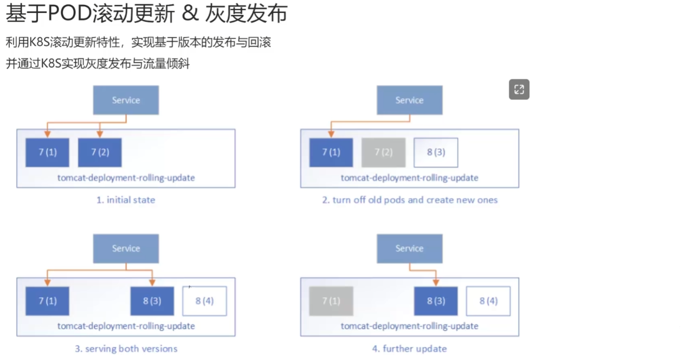

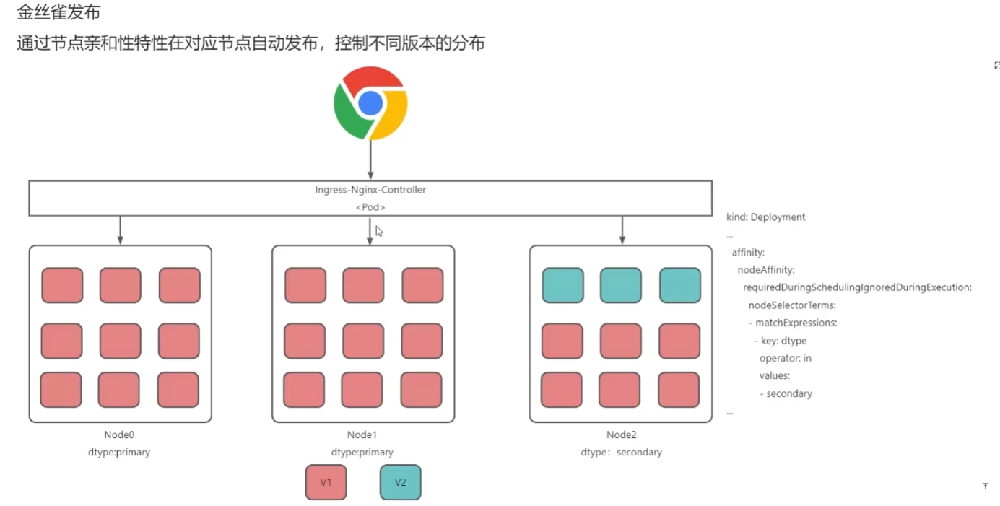

# 控制动态扩容
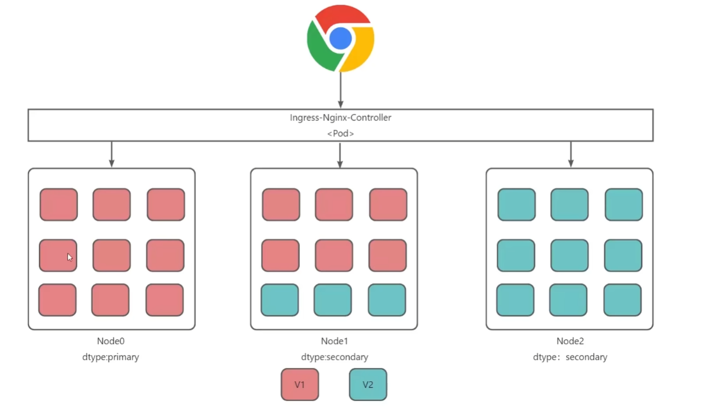

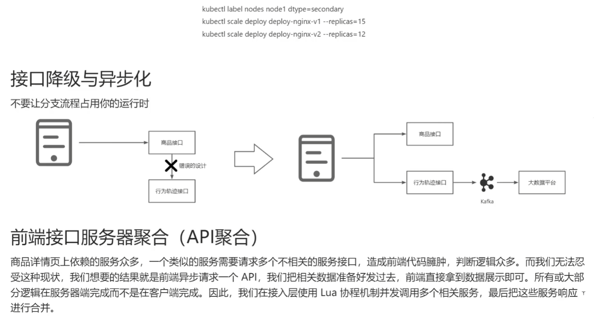

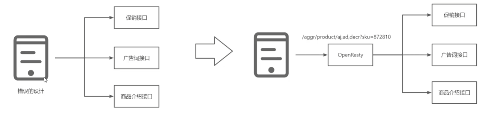

> 更新: 2025-04-20 22:38:58  
> 原文: <https://www.yuque.com/aaron-wecc3/dhluml/oonlvy38mteogmrs>