# 代码合并到底用Git Rebase 还是 Git Merge

在使用 [Git](https://so.csdn.net/so/search?q=Git\&spm=1001.2101.3001.7020) 进行版本控制时，理解何时使用 git merge 和 git rebase 对于高效和有序的代码管理至关重要。虽然两者都是用于合并代码的强大工具，但它们在不同情境下的适用性和影响各不相同。本文旨在深入探讨这两种命令，并指导何时以及如何正确使用它们。

### Git [Merge](https://so.csdn.net/so/search?q=Merge\&spm=1001.2101.3001.7020)

#### 概述

git merge 是一种非破坏性操作，用于将两个分支的更改合并到一起。它通过创建一个新的“合并提交”（G'），将两个分支的历史联系起来。

#### 优点

* **保留历史完整性**：合并操作保持了两个分支的原始历史不变。
* **简单直观**：对于 Git 新手来说， merge 更易于理解和操作。

#### 使用场景

git merge 特别适用于团队协作环境，其中保留完整的历史记录和明确的合并点是有价值的。

### Git [Rebase](https://so.csdn.net/so/search?q=Rebase\&spm=1001.2101.3001.7020)

#### 概述

git rebase 重新定位分支上的更改，将它们放在另一分支的最新更改之上。这通常涉及重写提交历史，使其看起来更加线性。

#### 优点

* **清晰的线性历史**： rebase 为项目提供了一个干净、直线的历史。
* **避免冗余合并提交**：有助于减少不必要的合并提交。

#### 使用场景

rebase 是理想的选择，当你想要整理个人分支上的提交，或者在团队中共享更改之前更新你的特性分支。

### Git 变基的黄金规则

"永远不要在公共分支上使用 git rebase"。这是因为变基会改变历史，可能导致团队成员间的历史不一致，从而引起混乱。

### 选择 Git Merge 还是 Git Rebase？

在决定使用 git merge 还是 git rebase 时，重要的是要考虑你的工作环境和团队的工作流程：

大家在工作中团队开发的时候对于拉取分支和合并代码时就会涉及到两种选择，git rebase与git merge：

rebase：变基，会有一个干净的分支，但是对于记录来源不够清晰

merge：合并，git分支看起来比较混乱，但是清楚各个记录的来源与时间节点

拉公共分支使用最新代码：merge；

有些公司会要求使用rebase，也就是git pull -r或git pull --rebase。这样的好处很明显，提交记录会比较简洁。但有个缺点就是rebase以后我就不知道我的当前分支最早是从哪个分支拉出来的了，因为基底变了嘛，所以看个人需求了。总体来说，即使是单机也不建议使用。

git fetch

git merge --ff-only

往公共分支上合代码merge；如果使用rebase，那么其他开发人员想看主分支的历史，就不是原来的历史了，历史已经被你篡改了。举个例子解释下，比如张三和李四从共同的节点拉出来开发，张三先开发完提交了两次然后merge上去了，李四后来开发完如果rebase上去（注意，李四需要切换到自己本地的主分支，假设先pull了张三的最新改动下来，然后执行\<git rebase 李四的开发分支>，然后再git push到远端），则李四的新提交变成了张三的新提交的新基底，本来李四的提交是最新的，结果最新的提交显示反而是张三的，就乱套了，以后有问题就不好追溯了。

正因如此，大部分公司其实会禁用rebase，不管是拉代码还是push代码统一都使用merge，虽然会多出无意义的一条提交记录“Merge … to …”，但至少能清楚地知道主线上谁合了的代码以及他们合代码的时间先后顺序

详细解读：

## 1 git rebase

1.1 过程详解

首先我们通过简单的提交节点图解感受一下rebase在干什么

构造两个分支master和feature，其中feature是在提交点B处从master上拉出的分支

master上有一个新提交M，feature上有两个新提交C和D

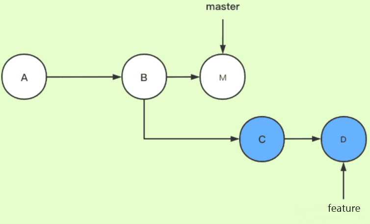

此时我们切换到feature分支上，执行rebase命令，相当于是想要把master分支合并到feature分支（这一步的场景就可以类比为我们在自己的分支feature上开发了一段时间了，准备从主干master上拉一下最新改动。模拟了git pull --rebase的情形）

# 将master上的分支合并到feature

# 这两条命令等价于git rebase master feature

git checkout feature

git rebase master

下图为变基后的提交节点图，解释一下其工作原理：

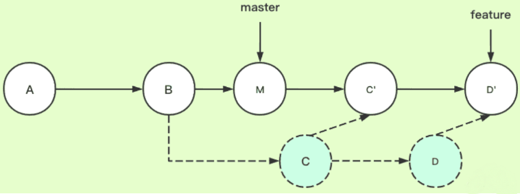

feature：待变基分支、当前分支

master：基分支、目标分支

官方解释（如果觉得看不懂可以直接看下一段）：当执行rebase操作时，git会从两个分支的共同祖先开始提取待变基分支上的修改，然后将待变基分支指向基分支的最新提交，最后将刚才提取的修改应用到基分支的最新提交的后面。

结合例子解释：当在feature分支上执行git rebase master时，git会从master和featuer的共同祖先B开始提取feature分支上的修改，也就是C和D两个提交，先提取到。然后将feature分支指向master分支的最新提交上，也就是M。最后把提取的C和D接到M后面，注意这里的接法，官方没说清楚，实际是会依次拿M和C、D内容分别比较，处理冲突后生成新的C’和D’。一定注意，这里新C’、D’和之前的C、D已经不一样了，是我们处理冲突后的新内容，feature指针自然最后也是指向D’

通俗解释（重要！！）：rebase，变基，可以直接理解为改变基底。feature分支是基于master分支的B拉出来的分支，feature的基底是B。而master在B之后有新的提交，就相当于此时要用master上新的提交来作为feature分支的新基底。实际操作为把B之后feature的提交先暂存下来，然后删掉原来这些提交，再找到master的最新提交位置，把存下来的提交再接上去（接上去是逐个和新基底处理冲突的过程），如此feature分支的基底就相当于变成了M而不是原来的B了。（注意，如果master上在B以后没有新提交，那么就还是用原来的B作为基，rebase操作相当于无效，此时和git merge就基本没区别了，差异只在于git merge会多一条记录Merge操作的提交记录）

## 1.2 工作场景

上面的例子可抽象为如下实际工作场景：远程库上有一个master分支目前开发到B了，张三从B拉了代码到本地的feature分支进行开发，目前提交了两次，开发到D了；李四也从B拉到本地的master分支，他提交到了M，然后合到远程库的master上了。此时张三想从远程库master拉下最新代码，于是他在feature分支上执行了git pull origin master:feature --rebase（注意要加–rebase参数），即把远程库master分支给rebase下来，由于李四更早开发完，此时远程master上是李四的最新内容，rebase后再看张三的历史提交记录，就相当于是张三是基于李四的最新提交M进行的开发了。（但实际上张三更早拉代码下来，李四拉的晚但提交早）

## 1.3 实际git提交示例

我这里严格按照上面的图解，构造了实际的git提交示例

如下图所示，ABM是master分支线，ABCD是feature分支线。

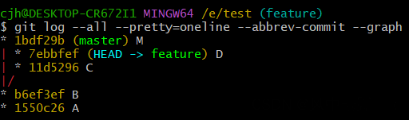

此时，在feature分支上执行git rebase master后，会提示有冲突，这里是关键，之前没有把这个细节说清楚。冲突其实也简单，因为我们要生成新的C’和D’嘛，那C’的内容如何得到呢？照搬C的？当然不是，C’的内容就是C和M两个节点的内容合并的结果，D’的内容就是D和M两个节点的内容合并的结果。我们手动处理冲突后，执行如下命令即可：

# 先处理完C，会继续报D的冲突，所以下面命令一共会执行两次

git add file

git rebase --continue

变基完成以后如下图所示，ABM还是没变化，ABMC’D’是rebase完成后的feature节点图，个人认为讲到这里就还是比较清楚了

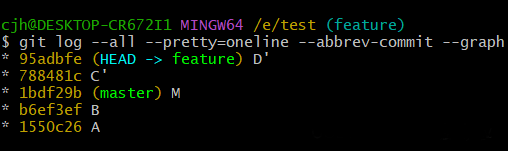

## 2 git merge

git merge有好几种不同的模式，下面我将针对这几种模式分别解释。

git merge 应该是开发者最常用的 git 指令之一，默认情况下你直接使用 git merge 命令，没有附加任何选项命令的话，那么应该是交给 git 来判断使用哪种 merge 模式，实际上 git 默认执行的指令是 git merge -ff 指令（默认值）

对于专业的开发者来说，你可能无须每次合并都指定合并模式（如果需要的话还是要指定的），但是你可能需要知道 git 在背后为你默认做了什么事情，这样才能保证你的代码万无一失。

## 2.1 fast-forward(–ff)：master与feature存在公共祖先

开发者小王接到需求任务，从 master 分支中创建功能分支，git 指令如下：

git checkout -b feature556

Switched to a new branch 'feature556'

小王在 feature556 分支上完成的功能开发工作，然后产生1次 commit，

git commit -m 'Create pop up effects'

\[feature556 6104106] create pop up effects

3 files changed, 75 insertions(+)

我们再更新一下 README 自述文件，让版本差异更明显一些

git commit -m `updated md`

这时候我们看看当前分支的 git 历史记录，输入 git log --online -all 可以看到全部分支的历史线：

f2c9c7f (HEAD -> feature556) updated md

6104106 create pop up effects

a1ec682 (origin/main, origin/HEAD, main) import dio

c5848ff update this readme

8abff90 update this readme

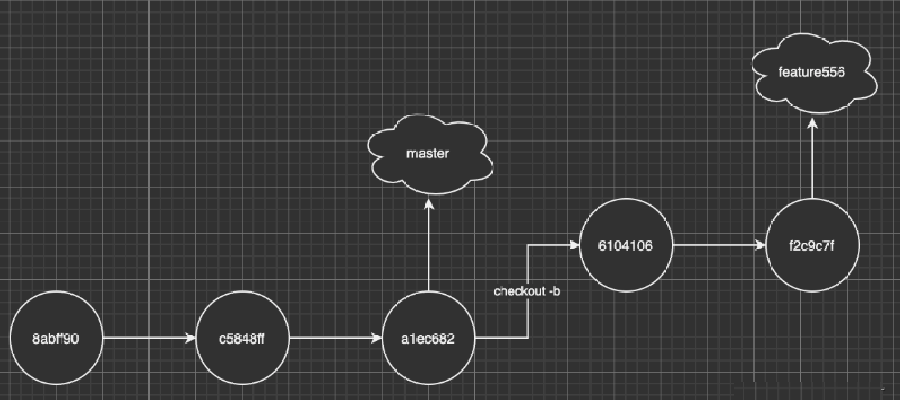

功能完成后自然要上线，我们把代码合并，完成上线动作，代码如下

git checkout master

git merge feautre556

Updating a1ec682..38348cc

Fast-forward

.......  | 2+++

1 file changed, 2 insertions(+)

如果你注意上面的文字的话，你会发现 git 帮你自动执行了 Fast-forward 操作，那么什么是 Fast-forward ？

Fast-forward 是指 Master 合并 Feature 时候发现 Master 当前节点一直和 Feature 的根节点相同，没有发生改变，那么 Master 快速移动头指针到 Feature 的位置，所以 Fast-forward 并不会发生真正的合并，只是通过移动指针造成合并的假象，这也体现 git 设计的巧妙之处。合并后的分支指针如下：

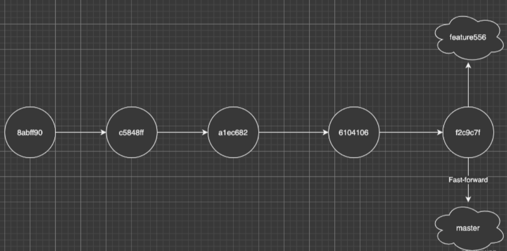

通常功能分支（feature556） 合并 master 后会被删除，通过下图可以看到，通过 Fast-forward 模式产生的合并可以产生干净并且线性的历史记录：

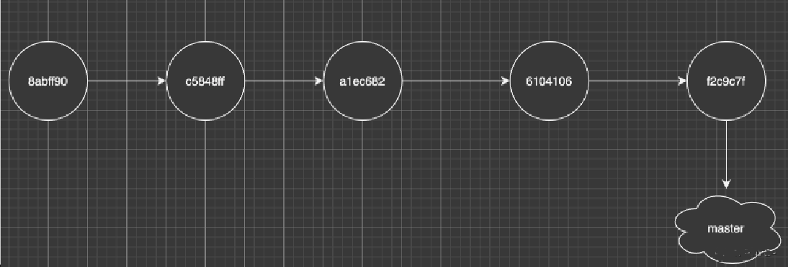

2.2 non-Fast-forward(–no-ff):master与feature不存在公共祖先

刚说了会产生 Fast-forward 的情况，现在再说说什么情况会产生 non-Fast-forward，通常，当合并的分支跟 master 不存在共同祖先节点的时候，这时候在 merge 的时候 git 默认无法使用 Fast-forward 模式，

我们先看看下图的模型：

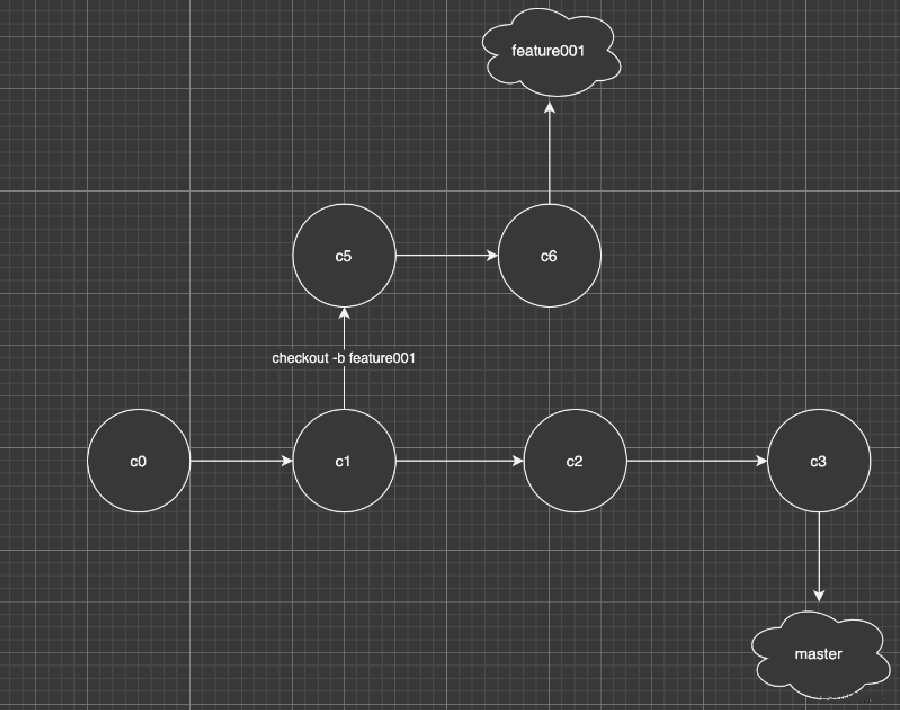

可以看到 master 分支已经比 feature001 快了2个版本，master 已经没办法通过移动头指针来完成 Fast-forward，所以在 master 合并 feature001 的时候就不得不做出真正的合并，真正的合并会让 git 多做很多工作，具体合并的动作如下：

找出 master 和 feature001 的公共祖先，节点 c1，c6, c3 三个节点的版本 （如果有冲突需要处理）

创建新的节点 c7，并且将三个版本的差异合并到 c7，并且创建 commit

将 master 和 HEAD 指针移动到 c7

补充🏡：大家在 git log 看到很多类似：Merge branch 'feature001' into master 的 commit 就是 non-Fast-forward 产生的。

执行完以上动作，最终分支流程图如下：

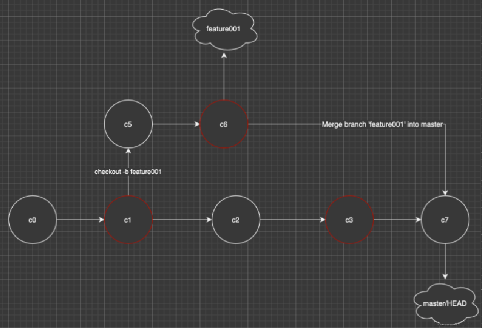

## 2.3 fast-forward only(–ff-only)：尝试–ff方式合并，如果不满足则退出

表明只有在

先简单介绍一下 git merge 的三个合并参数模式：

-ff 自动合并模式：当合并的分支为当前分支的后代的，那么会自动执行 --ff (Fast-forward) 模式，如果不匹配则执行 --no-ff（non-Fast-forward） 合并模式

–no-ff 非 Fast-forward 模式：在任何情况下都会创建新的 commit 进行多方合并（及时被合并的分支为自己的直接后代）

–ff-onlu Fast-forward 模式：只会按照 Fast-forward 模式进行合并，如果不符合条件（并非当前分支的直接后代），则会拒绝合并请求并且退出

2.4 三种模式选择

三种 merge 模式没有好坏和优劣之分，只有根据你团队的需求和实际情况选择合适的合并模式才是最优解，那么应该怎么选择呢？ 我给出以下推荐：

如果你是小型团队，并且追求干净线性 git 历史记录，那么我推荐使用 git merge --ff-only 方式保持主线模式开发是一种不错的选择

如果你团队不大不小，并且也不追求线性的 git 历史记录，要体现相对真实的 merge 记录，那么默认的 git --ff 比较合适

如果你是大型团队，并且要严格监控每个功能分支的合并情况，那么使用 --no-ff 禁用 Fast-forward 是一个不错的选择

3 区别及推荐

①区别

rebase：变基，会有一个干净的分支，但是对于记录来源不够清晰，commit的提交先后顺序也会比较错乱。（rebase以后我就不知道我的当前分支最早是从哪个分支拉出来的了，因为基底变了）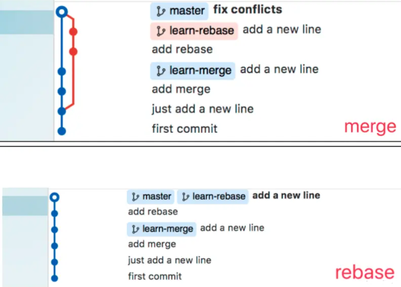

merge（推荐使用）：合并，git分支看起来比较混乱，但是清楚各个记录的来源与时间节点

搞来搞去那么多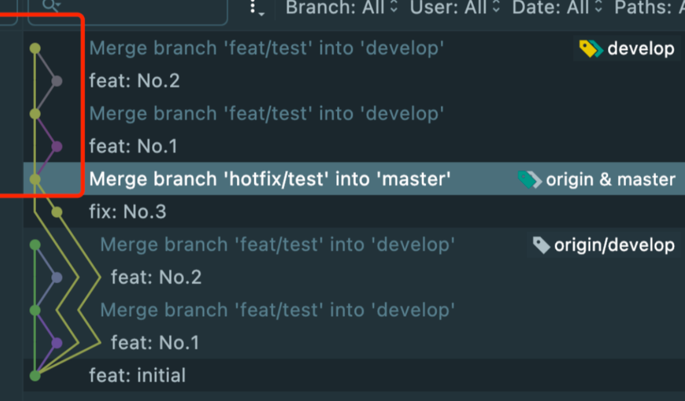，这其实是最重要的。不同公司，不同情况有不同使用场景，不过大部分情况推荐如下：

②推荐：全部使用merge

拉公共分支使用最新代码：merge；有些公司会要求使用rebase，也就是git pull -r或git pull --rebase。这样的好处很明显，提交记录会比较简洁。但有个缺点就是rebase以后我就不知道我的当前分支最早是从哪个分支拉出来的了，因为基底变了嘛，所以看个人需求了。总体来说，即使是单机也不建议使用。

git fetch

git merge --ff-only

往公共分支上合代码merge；如果使用rebase，那么其他开发人员想看主分支的历史，就不是原来的历史了，历史已经被你篡改了。举个例子解释下，比如张三和李四从共同的节点拉出来开发，张三先开发完提交了两次然后merge上去了，李四后来开发完如果rebase上去（注意，李四需要切换到自己本地的主分支，假设先pull了张三的最新改动下来，然后执行\<git rebase 李四的开发分支>，然后再git push到远端），则李四的新提交变成了张三的新提交的新基底，本来李四的提交是最新的，结果最新的提交显示反而是张三的，就乱套了，以后有问题就不好追溯了。

正因如此，大部分公司其实会禁用rebase，不管是拉代码还是push代码统一都使用merge，虽然会多出无意义的一条提交记录“Merge … to …”，但至少能清楚地知道主线上谁合了的代码以及他们合代码的时间先后顺序

> 更新: 2024-05-08 20:11:12  
> 原文: <https://www.yuque.com/aaron-wecc3/dhluml/rw63vmqmg42s0aw0>