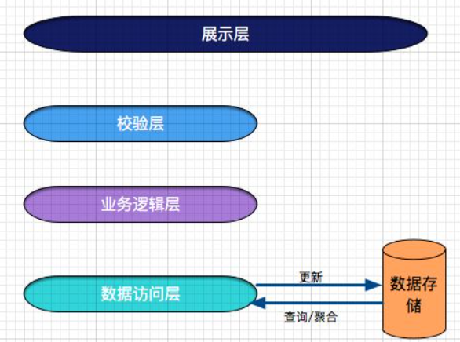
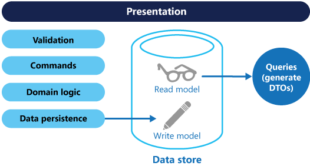
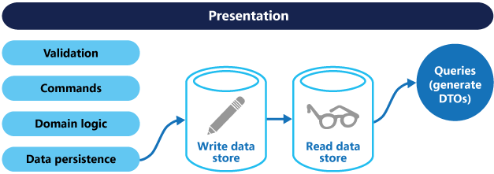
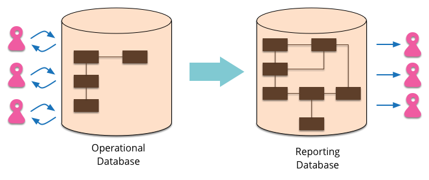
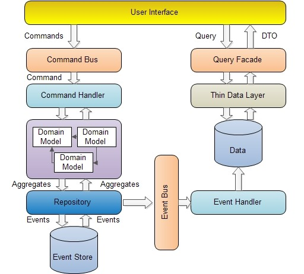

# 命令查询职责分离模式CQRS

### **<font style="color:rgb(0, 0, 0);">背景和问题</font>**
<font style="color:rgb(51, 51, 51);">在传统的体系结构中，使用相同的数据模型来查询和更新</font>[数据库](https://cloud.tencent.com/solution/database?from_column=20065&from=20065)<font style="color:rgb(51, 51, 51);">。这很简单，适用于基本的CRUD操作。然而，在更复杂的应用程序中，这种方法可能变得笨拙。例如，在读取端，应用程序可能执行许多不同的查询，返回具有不同形状的数据传输对象(dto)。对象映射可能变得复杂。在写端，模型可能实现复杂的验证和业务逻辑。结果，您可能会得到一个做得太多的过于复杂的模型。</font>

<font style="color:rgb(51, 51, 51);">读和写工作负载通常是不对称的，性能和规模需求非常不同。 </font>


<font style="color:rgb(0, 0, 0);">最近不少学员想用Scala来重构Java项目。Scala的灵活高效这里就不用说了，Java MVC一套架构确实有它优点。但是开发调试效率确实慢很多。所以准备使用DDD中的命令查询职责分离模式(Command Query Responsibility Segregation，CQRS)重构项目。</font>

<font style="color:rgb(0, 0, 0);">首先我们先介绍下CQRS。</font>

# <font style="color:rgb(0, 0, 0);">一：什么是CQRS</font>
<font style="color:rgb(0, 0, 0);">CQRS最早来自于Betrand Meyer（Eiffel语言之父，</font>[开-闭原则](http://msdn.microsoft.com/en-us/magazine/cc546578.aspx)<font style="color:rgb(0, 0, 0);">OCP提出者）在 </font>[Object-Oriented Software Construction](http://www.amazon.com/gp/product/0136291554)<font style="color:rgb(0, 0, 0);"> 这本书中提到的一种 </font>[命令查询分离](http://martinfowler.com/bliki/CommandQuerySeparation.html)<font style="color:rgb(0, 0, 0);"> (</font>[Command Query Separation](http://en.wikipedia.org/wiki/Command-query_separation)<font style="color:rgb(0, 0, 0);">,CQS) 的概念。其基本思想在于，任何一个对象的方法可以分为两大类：</font>

+ <font style="color:rgb(0, 0, 0);">命令(Command):不返回任何结果(void)，但会改变对象的状态。</font>
+ <font style="color:rgb(0, 0, 0);">查询(Query):返回结果，但是不会改变对象的状态，对系统没有副作用。</font>



+ <font style="color:rgb(51, 51, 51);">数据的读和写表示形式之间常常存在不匹配，比如必须正确更新的附加列或属性，尽管它们不是操作的一部分。</font>
+ <font style="color:rgb(51, 51, 51);">当对同一组数据并行执行操作时，可能会发生数据争用。</font>
+ <font style="color:rgb(51, 51, 51);">由于</font>[数据存储](https://cloud.tencent.com/product/cdcs?from_column=20065&from=20065)<font style="color:rgb(51, 51, 51);">和数据访问层的负载以及检索信息所需的查询的复杂性，传统方法可能会对性能产生负面影响。</font>
+ <font style="color:rgb(51, 51, 51);">管理安全性和权限可能变得复杂，因为每个实体都受读和写操作的约束，这可能会在错误的上下文中公开数据。</font>

<font style="color:rgb(0, 0, 0);"></font>

# <font style="color:rgb(0, 0, 0);">二：深入理解CQS</font>
<font style="color:rgb(0, 0, 0);">根据CQS的思想，任何一个方法都可以拆分为命令和查询两部分，比如：</font>


```plain
private int i = 0;
private int Increase(int value)
{
    i += value;
    return i;
}
```


<font style="color:rgb(0, 0, 0);">这个方法，我们执行了一个命令即对变量i进行相加，同时又执行了一个Query，即查询返回了i的值，如果按照CQS的思想，该方法可以拆成Command和Query两个方法，如下：</font>


```plain
private void IncreaseCommand(int value)
{
    i += value;
}
private int QueryValue()
{
    return i;
}
```


<font style="color:rgb(0, 0, 0);">操作和查询分离使得我们能够更好的把握对象的细节，能够更好的理解哪些操作会改变系统的状态。当然</font>[CQS](http://en.wikipedia.org/wiki/Command-query_separation)<font style="color:rgb(0, 0, 0);">也有一些缺点，比如代码需要处理多线程的情况。</font>

<font style="color:rgb(0, 0, 0);">CQRS是对CQS模式的进一步改进成的一种简单模式。 它由Greg Young在</font>[CQRS, Task Based UIs, Event Sourcing agh!](http://codebetter.com/gregyoung/2010/02/16/cqrs-task-based-uis-event-sourcing-agh/)<font style="color:rgb(0, 0, 0);"> 这篇文章中提出。“CQRS只是简单的将之前只需要创建一个对象拆分成了两个对象，这种分离是基于方法是执行命令还是执行查询这一原则来定的(这个和CQS的定义一致)”。</font>

<font style="color:rgb(0, 0, 0);">CQRS使用分离的接口将数据查询操作(Queries)和数据修改操作(Commands)分离开来，这也意味着在查询和更新过程中使用的数据模型也是不一样的。这样读和写逻辑就隔离开来了。</font>

<font style="color:rgb(0, 0, 0);"></font>



<font style="color:rgb(0, 0, 0);">使用CQRS分离了读写职责之后，可以对数据进行读写分离操作来改进性能，可扩展性和安全。如下图：</font>



<font style="color:rgb(0, 0, 0);">主数据库处理CUD，从库处理R，从库的的结构可以和主库的结构完全一样，也可以不一样，从库主要用来进行只读的查询操作。在数量上从库的个数也可以根据查询的规模进行扩展，在业务逻辑上，也可以根据专题从主库中划分出不同的从库。从库也可以实现成</font>[ReportingDatabase](http://martinfowler.com/bliki/ReportingDatabase.html)<font style="color:rgb(0, 0, 0);">，根据查询的业务需求，从主库中抽取一些必要的数据生成一系列查询报表来存储。</font>



<font style="color:rgb(0, 0, 0);">使用ReportingDatabase的一些优点通常可以使得查询变得更加简单高效：</font>

+ <font style="color:rgb(0, 0, 0);">ReportingDatabase的结构和数据表会针对常用的查询请求进行设计。</font>
+ <font style="color:rgb(0, 0, 0);">ReportingDatabase数据库通常会去正规化，存储一些冗余而减少必要的Join等联合查询操作，使得查询简化和高效，一些在主数据库中用不到的数据信息，在ReportingDatabase可以不用存储。</font>
+ <font style="color:rgb(0, 0, 0);">可以对ReportingDatabase重构优化，而不用去改变操作数据库。</font>
+ <font style="color:rgb(0, 0, 0);">对ReportingDatabase数据库的查询不会给操作数据库带来任何压力。</font>
+ <font style="color:rgb(0, 0, 0);">可以针对不同的查询请求建立不同的ReportingDatabase库。</font>

<font style="color:rgb(0, 0, 0);">当然这也有一些缺点，比如从库数据的更新。如果使用SQLServer，本身也提供了一些如故障转移和复制机制来方便部署。</font>

<font style="color:rgb(0, 0, 0);"></font>

<font style="color:rgb(51, 51, 51);">CQRS的好处包括:</font>

+ <font style="color:rgb(51, 51, 51);">独立的扩展。CQRS允许读写工作负载独立伸缩，并且可能导致更少的锁争用。</font>
+ <font style="color:rgb(51, 51, 51);">优化的数据模式。读端可以使用为查询优化的模式，而写端使用为更新优化的模式。</font>
+ <font style="color:rgb(51, 51, 51);">安全。更容易确保只有正确的域实体才对数据执行写操作。</font>
+ <font style="color:rgb(51, 51, 51);">关注点分离。分离读和写端可以得到更易于维护和灵活的模型。大多数复杂的业务逻辑都进入了写模型。读取模型可以相对简单。</font>
+ <font style="color:rgb(51, 51, 51);">简单的查询。通过在read数据库中存储物化视图，应用程序可以在查询时避免复杂的连接。</font>

**<font style="color:rgb(0, 0, 0);">问题和注意事项</font>**

<font style="color:rgb(51, 51, 51);">实施这一模式的一些挑战包括:</font>

+ <font style="color:rgb(51, 51, 51);">复杂性。CQRS的基本思想很简单。但这可能导致更复杂的应用程序设计，特别是如果它们包含事件源模式。</font>
+ <font style="color:rgb(51, 51, 51);">消息传递性。虽然CQRS不需要消息传递，但是通常使用消息传递来处理命令和发布更新事件。在这种情况下，应用程序必须处理消息失败或重复消息。</font>
+ <font style="color:rgb(51, 51, 51);">最终一致性。如果将读和写数据库分开，则读数据可能会过时。必须更新读模型存储以反映对写模型存储的更改，并且很难检测用户何时基于陈旧的读数据发出了请求。</font>

<font style="color:rgb(0, 0, 0);"></font>

<font style="color:rgb(0, 0, 0);"></font>

# <font style="color:rgb(0, 0, 0);">三： 什么时候可以考虑CQRS</font>
<font style="color:rgb(0, 0, 0);">CQRS模式有一些优点：</font>

1. <font style="color:rgb(0, 0, 0);">分工明确，可以负责不同的部分</font>
2. <font style="color:rgb(0, 0, 0);">将业务上的命令和查询的职责分离能够提高系统的性能、可扩展性和安全性。并且在系统的演化中能够保持高度的灵活性，能够防止出现CRUD模式中，对查询或者修改中的某一方进行改动，导致另一方出现问题的情况。</font>
3. <font style="color:rgb(0, 0, 0);">逻辑清晰，能够看到系统中的那些行为或者操作导致了系统的状态变化。</font>
4. <font style="color:rgb(0, 0, 0);">可以从数据驱动(Data-Driven) 转到任务驱动(Task-Driven)以及事件驱动(</font>[Event-Driven](http://en.wikipedia.org/wiki/Event-driven_programming)<font style="color:rgb(0, 0, 0);">).</font>

<font style="color:rgb(0, 0, 0);">在下场景中，可以考虑使用CQRS模式：</font>

1. <font style="color:rgb(0, 0, 0);">当在业务逻辑层有很多操作需要相同的实体或者对象进行操作的时候。CQRS使得我们可以对读和写定义不同的实体和方法，从而可以减少或者避免对某一方面的更改造成冲突</font>
2. <font style="color:rgb(0, 0, 0);">对于一些基于任务的用户交互系统，通常这类系统会引导用户通过一系列复杂的步骤和操作，通常会需要一些复杂的领域模型，并且整个团队已经熟悉领域驱动设计技术。写模型有很多和业务逻辑相关的命令操作的堆，输入验证，业务逻辑验证来保证数据的一致性。读模型没有业务逻辑以及验证堆，仅仅是返回DTO对象为视图模型提供数据。读模型最终和写模型相一致。</font>
3. <font style="color:rgb(0, 0, 0);">适用于一些需要对查询性能和写入性能分开进行优化的系统，尤其是读/写比非常高的系统，横向扩展是必须的。比如，在很多系统中读操作的请求时远大于写操作。为适应这种场景，可以考虑将写模型抽离出来单独扩展，而将写模型运行在一个或者少数几个实例上。少量的写模型实例能够减少合并冲突发生的情况</font>
4. <font style="color:rgb(0, 0, 0);">适用于一些团队中，一些有经验的开发者可以关注复杂的领域模型，这些用到写操作，而另一些经验较少的开发者可以关注用户界面上的读模型。</font>
5. <font style="color:rgb(0, 0, 0);">对于系统在将来会随着时间不段演化，有可能会包含不同版本的模型，或者业务规则经常变化的系统</font>
6. <font style="color:rgb(0, 0, 0);">需要和其他系统整合，特别是需要和事件溯源Event Sourcing进行整合的系统，这样子系统的临时异常不会影响整个系统的其他部分。</font>

<font style="color:rgb(0, 0, 0);">但是在以下场景中，可能不适宜使用CQRS：</font>

1. <font style="color:rgb(0, 0, 0);">领域模型或者业务逻辑比较简单，这种情况下使用CQRS会把系统搞复杂。</font>
2. <font style="color:rgb(0, 0, 0);">对于简单的，CRUD模式的用户界面以及与之相关的数据访问操作已经足够的话，没必要使用CQRS，这些都是一个简单的对数据进行增删改查。</font>
3. <font style="color:rgb(0, 0, 0);">不适合在整个系统中到处使用该模式。在整个数据管理场景中的特定模块中CQRS可能比较有用。但是在有些地方使用CQRS会增加系统不必要的复杂性。</font>

# <font style="color:rgb(0, 0, 0);">四： CQRS与Event Sourcing的关系</font>
<font style="color:rgb(0, 0, 0);">在CQRS中，查询方面，直接通过方法查询数据库，然后通过DTO将数据返回。在操作(Command)方面，是通过发送Command实现，由CommandBus处理特定的Command，然后由Command将特定的Event发布到EventBus上，然后EventBus使用特定的Handler来处理事件，执行一些诸如，修改，删除，更新等操作。这里，所有与Command相关的操作都通过Event实现。这样我们可以通过记录Event来记录系统的运行历史记录，并且能够方便的回滚到某一历史状态。</font>[Event Sourcing](http://msdn.microsoft.com/en-us/library/dn589792.aspx)<font style="color:rgb(0, 0, 0);">就是用来进行存储和管理事件的。这里不展开介绍。</font>

# <font style="color:rgb(0, 0, 0);">五： CQRS的简单实现</font>
<font style="color:rgb(0, 0, 0);">CQRS模式在思想上比较简单，但是实现上还是有些复杂。它涉及到DDD，以及Event Sourcing，这里使用codeproject上的 </font>[Introduction to CQRS](http://www.codeproject.com/Articles/555855/Introduction-to-CQRS)<font style="color:rgb(0, 0, 0);"> 这篇文章的例子来说明CQRS模式。这个例子是一个简单的在线记日志(Diary)系统，实现了日志的增删改查功能。整体结构如下：</font>



<font style="color:rgb(0, 0, 0);">上图很清晰的说明了CQRS在读写方面的分离，在读方面，通过QueryFacade到数据库里去读取数据，这个库有可能是ReportingDB。在写方面，比较复杂，操作通过Command发送到CommandBus上，然后特定的CommandHandler处理请求，产生对应的Event，将Eevnt持久化后，通过EventBus特定的EevntHandler对数据库进行修改等操作。</font>

#  六：示范代码
<font style="color:rgb(51, 51, 51);">下面的代码显示了CQRS实现示例的一些摘录，该实现对读和写模型使用了不同的定义。模型接口不指定底层数据存储的任何特性，而且由于这些接口是分离的，它们可以独立地发展和微调。</font>

<font style="color:rgb(51, 51, 51);">下面的代码显示了读取的模型定义。</font>


```javascript
// Query interface
namespace ReadModel
{
  public interface ProductsDao
  {
    ProductDisplay FindById(int productId);
    ICollection<ProductDisplay> FindByName(string name);
    ICollection<ProductInventory> FindOutOfStockProducts();
    ICollection<ProductDisplay> FindRelatedProducts(int productId);
  }

  public class ProductDisplay
  {
    public int Id { get; set; }
    public string Name { get; set; }
    public string Description { get; set; }
    public decimal UnitPrice { get; set; }
    public bool IsOutOfStock { get; set; }
    public double UserRating { get; set; }
  }

  public class ProductInventory
  {
    public int Id { get; set; }
    public string Name { get; set; }
    public int CurrentStock { get; set; }
  }
}
```

<font style="color:rgb(51, 51, 51);">该系统允许用户对产品进行评分。应用程序代码使用下面代码中显示的RateProductcommand来实现这一点。</font>

```javascript
public interface ICommand
{
  Guid Id { get; }
}

public class RateProduct : ICommand
{
  public RateProduct()
  {
    this.Id = Guid.NewGuid();
  }
  public Guid Id { get; set; }
  public int ProductId { get; set; }
  public int Rating { get; set; }
  public int UserId {get; set; }
}
```

<font style="color:rgb(51, 51, 51);">系统使用ProductsCommandHandler类来处理应用程序发送的命令。客户端通常通过消息传递系统(如队列)向域发送命令。命令处理程序接受这些命令并调用域接口的方法。每个命令的粒度旨在减少冲突请求的机会。下面的代码显示了ProductsCommandHandler类的大纲。</font>

**<font style="color:rgb(0, 0, 0);"></font>**

```javascript
public class ProductsCommandHandler :
    ICommandHandler<AddNewProduct>,
    ICommandHandler<RateProduct>,
    ICommandHandler<AddToInventory>,
    ICommandHandler<ConfirmItemShipped>,
    ICommandHandler<UpdateStockFromInventoryRecount>
{
  private readonly IRepository<Product> repository;

  public ProductsCommandHandler (IRepository<Product> repository)
  {
    this.repository = repository;
  }

  void Handle (AddNewProduct command)
  {
    ...
  }

  void Handle (RateProduct command)
  {
    var product = repository.Find(command.ProductId);
    if (product != null)
    {
      product.RateProduct(command.UserId, command.Rating);
      repository.Save(product);
    }
  }

  void Handle (AddToInventory command)
  {
    ...
  }

  void Handle (ConfirmItemsShipped command)
  {
    ...
  }

  void Handle (UpdateStockFromInventoryRecount command)
  {
    ...
  }
}
```

<font style="color:rgb(24, 24, 24);background-color:rgb(244, 247, 251);">  
</font>


> 更新: 2024-07-11 21:28:29  
> 原文: <https://www.yuque.com/aaron-wecc3/dhluml/cloduv51syn0bdqp>