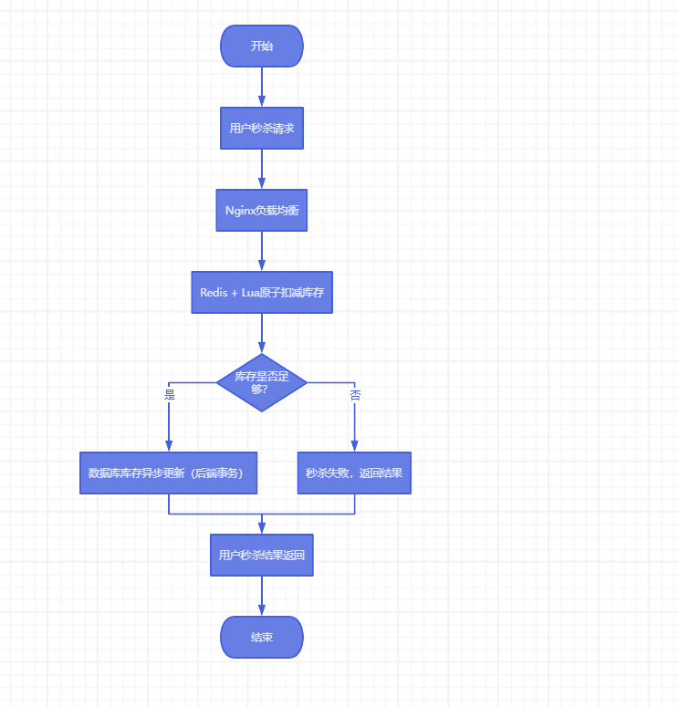

# 商品秒杀巧用Redis与Lua预防库存超卖~

# 方案分析

在高并发秒杀场景下，库存超卖的主要原因是：

1. 多个并发请求同时操作库存，导致库存变负或超卖。
2. 数据库性能瓶颈无法快速响应大量请求。

# Redis+Lua解决方案

Redis是单线程的，结合Lua脚本可以保证对库存的操作是原子的，避免并发问题。

* **Redis的优势**：高并发、高性能、支持丰富的数据结构。
* **Lua的优势**：运行在Redis中，**可以在一个原子操作中完成多条命令**。

# 核心思路

* 商品秒杀前，将商品的库存预先加载到Redis中。
* 使用Lua脚本对库存进行扣减操作，确保每个请求的库存操作是**原子**的。
* Lua脚本校验库存是否足够，如果足够则扣减库存并返回秒杀成功；否则返回秒杀失败。

# Lua脚本实现库存扣减

```java
lua

-- Lua脚本：扣减库存
local stock_key = KEYS[1]  -- 商品库存Key
local user_key = KEYS[2]   -- 用户秒杀Key，防止重复秒杀
local stock = tonumber(redis.call('get', stock_key))

-- 判断库存是否足够
if stock <= 0 then
return -1  -- 库存不足
end

-- 判断用户是否已经秒杀过
if redis.call('sismember', user_key, ARGV[1]) == 1 then
return 0  -- 用户已经秒杀
end

-- 扣减库存
redis.call('decr', stock_key)

-- 记录用户已经秒杀
redis.call('sadd', user_key, ARGV[1])

return 1  -- 秒杀成功
```

# Java代码调用Lua脚本

在Java中使用`Jedis`，Redis客户端调用上述Lua脚本。下面是一个基于`Jedis`的示例代码：

```java
java


复制代码
import redis.clients.jedis.Jedis;
import redis.clients.jedis.JedisPool;

public class SecKillService {
    private JedisPool jedisPool;

    public SecKillService(JedisPool jedisPool) {
        this.jedisPool = jedisPool;
    }

    public boolean doSecKill(String userId, String productId) {
        try (Jedis jedis = jedisPool.getResource()) {
            // Lua脚本
            String luaScript = "local stock_key = KEYS[1];" +
            "local user_key = KEYS[2];" +
            "local stock = tonumber(redis.call('get', stock_key));" +
            "if stock <= 0 then return -1 end;" +
            "if redis.call('sismember', user_key, ARGV[1]) == 1 then return 0 end;" +
            "redis.call('decr', stock_key);" +
            "redis.call('sadd', user_key, ARGV[1]);" +
            "return 1;";

            String stockKey = "product_stock_" + productId;
            String userKey = "user_seckill_" + productId;

            // 执行Lua脚本
            Object result = jedis.eval(luaScript, 2, stockKey, userKey, userId);

            if (result.equals(1L)) {
                System.out.println("秒杀成功");
                return true;
            } else if (result.equals(0L)) {
                System.out.println("你已经秒杀过了");
                return false;
            } else {
                System.out.println("库存不足");
                return false;
            }
        }
    }
}
```

# 使用场景示例

假设我们有一个热销商品的秒杀活动，活动开始时将商品的库存加载到Redis中：

```java
java

public void preloadStock(String productId, int stock) {
    try (Jedis jedis = jedisPool.getResource()) {
        String stockKey = "product_stock_" + productId;
        jedis.set(stockKey, String.valueOf(stock));  // 设置库存
    }
}
```

在秒杀开始时，用户请求会通过Java代码调用Lua脚本进行库存的校验与扣减操作，保证每个操作是线程安全的。

# 秒杀并发防超卖架构图

1. 

# 优化建议

1. **提前预热库存**：将热门商品的库存提前放入Redis，减轻数据库压力。
2. **使用消息队列**：将秒杀成功的订单异步写入数据库，通过消息队列缓解数据库压力。
3. **限流与降级**：为秒杀活动设置限流策略，防止过多请求涌入影响整体系统。

# 总结

## 1. 原理与执行方式

### Lua脚本

* **原子性**：Lua脚本在Redis中执行是原子的，意味着整个脚本的执行不会被中断。即使多个请求几乎同时到达，Redis会逐个处理每个脚本的执行。
* **单线程处理**：Redis是单线程的，所有的请求都会按顺序处理，确保在执行Lua脚本时不会出现数据竞态条件。

### 加锁

* **锁机制**：加锁是一种控制并发访问的机制。使用锁的目的是在某个时间点，只允许一个线程或进程访问特定资源（如数据库记录）。
* **可能导致阻塞**：在高并发情况下，多个线程可能会等待同一个锁释放，这可能导致性能瓶颈和资源浪费。

## 2. 性能与效率

### Lua脚本

* **高性能**：Lua脚本在Redis中执行的速度非常快，因为Redis是内存数据库，并且Lua脚本避免了多次网络往返。
* **没有锁的开销**：由于脚本是原子执行的，没有额外的锁机制开销，减少了上下文切换和锁竞争。

### 加锁

* **性能损耗**：在高并发场景中，加锁会引入额外的开销，如获取和释放锁的时间、可能的上下文切换等。
* **可能造成死锁**：如果没有合理管理，加锁可能导致死锁或饥饿状态（某些线程长期无法获取锁）。

## 3. 适用场景

### Lua脚本

* **高并发的场景**：非常适合秒杀、抢购等需要原子性操作的高并发场景。
* **简单的业务逻辑**：适用于需要在单个操作中完成的简单业务逻辑，如库存检查、更新等。

### 加锁

* **复杂的业务逻辑**：适合需要多个步骤的复杂业务逻辑，或者需要在多个服务之间协调的场景。
* **需要跨系统协调**：如果操作涉及多个服务或系统，并且需要在整个分布式系统中保持一致性，加锁可能更合适。

这种方案通过Redis和Lua实现了高效的库存操作，确保了库存的准确性和并发情况下的线程安全。在秒杀活动中，减少了超卖的风险，提升了系统的可靠性。


> 更新: 2025-04-20 22:38:59  
> 原文: <https://www.yuque.com/aaron-wecc3/dhluml/ax10a906guxme9nh>