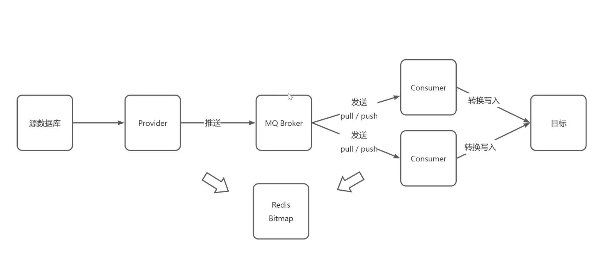
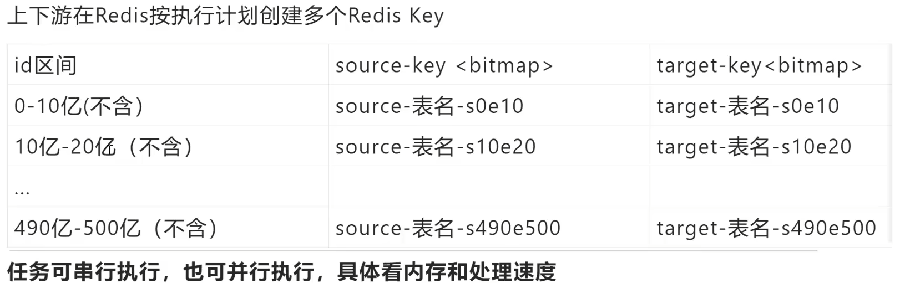
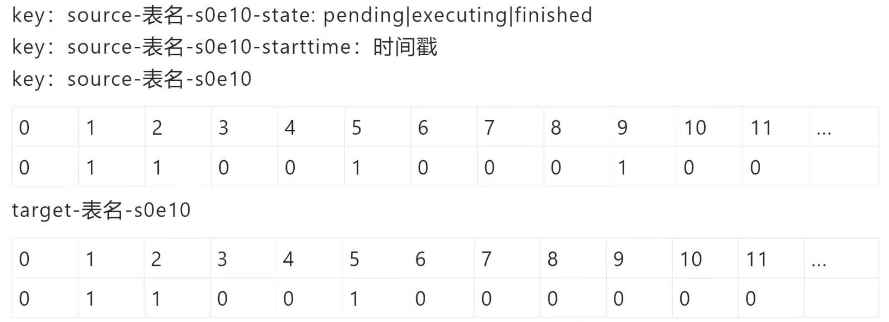
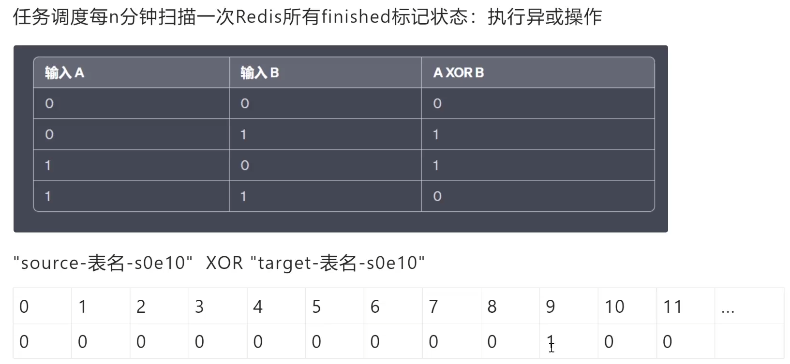

# 基于bitmap百亿级数据迁移的数据一致方案

## 背景：
互联网有很多“数据量较大，并发量较大，业务复杂度较高”的业务场景

服务化分层架构的好处是，服务层屏蔽下游数据层的复杂性，例如缓存、[分库分表](https://so.csdn.net/so/search?q=%E5%88%86%E5%BA%93%E5%88%86%E8%A1%A8&spm=1001.2101.3001.7020)、存储引擎等存储细节不需要向调用方暴露，而只向上游提供方便的RPC访问接口，当有一些数据层变化的时候，所有的调用方也不需要升级，只需要服务层升级即可。

互联网架构，很多时候面临着这样一些需求：

需求1->底层表结构变更：数据量非常大的情况下，数据表增加了一些属性，删除了一些属性，修改了一些属性。

需求2->分库个数变换：由于数据量的持续增加，底层分库个数非成倍增加。

需求3->底层存储介质变换：底层存储引擎由一个数据库换为另一个数据库。

种种需求，都需要进行数据迁移，如何平滑迁移数据，迁移过程不停机，保证系统持续服务，是接下来要讨论的问题。

## 解决方案：
### 一：停机方案
在讨论平滑迁移数据方案之前，先看下不平滑的停机数据迁移方案，主要分三个步骤。

**步骤一：**挂一个类似“为了给广大用户提供更好的服务，服务器会在凌晨0:00-0:400进行停机维护”的公告，并在对应时段进行停机，这个时段系统没有流量进入。

**步骤二：**停机后，研发一个离线的数据迁移工具，进行数据迁移。针对第一节的三类需求，会分别开发不同的数据迁移工具。

（1）底层表结构变更需求：开发旧表导新表的工具

（2）分库个数变换需求：开发2库导3库的工具

（3）底层存储介质变换需求：开发Mongo导Mysql工具

**步骤三：**恢复服务，并将流量切到新库，不同的需求，可能会涉及不同服务升级。

（1）底层表结构变更需求：服务要升级到访问新表

（2）分库个数变换需求：服务不需要升级，只需要改寻库路由配置

（3）底层存储介质变换需求：服务升级到访问新的存储介质

 

总的来说，停机方案是相对直观和简单的，但对服务的可用性有影响，许多游戏公司的服务器升级，游戏分区与合区，可能会采用类似的方案。

除了影响服务的可用性，这个方案还有一个缺点，就是必须在指定时间完成升级，这个对研发、测试、运维同学来说，压力会非常大，一旦出现问题例如数据不一致，必须在规定时间内解决，否则只能回滚。根据经验，人压力越大越容易出错，这个缺点一定程度上是致命的。

无论如何，停机方案并不是今天要讨论的重点，接下来看一下常见的平滑数据迁移方案。

###  二：平滑数据迁移方案：

**步骤一：**生成执行计划

**步骤一：**执行计划

10亿个数据，每条数据占用1位，需要大约119.21MB * 2

**步骤三：**任务调度扫描

## 总结：
解决方案主要有两种：停机迁移 和 平滑数据迁移

前一种方案对研发、测试、运维同学来说，压力都非常大

后一种方案主要分为三步：先按数据量分配成执行计划，然后执行计划，最后再做任务调度扫描查看迁移情况对异常情况补偿。

> 更新: 2024-08-05 20:34:13  
> 原文: <https://www.yuque.com/aaron-wecc3/dhluml/avyhhu7fchiupy46>