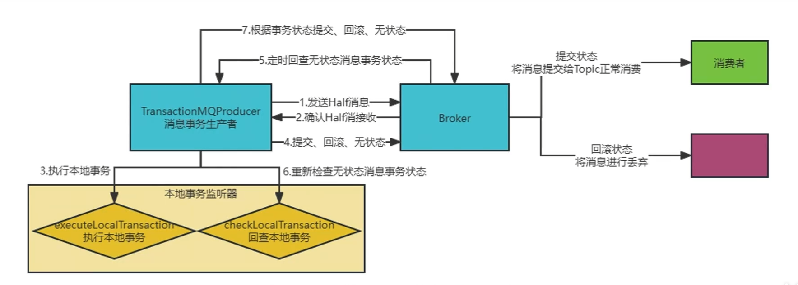

# 如何保证RocketMQ消息与事务一致性

## 介绍
RocketMQ是阿里巴巴开源的分布式消息中间件，它是一个高性能、低延迟、可靠的消息队列系统 ，用于在分布式系统中进行异步通信。


从4.3.0版本开始正式支持分布式事务消息~


RocketMq事务消息支持最终一致性：在普通消息基础上，支持二阶段的提交能力。将二阶段提交和本地事务绑定，实现全局提交结果的一致性。


### 原理、流程
本质上RocketMq的事务能力是基于二阶段提交来实现的


在消息发送上，将二阶段提交与本地事务绑定


本地事务执行成功，则事务消息成功，可以交由Consumer消费

本地事务执行失败，则事务消息失败，Consumer无法消费

但是，RocketMq只能保证本地事务与消息发送的一致性，不能保证下游消费结果一定为成功，故此需要下游业务方进行对应处理。


### 流程如下





## 官方案例
### 先来看看事务消息的 Producer


通过代码注释，我们可以比较直观地发现，RocketMq事务发送事务消息与普通消息的首要区别就在于发送的API，当然除此之外，事务消息还会设置TransactionListener，RocketMq的两阶段提交就与TransactionListener密不可分~


```java
public class TransactionProducer {

    public static final String PRODUCER_GROUP = "please_rename_unique_group_name";
    public static final String DEFAULT_NAMESRVADDR = "127.0.0.1:9876";
    public static final String TOPIC = "TopicTest1234";

    public static final int MESSAGE_COUNT = 10;

    public static void main(String[] args) throws MQClientException, InterruptedException {
        TransactionListener transactionListener = new TransactionListenerImpl();
        TransactionMQProducer producer = new TransactionMQProducer(PRODUCER_GROUP);

        // 设置事务监听器
        producer.setTransactionListener(transactionListener);
        producer.start();

        String[] tags = new String[] {"TagA", "TagB", "TagC", "TagD", "TagE"};
        for (int i = 0; i < MESSAGE_COUNT; i++) {
            try {
                Message msg =
                new Message(TOPIC, tags[i % tags.length], "KEY" + i,
                            ("Hello RocketMQ " + i).getBytes(RemotingHelper.DEFAULT_CHARSET));

                // 发送事务消息
                SendResult sendResult = producer.sendMessageInTransaction(msg, null);
                System.out.printf("%s%n", sendResult);

                Thread.sleep(10);
            } catch (MQClientException | UnsupportedEncodingException e) {
                e.printStackTrace();
            }
        }

        for (int i = 0; i < 100000; i++) {
            Thread.sleep(1000);
        }
        producer.shutdown();
    }
}

```


### 事务消息监听器
```java
public class TransactionListenerImpl implements TransactionListener {
  private AtomicInteger transactionIndex = new AtomicInteger(0);
 
  private ConcurrentHashMap<String, Integer> localTrans = new ConcurrentHashMap<>();
 
  @Override
  public LocalTransactionState executeLocalTransaction(Message msg, Object arg) {
    // 执行本地事务
    int value = transactionIndex.getAndIncrement();
    int status = value % 3;
    localTrans.put(msg.getTransactionId(), status);
    return LocalTransactionState.UNKNOW;
  }
 
  @Override
  public LocalTransactionState checkLocalTransaction(MessageExt msg) {
    // 处理事务回查
    Integer status = localTrans.get(msg.getTransactionId());
    if (null != status) {
      switch (status) {
        case 0:
          return LocalTransactionState.UNKNOW;
        case 1:
          return LocalTransactionState.COMMIT_MESSAGE;
        case 2:
          return LocalTransactionState.ROLLBACK_MESSAGE;
        default:
          return LocalTransactionState.COMMIT_MESSAGE;
      }
    }
    return LocalTransactionState.COMMIT_MESSAGE;
  }
}
```


### 源码
发送半事务消息

Producer调用sendMessageInTransaction方法发送事务消息。因为RocketMq的两阶段提交依靠事务监听器，所以可以看到，如果没设置事务监听器，则直接抛异常。


```java
@Override
public TransactionSendResult sendMessageInTransaction(final Message msg,
                                                      final Object arg) throws MQClientException {
  if (null == this.transactionListener) {
    // 如果没设置事务监听器，则抛错
    throw new MQClientException("TransactionListener is null", null);
  }
 
  msg.setTopic(NamespaceUtil.wrapNamespace(this.getNamespace(), msg.getTopic()));
  return this.defaultMQProducerImpl.sendMessageInTransaction(msg, null, arg);
}
java复制代码public TransactionSendResult sendMessageInTransaction(final Message msg,
                                                      final LocalTransactionExecuter localTransactionExecuter, final Object arg)
  throws MQClientException {
 
  // 获取并检查事务监听器
  TransactionListener transactionListener = getCheckListener();
  if (null == localTransactionExecuter && null == transactionListener) {
    throw new MQClientException("tranExecutor is null", null);
  }
 
  // 事务消息不支持延时，如果设置了延时级别，则需要清除
  if (msg.getDelayTimeLevel() != 0) {
    MessageAccessor.clearProperty(msg, MessageConst.PROPERTY_DELAY_TIME_LEVEL);
  }
 
  Validators.checkMessage(msg, this.defaultMQProducer);
 
  SendResult sendResult = null;
 
  // todo 设置事务消息的标识
  MessageAccessor.putProperty(msg, MessageConst.PROPERTY_TRANSACTION_PREPARED, "true");
  MessageAccessor.putProperty(msg, MessageConst.PROPERTY_PRODUCER_GROUP, this.defaultMQProducer.getProducerGroup());
  try {
    // todo 发送消息，逻辑跟普通消息一直，只不过broker在处理消息时会特殊处理下事务消息
    sendResult = this.send(msg);
  } catch (Exception e) {
    throw new MQClientException("send message Exception", e);
  }
 
  // 本地事务的状态，默认为UNKNOW
  LocalTransactionState localTransactionState = LocalTransactionState.UNKNOW;
  Throwable localException = null;
 
  // todo 根据消息发送结果，进行不同的状态处理
  switch (sendResult.getSendStatus()) {
      // 发送成功
    case SEND_OK: {
      try {
        if (sendResult.getTransactionId() != null) {
          msg.putUserProperty("__transactionId__", sendResult.getTransactionId());
        }
        String transactionId = msg.getProperty(MessageConst.PROPERTY_UNIQ_CLIENT_MESSAGE_ID_KEYIDX);
        if (null != transactionId && !"".equals(transactionId)) {
          msg.setTransactionId(transactionId);
        }
        if (null != localTransactionExecuter) {
          localTransactionState = localTransactionExecuter.executeLocalTransactionBranch(msg, arg);
        } else if (transactionListener != null) {
          log.debug("Used new transaction API");
          // todo 执行本地事务
          localTransactionState = transactionListener.executeLocalTransaction(msg, arg);
        }
        if (null == localTransactionState) {
          localTransactionState = LocalTransactionState.UNKNOW;
        }
 
        if (localTransactionState != LocalTransactionState.COMMIT_MESSAGE) {
          log.info("executeLocalTransactionBranch return {}", localTransactionState);
          log.info(msg.toString());
        }
      } catch (Throwable e) {
        log.info("executeLocalTransactionBranch exception", e);
        log.info(msg.toString());
        localException = e;
      }
    }
      break;
      // 超时 or 节点不可用，则全部标记为事务回滚
    case FLUSH_DISK_TIMEOUT:
    case FLUSH_SLAVE_TIMEOUT:
    case SLAVE_NOT_AVAILABLE:
      // 标记事务状态为 回滚
      localTransactionState = LocalTransactionState.ROLLBACK_MESSAGE;
      break;
    default:
      break;
  }
 
  try {
    // 结束事务，进行收尾工作
    this.endTransaction(msg, sendResult, localTransactionState, localException);
  } catch (Exception e) {
    log.warn("local transaction execute " + localTransactionState + ", but end broker transaction failed", e);
  }
 
  // 设置事务发送结果
  TransactionSendResult transactionSendResult = new TransactionSendResult();
  transactionSendResult.setSendStatus(sendResult.getSendStatus());
  transactionSendResult.setMessageQueue(sendResult.getMessageQueue());
  transactionSendResult.setMsgId(sendResult.getMsgId());
  transactionSendResult.setQueueOffset(sendResult.getQueueOffset());
  transactionSendResult.setTransactionId(sendResult.getTransactionId());
  transactionSendResult.setLocalTransactionState(localTransactionState);
  return transactionSendResult;
}
```


发送事务消息流程并无过多复杂点，逻辑如下↓


基本的参数检查和处理，例: 清除事务消息设置的延时级别、设置事务消息标识方便Broker识别。

发送事务消息，流程与发送普通消息一致

根据消息发送结果，进行不同的处理，生成最终的本地事物的执行结果

SEND_OK，消息发送成功，因为transactionListener肯定不为空，所以一定会执行本地事务，即executeLocalTransaction

FLUSH_DISK_TIMEOUT、FLUSH_SLAVE_TIMEOUT、SLAVE_NOT_AVAILABLE 这三种情况消息发送失败，需进行事务回滚~

endTransaction，将事务执行结果告诉Broker，从而开始二阶段。

组装并返回事务消息发送结果


### 下面继续看下endTransaction


```java
public void endTransaction(
  final Message msg,
  final SendResult sendResult,
  final LocalTransactionState localTransactionState,
  final Throwable localException) throws RemotingException, MQBrokerException, InterruptedException, UnknownHostException {
  final MessageId id;
  if (sendResult.getOffsetMsgId() != null) {
    id = MessageDecoder.decodeMessageId(sendResult.getOffsetMsgId());
  } else {
    id = MessageDecoder.decodeMessageId(sendResult.getMsgId());
  }
  
  String transactionId = sendResult.getTransactionId();
  // 根据brokerName查询broker地址
  final String brokerAddr = this.mQClientFactory.findBrokerAddressInPublish(sendResult.getMessageQueue().getBrokerName());
  EndTransactionRequestHeader requestHeader = new EndTransactionRequestHeader();
  requestHeader.setTransactionId(transactionId);
  requestHeader.setCommitLogOffset(id.getOffset());
  requestHeader.setBname(sendResult.getMessageQueue().getBrokerName());
  
  // todo 根据本地事务执行状态映射为broker认知的执行结果
  switch (localTransactionState) {
    case COMMIT_MESSAGE:
      // 事务提交
      requestHeader.setCommitOrRollback(MessageSysFlag.TRANSACTION_COMMIT_TYPE);
      break;
    case ROLLBACK_MESSAGE:
      // 事务回滚
      requestHeader.setCommitOrRollback(MessageSysFlag.TRANSACTION_ROLLBACK_TYPE);
      break;
    case UNKNOW:
      // unknown，需要进行事务回查，即回调checkLocalTransaction
      requestHeader.setCommitOrRollback(MessageSysFlag.TRANSACTION_NOT_TYPE);
      break;
    default:
      break;
  }
 
  doExecuteEndTransactionHook(msg, sendResult.getMsgId(), brokerAddr, localTransactionState, false);
  requestHeader.setProducerGroup(this.defaultMQProducer.getProducerGroup());
  requestHeader.setTranStateTableOffset(sendResult.getQueueOffset());
  requestHeader.setMsgId(sendResult.getMsgId());
  String remark = localException != null ? ("executeLocalTransactionBranch exception: " + localException.toString()) : null;
  
  // todo 告诉broker本地事务的执行结果
  this.mQClientFactory.getMQClientAPIImpl().endTransactionOneway(brokerAddr, requestHeader, remark,
                                                                 this.defaultMQProducer.getSendMsgTimeout());
}
```


查询Broker地址

将本地事务执行状态映射为Broker熟知的对应的状态

告诉Broker本地事务的执行结果

Broker接受半事务消息

事务消息的发送和普通消息是一致的，Broker都收通过SendMessageProcessor来处理发送过来的消息~


```java
private CompletableFuture<RemotingCommand> asyncSendMessage(ChannelHandlerContext ctx, RemotingCommand request,
                                                            SendMessageContext mqtraceContext,
                                                            SendMessageRequestHeader requestHeader) {
  final RemotingCommand response = preSend(ctx, request, requestHeader);
  
  // ......
  
  CompletableFuture<PutMessageResult> putMessageResult = null;
  
  // 判断是否是事务消息，发送事务消息时，将PROPERTY_TRANSACTION_PREPARED设置为true了
  String transFlag = origProps.get(MessageConst.PROPERTY_TRANSACTION_PREPARED);
  if (Boolean.parseBoolean(transFlag)) {
    if (this.brokerController.getBrokerConfig().isRejectTransactionMessage()) {
      response.setCode(ResponseCode.NO_PERMISSION);
      response.setRemark(
        "the broker[" + this.brokerController.getBrokerConfig().getBrokerIP1()
        + "] sending transaction message is forbidden");
      return CompletableFuture.completedFuture(response);
    }
    
    // 发送半事务消息
    putMessageResult = this.brokerController.getTransactionalMessageService().asyncPrepareMessage(msgInner);
  } else {
    putMessageResult = this.brokerController.getMessageStore().asyncPutMessage(msgInner);
  }
  return handlePutMessageResultFuture(putMessageResult, response, request, msgInner, responseHeader, mqtraceContext, ctx, queueIdInt);
}

java复制代码public CompletableFuture<PutMessageResult> asyncPutHalfMessage(MessageExtBrokerInner messageInner) {
  // 解析并存储消息到commitLog
  return store.asyncPutMessage(parseHalfMessageInner(messageInner));
}
 
// 解析半事务消息
private MessageExtBrokerInner parseHalfMessageInner(MessageExtBrokerInner msgInner) {
  // 备份原始消息的topic、queueId
  MessageAccessor.putProperty(msgInner, MessageConst.PROPERTY_REAL_TOPIC, msgInner.getTopic());
  MessageAccessor.putProperty(msgInner, MessageConst.PROPERTY_REAL_QUEUE_ID,
                              String.valueOf(msgInner.getQueueId()));
  msgInner.setSysFlag(
    MessageSysFlag.resetTransactionValue(msgInner.getSysFlag(), MessageSysFlag.TRANSACTION_NOT_TYPE));
  
  // 重新设置topic为事务消息专属topic: RMQ_SYS_TRANS_HALF_TOPIC
  msgInner.setTopic(TransactionalMessageUtil.buildHalfTopic());
  // 重新设置queueId
  msgInner.setQueueId(0);
  msgInner.setPropertiesString(MessageDecoder.messageProperties2String(msgInner.getProperties()));
  return msgInner;
}
```


Consumer在事务消息真正执行成功前无法消费的原因就在于此~ 因为消息的topic被偷天换日了，hh


二阶段: 执行并处理本地事务

在前面面提到过，Producer会根据消息的发送结果状态码进行不同的处理


SEND_OK，消息发送成功，因为transactionListener肯定不为空，所以一定会执行本地事务，即executeLocalTransaction


FLUSH_DISK_TIMEOUT、FLUSH_SLAVE_TIMEOUT、SLAVE_NOT_AVAILABLE 这三种情况消息发送失败，需进行事务回滚~


最终在endTransaction中将事务的执行结果告诉Broker


而Broker则是通过EndTransactionProcessor来处理的~


本地事务commit

```java
@Override
public RemotingCommand processRequest(ChannelHandlerContext ctx, RemotingCommand request) throws
  RemotingCommandException {
 
  // ......
 
  OperationResult result = new OperationResult();
  if (MessageSysFlag.TRANSACTION_COMMIT_TYPE == requestHeader.getCommitOrRollback()) {
    // todo 本地事务提交
    // todo 从commitLog中查询半事务消息
    result = this.brokerController.getTransactionalMessageService().commitMessage(requestHeader);
    if (result.getResponseCode() == ResponseCode.SUCCESS) {
      RemotingCommand res = checkPrepareMessage(result.getPrepareMessage(), requestHeader);
      if (res.getCode() == ResponseCode.SUCCESS) {
        
        // 读取出半事务消息，并将Topic和queueId替换成原始的Topic和Queue
        MessageExtBrokerInner msgInner = endMessageTransaction(result.getPrepareMessage());
        msgInner.setSysFlag(MessageSysFlag.resetTransactionValue(msgInner.getSysFlag(), requestHeader.getCommitOrRollback()));
        msgInner.setQueueOffset(requestHeader.getTranStateTableOffset());
        msgInner.setPreparedTransactionOffset(requestHeader.getCommitLogOffset());
        msgInner.setStoreTimestamp(result.getPrepareMessage().getStoreTimestamp());
        MessageAccessor.clearProperty(msgInner, MessageConst.PROPERTY_TRANSACTION_PREPARED);
 
        // 重新将消息写入commitLog，供消费者消费
        RemotingCommand sendResult = sendFinalMessage(msgInner);
        if (sendResult.getCode() == ResponseCode.SUCCESS) {
          // 将半事务消息标记为删除
          this.brokerController.getTransactionalMessageService().deletePrepareMessage(result.getPrepareMessage());
        }
        return sendResult;
      }
      return res;
    }
  }
 
  // ......
 
}
```


当commitOrRollback ==

MessageSysFlag.TRANSACTION_COMMIT_TYPE时，代表事务需要提交，流程如下


从commitLog中查询半事务消息

将Topic和queueId替换成原始的Topic和queueId

将消息重新写入到commitLog，此时Consumer就能感知并消费消息了

将半事务消息标记为删除

本地事务rollback

```java
@Override
public RemotingCommand processRequest(ChannelHandlerContext ctx, RemotingCommand request) throws
  RemotingCommandException {
 
  // ......
 
  OperationResult result = new OperationResult();
  if (MessageSysFlag.TRANSACTION_ROLLBACK_TYPE == requestHeader.getCommitOrRollback()) {
    // todo 本地事务回滚
    // todo 从commitLog中查询半事务消息
    result = this.brokerController.getTransactionalMessageService().rollbackMessage(requestHeader);
    if (result.getResponseCode() == ResponseCode.SUCCESS) {
      RemotingCommand res = checkPrepareMessage(result.getPrepareMessage(), requestHeader);
      if (res.getCode() == ResponseCode.SUCCESS) {
        // 将半事务消息标记为删除
        this.brokerController.getTransactionalMessageService().deletePrepareMessage(result.getPrepareMessage());
      }
      return res;
    }
  }
 
  // ......
 
}
```


事务回滚流程与事务提交基本一致，只不过不需要再写入到CommitLog中，直接标记删除即可~


本地事务unknown

在EndTransactionProcessor中，只处理了消息的 commit 和 rollback, 并没有处理 unKnown ，它实际上在异步线程

TransactionalMessageCheckService 中处理的。

```java
public class TransactionalMessageCheckService extends ServiceThread {
 
  @Override
  public void run() {
    log.info("Start transaction check service thread!");
    // 60s
    long checkInterval = brokerController.getBrokerConfig().getTransactionCheckInterval();
    while (!this.isStopped()) {
      // 每60s执行一次，调用onWaitEnd方法
      this.waitForRunning(checkInterval);
    }
    log.info("End transaction check service thread!");
  }
 
  @Override
  protected void onWaitEnd() {
    // 超时时间，默认6000ms
    long timeout = brokerController.getBrokerConfig().getTransactionTimeOut();
    // 最大检查次数，默认15次
    int checkMax = brokerController.getBrokerConfig().getTransactionCheckMax();
    long begin = System.currentTimeMillis();
    log.info("Begin to check prepare message, begin time:{}", begin);
    
    // 调用check方法
    this.brokerController.getTransactionalMessageService().check(timeout, checkMax, this.brokerController.getTransactionalMessageCheckListener());
    
    log.info("End to check prepare message, consumed time:{}", System.currentTimeMillis() - begin);
  }
 
}
```


TransactionalMessageCheckService实现了run方法，默认每隔60s执行一次waitForRunning，最终调用的是onWaitEnd


```java
@Override
public void check(long transactionTimeout, int transactionCheckMax,
                  AbstractTransactionalMessageCheckListener listener) {
  try {
    // 半事务消息topic
    String topic = TopicValidator.RMQ_SYS_TRANS_HALF_TOPIC;
    // 拿到该topic的所有MessageQueue
    Set<MessageQueue> msgQueues = transactionalMessageBridge.fetchMessageQueues(topic);
    if (msgQueues == null || msgQueues.size() == 0) {
      log.warn("The queue of topic is empty :" + topic);
      return;
    }
 
    log.debug("Check topic={}, queues={}", topic, msgQueues);
    for (MessageQueue messageQueue : msgQueues) {
      long startTime = System.currentTimeMillis();
 
      // ......省略
 
      while (true) {
        if (System.currentTimeMillis() - startTime > MAX_PROCESS_TIME_LIMIT) {
          log.info("Queue={} process time reach max={}", messageQueue, MAX_PROCESS_TIME_LIMIT);
          break;
        }
 
        if (removeMap.containsKey(i)) {
          log.debug("Half offset {} has been committed/rolled back", i);
          Long removedOpOffset = removeMap.remove(i);
          doneOpOffset.add(removedOpOffset);
        } else {
 
          // todo 拿到半事务消息
          GetResult getResult = getHalfMsg(messageQueue, i);
          MessageExt msgExt = getResult.getMsg();
          if (msgExt == null) {
            if (getMessageNullCount++ > MAX_RETRY_COUNT_WHEN_HALF_NULL) {
              break;
            }
            if (getResult.getPullResult().getPullStatus() == PullStatus.NO_NEW_MSG) {
              log.debug("No new msg, the miss offset={} in={}, continue check={}, pull result={}", i,
                        messageQueue, getMessageNullCount, getResult.getPullResult());
              break;
            } else {
              log.info("Illegal offset, the miss offset={} in={}, continue check={}, pull result={}",
                       i, messageQueue, getMessageNullCount, getResult.getPullResult());
              i = getResult.getPullResult().getNextBeginOffset();
              newOffset = i;
              continue;
            }
          }
 
          // .....省略
 
 
          // 检查检查次数是否超过最大值，如果超过则丢弃该消息
          if (needDiscard(msgExt, transactionCheckMax) || needSkip(msgExt)) {
            listener.resolveDiscardMsg(msgExt);
            newOffset = i + 1;
            i++;
            continue;
          }
 
          List<MessageExt> opMsg = pullResult.getMsgFoundList();
          // todo 是否需要回查
          boolean isNeedCheck = (opMsg == null && valueOfCurrentMinusBorn > checkImmunityTime)
            || (opMsg != null && (opMsg.get(opMsg.size() - 1).getBornTimestamp() - startTime > transactionTimeout))
            || (valueOfCurrentMinusBorn <= -1);
 
          if (isNeedCheck) {
            if (!putBackHalfMsgQueue(msgExt, i)) {
              continue;
            }
 
            // todo 执行回查
            listener.resolveHalfMsg(msgExt);
          } else {
            pullResult = fillOpRemoveMap(removeMap, opQueue, pullResult.getNextBeginOffset(), halfOffset, doneOpOffset);
            log.debug("The miss offset:{} in messageQueue:{} need to get more opMsg, result is:{}", i,
                      messageQueue, pullResult);
            continue;
          }
        }
        newOffset = i + 1;
        i++;
      }
      if (newOffset != halfOffset) {
        transactionalMessageBridge.updateConsumeOffset(messageQueue, newOffset);
      }
      long newOpOffset = calculateOpOffset(doneOpOffset, opOffset);
      if (newOpOffset != opOffset) {
        transactionalMessageBridge.updateConsumeOffset(opQueue, newOpOffset);
      }
    }
  } catch (Throwable e) {
    log.error("Check error", e);
  }
 
}
```


在check方法中，如果满足条件，会进行回查操作，但是满足什么样的条件才会进行回查呢？


在前面提到过，Broker会处理commit or rollback的事务状态，并且在处理成功后，都会创建一条删除半事务消息的消息，那么第一个需要回查的情况就是: 如果存在半事务消息，但是没有对应的删除的消息，说明本地事务是unknown状态，需要回查。

本地事务执行超过超时时间（默认6秒）没有返回给Broker状态，那么也需要进行回查

如果回查一直还是unknown，那么会有重试，默认最大重试次数为15次，超过15次则丢弃该消息


Broker发起回查

Broker回查，将任务提交到线程池进行异步回查

```java
public abstract class AbstractTransactionalMessageCheckListener {
 
  private static ExecutorService executorService = new ThreadPoolExecutor(2, 5, 100, TimeUnit.SECONDS, new ArrayBlockingQueue<Runnable>(2000), new ThreadFactory() {
    @Override
    public Thread newThread(Runnable r) {
      Thread thread = new Thread(r);
      thread.setName("Transaction-msg-check-thread");
      return thread;
    }
  }, new CallerRunsPolicy());
 
  public void resolveHalfMsg(final MessageExt msgExt) {
    // 异步回查
    executorService.execute(new Runnable() {
      @Override
      public void run() {
        try {
          // 发起回查
          sendCheckMessage(msgExt);
        } catch (Exception e) {
          LOGGER.error("Send check message error!", e);
        }
      }
    });
  }
}
```


发送回查请求，RequestCode = CHECK_TRANSACTION_STATE


```java
public void sendCheckMessage(MessageExt msgExt) throws Exception {
 
  // .......组装请求
 
  String groupId = msgExt.getProperty(MessageConst.PROPERTY_PRODUCER_GROUP);
  Channel channel = brokerController.getProducerManager().getAvailableChannel(groupId);
  if (channel != null) {
    // todo Broker 回查Client事务消息状态
    brokerController.getBroker2Client().checkProducerTransactionState(groupId, channel, checkTransactionStateRequestHeader, msgExt);
  } else {
    LOGGER.warn("Check transaction failed, channel is null. groupId={}", groupId);
  }
}
 
public void checkProducerTransactionState(
  final String group,
  final Channel channel,
  final CheckTransactionStateRequestHeader requestHeader,
  final MessageExt messageExt) throws Exception {
  
  // 发送请求，RequestCode = CHECK_TRANSACTION_STATE
  RemotingCommand request =
    RemotingCommand.createRequestCommand(RequestCode.CHECK_TRANSACTION_STATE, requestHeader);
  request.setBody(MessageDecoder.encode(messageExt, false));
  try {
    this.brokerController.getRemotingServer().invokeOneway(channel, request, 10);
  } catch (Exception e) {
    log.error("Check transaction failed because invoke producer exception. group={}, msgId={}, error={}",
              group, messageExt.getMsgId(), e.toString());
  }
}
```


Producer处理回查

Producer由**ClientRemotingProcessor来接收消息回查请求，Broker 回查请求的RequestCode = CHECK_TRANSACTION_STATE**


```java
public class ClientRemotingProcessor extends AsyncNettyRequestProcessor implements NettyRequestProcessor {
 
  @Override
  public RemotingCommand processRequest(ChannelHandlerContext ctx,
                                        RemotingCommand request) throws RemotingCommandException {
    switch (request.getCode()) {
       // 事务消息回查
      case RequestCode.CHECK_TRANSACTION_STATE:
        return this.checkTransactionState(ctx, request);
      // ......
      default:
        break;
    }
    return null;
  }
 
}

java复制代码@Override
public void checkTransactionState(final String addr, final MessageExt msg,
                                  final CheckTransactionStateRequestHeader header) {
  
  // 封装一个回查的Runnable任务
  Runnable request = new Runnable() {
    private final String brokerAddr = addr;
    private final MessageExt message = msg;
    private final CheckTransactionStateRequestHeader checkRequestHeader = header;
    private final String group = DefaultMQProducerImpl.this.defaultMQProducer.getProducerGroup();
 
    @Override
    public void run() {
      TransactionCheckListener transactionCheckListener = DefaultMQProducerImpl.this.checkListener();
      
      // 拿到事务监听器
      TransactionListener transactionListener = getCheckListener();
      if (transactionCheckListener != null || transactionListener != null) {
        
        // 本地事务状态，默认为UNKNOW
        LocalTransactionState localTransactionState = LocalTransactionState.UNKNOW;
        Throwable exception = null;
        try {
          if (transactionCheckListener != null) {
            localTransactionState = transactionCheckListener.checkLocalTransactionState(message);
          } else if (transactionListener != null) {
            log.debug("Used new check API in transaction message");
            // todo 回查本地事务
            localTransactionState = transactionListener.checkLocalTransaction(message);
          } else {
            log.warn("CheckTransactionState, pick transactionListener by group[{}] failed", group);
          }
        } catch (Throwable e) {
          log.error("Broker call checkTransactionState, but checkLocalTransactionState exception", e);
          exception = e;
        }
 
        // 跟endTransaction一样，告诉Broker回查结果
        this.processTransactionState(
          localTransactionState,
          group,
          exception);
      } else {
        log.warn("CheckTransactionState, pick transactionCheckListener by group[{}] failed", group);
      }
    }
 
    private void processTransactionState(
      final LocalTransactionState localTransactionState,
      final String producerGroup,
      final Throwable exception) {
      // ... 省略，跟endTransaction一样，告诉Broker回查结果
    }
  };
 
  // 提交给线程池，异步回查
  this.checkExecutor.submit(request);
}
```


## 总结
事务消息必须设置事务监听器，依靠此事务监听器执行本地事务以及事务回查，保证消息的一致性

事务消息不支持延时发送及批量发送

只能保证消息发送与本地事务执行的一致性，无法保证下游消费结果一定成功

 


> 更新: 2024-07-25 22:07:58  
> 原文: <https://www.yuque.com/aaron-wecc3/dhluml/daazz1gk7265huqw>