# 如何实现无状态的JWT令牌自动续约

## 概念
JSON Web Token (JWT)是一个开放标准(RFC 7519) ，它定义了一种简洁的、自包含的方法用于通信双方之间以 JSON 对象的形式安全地传输信息。这种信息可以被验证和信任，因为它是数字签名的。JWT通常用于互联网应用程序中，用于身份验证和授权。 **JWT 和 传统 Token 的区别**

| | JWT | 传统 Token |
| --- | :--- | :--- |
| 存储位置 | JWT通常存储在客户端 | 传统的Token如Cookies和Session Tokens通常在服务器端存储状态 |
| 传输方式 | JWT作为HTTP请求的一部分传输，可以直接在请求的Header中 | 传统Token通常通过Cookie在浏览器和服务器之间传输 |
| 状态管理 | JWT是自包含的，不依赖于服务器的会话状态，减轻服务器负担。 | 传统Token通常与服务器的会话状态绑定，服务器需要存储用户的会话信息，这可能导致更高的服务器负载和状态管理复杂性。 |
| 安全性和隐私 | JWT的所有信息都是加密的，并且可以设置权限，只有拥有正确密钥的用户才能解码信息。但是，如果密钥被泄露，那么所有的JWT都可能受到影响。 | 不包含敏感信息，因此不加密 |
| 跨域使用 | 由于 JWT 不依靠服务器状态，可以在不同域之间请求和传递用户信息，因此适合跨域请求 | 传统Token在跨域请求中可能需要服务器配置CORS（跨源资源共享）策略 |

#### JWT 组成部分
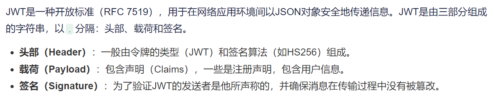

****

由于JWT是自包含的，所以它不需要在[服务器](https://cloud.tencent.com/act/pro/promotion-cvm?from_column=20065&from=20065)上存储状态，这减少了攻击面，并允许用户在没有状态的系统中进行认证。同时，由于JWT是在客户端和服务器之间传输的，所以它也易于跨域使用。 以下是一段 JWT的内容，我们需要找到令牌中的用户名

官网地址：[https://jwt.io](https://jwt.io)

## JWT 原理
JWT 的原理是，服务器认证以后，生成一个 JSON 对象，发回给用户，就像下面这样。

{

  "姓名": "诸葛",

  "角色": "管理员",

  "到期时间": "2028年12月11日0点0分"

}

以后，用户与服务端通信的时候，都要发回这个 JSON 对象。服务器完全只靠这个对象认定用户身份。为了防止用户篡改数据，服务器在生成这个对象的时候，会加上签名（详见后文）。

服务器就不保存任何 session 数据了，也就是说，服务器变成无状态了，从而比较容易实现扩展。

 

 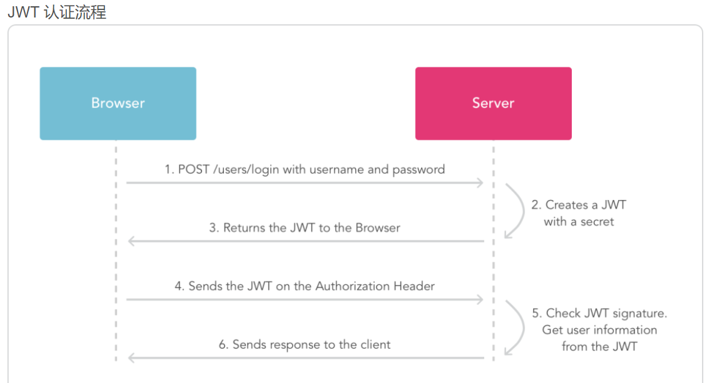

认证流程流程说明：

浏览器发起请求登陆，用户携带用户名和密码等了

服务端验证身份，根据算法，将用户标识符打包生成 Token,

服务器返回JWT信息给浏览器，JWT不包含敏感信息

浏览器发起请求获取用户资料，把刚刚拿到的 Token一起发送给服务器

服务器发现数据中有 Token，验证身份是否合法

服务器根据当前Token解析返回该用户的用户资料

### 整体过程如下：
 

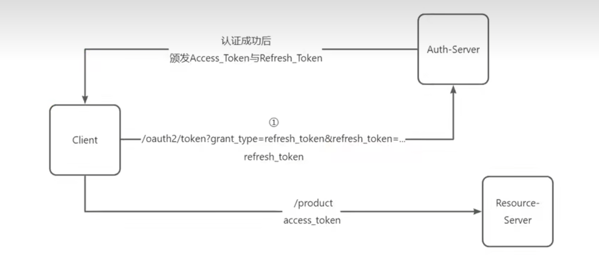

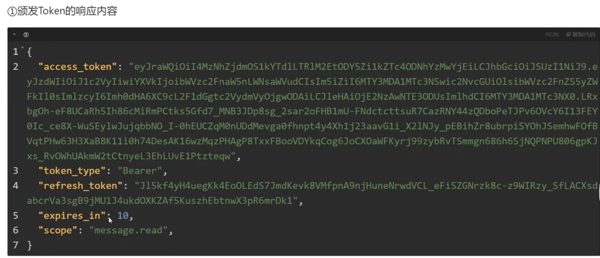

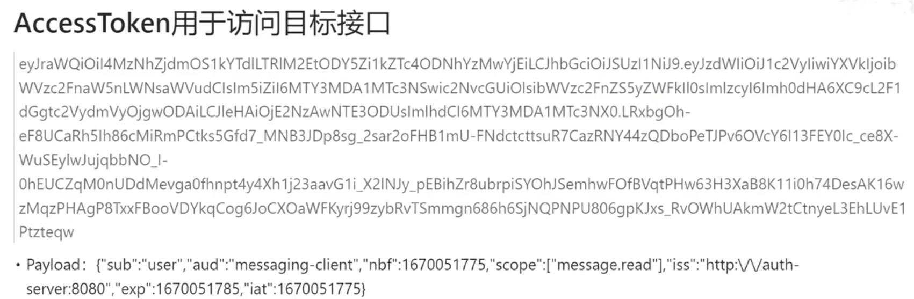

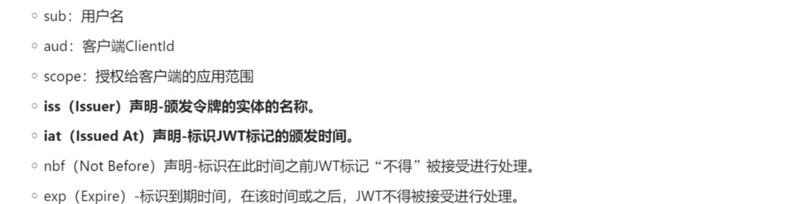

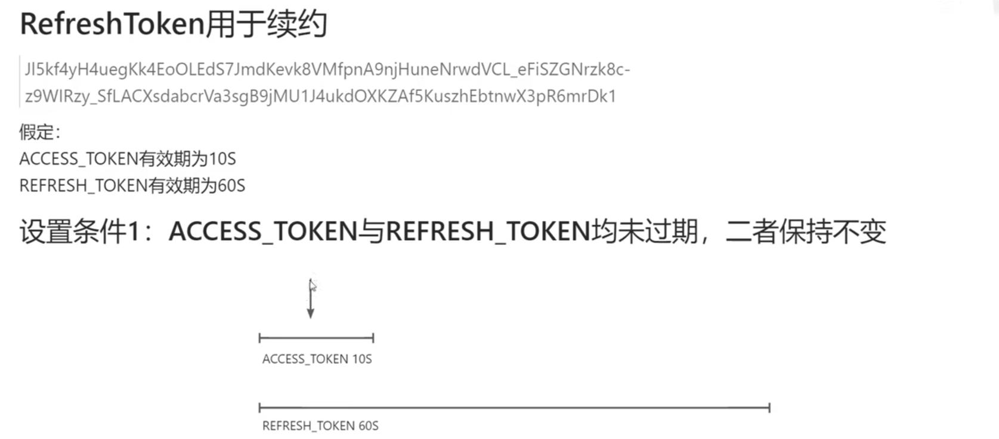

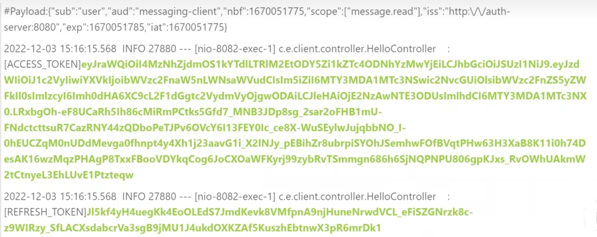

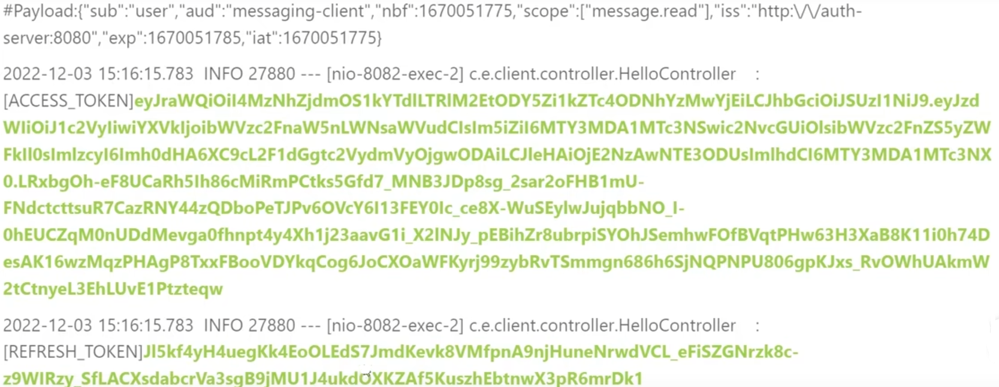

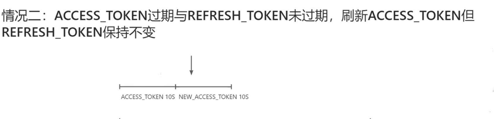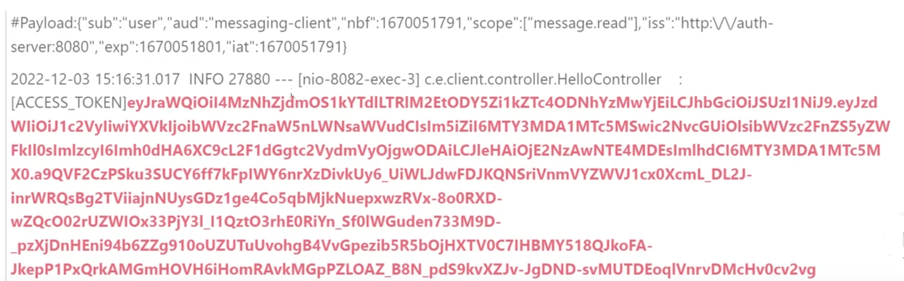

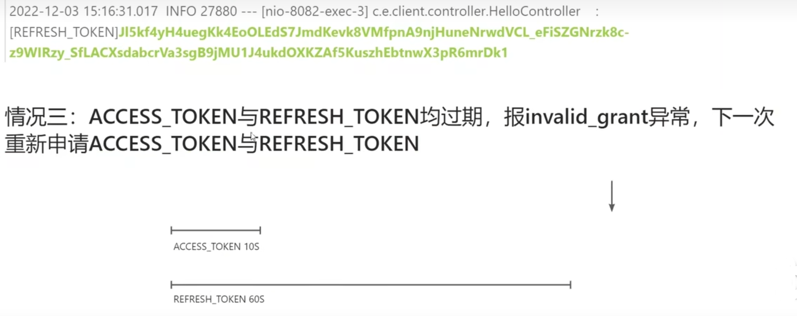

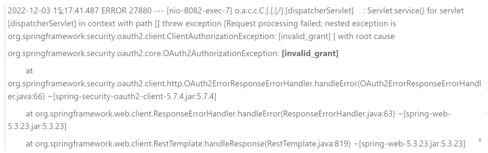

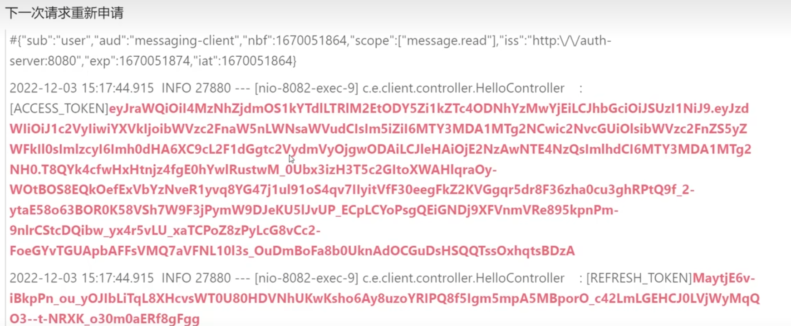

> 更新: 2025-04-20 22:39:01  
> 原文: <https://www.yuque.com/aaron-wecc3/dhluml/ch15inta1brw8y3m>