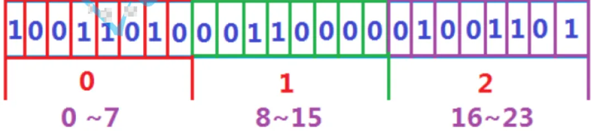
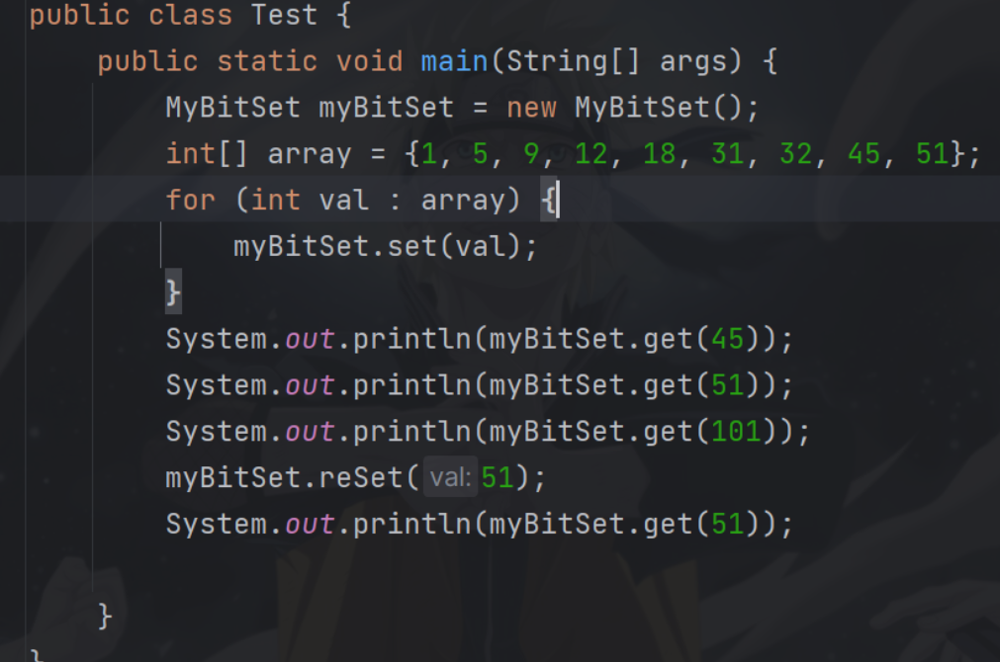
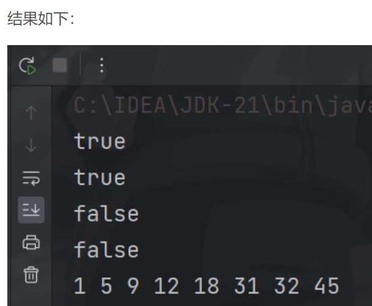

# 如何快速判断几十亿个数中是否存在某个数

## 【腾讯面试题】
给40亿个不重复的无符号整数，没排过序。给一个无符号整数，如何快速判断一个数是否在这40亿个数中。

 对于这个问题，在前面学习到的知识中，我们有两种方案进行解决：


1  遍历，时间复杂度O(N)

2  排序 + 二分查找，时间复杂度O(NlogN) + O(logN)

而对于40亿的无符号整数来说，我们计算一下将这些数组放在内存中需要多大的空间：


10亿个字节换算后需要0.93GB的内存(近似看作1GB) -->


10亿个整型则需要4GB的内存 -->


40亿个整型就需要16GB的内存！！！


我们16GB的电脑内存刚开机就已经占用了20%以上的内存，因此对于这种场景，上述两种方案明显不可取。此时就需要用到位图解决。

 

## 位图的概念
        位图是一种数据结构，是用每一位来存放某种状态，适用于海量数据，整数，数据无重复的场景。通常是用来判断某个数据存不存在的。

        数据是否在给定的整形数据中，结果是在或者不在，刚好是两种状态，那么可以使用一个二进制比 特位来代表数据是否存在的信息，如果二进制比特位为1，代表存在，为0代表不存在。比如：


 int arry[] = {0,3,4,6,11,17,21,23,10,,20}

原本int需要4个字节。10*4就是40个字节。换成位图存储则只需要3个字节即可。




**<font style="color:rgb(13, 0, 22);">如上例子，10个整数本应该存放需要40个字节，此时用位图只需要3个字节。而此时处理40亿个整型数据的问题也就迎刃而解了。</font>**

**<font style="color:rgb(13, 0, 22);"></font>**

**<font style="color:rgb(13, 0, 22);">预计：10亿数据int类型ID  = 10亿 *4字节 = 3.7G内存</font>**

**<font style="color:rgb(13, 0, 22);">换成bitmap  =  3.7G /32 =117mb内存</font>**

**<font style="color:rgb(13, 0, 22);"></font>**

## 二、位图的实现
注意：模拟实现的位图只处理0和正整数数据


思路：一个字节有8个比特位，每个比特位只表示0和1。位图的关键就在于，对于每个字节，将其所有比特位用来表示对应的某些数存不存在。

例如：一个byte类型占一个字节，也就是8个比特位，则第一个byte用来表示0-7，第二个表示8-15，以此类推。


下面，我用byte数组的方式模拟实现了一个位图（Java中BitSet集合类中用的是long数组，为什么？）

 

```java
import java.util.Arrays;
 
public class MyBitSet {
 
    byte[] elem;
    int usedSize;
 
    public MyBitSet() {
        elem = new byte[4];
    }
 
    //bits：elem数组需要存入的最大位数
    public MyBitSet(int bits) {
        elem = new byte[bits / 8 + 1];
    }
 
    //存入集合 -> 等价于将数据的对应位置为1
    public void set(int val) {
        if (val < 0) {
            throw new IndexOutOfBoundsException();
        }
        //判断是否需要扩容
        if (val >= elem.length * 8) {
            elem = Arrays.copyOf(elem, val / 8 + 1);
        }
        int arrayIndex = val / 8; //该数字在数组中应存入的位置
        int bitIndex = val % 8; //该数字在数组位置中应存入的比特位位置
        elem[arrayIndex] |= (byte) (1 << bitIndex);
        usedSize++;
    }
 
    //判断数字是否存在 -> 等价于检查数据的对应位置是否为1
    public boolean get(int val) {
        if (val < 0) {
            throw new IndexOutOfBoundsException();
        }
        int arrayIndex = val / 8;
        //如果下标超过数组元素个数，一定不存在
        if (arrayIndex >= elem.length) {
            return false;
        }
        int bitIndex = val % 8;
        //逻辑& 如果结果不为0，说明当前bitIndex位置为1，否则为0
        return (elem[arrayIndex] & (1 << bitIndex)) != 0;
    }
 
    //将数据的对应位置置为0
    public void reSet(int val) {
        if (val < 0) {
            throw new IndexOutOfBoundsException();
        }
        int arrayIndex = val / 8;
        if (arrayIndex >= elem.length) {
            return;
        }
        int bitIndex = val % 8;
        // 1 << bitIndex位置为1，对整个字节取反，再逻辑&运算
        // 这样bitIndex位置无论是0或者1都会被置0，其余位都为1，因此会保留原有的1
        elem[arrayIndex] &= (byte) ~(1 << bitIndex);
        usedSize--;
    }
 
    public int getUsedSize() {
        return usedSize;
    }
}
```

**<font style="color:rgb(77, 77, 77);">MyBitSet 中有三个主要方法，其解决方式基本一致，只在最后的位运算中有所差别，代码中已有详细的注释。</font>**

对比上述代码和这个测试用例，我们来想想为什么Java中的BitSet集合类使用long数组进行存储？


在Java中，byte占1个字节，long占8个字节，也就是说一个long可以存64比特位的信息，对于数字分散较大情况，long类型更有可能直接存入这个信息。

对于上述代码来说，byte数组默认的长度为4，即能够存储32位信息，而在数据为32，45，51时，数组都进行了扩容操作（当然也可以做二倍扩容，不要只扩容到刚好放的下的情况），显然这样的操作对比long类型来说，数组的长度必然更大，需要扩容的可能性也更大。

总结：使用long数组作为BitSet的底层数据结构是为了提高存储效率、快速访问和实现位级别的操作。这种设计使得BitSet在处理大规模位信息时能够高效地进行操作，并且具有较低的空间复杂度。

##  三、位图的应用
使用位图进行排序

基本思想：在模拟实现的位图数组中，顺序读取BitSet中被设置为1的位，这些位所对应的索引即为排好序的整数序列。这种排序方式也就是我们熟悉的基于计数排序（Counting Sort）的算法。


下面是使用位图进行排序的基本步骤：


创建BitSet：根据待排序的整数集合的范围，创建一个足够大的BitSet对象。


设置位：遍历待排序的整数集合，将每个整数对应的位设置为1。


读取排序结果：按顺序读取BitSet中被设置为1的位，这些位所对应的索引即为排好序的整数序列。


由于位图中的每个比特位只能证明其存不存在，因此对于重复的数据，位图无法全部获取，但能够以数值上的大小进行排序，因此，位图的排序就已经做到了排序+去重。

 

```java
public class Test {
    public static void main(String[] args) {
        MyBitSet myBitSet = new MyBitSet();
        int[] array = {1, 5, 9, 12, 18, 31, 32, 45, 51, 45, 45};
        for (int val : array) {
            myBitSet.set(val);
        }
        System.out.println(myBitSet.get(45));
        System.out.println(myBitSet.get(51));
        System.out.println(myBitSet.get(101));
        myBitSet.reSet(51);
        System.out.println(myBitSet.get(51));
 
        for (int i = 0; i < myBitSet.elem.length; i++) {
            for (int j = 0; j < 8; j++) {
                if ((myBitSet.elem[i] & (1 << j)) != 0) {
                    System.out.print(i * 8 + j + " ");
                }
            }
        }
    }
}
```



## 除此之外，位图还有以下应用：


1. 快速查找某个数据是否在一个集合中

2. 求两个集合的交集、并集等

3. 操作系统中磁盘块标记

其余的，位图通常用于解决一些特定问题，例如 布隆过滤器、位图索引 等。布隆过滤器利用位图来高效地判断一个元素是否存在于一个集合中；位图索引则利用位图来快速查找某个值在一个范围内的出现次数等。知道了位图，就要知道布隆过滤器了。

布隆过滤器是一种概率型数据结构，用于快速判断一个元素是否可能存在于一个集合中。它通过多个哈希函数将元素映射到位图中的多个位置，然后检查这些位置上的位是否都为1来进行判断。布隆过滤器的主要优点是节省存储空间、快速判断元素存在性，但可能存在一定的误判率（False Positive）。


在实际应用中，布隆过滤器通常会使用位图作为其基础数据结构，即将位图用于存储布隆过滤器的位数组。布隆过滤器通过多次哈希映射将元素映射到位图中，从而实现快速的元素存在性判断。


因此，可以说位图是布隆过滤器的基础数据结构，而布隆过滤器则是在位图的基础上实现了一种概率型的元素存在性判断方法。

 


> 更新: 2025-04-20 22:39:01  
> 原文: <https://www.yuque.com/aaron-wecc3/dhluml/kntmehqtbpzgilpz>