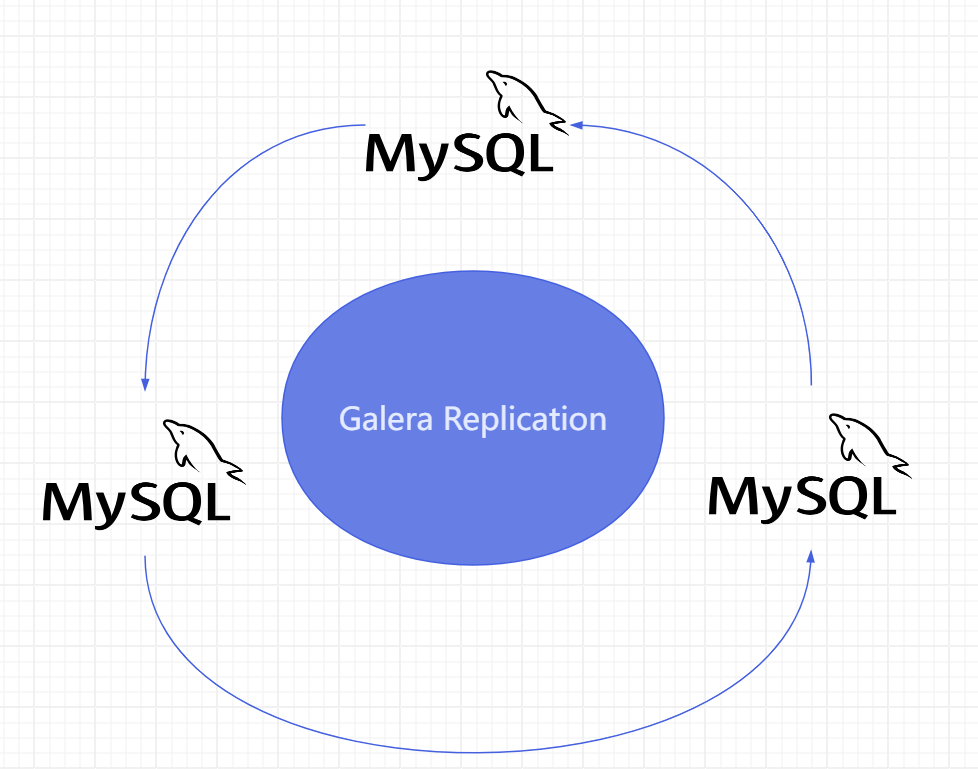
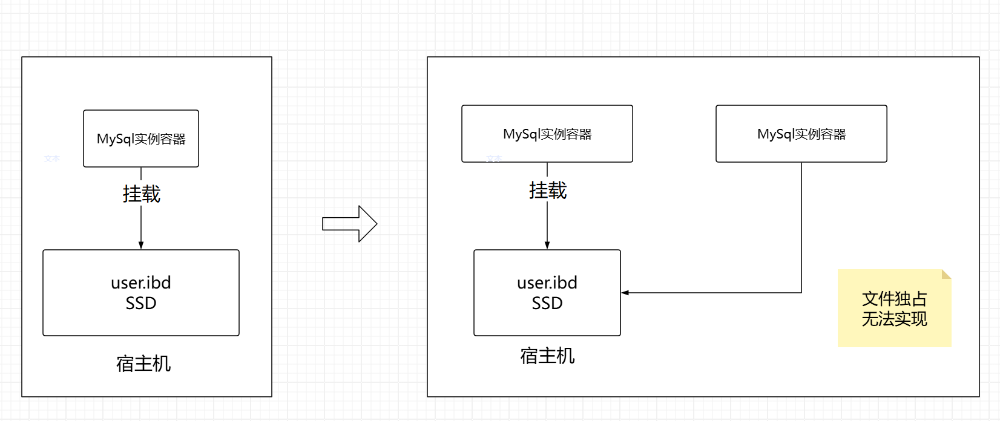
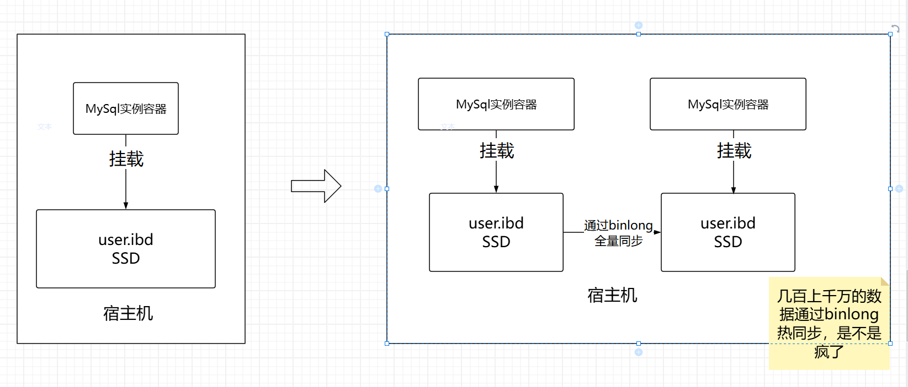
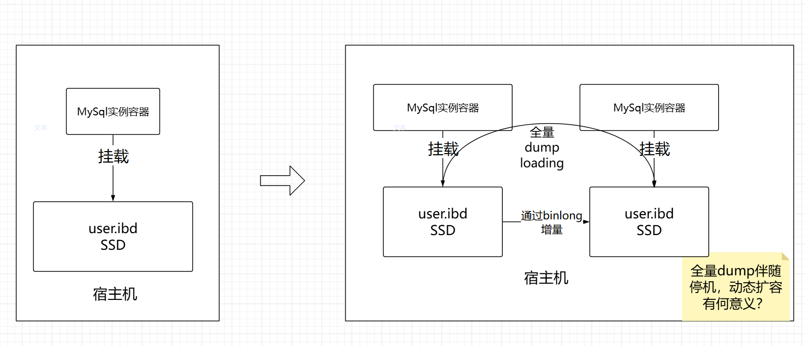
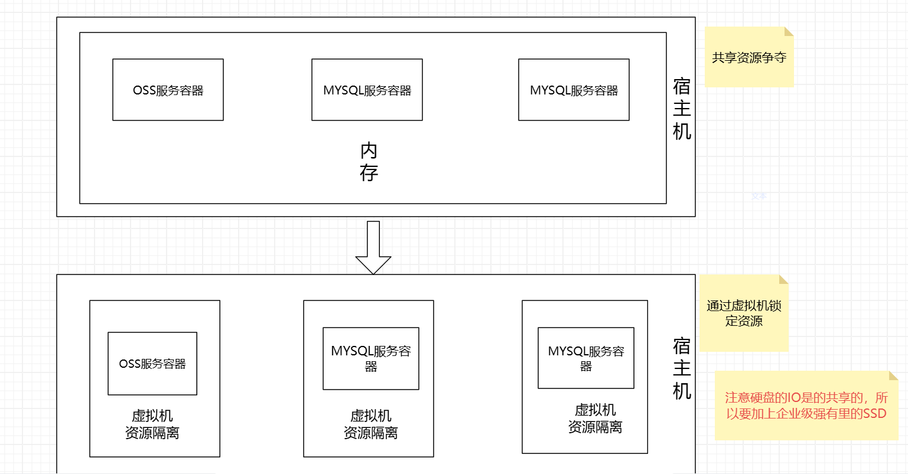

# 我为什么不建议使用Docker部署MySQL数据库？

从应用场景下，数据存储节点是少量而稳定的，大多数场景并没有“灵活扩容的需求”

从技术方面，Mysql容器是“有状态的”无法轻易的水平扩容

扩容容器，共享数据文件

每个容器都挂载各自的SSD

资源上占用

> 更新: 2025-04-20 22:38:59  
> 原文: <https://www.yuque.com/aaron-wecc3/dhluml/wcmxppyaztm7mb8l>