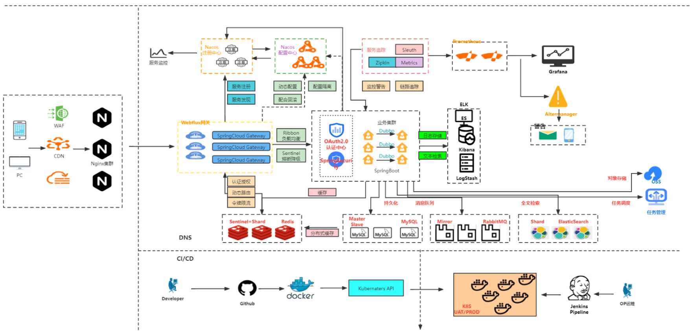
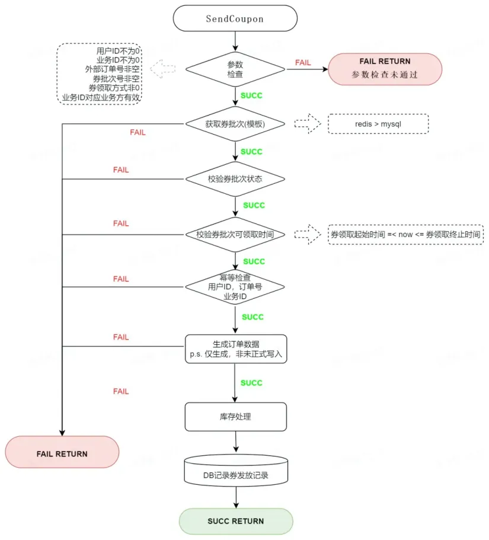
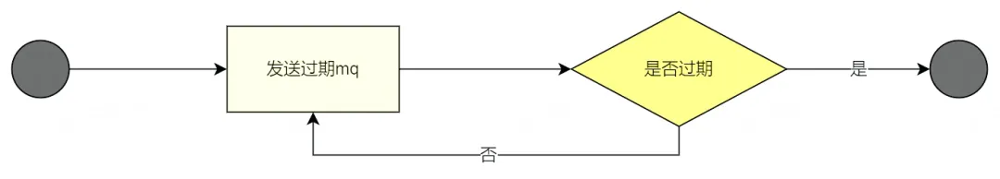

# 抖音直播演示稿

# -- MySQL场景题--

## 一、整体架构及执行流程
### Query语句
+ 描述SQL语句从客户端到服务器的执行流程？
+ 如果提示too many connections 怎么处理?

### Update语句   
+ 详细解释每种日志的作用和使用场景
+ InnoDB三大特性  

## 二、索引相关  
+ MySQL索引用什么数据结构？
+ 为什么不用AVL ，B-Tree ,Red-back,Hash
+ 为何要求表必须有长整型自增主键？主键跟索引的关系？
+ 什么情况B+Tree叶子节点有row data？
+ 索引优化  explain type 
+ 索引失效?type级别 回表覆盖索引 ICP
+ 索引什么数据结构？三大日志分别做什么？
+ 为何有了redoLog还要binlog? 
+ 宕机重启时binlog无记录，redo有如何操作？ 
+ 了解InnoDB三大特性吗？BufferPool  AHI
+ 为什么很多公司都建议MySQL单表不超过两千万?
+ 索引失效场景有哪些？

## 三、事务与锁 
    - MySQL线上死锁问题如何排查？
    - 数据库连接池爆满如何解决？
    - MySQL如何解决并发问题？

## 四、性能调优相关 
    - 慢SQL问题如何排查？
    - 何时考虑主从,分库分表？ 
    - 如何设计日均千万级数据库，如何迁移到分库？
    - 关联业务跨库如何查询？
    - 海量数据如何高效统计？
    - ERP包装成SaaS架构需要关注的重难点？

# -- Redis 专题 --
## 一、选择Redis的原因？为何快？
    - 单线程还是多线程？
    - 数据类型应用场景？底层数据结构？
    - String 数据结构Int   sds5(遗弃)8 16 32
    - C 统计 \0  二进制转化 动态缩容扩容
    - List
    - Set
    - Zset
    - hash 
    - (bitmaps 签到 统计 布隆过滤器  Geo地理位 Hyperloglog UV )
    - Dict扩缩容是否影响bgsave，新增等操作?  
    - 假如used6  size8 再加一个会不会扩容？到多少?
    - Used 2   size20  再移除一个会不会缩容?
    - Factor（used/size）>1
    - 网络模型BIO NIO AIO ，Select Poll EPoll

## 二、Redis持久化 ，淘汰，过期，雪崩穿透穿刺
    - 项目中采用什么持久化方案？
    - 定期过期一次过期了从第一个table拿到20接下来干啥？
    - RDB文件生成是否会阻塞主线程？
    - 为什么主从复制不能用AOF完成？

## 三、哨兵主从集群
    - Redis集群会有写丢失吗？应急方案？
    - 项目如何确保缓存和数据库双写时的一致性？
    - Redis集群有无出现过整个集群不可用？如何处理？

## 四、Redis常见的性能问题及解决方案?
    - 有调慢查询经验吗？
    - 项目中Key冲突的问题？
    - 怎么提高Redis命中率？

#   -- MQ 相关 --
## 一、为什么需要消息中间件? 消息中间的选择？
    - 整体架构/核心组件有哪些？

## 二、项目中是否存在重复消费问题?如何解决？
    - 相同分组的消费者能消费同一个topic 里面相同的分区吗？
    - 何时会触发rebalance？
    - 主节点凉了后怎么选举新的repartition？（ISR OSR HW）
    - 假如：在3个broker中皆有topic1，如果group1中有1个consumer如何消费，2consumer，4consumer呢？

## 三、消息批次发送触发机制？可能异常？如何优化？
    - Msg 几百MB batch-size  16K   新建 缓存32M 
    - 什么时候发消息积压  60000ms   10次
    - 你项目中发送消息是如何选择分区的？
    - 消息发送如何确保可靠性传输？最多失败重试几次？	

## 四、消息拉取机制是如何工作的？
    - 监听什么时候实例化的？
    - @KafkaListener写在类上和方法上实例化的对象一样吗？
    - 你项目中是如何提交消费结果的？
    - 如何确保消息有序性？
    - 清楚Kafka网络模型吗？
    - 上百分片跨机房消息延迟优化？

# --并发编程专题--
## 一、并发编程的基础概念
	原子性可见性有序性

进程/线程 ；串行/并行/并发

同步/异步 ，阻塞/非阻塞

创建线程方法状态扭转停止wait sleep

## 二、并发编程中的锁
可重入/不可重入锁； 乐观锁/悲观锁

公平锁/非公平锁； 互斥锁/共享锁

Synchronized 实现原理（ObjectMonitor markWork jol包锁升级） 优化：锁消除

禁用Synchronized原因

区别ReentrantLock。AQS /CAS核心思想

加锁  释放锁

## 三、读写锁源码流程
	读写锁实现原理

## 四、阻塞队列
## 五、线程池

# --  生产项目难点亮点分享--       
## 一、日均千百万的数据量如何记录和统计?
读写分离分库分表集群（查询）

ES （实时统计困难） 替换了

starrocks 行列混存

（延迟kafka组装顺序性 批次  hbase做点查） 多数据源

## 二、频繁增加字段，过滤条件繁多如何优化?
上游业务表（+业务概念 角色） 

预留扩展json> flinkcdc   kafka 字段打平 发到starrocks 列式存储  

starrocks 瓶颈 分桶 分区。组一个维度的宽表，尽量确保需要联查在一个桶/区

## 三、业务迭代维护成本剧增shi山代码处置?
重构  继续堆

DDD拆业务  上层编排

## 四、生产中分布式事务方案选择?
 加版本号业务不接受

改造类似AT  拿undolog 回滚自己操作  ，并发高死锁

MQ  顺序消费 异步    回滚到之前版本

最终一致还得锁。1  +1 本地提交，需要回滚  +1 提交了3

场景：>2  触发逻辑 ，改数据无法满足。  

补偿性相反事件（无可挽回）

触发逻辑前先校验判断是否有其他事务

校验逻辑把主键加入redis ，每次操作看主键是否存在

redis 批量id 没有现成成本高

触发逻辑转为异步延迟

## 五：SAAS系统关注重难点有哪些？
简历包装

数据隔离，配置及时更新，海量数据，高并发，通用性

## 六：如何设计几百万QPS的红包/订单接口？
关键流程：发红包  拆包入账

重难点：防刷等过滤  多端互通幂等性

	缓存击穿  安全性  加机器  金额计算

同步转异步批处理  坑类似车票  预算控制超卖

流程拆分  负载均衡降级容灾

## 七：三高项目中如何设计业务场景的ID？
有序整形主键?	

## 八、分布式系统高并发解决方案? 

## 
# 应届生  面试突击 
			三个月左右够

1，准备技术栈  Java核心类 MySQL JVM Redis MQ 并发

理解记忆  画图   先不要扣代码

2，准备一两个项目springboot springcloud （遇到 理解 尝试先放着） 跟着敲 只看

理解微服务分布式项目流程框架业务功能  难点  亮点

3，简历（1年到半年）

只是一个敲门砖，有面试机会，才有拿到offer，选更好

薪资5 10 15   

4，进去之后  待下去（3-7星期  帮助 不犯大错 卡转正  开了）

连麦话题

1.大形势走向何方？

2.长远看选哪种语言更好？

3.学历低还适合在互联网吗从业？大专没机会了吗？

4.有没有被裁风险？被裁如何快速入职？

5.IT入行方式有何优缺点？有无影响你的发展？

6.自身技术进阶的几种方式？

7.不同背景人的学习方案？

8.大龄程序员进大厂的可能性 ？

9.传统，外包如何进互联网公司？

10.年底跳还是等年初？

11.如何做到一个月涨薪翻倍？

12.程序员该如何做职业规划？

13.应届生如何成功上岸？主要看什么？

14.面试问到最多技术栈 ？

15.新手入行薪资要多少合适？

16.为什么很多时候一看就会，一用就废

17.互联网行业为何这么卷？都在卷什么？

18.测开，运维，测试，实施都是打杂的吗？

19.互联网行业的红利还能吃多久？

20.数据结构与算法有必要学吗？怎么学？

21.	模拟面试有用吗？有想试试的吗？

22.	Offer的选择？

23.	3本两年跳槽深圳多少合适？

24. DBA需要具备哪些？ 

25. 如今市场对技术的要求变化？

26. 小公司面试区别？

# -- 三高场景题分享  --
## 背景介绍：面试造火箭
（短期面试需求，快速拿到结果）

#### 上班搬砖，面试造火箭
前几年：狂刷八股文

现在：项目+场景+技术原理   业务

感知到的：面试机会少了，要求更高

实质：整体偏向对技术栈的理解和应用能力

#### 整体情况，越来越难
    - 简历**已读未回**，未读
    - 小白八股文**背完就完**，感觉问的**简单确无下文**
    - 外包，小公司，大龄跳不出**死循环倒计时**
    - 类似保险，银行内部，OA，ERP，内部管理系统。
    - 简单CRUD 无难点 亮点

## 常见的  优惠劵抢购 秒杀设计方案？ 
（先从整体架构设计   再结合场景提升技术深度）

#### 整体架构拆解分摊
##### 架构图

##### 10W 并发  :gateway网关 ，web服务，Redis ，MQ ，DB
##### 拦截：
端：JS限时提交次数，CDN动静分离

站点：用户UID标识，鉴权防刷，恶意发包，限流降级，监控预警, 黑白名单

服务：负载均衡，多级缓存(CDN,Nginx,Echache,Caffiene,Redis,BufferPool),异步分批

##### 分摊：
负载均衡，多网管，多中心，多数据源/库实例，分流处理，多级缓存，层层过滤分摊

数据：数据缓存，读写分离，分库分表，集群，SQL优

#### 需求拆解：
    - 要配置券，会涉及到券批次（券模板）创建，券模板的有效期以及券的库存信息
    - 要发券，会涉及到券记录的创建和管理（过期时间，状态）
    - 超卖

#### 核心逻辑流程
发券流程分为三部分：参数校验、幂等校验、库存扣减

二级缓存

幂等操作用于保证发券请求不正确的情况下，业务方通过重试、补偿的方式再次请求，可以最终只发出一张券，防止资金损失。

**券过期：**券过期是一个状态推进的过程，这里我们使用 RocketMQ 来实现。

+ 由于 RocketMQ 支持的延时消息有最大限制，而卡券的有效期不固定，有可能会超过限制，所以我们将卡券过期消息循环处理，直到卡券过期。

**（攻击手段）防刷的方法有哪些？  **

## 三高问题及解决方案
#### 存储瓶颈处理？
读多写少则考虑读写分离。

数据量大则考虑分库分表。

冷热分离加入缓存，配备好过期&淘汰策略

数据去重减少存储冗余，历史数据压缩迁移。

升级存储硬件，SSD代替HDD，构建RAID阵列

#### 分库分表依据？
《阿里规范》预计3年内，500W/2GB则考虑。

根据业务，区域，数据量 做垂直水平查分。

#### 数据如何迁移？
##### low:
公告停机，提前备份，读取批量导入完成迁移

##### up:
备份，双写无感知。导入老库备份，根据修改时间截至。跑批判断数据异同是否需要补充

#### 跨库问题？
跨节点联查，统计分页，全局ID

解决方案：应用层join，数据冗余，中间件，数据仓库，缓存异步，

#### 分布式ID生成策略 ？
UUID,数据库号段，Redis集群，ZK

低延迟，高可用，高并发如何确保？

#### 10 个分库，2号分库异常处理？
路由失败，降级到默认库 .数据结构增加 原目标库，原目标表，同步状态

数据流处理 ： 写入目标库，目标不可用则写入默认库，记录不同信息，触发异步人物

数据同步机制：间隔执行，查询待同步，检查目标可用，同步，更新状态，失败重试

[详见建行市场结算平台亮点难点](https://www.yuque.com/tulingzhouyu/db22bv/fhtiwxnmcgg0nztu#XFteP)

#### 分布式事务？
MQ异步

#### 订单超时处理方案 ？
MQ异步

#### 超卖问题？多发多抢？
sync锁，redis分布式锁，MQ最终一致，for update，串行，补偿，幂等性设计

#### 安全性和防止刷单？
#### 金额精度和舍入的问题 ？
除不尽？0.0000001处理

#### 热点库存问题？
#### 优惠卷怎么过期？
    - MQ **定时任务** 存储过程 xxljob  redis expire 
    - 半夜都跑很多批  第三方
    - 应用的时候去比较时间判过期

## 技术架构宽度，技术的深度
并发，分布式，Redis ，MQ，MySQL,分库分表，集群，调优  

## 怎么快速突击面试拿到Offer

## 想听莫名奇妙 bug?   
  	生产环境慢sql ，测试环境快

 生产发布有问题，测试正常，本地也正常

 sql调优，all 改到index  但是不增反减

mysql的bufferpool,page_size内存设置多大

上线项目用户不少，放假一段时间就凉凉 

项目中查询的时间跟数据库不一致

## 

# -- Java面试突击训练营  --  
## 背景介绍，面试突击适合人群
（短期面试需求，快速拿到结果）

#### 上班搬砖，面试造火箭
前几年：狂刷八股文

现在：项目+场景+技术原理   业务

感知到的：面试机会少了，要求更高

实质：整体偏向对技术栈的理解和应用能力

#### 整体情况，越来越难
    - 简历**已读未回**，未读
    - 小白八股文**背完就完**，感觉问的**简单确无下文**
    - 外包，小公司，大龄跳不出**死循环倒计时**
    - 传统保险银行，CRM客户，OA办公，ERP资源，IMS管理系统。
    - 简单CRUD 无难点 亮点

## 简历优化，让简历不在已读未回
（如何让简历不再已读未回！<<简历模板>>）

#### 技术栈
由浅入深描述，技术栈加上关键词描述

必备技术栈：MySQL,JVM,Redis,MQ,IO,并发，分布式等

熟悉程度：了解，熟悉，掌握，熟练，研究过，精通，定制化

可适当加入通用能力，专业能力，管理能力

#### 项目
（为了解决xx问题，使用xx技术，达到xx效果）

写最近或最擅长最有亮点的2-4个即可。**适当优化**

提前预备好项目场景问题，**难点**/**亮点**适当投匹配度高项目

技术架构 

结合项目问题，使用什么技术，达到什么效果。数据化

业务架构

通用性设计，处理流程，定制化操作

## 项目必问，让你hold住吹的牛
（如何让面试官跟你聊你擅长的点！）

#### 提前预设好项目相关问题	
##### 1，项目基本情况/规模，软硬件技术架构，并发量/数据量
###### Gateway
    - 硬件配置：8核16G，能够承受2000+每秒的请求，而32核64G的配置可以支持上万每秒的请求。
    - 技术架构：介绍网关如何作为系统的第一道防线，处理请求转发、负载均衡、服务降级等功能。

###### Web服务
    - 并发量：一般单机能够处理几百到几千的并发请求。
    - 技术架构：讨论如何通过微服务架构提高系统的可扩展性和可维护性。

###### MQ
    - 技术选型：Kafka, RocketMQ, RabbitMQ, ActiveMQ等，讨论各自的优缺点及适用场景。
    - 性能表现：单机处理能力从十万到百万消息/秒，根据业务需求选择合适的产品。

###### NoSQL
    - 并发能力：单机支持几万并发，高并发场景下考虑集群部署。
    - 技术选型：根据数据模型和查询需求选择合适的NoSQL数据库，如MongoDB、Redis等。

###### DB
    - 并发量：8核16G配置可以处理几百并发，4-5K并发则需要考虑分库分表或提升硬件配置。
    - 性能优化：32核64G配置可以处理五六千并发，讨论如何通过索引优化、查询优化提高数据库性能。

##### 2，项目各环节关注的问题，解决的方案。考察对应技术栈深度
    - **并发处理**：讨论如何通过多线程、异步处理等技术提高系统的并发处理能力。
    - **分布式系统**：介绍分布式系统的设计理念，如CAP定理、BASE定理等，并讨论如何实现服务的高可用和数据一致性。
    - **缓存机制**：深入讨论Redis的使用场景、数据结构、持久化机制以及缓存穿透、缓存雪崩的解决方案。
    - **消息队列**：探讨MQ在解耦、异步处理、流量削峰中的作用，以及如何保证消息的可靠性和顺序性。
    - **数据库优化**：讨论MySQL的索引设计、查询优化、分库分表策略以及如何通过主从复制、读写分离提高数据库性能。
    - **集群部署**：介绍如何通过集群部署提高系统的可用性和扩展性。

##### 3，核心亮点，技术难点，问题解决，性能优化
    - **海量数据&SQL调优**：分享具体的SQL调优案例，通过分析执行计划、

  优化查询语句提高查询效率。

    - **多级缓存&数据一致性**：在分布式系统中如何保证数据一致性，

引入分布式事务的解决方案，如两阶段提交、补偿事务等。

    - **分布式事务**：分布式事务的实现机制，以及在面对复杂业务场景时

如何保证事务的原子性和一致性。

    - **系统调优**：介绍系统级别的调优经验，如JVM参数优化、

垃圾回收策略选择等

##### 4，深入细节和底层提升面试通过率
#### 分销领客牛平台（保险产品分销系统）
##### 一、采用多级缓存架构，将热点产品信息查询延迟控制在10ms内
具体如何通过多级缓存架构，提高查询效率？

Caffeine采用的过期策略是？底层数据结构？

Spring/MyBatis二级缓存的应用？

如何处理缓存一致性问题？

如何实现产品信息分级缓存？哪些热点？哪些二级？

如何预热已达到用户更佳体验？

缓存三剑客是如何处理的？具体步骤是？

穿透（不存在），击穿（多请某key正好失效），雪崩（大量key同时）

更多细节 落地。点小黄车查看

##### 二、设计了分布式锁+消息队列的架构，实现订单峰值1000+TPS的稳定处理
不使用Redis & MQ可行吗？

分布式锁控制峰值稳定处理采用方案？

锁的分类？大厂禁用Synchronized的原因？  

三高场景设计？死锁问题 如何解决？

更多细节 落地。点小黄车查看

##### 三、使用分库分表技术，解决了亿级订单数据存储问题
什么时候分？怎么迁移？

500W行，行字段2G ？ 双写迁移 

10节点，2号坏了咋办？

SQL优化经验？分库分表难点和解决方案？

索引失效 or    in 

关联查询跨库怎么办？

分布式ID设计？如何确保低延迟，高可用，高并发？

海量数据如何记录和统计？频繁增加字段如何维护？

##### 四、设计了灵活的多级分销佣金计算规则引擎，支持20+种佣金计算规则
shi山代码如何维护？规则引擎好处？

是否考虑优化？有何经验？

怎么实现自定义消息协议RPC通信 ，注册中心 负载均衡

##### 五、结合业务场景优化复杂SQL & JVM ，将30秒级查询优化到1秒内
SQL执行流程？**Query ** ? Update?

索引设计？ B+(聚集叶子data，二级叶子存id)  哈希

ID  唯一非空  row_id

调优经验？explain详细字段分析？

JVM相关

##### 六、服务器部署情况（需根据实际情况考虑冗余）
项目大体情况，软硬件技术架构，大体规模，并发量与数据量

#### 注意事项
    - 任何面试时长，**不过30分钟**的基本没戏。面试时间过短可能意味着面试官对你的**兴趣不大**，因此要确保在有限的时间内充分展示自己的能力。
    - 任何问题，没有几次**连续追问**的基本没戏。面试官的连续追问是对你**能力的认可**，也是深入了解你的机会。准备充分，自信回答，展现你的专业素养。

## 面试突击训练营，让你快速拿到满意offer
（如何快速拿到满意offer！）

#### 倔强青铜玩家
打鱼，看书，背八股，刷题，找网上视频，报上万体系课

#### 传奇王者选手
JVM MySQL  并发  Redis  MQ  海量数据  网络IO 

十五天**录播+直播**，项目场景形式搞定必问项目+技术栈

全程1V1 答疑辅导服务，**陪伴式成长**无忧

配套150W字，**面试突击宝典**

**七天无理由**退款

**天明专属**福利（名额有限，定制化）

**12.8**小黄车：几乎白送，**已拍**+麦上客服首页视频激活

（3分钟订单未支付延时处理）

调优最重要是什么？  预调优 整个业务技术架构的把控

老系统50G ,  新系统做数据库选型。

 （数据库表 外键  ，处理逻辑错综复杂  维护牛 开了）

1，备份  3，压测  3，同步进行 （老旧）4，慢慢替换

老库  ，分库分表   历史备份压缩  读写分离 

备份+增量 最后跑批校验

## offer选择，系统提升，职业规划
（拿到满意offer请记得 > 图灵课堂天明！）

#### offer选择
钱多， 事少，离家近，福利发展文化好

断线目标，中期突破，长期规划

#### 系统提升&职业规划
**小白**：编码能力，框架应用，不求大功只求无过

**中级**：架构理解，性能优化，设计模式，项目管理

**高级**：宽度深度，性能优化，技术主导，架构定制

**资深**：技术大牛，团队管理，持续探索，战略规划

终身学习，跨界融合

## 

## 

## ...

## 直播IM 上万人 同时在线场景
1. IM 通信系统  redis  mq  db 集群    批次
2. go  websocket

  

#### 海量场景题
1、几十上百万每秒并发订单系统的三高架构如何设计？订单积压了如何处理?黑名单数据如何处理？超卖问题如何处理？数据库事务并发问题？redis 和 MQ如何保证事务一致性？什么时候分库分表，具体策略是？老系统如何切换到分库分表，怎么处理跨库问题? 

2、如何设计高并发微信红包架构？如何保证红包系统高可用？即便在春晚这种高峰时期，海量缓存数据如何存储？春晚高峰期如何做好红包架构降级方案？项目本地正常，发布线上运行不了，你怎么分析问题？怎么解决？

3、缓存命中率有多高？缓存抗了多少 QPS？采用的什么读写机制？是否某个 key 出现了热点缓存导致缓存集群中某个机器的负载过高？

是否出现超大value打满网卡的问题？如何规避？有没有解决过线上的缓存崩溃的问题？

平时如何监控缓存集群的 QPS 和容量？如果要扩容该怎么扩？能否平滑扩容？扩容会导致系统需要停机吗？

4、你在项目做了哪些性能优化？你在项目中是怎么做SQL优化的？有没有解决过生产环境慢查询slow log的问题？如何去定位和分析的？如何从执行计划发现性能问题？

阿里内部为什么禁止超过三张表关联查询？千万级数据表如何用索引快速查找？

5、大促期间订单消息一般怎么传输？消息队列会不会丢数据？如何去配置？

你们MQ集群方案是什么样的？ 高并发场景消息积压丢失重复幂等性问题？

6、项目里面有没有用到分布式锁？哪一种解决方案？没有获得锁的线程如何处理的？

会不会有用户体验的问题？等待时间设置多少？有没有性能问题？如何解决?

大促如何将分布式锁性能提升100倍？

7、公司项目微服务架构是什么搭建的？大促场景下服务注册是怎么保证高可用的？

统一认证系统如何设计的？安全认证网关Gateway是怎么回事？

针对大流量访问？如何做限流，熔断，降级的方案？

基于K8S大规模微服务集群监控是怎么做的？Prometheus&Grafana用过没？

有没有看过Nacos的底层源码？ 服务注册和发现的原理？

8、有没有遇到过或者解决过 内存泄漏溢出的问题？举例说下？

如何排查线上内存问题？定位的步骤是什么？

有做过内存调优吗？是如何做的？参数是怎么配置的？

对垃圾收集器CMS&G1&ZGC设计原理了解的怎么样？

9、项目里面有没用过线程池的场景？大厂是如何使用线程池的？

线程池有没有性能问题？如何监控线程池？如何调优线程池？参数应该怎么配置？

网上说的核数2N 或者N+1是不是对的？正确的线程池参数是怎么配置？

tp99指标是什么？怎么去压测和优化？如何去动态调整参数？？

10、给你一个设计类似抖音这样的直播平台的需求，你应该从哪里下手？需要思考哪些问题？

如何从业务角度出发去做设计？应用架构，逻辑架构，物理架构是什么？

如何站在架构师角度去思考问题？三高架构的设计思想？

分布式解决方案都有哪些？能不能举一个例子说说某个功能模块的设计方案？

优惠券怎么设计？ 618大促 领取优惠券怎么设计？

（为了解决xx问题，使用xx技术，达到xx效果）

1. 1，项目基本情况，软硬件技术架构，大体规模，并发量与数据量， 你在其中参与的角色**	Gateway， Web服务，MQ，Redis，DB**
2. 项目各环节关注的问题，解决的方案。考察对应技术栈深度&#x20;  并发，分布式，Redis ，MQ，MySQL,分库分表，集群
3. 核心亮点，技术难点，问题解决，性能优化**  SQL调优 数据一致性 分布式事务 OOM 系统调优**

> 更新: 2025-04-20 22:38:55  
> 原文: <https://www.yuque.com/aaron-wecc3/dhluml/de4sh175fxioa1dh>