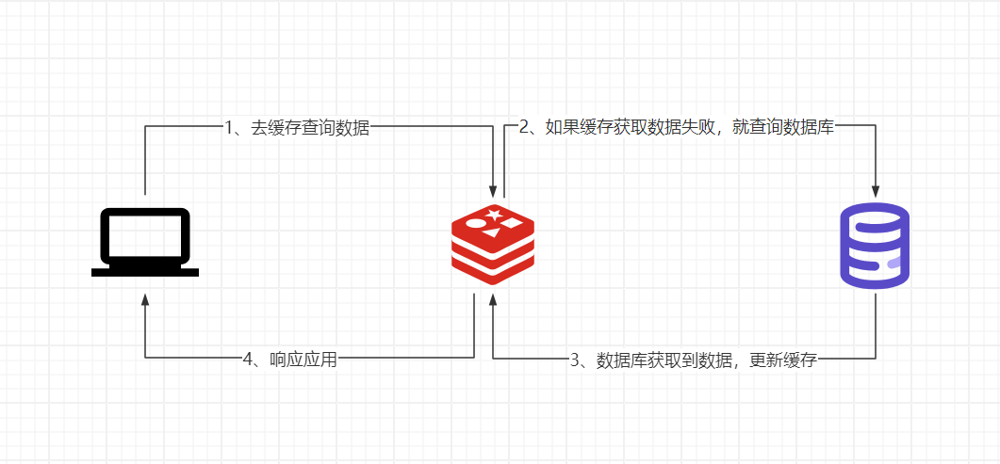
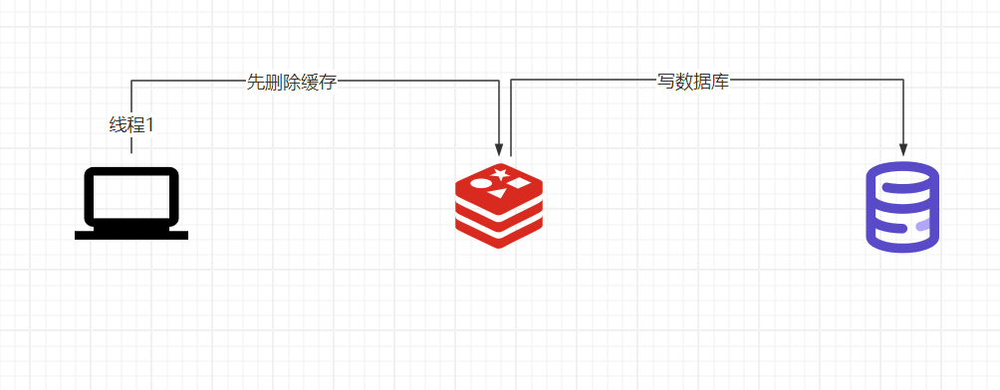
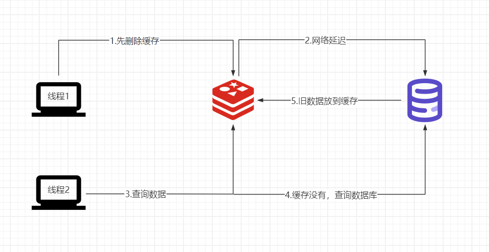
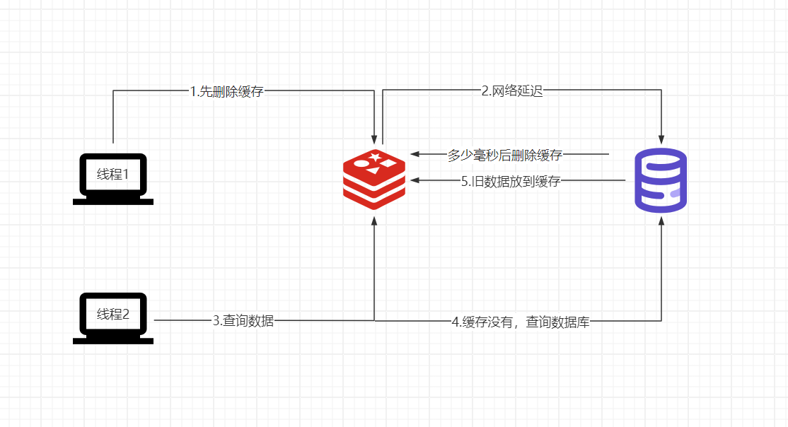
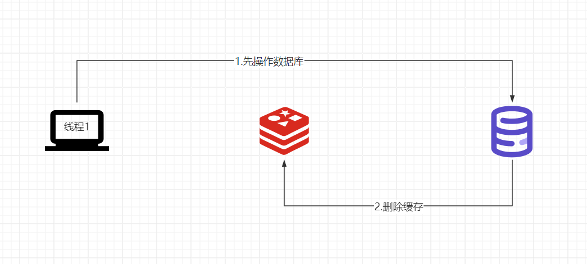
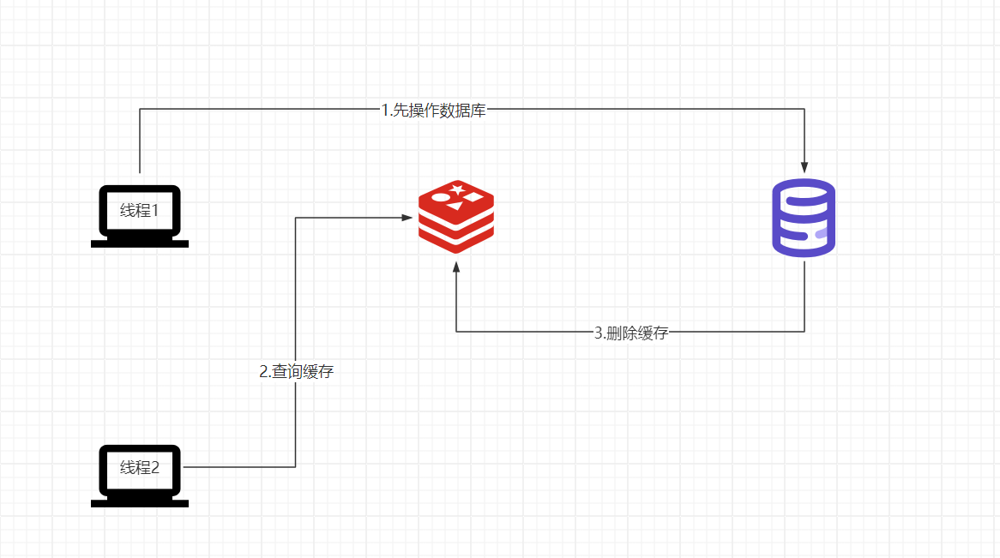
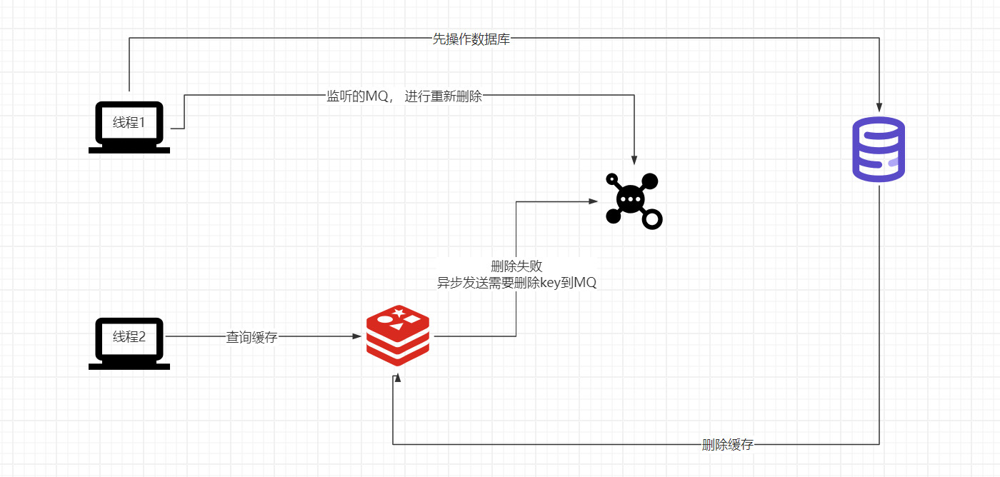
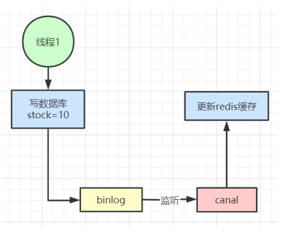

# 数据库与缓存的一致性

# 1.1读取数据
  逻辑如下：

# 1.2写数据流程
先**删除**缓存在**更新**数据库

先**更新**数据库在**删除**缓存

先操作缓存

数据库不一致

解决办法：延迟双删

1.先删除缓存。

2.写数据库。

3.休眠多少毫秒，在删除缓存。

这样子最多其他线程在这个时间段读取的脏数据。

**注意：咱们用redis一定是为了提供性能，所以这里的所有方案都是最终一致性，允许短暂的不一致，如果非要强一致，那就不要用缓存或者直接加锁**

先操作数据库

数据不一致

假如在删除缓存的失败，那就用重试级制

比如重试三次，三次都失败则记录日志到数据库并发送警告让人工介入。

在高并发的场景下，重试最好使用的异步方式，比如发送消息到mq中间件，实现异步解耦。

# 总结：
1、对于并发几率很小的数据(如个人维度的订单数据、用户数据等)，这种几乎不用考虑这个问题，很少会发生缓存不一致，可以给缓存数据加上过期时间，每隔一段时间触发读的主动更新即可。

2、就算并发很高，如果业务上能容忍短时间的缓存数据不一致(如商品名称，商品分类菜单等)，缓存加上过期时间依然可以解决大部分业务对于缓存的要求。

3、如果不能容忍缓存数据不一致，可以通过加**分布式读写锁**保证并发读写或写写的时候按顺序排好队，**读读的时候相当于无锁**。

4、也可以用阿里开源的canal通过监听数据库的binlog日志及时的去修改缓存，但是引入了新的中间件，增加了系统的复杂度。

> 更新: 2025-04-20 22:39:00  
> 原文: <https://www.yuque.com/aaron-wecc3/dhluml/lwennyszhc65pfrd>