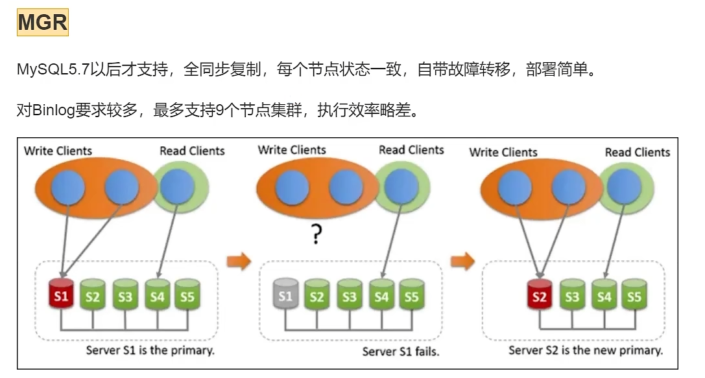
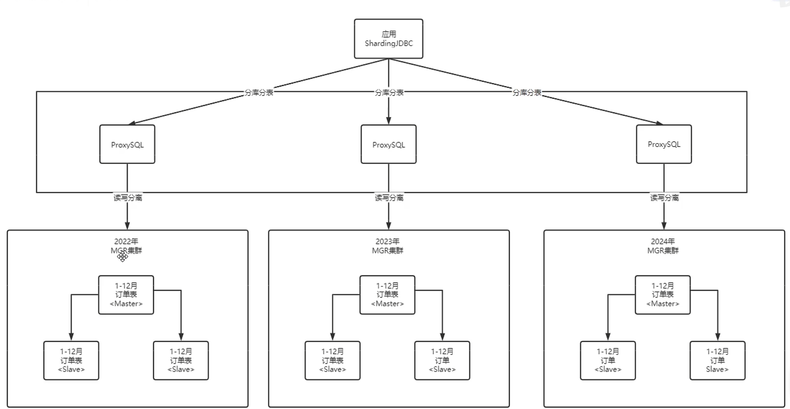

# 日均30万订单如何读写分离与分库分表

## **为什么要分库分表？**
当数据库产生性能瓶颈：IO瓶颈或CPU瓶颈。两种瓶颈最终都会导致数据库的活跃连接数增加，进而达到数据库可承受的最大活跃连接数阈值。

终会导致应用服务无连接可用，造成灾难性后果。可以先从代码，sql，索引几方面进行优化。如果这几方面已经没有太多优化的余地，就该考虑分库分表了。

### 1、IO瓶颈
磁盘读IO瓶颈。由于热点数据太多，数据库缓存完全放不下，查询时会产生大量的磁盘IO，查询速度会比较慢，这样会导致产生大量活跃连接，最终可能会发展成无连接可用的后果。

可以采用一主多从，读写分离的方案，用多个从库分摊查询流量。或者采用分库+水平分表（把一张表的数据拆成多张表来存放，比如订单表可以按user_id来拆分）的方案。

第二种：磁盘写IO瓶颈。由于数据库写入频繁，会产生频繁的磁盘写入IO操作，频繁的磁盘IO操作导致产生大量活跃连接，最终同样会发展成无连接可用的后果。

这时只能采用分库方案，用多个库来分摊写入压力。再加上水平分表的策略，分表后，单表存储的数据量会更小，插入数据时索引查找和更新的成本会更低，插入速度自然会更快。

### 2、CPU瓶颈
SQL问题。如果SQL中包含join，group by，order by，非索引字段条件查询等增加CPU运算的操作，会对CPU产生明显的压力。 这时可以考虑SQL优化，创建适当的索引，也可以把一些计算量大的SQL逻辑放到应用中处理。

单表数据量太大。由于单张表数据量过大，比如超过一亿，查询时遍历树的层次太深或者扫描的行太多，SQL效率会很低，也会非常消耗CPU。这时可以根据业务场景水平分表。

MHA 和 MGR

> 更新: 2025-04-20 22:38:58  
> 原文: <https://www.yuque.com/aaron-wecc3/dhluml/yxmyzoqfrnx5ig0a>