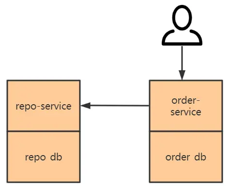
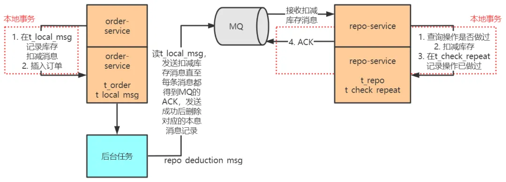
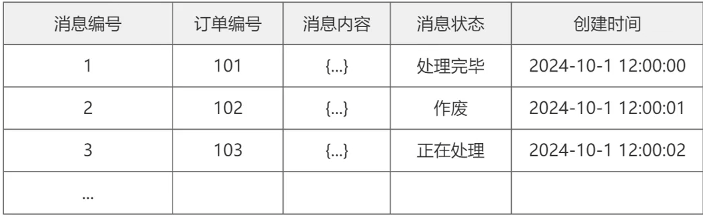
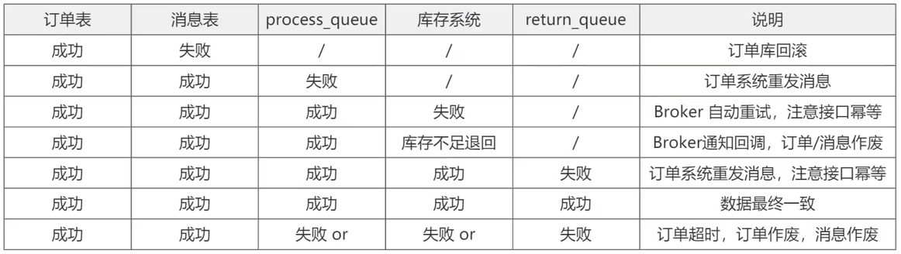
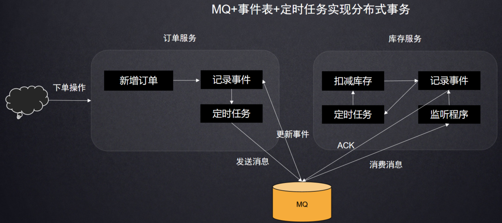

# 本地消息表如何保障分布式最终一致性的

##### <font style="color:rgb(51, 51, 51);">基于本地消息表异步模型</font>
<font style="color:rgb(51, 51, 51);">无论是 2PC & 3PC 还是 TCC、事务状态表，基本都遵守 </font>**<font style="color:rgb(51, 51, 51);">XA 协议</font>**<font style="color:rgb(51, 51, 51);">的思想，即这些方案本质上都是事务协调者协调各个事务参与者的本地事务的进度，使所有本地事务共同提交或回滚，最终达成一种全局的 ACID 特性。</font>

<font style="color:rgb(51, 51, 51);">在协调的过程中，协调者需要收集各个本地事务的当前状态，并根据这些状态发出下一阶段的操作指令。</font>

<font style="color:rgb(51, 51, 51);">但是这些全局事务方案由于操作繁琐、时间跨度大，或者在全局事务期间会排他地锁住相关资源，使得整个分布式系统的全局事务的并发度不会太高。这很难满足电商等高并发场景对事务吞吐量的要求，因此互联网服务提供商探索出了很多与 XA 协议背道而驰的分布式事务解决方案。</font>

<font style="color:rgb(51, 51, 51);">其中利用消息中间件实现的最终一致性全局事务就是一个经典方案。</font>

<font style="color:rgb(51, 51, 51);">为了表现出这种方案的精髓，我将使用如下的电商系统微服务结构来进行描述：</font>



<font style="color:rgb(51, 51, 51);">在这个模型中，用户不再是请求整合后的 shopping-service 进行下单，而是直接请求 order-service 下单，order-service 一方面添加订单记录，另一方面会调用 repo-service 扣减库存。</font>

<font style="color:rgb(51, 51, 51);">这种基于消息中间件的最终一致性事务方案实现方式：</font>

<font style="color:rgb(51, 51, 51);">如下所示：</font>



消息表大致包含：



订单处理情况分为：




###### <font style="color:rgb(51, 51, 51);">完整业务流程图：</font>



<font style="color:rgb(51, 51, 51);">当用户下单操作业务开始，订单服务先插入订单表，并记录事件表，定时任务会读取未发送的事件（0未发送，1已发送）发到消息队列并将事件状态改为1.</font>

<font style="color:rgb(51, 51, 51);">库存服务监听程序会消费消息队列中的消息，并根据事件记录事件表，并返回消息队列ACK确认。库存服务中同样有一个定时任务读取事件，并将未处理(0未处理,1已处理)的做响应的扣减库存操作。</font>

<font style="color:rgb(51, 51, 51);">上图所示的方案，利用消息中间件如 rabbitMQ 来实现分布式下单及库存扣减过程的最终一致性。对这幅图做以下说明：</font>

<font style="color:rgb(51, 51, 51);">1）。order-service 中，</font>

```plain
在 t_order 表添加订单记录 &&

在 t_local_msg 添加对应的扣减库存消息
```

<font style="color:rgb(51, 51, 51);">这两个过程要在一个事务中完成，保证过程的原子性。同样，repo-service 中，</font>

```plain
检查本次扣库存操作是否已经执行过 &&

执行扣减库存如果本次扣减操作没有执行过 &&

写判重表 &&

向 MQ sever 反馈消息消费完成 ACK
```

<font style="color:rgb(51, 51, 51);">这四个过程也要在一个事务中完成，保证过程的原子性。</font>

<font style="color:rgb(51, 51, 51);">2）。order-service 中有一个后台程序，源源不断地把消息表中的消息传送给消息中间件，成功后则删除消息表中对应的消息。如果失败了，也会不断尝试重传。由于存在网络 的问题，即当 order-service 发送给消息中间件的消息网络超时时，这时候消息中间件可能收到了消息但响应 ACK 失败，也可能没收到，order-service 会再次发送该消息，直至消息中间件响应 ACK 成功，这样可能发生消息的重复发送，不过没关系，只要保证消息不丢失，不乱序就行，后面 repo-service 会做去重处理。</font>

<font style="color:rgb(51, 51, 51);">3）。消息中间件向 repo-service 推送 repo_deduction_msg，repo-service 成功处理完成后会向中间件响应 ACK，消息中间件收到这个 ACK 才认为 repo-service 成功处理了这条消息，否则会重复推送该消息。但是有这样的情形：repo-service 成功处理了消息，向中间件发送的 ACK 在网络传输中由于网络故障丢失了，导致中间件没有收到 ACK 重新推送了该消息。这也要靠 repo-service 的消息去重特性来避免消息重复消费。</font>

<font style="color:rgb(51, 51, 51);">4）。在 2）和 3）中提到了两种导致 repo-service 重复收到消息的原因，一是生产者重复生产，二是中间件重传。为了实现业务的幂等性，repo-service 中维护了一张判重表，这张表中记录了被成功处理的消息的 id。repo-service 每次接收到新的消息都先判断消息是否被成功处理过，若是的话不再重复处理。</font>

<font style="color:rgb(51, 51, 51);">通过这种设计，实现了消息在发送方不丢失，消息在接收方不被重复消费</font>**<font style="color:rgb(51, 51, 51);">，联合起来就是消息不漏不重</font>**<font style="color:rgb(51, 51, 51);">，严格实现了 order-service 和 repo-service 的两个数据库中数据的</font>**<font style="color:rgb(51, 51, 51);">最终一致性</font>**<font style="color:rgb(51, 51, 51);">。</font>

**<font style="color:rgb(51, 51, 51);">优点：</font>**

<font style="color:rgb(51, 51, 51);">基于消息中间件的最终一致性全局事务方案是互联网公司在高并发场景中探索出的一种创新型应用模式，利用 MQ 实现微服务之间的异步调用、解耦合和流量削峰，支持全局事务的高并发，并保证分布式数据记录的最终一致性。降低用户的响应时间，提高系统的吞吐量。</font>


> 更新: 2024-07-30 20:11:53  
> 原文: <https://www.yuque.com/aaron-wecc3/dhluml/fsco6e4pyvm4uio8>