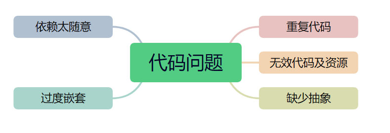

# 架构必备的经典解耦策略

##  一、基本说明
在Java开发中，紧耦合指的是代码中的组件之间过度依赖，这会导致代码难以维护和扩展。

**千里之堤，溃于蚁穴。**


近几年不少学员因为疫情原因，经济萧条，裁员较多，不得不参与处理别人遗留的项目。在同时开发新老系统的同时，我总结除了几种典型代码后期维护太耗时了，包括自己当时为了赶时间而完成的代码。


多年后再回去看这些坏代码，然后看了些别人优秀代码，总结了几点自己过去没处理好的代码或者其它开发者没处理好的代码。Java中常提到“低耦合高内聚”，为了后期代码质量的提高做了些总结。首先我总结了下业务中最多的代码问题。



**<font style="color:rgb(77, 77, 77);">随意依赖</font>**<font style="color:rgb(77, 77, 77);">：代码</font>[耦合度](https://so.csdn.net/so/search?q=%E8%80%A6%E5%90%88%E5%BA%A6&spm=1001.2101.3001.7020)<font style="color:rgb(77, 77, 77);">高，无法抽离出独立的组件。</font>

<font style="color:rgb(77, 77, 77);">解决方案：暴露接缝减少合或者依赖于稳定的抽象接口而不依赖具体的实现。</font>

**<font style="color:rgb(77, 77, 77);">过度嵌套</font>**<font style="color:rgb(77, 77, 77);">：代码阅读性差不方便维护。</font>

<font style="color:rgb(77, 77, 77);">解决方案：将逻辑拉平，减少在分支中来回切换上下文</font>

**<font style="color:rgb(77, 77, 77);">重复代码</font>**<font style="color:rgb(77, 77, 77);">：当遇到变化时需要修改许多不同的类维护工作量翻倍。</font>

<font style="color:rgb(77, 77, 77);">解决方案：将公共部分提取为方法或者类进行复用。</font>

**<font style="color:rgb(77, 77, 77);">无效代码及资源</font>**<font style="color:rgb(77, 77, 77);">：增加理解代码的成本降低代码的可维护性。</font>

<font style="color:rgb(77, 77, 77);">解决方案：直接删除无效的代码及资源。</font>

**<font style="color:rgb(77, 77, 77);">缺少抽象</font>**<font style="color:rgb(77, 77, 77);">：代码可扩展性差所有的需求变化都要在一个类中进行集中修改，易出错。</font>

<font style="color:rgb(77, 77, 77);">解决方案：使用分层架构进行优化使其职责更加单一。</font>

<font style="color:rgb(77, 77, 77);"></font>

### 总的来说
解决紧耦合问题，可以采用以下几种策略：

**使用接口（Interface）**：

通过定义接口并使类实现这些接口，我们可以降低依赖具体实现的程度，提高组件之间的可替换性。这样，即使实现细节变换，使用接口的代码也不需要改变。

**依赖注入（Dependency Injection）：**

这是一种将依赖关系从代码内部移至外部的设计模式。通过依赖注入框架（如Spring）管理对象的创建和生命周期，我们可以使得组件之间相互独立，降低耦合度。

**设计模式：**

运用一些设计模式，如工厂模式、策略模式、观察者模式等，可以有效地管理类之间的关系，降低代码的耦合度。

**模块化：**

将应用程序分割成独立或半独立的模块，每个模块负责一块独立的功能。模块间通过定义的接口进行通信，这样可以减少内部实现对外部的暴露。

**服务层（Service Layer）：**

在多层架构中，引入服务层来隔离不同层次间的直接通信，可以将业务逻辑抽象出来，从而降低耦合。

**面向切面编程（AOP）：**

面向切面编程允许开发者将横切关注点（如日志、安全性等）模块化为专门的类，从而实现业务代码和横切逻辑的解耦。

**消息队列：**

在系统各组件间使用消息队列进行异步通信也可以降低耦合度，因为组件不再直接调用对方的API，而是通过消息传递来交互。

**事件驱动架构：**

采用事件驱动的方式，组件通过生成和监听事件来解耦，组件仅需知道哪些事件会影响它，而不需要知道这些事件是由哪些其他组件触发的。


使用上述方法时，我们应该根据具体的应用场景选择合适的策略，避免为了解耦而过度设计。通常最佳实践是在项目开始阶段就考虑到软件的结构和模块划分，这样可以在后期节约大量的重构成本。


## 二、代码演示
### 1、使用接口（Interface）
应用接口可以降低类之间的依赖性，你不依赖特定的实现，而是依赖接口定义的契约。

```java
// 定义一个接口
public interface Vehicle {
    void start();
    void stop();
}

// 实现接口的类
public class Car implements Vehicle {
    public void start() {
        // 实现启动汽车的代码
    }
    public void stop() {
        // 实现停止汽车的代码
    }
}

// 客户端代码使用接口而不是具体类
public class TransportService {
    private Vehicle vehicle;

    public TransportService(Vehicle vehicle) {
        this.vehicle = vehicle;
    }

    public void startTransport() {
        vehicle.start();
        // 其他运输服务相关的代码
    }
}

// 使用时
Vehicle car = new Car();
TransportService service = new TransportService(car);
service.startTransport(); 
```


在这个例子中，TransportService 依赖 Vehicle 接口，而不是其具体实现 Car。这样你可以很容易地引入新的 Vehicle 实现，比如 Bike 或 Truck，而不需要修改 TransportService。


### 2、依赖注入（Dependency Injection）
依赖注入允许将依赖关系从类的内部构造移至外部，这通常通过使用依赖注入框架（比如 Spring）来实现。

```java
// 首先有一个接口定义
public interface MessageService {
    void sendMessage(String message);
}

// 实现接口的类
public class EmailService implements MessageService {
    public void sendMessage(String message) {
        // 发送电子邮件的逻辑
    }
}

// 使用依赖注入的消费者类
public class NotificationManager {
    private MessageService messageService;

    // 通过构造器注入
    @Autowired
    public NotificationManager(MessageService messageService) {
        this.messageService = messageService;
    }

    public void sendAlert(String message) {
        messageService.sendMessage(message);
    }
}
```


 

在这个例子中，NotificationManager 不再负责创建 MessageService 的实例，而是通过构造函数将其注入。


### 3、设计模式
设计模式是常见问题的解决方案模板。例如，使用工厂模式创建对象，可以解耦对象的创建过程：

```java
public class CarFactory {
    public static Vehicle getCar() {
        return new Car();
    }
}

// 客户端代码在需要汽车对象时
Vehicle car = CarFactory.getCar();
```


 

### 4、模块化
模块化是将系统分解为高内聚、低耦合的模块的过程。

```java
// 假定我们有几个模块 package A, B, C
package A;

public class ModuleA {
    public void performAction() {
        // 模块A的行为
    }
}

package B;

import A.ModuleA;

public class ModuleB {
    private ModuleA moduleA;

    public ModuleB(ModuleA moduleA) {
        this.moduleA = moduleA;
    }

    public void doSomething() {
        // 使用模块A来完成某些工作，但是不关心模块A的具体实现
    }
}
```


 

### 5、服务层（Service Layer）
在多层架构中，服务层充当业务逻辑和其他层（比如数据访问层和表示层）之间的中间人。

```java
// 数据访问层接口
public interface UserRepository {
    User findById(Long id);
}

// 服务层
public class UserService {
    private UserRepository userRepository;

    @Autowired
    public UserService(UserRepository userRepository) {
        this.userRepository = userRepository;
    }

    public User getUserById(Long id) {
        return userRepository.findById(id);
    }
}
```


 

### 6、面向切面编程（AOP）
面向切面编程将**公共功能（比如日志或事务管理）**模块化为切面，与核心业务逻辑解耦。

```java
@Aspect
public class LoggingAspect {
    @Before("execution(* UserService.*(..))")
    public void logBeforeMethod(JoinPoint joinPoint) {
        System.out.println("调用方法: " + joinPoint.getSignature().getName());
    }
}
```


 

### 7、消息队列
组件通过消息队列进行异步通信，可以解耦。

```java
// 生产者代码
MessageProducer producer = session.createProducer(queue);
TextMessage message = session.createTextMessage("Hello, World!");
producer.send(message);

// 消费者代码
MessageConsumer consumer = session.createConsumer(queue);
Message message = consumer.receive();
```


 

### 8、事件驱动架构
组件通过生成和监听事件来解耦。

```java
// 定义事件
public class CustomEvent extends ApplicationEvent {
    // 事件定义
}

// 定义事件监听器
public class CustomEventListener implements ApplicationListener<CustomEvent> {
    public void onApplicationEvent(CustomEvent event) {
        // 事件处理代码
    }
}

// 发布事件
publisher.publishEvent(new CustomEvent(this));
```


 


 


> 更新: 2024-06-26 20:32:52  
> 原文: <https://www.yuque.com/aaron-wecc3/dhluml/urmi958malve2g8w>