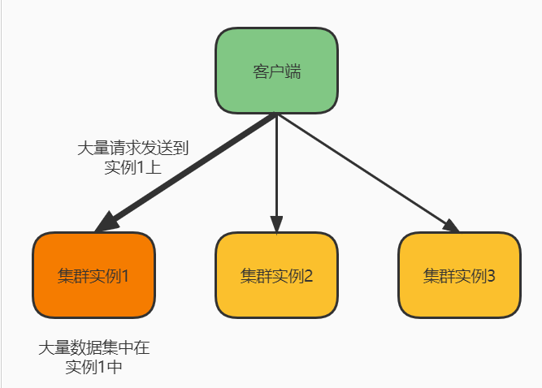
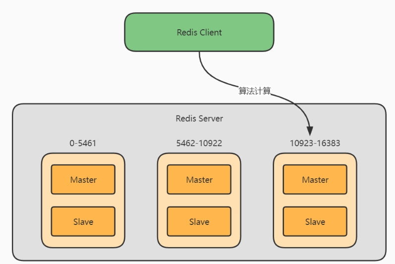
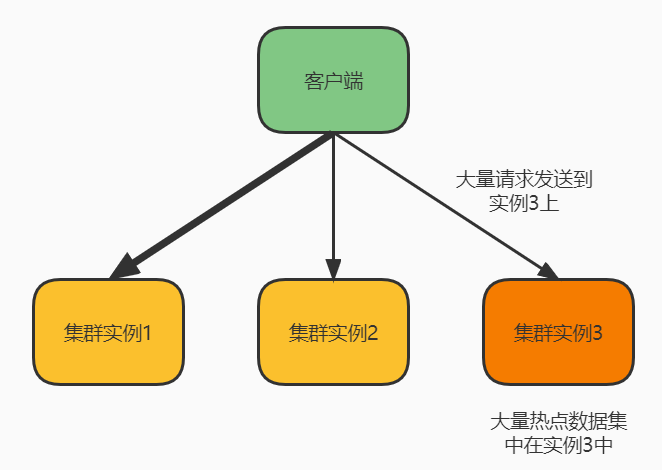
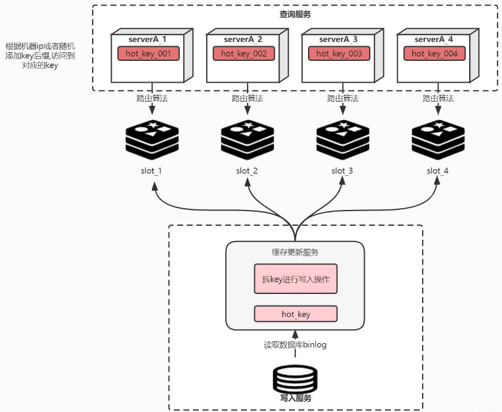
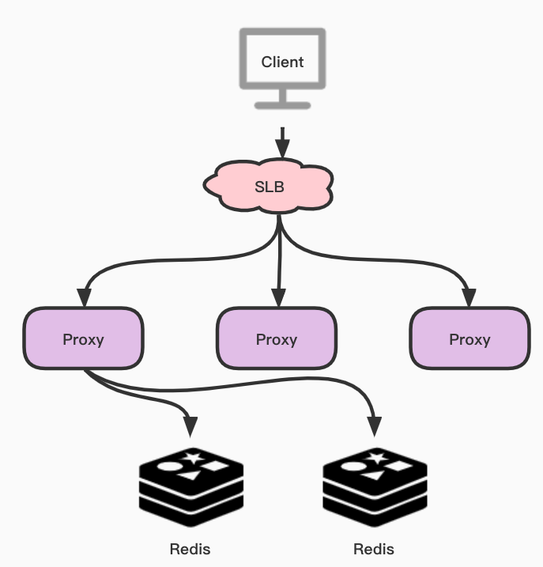
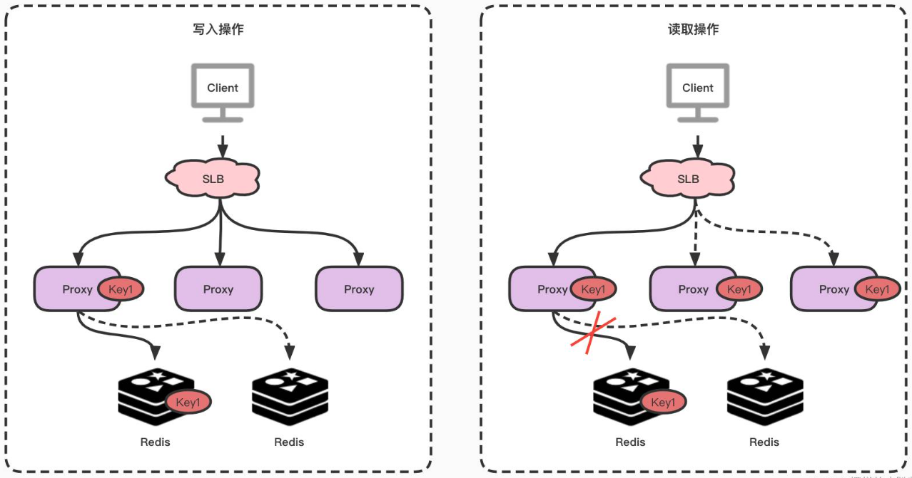
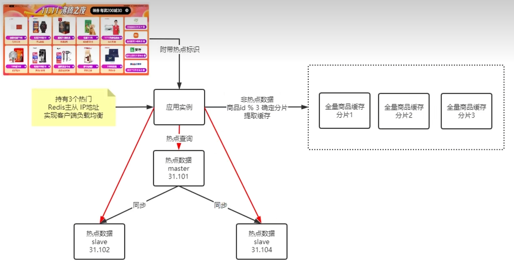
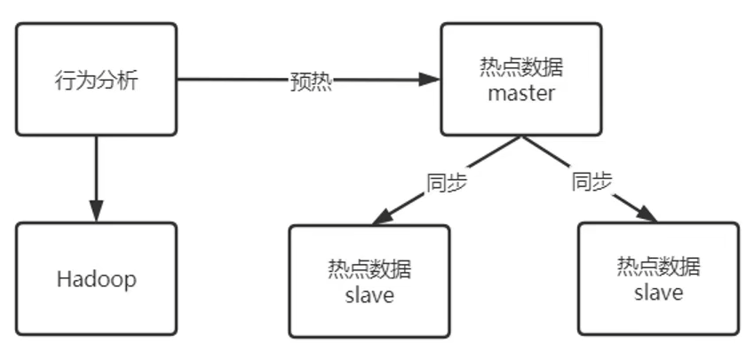
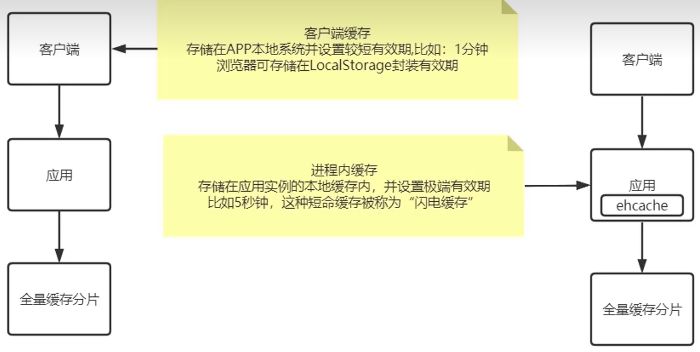

# 电商高并发活动缓存访问倾斜问题及处理

### 电商高并发活动缓存访问倾斜问题
 访问倾斜: 少量的服务器承载了大量的（读写）请求

对于集群系统，一般缓存是分布式的，即不同节点负责一定范围的缓存数据。我们把缓存数据分散度不够，导致大量的缓存数据集中到了一台或者几台服务节点上，称为数据倾斜。一般来说数据倾斜是由于负载均衡实施的效果不好引起的。

危害：如果发生了数据倾斜，那么就会有某一台机器或几台保存了大量数据。轻则造成性能下降，处理请求速度骤降。重则造成Redis服务器崩溃，缓存服务不可用，将性能影响范围扩散到DB层，对后端服务造成不可估量的后果。

  

## 问题分析：
###  一：写入倾斜：
在某些情况下，实例上的数据分布不均衡，某个实例上的数据特别多。

#### 1、bigkey导致倾斜
bigkey指的是某个 Redis 实例上保存了一个很大的 value （String 类型）或者是大量的集合元素（集合类型）的 key ，这个 key 就被称之为 bigkey ，而bigkey这种情况会导致集群中的某个实例的数据量很大，内存资源消耗也相应增加。

应对方案

在业务层生成数据时，要尽量避免把过多的数据保存在同一个键值对中。如果 bigkey 正好是集合类型，还有一个方法，就是把 bigkey 拆分成很多个小的集合类型数据，分散保存在不同的实例上。

#### 2、Slot分配不均导致倾斜
介绍一下slot，slot全称HashSlot(哈希槽)，类似于数据分区，每个key都会根据Hash算法计算出它应该属于哪个哈希槽，最终落到那个哈希槽中。而 Redis Cluster 就是采用哈希槽的方式来处理数据和实例间的映射关系。事实上，在 Redis Cluster 分片集群中一共有16384 个 Slot

这里的Hash算法市面上的方式一般是先计算hash值，然后将计算结果对slot个数取模，最终确定落到哪个slot上。而计算hash值的算法有很多，常用的像CRC16、CRC64、sha1等等 运维在构建切片集群时候，需要手动分配哈希槽，并且把16384 个槽都分配完，否则 Redis 集群无法正常工作。由于是手动分配，则可能会导致部分实例所分配的slot过多，导致数据倾斜。

应对方案：

使用CLUSTER SLOTS 命令来查看slot分配情况，使用CLUSTER SETSLOT，CLUSTER GETKEYSINSLOT，MIGRATE这三个命令来进行slot数据的迁移，具体内容不再这里细说，感兴趣的同学翻看图灵课堂相关视频。

#### 3.Hash Tag导致倾斜
Hash Tag 定义 :指当一个key包含 {} 的时候，就不对整个key做hash，而仅对 {} 包括的字符串做hash。假设hash算法为sha1。

对user:{user1}:ids和user:{user1}:tweets，其hash值都等同于sha1(user1)。

也就是说，**如果不同 key 的 Hash Tag 内容都是一样的，那么，这些 key 对应的数据会被映射到同一个 Slot 中，同时会被分配到同一个实例上**。

所以，如果不合理使用Hash Tag，会导致大量的数据可能被集中到一个实例上发生数据倾斜，集群中的负载不均衡。

应对方案

按照需求合理使用Hash Tag，甚至可以考量是否需要用到Hash Tag。  
 

### 二：读取倾斜：
读取倾斜大多数都是热key问题导致的。如图所示，虽然每个集群实例上的数据量相差并没有很大，但是如果其中某个实例上的数据是热点数据，那台实例就会被访问得非常频繁。

#### 原因：
用户消费的数据远大于生产的数据（热卖商品、热点新闻、热点评论、明星直播）。

在日常工作中一些突发的事件，例如：双十一期间某些热门商品在进行降价促销或秒杀时，这时某一件商品会被数万次点击浏览或者购买，会形成一个较大的需求量，这种情况下就很容易造成热点问题。

同理，被大量浏览的热点数据、明星直播等，这些典型的读多写少的场景也会产生热点问题。

#### 危害：
请求分片集中，超过单 Server 的性能极限。

在服务端读数据访问Redis时，往往会对请求key进行分片计算，此时中会将请求打到某一台 Server 上，如果热点过于集中，热点 Key 的缓存过多，访问量超过 Server 极限时，就会出现缓存分片服务被打垮现象的产生。当缓存服务崩溃后，此时再有请求产生，就会打到DB 上，这也就是我们常说的缓存穿透，如果没有合理的解决，数据库又没有扛住大量的穿透请求，则会进一步导致数据库雪崩现象。造成所有连接此数据库的系统服务不可用，上下游调用链中断，产生不可估量的后果。

#### ① 拆分热key
拆分热key，指的是把热点数据拆分成多份，在每份数据副本的 key 中增加一个随机后缀，让它和其它副本数据不会被映射到同一个 Slot 中。这里相当于把一份数据复制到多个实例上，通过Hash算法实现一个简陋的负载均衡。同样的，在读取的时候也要增加随机后缀，将对一个实例的读取压力，均摊到多个实例上。 例如：我们在放入缓存时就将对应业务的缓存key拆分成多个不同的key。如下图所示，在写入缓存的过程中，我们首先将key拆成N份，比如某个请求进来的key名字叫做"hot_key"，那我们就可以把它拆成“hot_key_001”、“hot_key_002”、“hot_key_003”、“hot_key_004”…，当然了，每次更新和新增时都要记得去改动这N个key，这就是拆key。

对于Service端来讲，我们要尽可能的将访问流量分流的足够的均匀。 如何给即将访问的热key上合理的加入后缀？说一下市面上常用的方案，根据本机的ip或mac地址做hash，之后的值与拆key的数量做取余，最终决定拼接成什么样的key后缀，从而打到哪台机器上。当然也有其他的解决方案，比如在服务启动时的一个随机数对拆key的数量做取余。 伪代码如下:

| publicbooleangetRandomHotKey(String hotKey,intcount) {   intrandom = newRandom().nextInt(count);         randomKey = hotKey + "_"+ random;         Object data = redis.get(randomKey);         if(data == null){             data = getFromDB();              redis.set(randomKey,expireTime + random);         }     } |
| :--- |

     

#### ② 多级缓存+动态计算自动发现热点缓存
基本流程图  
 

该方案主要是通过主动发现热点并对其进行本地缓存来解决热点 Key 的问题。对，你没有听错，就是在缓存上再架设一层缓存。具体来说，就是在 Proxy上增加本地缓存，本地缓存采用LRU算法来缓存热点数据，后端节点增加热点数据计算模块来返回热点数据。当然了，Client会访问SLB，并且通过SLB将各种请求分发至Proxy中，Proxy会按照基于路由的方式将请求转发至Redis中。

Proxy 架构的主要有以下优点：

+ Proxy 本地缓存热点，读能力可水平扩展
+ DB 节点定时计算热点数据集合
+ DB 反馈 Proxy 热点数据
+ 对客户端完全透明，不需做任何兼容

### 热点数据的发现与存储
对于热点数据的发现，首先会在一个周期内对 Key 进行请求统计，在达到请求量级后会对热点 Key 进行热点定位，并将所有的热点 Key 放入一个小的 LRU 链表内，在通过 Proxy 请求进行访问时，若 Redis 发现待访点是一个热点，就会进入一个反馈阶段，同时对该数据进行标记。

可以使用一个etcd或者zk集群来存储反馈的热点数据，然后本地所有节点监听该热点数据，进而加载到本地JVM缓存中。

#### 热点数据的获取

在热点 Key 的处理上主要分为写入跟读取两种形式，在数据写入过程当 SLB 收到数据 Key1 并将其通过某一个 Proxy 写入一个 Redis，完成数据的写入。

假若经过后端热点模块计算发现 Key1 成为热点 key 后， Proxy 会将该热点进行本地缓存，当下次客户端再进行访问 Key1 时，则可以不读取 Redis，直接从 Proxy 返回数据。

注意：由于 Proxy 是可以水平扩充的，因此可以任意增强热点数据的访问能力。

### 成熟方案:  参看京东，美团
美团：默认大促时参与活动的商品

京东：用户行为分析与大数据评估

比如京东开源的项目HotKey，它拥有自动探测热Key、分布式一致性缓存的设计。原理就是在Client端做洞察;然后上报对应Hotkey，Server端检测到后，将对应Hotkey下发到对应服务端做本地缓存，并且能保证本地缓存和远程缓存的一致性。

#### 一：热门数据分片
1.将全量商品数据根据产品ID分片缓存集群

2.热门商品数据独立部署缓存集群(使用负载均衡方式分发访问请求)

是否热门商品需要提前定义好:

简单点的方式是参与限时抢购的商品都定义为热门商品

复杂点的方式是用户行为分析与大数据评估,确定是否为热门商品,这种方式实现重,代价大,不适合小体量电商网站

      前端首先拉取商品列表,列表中已经提前标识是否热门商品,访问商品详情时带上热门标识,后端服务根据热门标识确认是否热门商品,若为非热门商品访问全量数据分片集群,若为热门商品采用负载均衡方式访问热门商品缓存集群

 

(热点数据特征：是短时间访问超高，数据总量相对较少)

#### 二：缓存前置 + 闪电缓存
1.客户端缓存,设置缓存时间,尽量分钟级别(缓存前置)

2.服务进程缓存,设置缓存时间尽量秒级别(闪电缓存)

设置较短缓存时间可以降低缓存一致性时间窗口,降低负面影响,同时降低缓存服务器访问压力,不需要区分是否热点商品

> 更新: 2024-07-24 06:46:52  
> 原文: <https://www.yuque.com/aaron-wecc3/dhluml/cwr6xybqf1n5o78h>