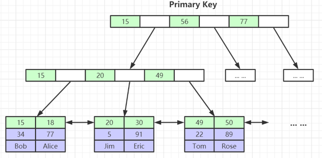
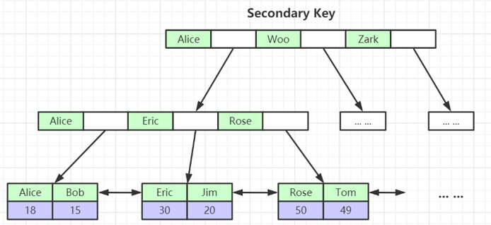
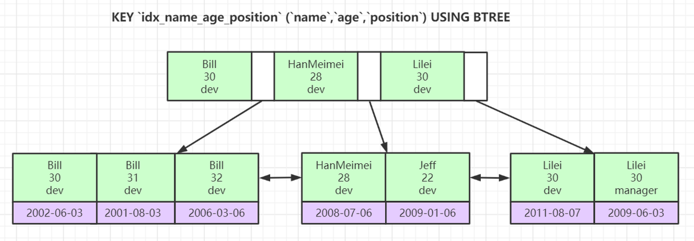

# 索引的分类

## <font style="color:rgb(0, 0, 0);">主键索引（Primary Key Index）：</font>
    - <font style="color:rgb(0, 0, 0);">主键索引是唯一且特殊的索引，用于唯一标识表中的每一行。创建主键时，MySQL会自动创建一个唯一索引。</font>
    - <font style="color:rgb(0, 0, 0);">主键索引不允许有NULL值，并且表中每一行的主键值必须是唯一的。</font>



## <font style="color:rgb(0, 0, 0);">唯一索引（Unique Index）：</font>
    - <font style="color:rgb(0, 0, 0);">唯一索引确保列中的所有值都是唯一的，但允许有NULL值。一个表可以有多个唯一索引。</font>
    - <font style="color:rgb(0, 0, 0);">通常用于需要保证数据列唯一性的场合。</font>

```sql
CREATE UNIQUE INDEX unique_email ON users (email);
```

## <font style="color:rgb(0, 0, 0);">普通索引（Regular Index）：</font>
    - <font style="color:rgb(0, 0, 0);">普通索引是最基本的索引类型，不强制唯一性。它们可以加快查询速度，但对插入、更新性能有一定影响。</font>
    - <font style="color:rgb(0, 0, 0);">可以在一个表上创建多个普通索引。</font>



## <font style="color:rgb(0, 0, 0);">复合索引（Composite Index）：</font>
+ <font style="color:rgb(0, 0, 0);">复合索引是由多个列组成的索引，用于覆盖多个列的查询。</font>
+ <font style="color:rgb(0, 0, 0);">在执行涉及多个列的查询时，复合索引能显著提高查询效率</font>



# 总结
<font style="color:rgb(0, 0, 0);">对于如何选择和使用索引，以下几点建议可能对你有帮助：</font>

+ **<font style="color:rgb(0, 0, 0);">根据查询模式选择索引列</font>**<font style="color:rgb(0, 0, 0);">：如果某列频繁出现在</font>WHERE<font style="color:rgb(0, 0, 0);">子句、</font>JOIN<font style="color:rgb(0, 0, 0);">条件或者</font>ORDER BY<font style="color:rgb(0, 0, 0);">子句中，应考虑在该列上建立索引。</font>
+ **<font style="color:rgb(0, 0, 0);">限制索引数量</font>**<font style="color:rgb(0, 0, 0);">：虽然索引可以加快查询速度，但过多的索引会影响插入和更新操作性能，因此应平衡索引数量和写操作性能。</font>
+ **<font style="color:rgb(0, 0, 0);">利用复合索引</font>**<font style="color:rgb(0, 0, 0);">：对涉及多个列的查询，可以考虑创建复合索引，但要注意复合索引的列顺序，应根据查询频率和查询类型来决定。</font>

<font style="color:rgb(0, 0, 0);">希望这些信息能帮助到你在MySQL数据库管理中的索引设计</font>


> 更新: 2025-04-20 22:39:01  
> 原文: <https://www.yuque.com/aaron-wecc3/dhluml/mgxupg9107trcq3t>