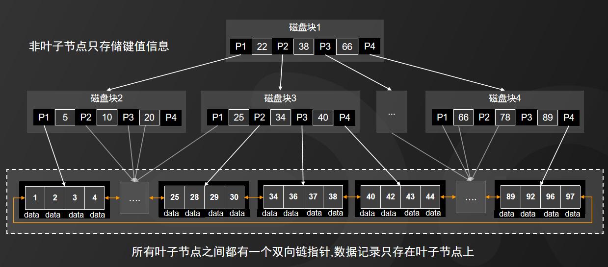

# 索引选择与失效的场景

### 简单回顾索引结构

# 索引失效场景及解决方案
模型数空运最快

## 模糊查询 ：
like ，not like 不能精准匹配，以通配符“%”或“_”开头，导致索引失效。如果匹配字符串的第一个字符为'%'，索引就不会起作用。只有'%'不在第一个位置，索引才会起作用。

解决方案：添加反向索引字段

对于大量的数据集或者复杂文本处理可以考虑在应用层加入缓存或者使用全文搜索引擎(ES,Solr)来替代数据库like操作

### 数据类型
当查询字段数据类型不一致时，会导致索引失效

### 函数计算
_函数导致索引失效，计算导致索引失效_

### 最佳左前缀法则
在MySQL建立联合索引时会遵守最佳左前缀原则，即最左优先，在检索数据时从联合索引的最左边开始匹配。

“OR”前后存在非索引列

例如索引(a,b,c)，只有查询(a),(a,b),(a,b,c)会走索引，而(b),(b,c),(c)都不会走索引。

如果索引了多列，要遵守最左前缀法则。指的是查询从索引的最左前列开始并且不跳过索引中的列。

### 
__

__

### 类型转换导致索引失效
_手动类型转换，通过调用函数；自动类型转换导致索引失效_

__

### 范围条件右边的列索引失效
__

### is not null、not like导致索引失效
_因为is not null、not like不能精准匹配，全表扫描二级索引树再回表效率不如直接全表扫描聚簇索引树。但使用覆盖索引时，联合索引数据量小，加载到内存所需空间比聚簇索引树小，且不需要回表，索引效率优于全表扫描聚簇索引树。覆盖索引：一个索引包含了满足查询结果的数据就叫做覆盖索引，不需要回表等操作。 _

__

_is null可以使用索引，is not null无法使用索引 _

原因：

在进行索引扫描时，MySQL 会优先利用索引中已经存在的值进行查询，在查询时直接跳过为 NULL 的那些行。但是，如果使用了 IS NOT NULL 条件，那么 MySQL 无法在索引中找到 NULL 值，也就是说，MySQL 无法像前面那样跳过那些为 NULL 的行，只能扫描整张表来找到符合条件的行，因此无法使用索引。

解决方案：

设计数据库的时候就将字段设置为 NOT NULL 约束

将 INT 类型的字段，默认值设置为0。

将字符类型的默认值设置为空字符串('')。

 

> 更新: 2025-04-20 22:39:02  
> 原文: <https://www.yuque.com/aaron-wecc3/dhluml/cg1retwys9gt2bng>