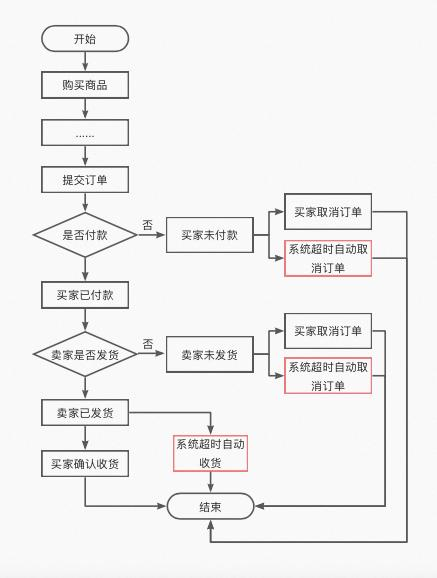

# 结合SpringBoot多线程应用最佳实践

# SpringBoot优雅开发的多线程应用


## 场景：


获取一次主要数据  
遍历第1步的主数据，对每一个数据，都以它为条件获取次要数据  
将前2步查到的数据组合起来，返回给前端  
那么问题来了，如果单次调获取数据比较慢，那么获取多个数据时会很费时间。最好的解决方法就是使用多线程处理。


## 需求:


假设需要提供一个接口，获得多个订单的信息，按创建时间由近到远排序。这个订单信息在其他公司那里，他们只提供了查单个订单的接口，没有批量的接口。


**数据库表结构**


订单的字段：订单id、用户id、总金额、商品id、商品的数量、创建时间 等。  
用户的字段：用户id、用户名字、用户的电话、注册时间 等。  
商品的字段：商品id、商品名字 等。  
**业务流程**


调第三方读出订单主要数据的前n行  
用第1步的每个数据的用户id去调第三方获取用户的信息  
将第2步获取到的用户信息整合到订单VO里。  
**说明**


本处为了简单，用这种方法处理：


仅获取订单的id、用户id、用户名字。  
使用模拟数据，不实际调用接口。用sleep()模拟对数据库的操作。  
所有代码都在controller层处理。（实际业务中肯定要放到service中处理）。


**思路汇总**


## 一：多线程方案：使用线程池。


线程池回顾：


1.1 在线程池的实践中，我们一般要通过ThreadPoolExecutor的构造函数来声明线程池，避免使用Executors类创建线程池，否则会有OOM风险，原因如下：  
FixedThreadPool 和 SingleThreadExecutor ： 使用的是无界的 LinkedBlockingQueue，任务队列最大长度为 Integer.MAX_VALUE,可能堆积大量的请求，从而导致 OOM。CachedThreadPool ：使用的是同步队列 SynchronousQueue, 允许创建的线程数量为 Integer.MAX_VALUE ，可能会创建大量线程，从而导致 OOM。**ScheduledThreadPool 和 SingleThreadScheduledExecutor ** : 使用的无界的延迟阻塞队列DelayedWorkQueue，任务队列最大长度为 Integer.MAX_VALUE,可能堆积大量的请求，从而导致 OOM。  
1.2 不同业务用不同的线程池 。配置线程池的时候要根据当前业务的情况对当前线程池进行配置，因为不同的业务的并发以及对资源的使用情况都不同，而且当多个业务使用同一个线程池时，可能会因为线程池使用不当导致死锁  
1.3 监测线程池运行状态  
1.4 给线程池命名  
1.5 正确配置线程池参数。公式如下：  
CPU 密集型任务(N+1)： 这种任务消耗的主要是 CPU 资源，可以将线程数设置为 N（CPU 核心数）+1。比 CPU 核心数多出来的一个线程是为了防止线程偶发的缺页中断，或者其它原因导致的任务暂停而带来的影响。一旦任务暂停，CPU 就会处于空闲状态，而在这种情况下多出来的一个线程就可以充分利用 CPU 的空闲时间。I/O 密集型任务(2N)： 这种任务应用起来，系统会用大部分的时间来处理 I/O 交互，而线程在处理 I/O 的时间段内不会占用 CPU 来处理，这时就可以将 CPU 交出给其它线程使用。因此在 I/O 密集型任务的应用中，我们可以多配置一些线程，具体的计算方法是 2N。


示范代码：


线程配置类 注意加上[@Configuration ](/Configuration ) 和[@EnableAsync ](/EnableAsync ) 里面配置executor核心参数。 


```java
package com.young.config;

import org.springframework.beans.factory.annotation.Qualifier;
import org.springframework.context.annotation.Bean;
import org.springframework.context.annotation.Configuration;

import java.util.concurrent.Executors;
import java.util.concurrent.LinkedBlockingDeque;
import java.util.concurrent.ThreadPoolExecutor;
import java.util.concurrent.TimeUnit;

@Configuration
@EnableAsync
public class ThreadPoolConfig {
    
    //在某个项目中看到的一个线程池创建方式
    @Bean
    @Qualifier(value = "threadPoolExecutor")
    public ThreadPoolExecutor threadPoolExecutor(){
        return new ThreadPoolExecutor(Runtime.getRuntime().availableProcessors(),
                (int)(Runtime.getRuntime().availableProcessors()/(1-0.9)),
                60, TimeUnit.SECONDS,
                new LinkedBlockingDeque<>(Runtime.getRuntime().availableProcessors()), Executors.defaultThreadFactory(),
                new ThreadPoolExecutor.CallerRunsPolicy());
    }

    //这里设置核心和最大线程数都是2，方便后面的测试
    @Bean
    @Qualifier(value = "commonThreadPoolExecutor")
    public ThreadPoolExecutor commonThreadPoolExecutor(){
        return new ThreadPoolExecutor(2,2,
                60,TimeUnit.SECONDS,
                new LinkedBlockingDeque<>(Runtime.getRuntime().availableProcessors()),Executors.defaultThreadFactory(),
                new ThreadPoolExecutor.CallerRunsPolicy());
    }

    //检查业务对应的线程池
    @Bean
    @Qualifier(value = "checkThreadPoolExecutor")
    public ThreadPoolExecutor checkThreadPoolExecutor(){
        return new ThreadPoolExecutor(2,2,
                60,TimeUnit.SECONDS,
                new LinkedBlockingDeque<>(Runtime.getRuntime().availableProcessors()),Executors.defaultThreadFactory(),
                new ThreadPoolExecutor.CallerRunsPolicy());
    }

    //支付业务对应的线程池
    @Bean
    @Qualifier(value = "payThreadPoolExecutor")
    public ThreadPoolExecutor payThreadPoolExecutor(){
        return new ThreadPoolExecutor(2,2,
                60,TimeUnit.SECONDS,
                new LinkedBlockingDeque<>(Runtime.getRuntime().availableProcessors()),Executors.defaultThreadFactory(),
                new ThreadPoolExecutor.CallerRunsPolicy());
    }

    //通知业务对应的线程池
    @Bean
    @Qualifier(value = "noticeThreadPoolExecutor")
    public ThreadPoolExecutor noticeThreadPoolExecutor(){
        return new ThreadPoolExecutor(2,2,
                60,TimeUnit.SECONDS,
                new LinkedBlockingDeque<>(Runtime.getRuntime().availableProcessors()),Executors.defaultThreadFactory(),
                new ThreadPoolExecutor.CallerRunsPolicy());
    }

    //用来模拟线程池使用不当导致死锁的情况
    @Bean
    @Qualifier(value = "deadThreadPoolExecutor")
    public ThreadPoolExecutor deadThreadPoolExecutor(){
        return new ThreadPoolExecutor(1,1,
                60,TimeUnit.SECONDS,
                new LinkedBlockingDeque<>(Runtime.getRuntime().availableProcessors()),Executors.defaultThreadFactory(),
                new ThreadPoolExecutor.CallerRunsPolicy());
    }
}
```


然后使用：


```java

package com.tuling.controller;

import org.springframework.beans.factory.annotation.Qualifier;
import org.springframework.web.bind.annotation.GetMapping;
import org.springframework.web.bind.annotation.RestController;

import javax.annotation.Resource;
import java.util.concurrent.ExecutionException;
import java.util.concurrent.Future;
import java.util.concurrent.ThreadPoolExecutor;

@RestController
public class TestController {
    @Resource
    @Qualifier(value = "commonThreadPoolExecutor")
    private ThreadPoolExecutor commonThreadPoolExecutor;

    @Resource
    @Qualifier(value = "checkThreadPoolExecutor")
    private ThreadPoolExecutor checkThreadPoolExecutor;

    @Resource
    @Qualifier(value = "payThreadPoolExecutor")
    private ThreadPoolExecutor payThreadPoolExecutor;

    @Resource
    @Qualifier(value = "noticeThreadPoolExecutor")
    private ThreadPoolExecutor noticeThreadPoolExecutor;

    @Resource
    @Qualifier(value = "deadThreadPoolExecutor")
    private ThreadPoolExecutor deadThreadPoolExecutor;

    //所有业务使用同一个线程池
    @GetMapping("/onePool")
    public String onePool(){
        //因为每个方法耗时2秒，而线程池中最多只能有两个线程，所有总共耗时4秒
        long start = System.currentTimeMillis();
        Future<Integer> checkSubmit = commonThreadPoolExecutor.submit(() -> {
            return check();
        });
        Future<Integer> paySubmit = commonThreadPoolExecutor.submit(() -> {
            return pay();
        });
        Future<Integer> noticeSubmit = commonThreadPoolExecutor.submit(() -> {
            return notice();
        });
        try{
            int sum=checkSubmit.get()+paySubmit.get()+noticeSubmit.get();
            System.out.println(sum);
        }catch (Exception e){
            e.printStackTrace();
        }
        long end=System.currentTimeMillis();
        System.out.println("onePool用时："+(end-start));
        return "success";
    }

    //不同业务使用对应的线程池
    @GetMapping("/multiPool")
    public String multiPool(){
        //每个方法耗时2秒，不过使用的是不同的线程池池，因此最终用时2秒
        long start = System.currentTimeMillis();
        Future<Integer> checkSubmit = checkThreadPoolExecutor.submit(() -> {
            return check();
        });
        Future<Integer> paySubmit = payThreadPoolExecutor.submit(() -> {
            return pay();
        });
        Future<Integer> noticeSubmit = noticeThreadPoolExecutor.submit(() -> {
            return notice();
        });
        try{
            int sum=checkSubmit.get()+paySubmit.get()+noticeSubmit.get();
            System.out.println(sum);
        }catch (Exception e){
            e.printStackTrace();
        }
        long end=System.currentTimeMillis();
        System.out.println("multiPool用时："+(end-start));
        return "success";
    }

    //模拟不同业务使用同一个线程池时可能出现的死锁现象
    @GetMapping("/dead")
    public String deadPool(){
        long start = System.currentTimeMillis();
        Future<Integer> submit = deadThreadPoolExecutor.submit(() -> {
            //线程池中最大线程数为1，这个线程用于处理如下逻辑
            //但是在deadNotice（）方法中，也有用到同一个线程池，但此时该线程池没有线程池可用，因此deadNotice（）迟迟无法结束，进而导致匿名函数无法结束让出线程，从而出现死锁
            int notice = deadNotice();
            return notice + pay();
        });
        try {
            System.out.println(submit.get());
        } catch (InterruptedException e) {
            e.printStackTrace();
        } catch (ExecutionException e) {
            e.printStackTrace();
        }
        long end=System.currentTimeMillis();
        System.out.println("deadPool用时："+(end-start));
        return "success";
    }


    public int deadNotice() throws ExecutionException, InterruptedException {
        return deadThreadPoolExecutor.submit(() -> {
            return notice();
        }).get();
    }

    //支付前检查
    public int check(){
        try {
            System.out.println("检查余额，选择支付方式=============");
            Thread.sleep(2000);
            return 1;
        } catch (InterruptedException e) {
            e.printStackTrace();
            return 0;
        }
    }

    //支付
    public int pay(){
        try{
            System.out.println("进行支付===================");
            Thread.sleep(2000);
            return 1;
        }catch (InterruptedException e){
            e.printStackTrace();
            return 0;
        }
    }

    //发送支付消息
    public int notice(){
        try{
            System.out.println("发送通知================");
            Thread.sleep(2000);
            return 1;
        }catch (InterruptedException e){
            e.printStackTrace();
            return 0;
        }
    }
}
```


## 二：等待多线程执行完毕


CountDownLatch也属于JUC。线程可以使用await()进行等待，多线程进行递减计数，等到计数到0的时候等待即不再阻塞，从而向下执行。


在日常开发中经常会遇到需要在主线程中开启多个线程去并行执行任务，并且主线程需要等待所有子线程执行完毕后再进行汇总的场景。


概述


在CountDownLatch出现之前一般都使用线程的join()方法来实现这一点，但是join方法不够灵活，两者的对比如下：

| **项** | **CountDonLatch** | **join()** |
| --- | --- | --- |
| 是否适用于线程池 | 适用。 | 不适用。使用线程池一般是直接添加Runable到线程池，这时没有办法再调用线程的join方法了。 |
| 调用时机 | 允许子线程运行完毕或者在运行中递减计数。 | 只能等待线程运行完毕。 |


方法

| **方法名 | | 解释 |
| --- | --- | --- |
| void countDown() | | 计数器减1 |
| long getCount() | | 返回当前计数值 |
| void await() | | 当前线程阻塞，直到该计数器为0后才能继续执行 |
| boolean await(long timeout, TimeUnit unit) | | 类似await()，只不过可以设置等待时间，如果在规定时间内计数器的值依然大于0，则继续执行 |
| | | |


**实例代码**


```java
package org.tuling.a;
import java.util.concurrent.CountDownLatch;
public class Demo {
    // 创建一个CountDownLatch实例
    private static volatile java.util.concurrent.CountDownLatch countDownLatch = new CountDownLatch(2);
    public static void main(String[] args) throws InterruptedException {
        Thread threadOne = new Thread(new Runnable() {
            @Override
            public void run() {
                try {
                    Thread.sleep(1000);
                    System.out.println("子线程1结束!");
                } catch (InterruptedException e) {
                    e.printStackTrace();
                } finally {
                    countDownLatch.countDown();
                }
            }
        });
        Thread threadTwo = new Thread(new Runnable() {
            @Override
            public void run() {
                try {
                    Thread.sleep(1000);
                    System.out.println("子线程2结束!");
                } catch (InterruptedException e) {
                    e.printStackTrace();
                } finally {
                    countDownLatch.countDown();
                }
            }
        });
        // 启动子线程
        threadOne.start();
        threadTwo.start();
        System.out.println("等待所有子线程结束---");
        // 等待子线程执行完毕，返回
        countDownLatch.await();
        System.out.println("所有子线程结束!");
    }
}
```


**测试**


```plain
等待所有子线程结束--- 
子线程2结束! 
子线程1结束!
所有子线程结束!
```


## 三：如何排序：


方案1：所有线程处理完之后统一排序。  
方案2：使用队列，前边的线程将结果放入最终结果集后，唤醒下一个线程将结果放入结果集。。


方案1示范代码：


```java
package com.tuling.order.controller;

import com.tuling.order.entity.OrderVO;
import com.tuling.order.entity.User;
import com.tuling.order.task.OrderTask;
import com.tuling.order.task.OrderTask2;
import com.tuling.utils.SynchroniseUtil;
import com.tuling.utils.ThreadPoolExecutors;
import com.tuling.utils.ThreadPoolExecutors2;
import org.springframework.web.bind.annotation.GetMapping;
import org.springframework.web.bind.annotation.RequestMapping;
import org.springframework.web.bind.annotation.RestController;

import javax.annotation.PostConstruct;
import java.time.LocalDateTime;
import java.util.ArrayList;
import java.util.Comparator;
import java.util.List;
import java.util.concurrent.ExecutorService;
import java.util.concurrent.ThreadPoolExecutor;
import java.util.concurrent.TimeUnit;
import java.util.stream.Collectors;

@RestController
@RequestMapping
public class OrderController {
    private List<OrderVO> orderVOS = new ArrayList<>();
    private List<User> users = new ArrayList<>();
    //初始化时就创建好数据。模拟数据库已经存在的数据
    @PostConstruct
    public void createData() {
        long dataCount = 500;

        // 创建订单数据。模拟已经插入到数据库的订单
        for (long i = 0; i < dataCount; i++) {
            OrderVO orderVO = new OrderVO();
            orderVO.setId(i + 1);
            orderVO.setUserId(i + 1);
            //防止电脑太快，导致都是同一个时间，所以加一个数
            orderVO.setCreateTime(LocalDateTime.now().plusSeconds(i));
            orderVOS.add(orderVO);
        }

        // 创建用户数据。模拟已经插入到数据库的用户
        for (long i = 0; i < dataCount; i++) {
            User user = new User();
            user.setId(i + 1);
            user.setUserName("用户名" + (i + 1));
            users.add(user);
        }
        orderVOS = orderVOS.stream()
            .sorted(Comparator.comparing(OrderVO::getCreateTime).reversed())
            .collect(Collectors.toList());
    }

    @GetMapping("/getOrderDetails")
    public List<OrderVO> getOrderDetails() {
        long startTime = System.currentTimeMillis();

        List<OrderVO> orderVOList;

        //这里是不同的执行方式（单线程/线程池）

        long endTime = System.currentTimeMillis();

        System.out.println("执行时间：" + (endTime - startTime) + " ms");
        return orderVOList;
    }
}
```


方案2示范代码：


```java
package org.example.a;
 
import java.util.Random;
import java.util.concurrent.ExecutorService;
import java.util.concurrent.Executors;
import java.util.concurrent.LinkedBlockingQueue;
import java.util.concurrent.TimeUnit;
 
public class Phone {
    /**
     * 手机的状态：
     * PRODUCED: 已生产
     * PACKED: 已打包
     * DELIVERED: 已发货
     * <p>手机的状态只能由PRODUCED->PACKED->DELIVERED转变
     */
    public enum Status {
        PRODUCED, PACKED, DELIVERED
    }
 
    // 默认状态为PRODUCED
    private Status status = Status.PRODUCED;
 
    private final int id;
 
    public Phone(int id) {
        this.id = id;
    }
 
    public void pack() {
        status = Status.PACKED;
    }
 
    public void deliver() {
        status = Status.DELIVERED;
    }
 
    public Status getStatus() {
        return status;
    }
 
    public int getId() {
        return id;
    }
 
    public String toString() {
        return "Phone id: " + id + ", status: " + status;
    } 
}
```


队列


```java
import java.util.concurrent.LinkedBlockingQueue;

public class PhoneQueue extends LinkedBlockingQueue<Phone> {
}
```


```java
/**
 * 生产手机的任务。
 */
public class Producer implements Runnable {
    private PhoneQueue phoneQueue;

    private int count = 0;

    private Random random = new Random(47);

    public Producer(PhoneQueue queue) {
        this.phoneQueue = queue;
    }

    @Override
    public void run() {
        try {
            while (!Thread.interrupted()) {
                TimeUnit.MILLISECONDS.sleep(300 + random.nextInt(500));
                //生产一部手机，这些手机是有序的
                Phone phone = new Phone(count++);
                System.out.println(phone);
                //放到PhoneQueue中
                phoneQueue.put(phone);
            }
        } catch (InterruptedException e) {
            System.out.println("Producer interrupted.");
        }
        System.out.println("Producer off.");
    }
}
```


```java
/**
 * 打包的任务
 */
public class Packer implements Runnable {
    private PhoneQueue producedQueue;
    private PhoneQueue packedQueue;

    public Packer(PhoneQueue producedQueue, PhoneQueue packedQueue) {
        this.producedQueue = producedQueue;
        this.packedQueue = packedQueue;
    }

    @Override
    public void run() {
        try {
            while (!Thread.interrupted()) {
                //在取得下一个手机之前会一直阻塞
                Phone phone = producedQueue.take();
                phone.pack();
                System.out.println(phone);
                packedQueue.put(phone);
            }
        } catch (InterruptedException e) {
            System.out.println("Packer interrupted.");
        }
        System.out.println("Packer off.");
    }
}
```


```java
/**
 * 发货的任务
 */
public class Delivery implements Runnable {
    private PhoneQueue butteredQueue;
    private PhoneQueue finishedQueue;
    public Delivery(PhoneQueue butteredQueue, PhoneQueue finishedQueue) {
        this.finishedQueue = finishedQueue;
        this.butteredQueue = butteredQueue;
    }
    @Override
    public void run() {
        try {
            while (!Thread.interrupted()) {
                //在取得下一个手机之前会一直阻塞
                Phone phone = butteredQueue.take();
                phone.deliver();
                System.out.println(phone);
                finishedQueue.put(phone);
            }
        } catch (InterruptedException e) {
            System.out.println("Deliverer interrupted.");
        }
        System.out.println("Deliverer off.");
    }
}
```


```java
/**
 * 买手机的人，消费者。
 */
public class Consumer implements Runnable {
    private PhoneQueue finishedQueue;
    private int count = 0;
    public Consumer(PhoneQueue finishedQueue) {
        this.finishedQueue = finishedQueue;
    }
    @Override
    public void run() {
        try {
            while (!Thread.interrupted()) {
                //在取得下一个手机之前会一直阻塞
                Phone phone = finishedQueue.take();
                //验证取得的手机是有序的，而且状态是DELIVERED的
                if (phone.getId() != count++
                        || phone.getStatus() != Phone.Status.DELIVERED) {
                    System.out.println("Error -> " + phone);
                    System.exit(-1);
                } else {
                    //使用手机
                    System.out.println(phone + "->Use");
                }
            }
        } catch (InterruptedException e) {
            System.out.println("Consumer interrupted.");
        }
        System.out.println("Consumer off.");
    }
}
```


```java
//主类
public class Demo {
    public static void main(String[] args) {
        PhoneQueue producedQueue = new PhoneQueue();
        PhoneQueue packedQueue = new PhoneQueue();
        PhoneQueue deliveredQueue = new PhoneQueue();
        ExecutorService exec = Executors.newCachedThreadPool();
        exec.execute(new Producer(producedQueue));
        exec.execute(new Packer(producedQueue, packedQueue));
        exec.execute(new org.example.a.Delivery(packedQueue, deliveredQueue));
        exec.execute(new Consumer(deliveredQueue));
        try {
            TimeUnit.SECONDS.sleep(5);
        } catch (Exception e) {
            e.printStackTrace();
        }
        exec.shutdownNow();
    }
}
```


# 如何实现订单超时未处理


## 背景


在企业的商业活动中，订单是指交易双方的产品或服务交易意向。交易下单负责创建这个交易双方的产品或服务交易意向，有了这个意向后，买方可以付款，卖方可以发货。


在电商场景下，买卖双方没有面对面交易，许多情况下需要通过超时处理自动关闭订单，下面是一个订单的流程：





如上图所示，一个订单流程中有许多环节要用到超时处理，包括但不限于：


+ 买家超时未付款：比如超过15分钟没有支付，订单自动取消。
+ 商家超时未发货：比如商家超过1个月没发货，订单自动取消。
+ 买家超时未收货：比如商家发货后，买家没有在14天内点击确认收货，则系统默认自动收货。


### 一、JDK自带的延时队列


JDK中提供了一种延迟队列数据结构DelayQueue，其本质是封装了PriorityQueue，可以把元素进行排序。


1. 把订单插入DelayQueue中，以超时时间作为排序条件，将订单按照超时时间从小到大排序。
2. 起一个线程不停轮询队列的头部，如果订单的超时时间到了，就出队进行超时处理，并更新订单状态到数据库中。
3. 为了防止机器重启导致内存中的DelayQueue数据丢失，每次机器启动的时候，需要从数据库中初始化未结束的订单，加入到DelayQueue中。


+  优点：简单，不需要借助其他第三方组件，成本低。 
+  缺点： 
+  
    - 所有超时处理订单都要加入到DelayQueue中，占用内存大。
    - 没法做到分布式处理，只能在集群中选一台leader专门处理，效率低。
    - 不适合订单量比较大的场景。


### 二、定时任务分布式批处理


定时任务分布式批处理解决方案，即通过定时任务不停轮询数据库的订单，将已经超时的订单捞出来，分发给不同的机器分布式处理：


使用定时任务分布式批处理的方案具有如下优势：


+ **稳定性强**：基于通知的方案（比如MQ和Redis），比较担心在各种极端情况下导致通知的事件丢了。使用定时任务跑批，只需要保证业务幂等即可，如果这个批次有些订单没有捞出来，或者处理订单的时候应用重启了，下一个批次还是可以捞出来处理，稳定性非常高。
+ **效率高**：基于MQ的方案，需要一个订单一个定时消息，consumer处理定时消息的时候也需要一个订单一个订单更新，对数据库tps很高。使用定时任务跑批方案，一次捞出一批订单，处理完了，可以批量更新订单状态，减少数据库的tps。在海量订单处理场景下，批量处理效率最高。
+ **可运维**：基于数据库存储，可以很方便的对订单进行修改、暂停、取消等操作，所见即所得。如果业务跑失败了，还可以直接通过sql修改数据库来进行批量运维。
+ **成本低**：相对于其他解决方案要借助第三方存储组件，复用数据库的成本大大降低。


但是使用定时任务有个天然的缺点：没法做到精度很高。定时任务的延迟时间，由定时任务的调度周期决定。如果把频率设置很小，就会导致数据库的qps比较高，容易造成数据库压力过大，从而影响线上的正常业务。


所以一般需要抽离出超时中心和超时库来单独做订单的超时调度，在阿里内部，几乎所有的业务都使用**基于定时任务分布式批处理的超时中心来做订单超时处理**，SLA可以做到30秒以内：


### 


如何让超时中心不同的节点协同工作，拉取不同的数据？


通常的解决方案是借助任务调度系统，开源任务调度系统大多支持分片模型，比较适合做分库分表的轮询，比如一个分片代表一张分表。但是如果分表特别多，分片模型配置起来还是比较麻烦的。另外如果只有一张大表，或者超时中心使用其他的存储，这两个模型就不太适合。


阿里巴巴分布式任务调度系统SchedulerX[3]，不但兼容主流开源任务调度系统和Spring @Scheduled注解，还自研了轻量级MapReduce模型[4]，针对任意异构数据源，简单几行代码就可以实现海量数据秒级别跑批。


1. 通过实现map函数，通过代码自行构造分片，SchedulerX会将分片平均分给超时中心的不同节点分布式执行。


1. 通过实现reduce函数，可以做聚合，可以判断这次跑批有哪些分片跑失败了，从而通知下游处理。


使用SchedulerX定时跑批解决方案，还具有如下优势：


+ **免运维、成本低**：不需要自建任务调度系统，由云上托管。
+ **可观测**：提供任务执行的历史记录、查看堆栈、日志服务、链路追踪等能力。
+ **高可用**：支持同城双活容灾，支持多种渠道的监控报警。
+ **混部**：可以托管阿里云的机器，也可以托管非阿里云的机器。


### 三、Redis的过期监听


Redis支持过期监听，也能达到和RocketMQ定时消息一样的能力，具体步骤如下：


1. redis配置文件开启"notify-keyspace-events Ex"


1. 监听key的过期回调，以java代码为例


```java
@Configurationpublic class RedisListenerConfig {  
    @Bean  
    RedisMessageListenerContainer container(RedisConnectionFactory factory){ 
        RedisMessageListenerContainer container=new RedisMessageListenerContainer();  
        container.setConnectionFactory(factory);    
        return container;   
    }
}
```


```java
@Componentpublic class RedisKeyExpirationListerner extends KeyExpirationEventMessageListener {  
    public RedisKeyExpirationListerner(RedisMessageListenerContainer listenerContainer) {  
        super(listenerContainer);  
    }   
    @Override   
    public void onMessage(Message message, byte[] pattern) {     
        String keyExpira = message.toString();       
        System.out.println("监听到key：" + expiredKey + "已过期");   
    }
}
```


使用Redis进行订单超时处理的流程图如下


这个方案表面看起来没问题，但是在实际生产上不推荐，我们来看下Redis过期时间的原理


每当我们对一个key设置了过期时间，Redis就会把该key带上过期时间，存到过期字典中，在redisDb中通过expires字段维护：


```c
typedef struct redisDb {  
    dict *dict;    
    /* 维护所有key-value键值对 */  
    dict *expires; 
    /* 过期字典，维护设置失效时间的键 */   
    ....
} 
redisDb;
```


过期字典本质上是一个链表，每个节点的数据结构结构如下：


+ key是一个指针，指向某个键对象。
+ value是一个long long类型的整数，保存了key的过期时间。


Redis主要使用了定期删除和惰性删除策略来进行过期key的删除


+ 定期删除：每隔一段时间（默认100ms）就**随机抽取**一些设置了过期时间的key，检查其是否过期，如果有过期就删除。之所以这么做，是为了通过限制删除操作的执行时长和频率来减少对cpu的影响。不然每隔100ms就要遍历所有设置过期时间的key，会导致cpu负载太大。
+ 惰性删除：不主动删除过期的key，每次从数据库访问key时，都检测key是否过期，如果过期则删除该key。惰性删除有一个问题，如果这个key已经过期了，但是一直没有被访问，就会一直保存在数据库中。


从以上的原理可以得知[2]，Redis过期删除是不精准的，在订单超时处理的场景下，惰性删除基本上也用不到，无法保证key在过期的时候可以立即删除，更不能保证能立即通知。如果订单量比较大，那么延迟几分钟也是有可能的。


Redis过期通知也是不可靠的，Redis在过期通知的时候，如果应用正好重启了，那么就有可能通知事件就丢了，会导致订单一直无法关闭，有稳定性问题。如果一定要使用Redis过期监听方案，建议再通过定时任务做补偿机制。


### 四、RabbitMQ的延时消息


RabbitMQ的延时消息主要有两个解决方案：


+ RabbitMQ Delayed Message Plugin
+ 消息的TTL+死信Exchange


RabbitMQ Delayed Message Plugin是官方提供的延时消息插件，虽然使用起来比较方便，但是不是高可用的，如果节点挂了会导致消息丢失。引用官网原文：


Delayed messages are stored in a Mnesia table (also see Limitations below) with a single disk replica on the current node. They will survive a node restart. While timer(s) that triggered scheduled delivery are not persisted, it will be re-initialised during plugin activation on node start. Obviously, only having one copy of a scheduled message in a cluster means that losing that node or disabling the plugin on it will lose the messages residing on that node.


消息的TTL+死信Exchange解决方案，先要了解两个概念：


+  TTL：即消息的存活时间。RabbitMQ可以对队列和消息分别设置TTL，如果对队列设置，则队列中所有的消息都具有相同的过期时间。超过了这个时间，我们认为这个消息就死了，称之为死信。 
+  死信Exchange（DLX）：一个消息在满足以下条件会进入死信交换机 
+  
    - 一个消息被Consumer拒收了，并且reject方法的参数里requeue是false。也就是说不会被再次放在队列里，被其他消费者使用。
    - TTL到期的消息。
    - 队列满了被丢弃的消息。


一个延时消息的流程如下图：


1. 定义一个BizQueue，用来接收死信消息，并进行业务消费。
2. 定义一个死信交换机(DLXExchange)，绑定BizQueue，接收延时队列的消息，并转发给BizQueue。
3. 定义一组延时队列DelayQueue_xx，分别配置不同的TTL，用来处理固定延时5s、10s、30s等延时等级，并绑定到DLXExchange。
4. 定义DelayExchange，用来接收业务发过来的延时消息，并根据延时时间转发到不同的延时队列中。


+  优点：可以支持海量延时消息，支持分布式处理。 
+  缺点： 
+  
    - 不灵活，只能支持固定延时等级。
    - 使用复杂，要配置一堆延时队列。


### 五、RocketMQ的定时消息


RocketMQ支持任意秒级的定时消息，如下图所示


使用门槛低，只需要在发送消息的时候设置延时时间即可，以java代码为例：


```java
MessageBuilder messageBuilder = null;Long deliverTimeStamp = System.currentTimeMillis() + 10L * 60 * 1000;
//延迟10分钟
Message message = messageBuilder.setTopic("topic")        
    //设置消息索引键，可根据关键字精确查找某条消息。     
    .setKeys("messageKey")        
    //设置消息Tag，用于消费端根据指定Tag过滤消息。    
    .setTag("messageTag")       
    //设置延时时间    
    .setDeliveryTimestamp(deliverTimeStamp) 
    //消息体      
    .setBody("messageBody".getBytes())   
    .build();
SendReceipt sendReceipt = producer.send(message);System.out.println(sendReceipt.getMessageId());
```


**RocketMQ的定时消息是如何实现的呢？**


在RocketMQ中，使用了经典的时间轮算法[1]。通过TimerWheel来描述时间轮不同的时刻，通过TimerLog来记录不同时刻的消息。


TimerWheel中的每一格代表着一个时刻，同时会有一个firstPos指向这个刻度下所有定时消息的首条TimerLog记录的地址，一个lastPos指向这个刻度下所有定时消息最后一条TimerLog的记录的地址。并且，对于所处于同一个刻度的的消息，其TimerLog会通过prevPos串联成一个链表。


当需要新增一条记录的时候，例如现在我们要新增一个 “1-4”。那么就将新记录的 prevPos 指向当前的 lastPos，即 “1-3”，然后修改 lastPos 指向 “1-4”。这样就将同一个刻度上面的 TimerLog 记录全都串起来了。


+  优点 
+  
    - 精度高，支持任意时刻。
    - 使用门槛低，和使用普通消息一样。
+  缺点 
+  
    - 使用限制：定时时长最大值24小时。
    - 成本高：每个订单需要新增一个定时消息，且不会马上消费，给MQ带来很大的存储成本。
    - 同一个时刻大量消息会导致消息延迟：定时消息的实现逻辑需要先经过定时存储等待触发，定时时间到达后才会被投递给消费者。因此，如果将大量定时消息的定时时间设置为同一时刻，则到达该时刻后会有大量消息同时需要被处理，会造成系统压力过大，导致消息分发延迟，影响定时精度。


### 总结


如果对于超时精度比较高，超时时间在24小时内，且不会有峰值压力的场景，推荐使用RocketMQ的定时消息解决方案。


在电商业务下，许多订单超时场景都在24小时以上，对于超时精度没有那么敏感，并且有海量订单需要批处理，推荐使用基于定时任务的跑批解决方案。


> 更新: 2024-04-16 16:39:17  
> 原文: <https://www.yuque.com/aaron-wecc3/dhluml/ey4lt3bpdevw2lxz>