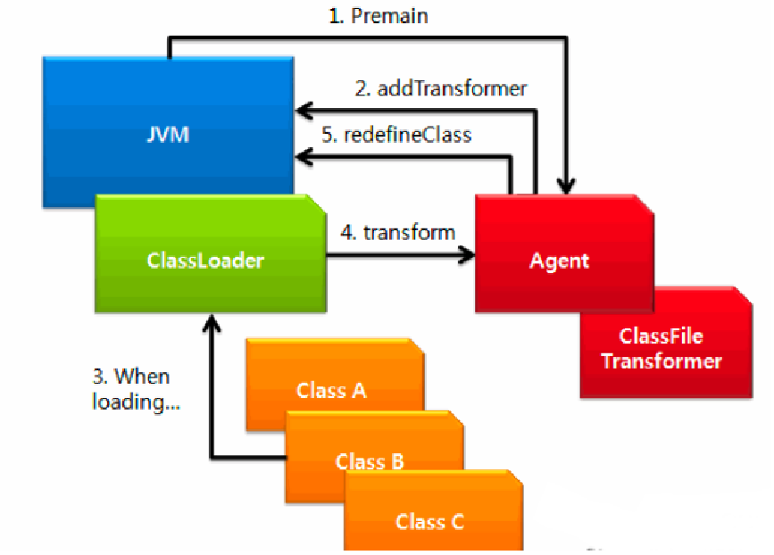
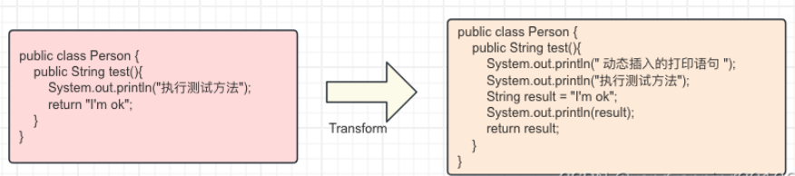
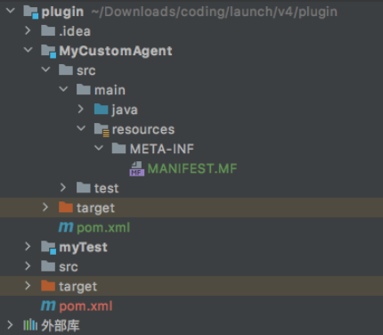

# 调式、热部署背后的Java Agent探针技术

### 前提概要
+ **Java调式、热部署、JVM背后的支持者Java Agent：**
    - 各个 Java IDE 的调试功能，例如 eclipse、IntelliJ ；
    - 热部署功能，例如 JRebel、XRebel、spring-loaded；
    - 各种线上诊断工具，例如 Btrace、Greys，还有阿里的 Arthas；
    - 各种性能分析工具，例如 Visual VM、JConsole 等；

 


## 一、什么是java Agent
Java Agent 直译为 Java 代理，中文圈也流行另外一个称呼 Java 探针 Probe 技术。


它在 JDK1.5 引入，是一种可以动态修改 Java 字节码的技术。Java 类编译后形成字节码被 JVM 执行，在 JVM 在执行这些字节码之前获取这些字节码的信息，并且通过字节码转换器ClassFileTransformer 对这些字节码进行修改，以此来完成一些额外的功能。Java Agent 是一个不能独立运行 jar 包，它通过依附于目标程序的 JVM 进程，进行工作


//Java Agent 和目标进程一起启动模式


nohup java -jar -Dspring.profiles.active=prod -DworkId=1 -javaagent:/opentelemetry-javaagent.jar  -Dfile.encoding=utf-8  -Xms4028M -Xmx4028M -XX:PermSize=512M -XX:MaxPermSize=512M /launch-adapter-0.0.1-SNAPSHOT.jar >/dev/null 2>&1 &


Agent 启动拦截提供两种方式：

#### 启动时修改
程序运行前：在Main方法执行之前，通过一个叫 premain方法来执行

启动时修改主要是在jvm启动时，执行native函数的Agent_OnLoad方法，在方法执行时，执行如下步骤：

• 创建InstrumentationImpl对象

• 监听ClassFileLoadHook事件

• 调用InstrumentationImpl的loadClassAndCallPremain方法，在这个方法里会去调用javaagent里MANIFEST.MF里指定的Premain-Class类的premain方法


#### 运行时修改


运行时修改主要是通过jvm的attach机制来请求目标jvm加载对应的agent，执行native函数的Agent_OnAttach方法，在方法执行时，执行如下步骤：

• 创建InstrumentationImpl对象

• 监听ClassFileLoadHook事件

• 调用InstrumentationImpl的loadClassAndCallAgentmain方法，在这个方法里会去调用javaagent里MANIFEST.MF里指定的Agentmain-Class类的agentmain方法

 


启动时需要在目标程序的启动参数中添加 -javaagent参数，Java Agent 内部通过注册 ClassFileTransformer ，这个转化器在Java 程序 Main方法前加了一层拦截器。在类加载之前，完成对字节码修改



Java Agent 具备以下的能力

• Java Agent 能够在加载 Java 字节码之前拦截并对字节码进行修改;


• Java Agent 能够在 Jvm 运行期间修改已经加载的字节码;


Java Agent 的价值

• IDE 的调试功能，例如 Eclipse、IntelliJ IDEA

• 热部署功能，例如 JRebel、XRebel、spring-loaded

• 各种线上诊断工具，例如 Btrace、Greys，国内阿里的 Arthas

• 各种性能分析工具，例如 Visual VM、JConsole 等

• 全链路性能检测工具，例如 OpenTelemetry、Skywalking、Pinpoint等 。

### Java Agent 功能介绍
Java Agent 主要有以下功能


Java Agent 能够在加载 Java 字节码之前拦截并对字节码进行修改;

Java Agent 能够在 Jvm 运行期间修改已经加载的字节码;

Java Agent 的应用场景


IDE 的调试功能，例如 Eclipse、IntelliJ IDEA ；

热部署功能，例如 JRebel、XRebel、spring-loaded；

各种线上诊断工具，例如 Btrace、Greys，还有阿里的 Arthas；

各种性能分析工具，例如 Visual VM、JConsole 等；

全链路性能检测工具，例如 Skywalking、Pinpoint等；

### Java Agent 实现原理
在了解Java Agent的实现原理之前，需要对Java类加载机制有一个较为清晰的认知。一种是在man方法执行之前，通过premain来执行，另一种是程序运行中修改，需通过JVM中的Attach实现，Attach的实现原理是基于JVMTI。


主要是在类加载之前，进行拦截，对字节码修改


下面我们分别介绍一下这些关键术语：


JVMTI 就是JVM Tool Interface，是 JVM 暴露出来给用户扩展使用的接口集合，JVMTI 是基于事件驱动的，JVM每执行一定的逻辑就会触发一些事件的回调接口，通过这些回调接口，用户可以自行扩展


JVMTI是实现 Debugger、Profiler、Monitor、Thread Analyser 等工具的统一基础，在主流 Java 虚拟机中都有实现


JVMTIAgent是一个动态库，利用JVMTI暴露出来的一些接口来干一些我们想做、但是正常情况下又做不到的事情，不过为了和普通的动态库进行区分，它一般会实现如下的一个或者多个函数：


Agent_OnLoad函数，如果agent是在启动时加载的，通过JVM参数设置

Agent_OnAttach函数，如果agent不是在启动时加载的，而是我们先attach到目标进程上，然后给对应的目标进程发送load命令来加载，则在加载过程中会调用Agent_OnAttach函数

Agent_OnUnload函数，在agent卸载时调用

javaagent 依赖于instrument的JVMTIAgent（Linux下对应的动态库是libinstrument.so），还有个别名叫JPLISAgent(Java Programming Language Instrumentation Services Agent)，专门为Java语言编写的插桩服务提供支持的


instrument 实现了Agent_OnLoad和Agent_OnAttach两方法，也就是说在使用时，agent既可以在启动时加载，也可以在运行时动态加载。其中启动时加载还可以通过类似-javaagent:jar包路径的方式来间接加载instrument agent，运行时动态加载依赖的是JVM的attach机制，通过发送load命令来加载agent


JVM Attach 是指 JVM 提供的一种进程间通信的功能，能让一个进程传命令给另一个进程，并进行一些内部的操作，比如进行线程 dump，那么就需要执行 jstack 进行，然后把 pid 等参数传递给需要 dump 的线程来执行

 

## 二、java Agent简单实现
我们先实现一个简单的Java Agent的栗子


引入javassist

在编写类转化器时，我们通过Javassist 来具体操作字节码，首先pom.xml 里面添加依赖

```java
<dependency>

        <groupId>org.javassist</groupId>

        <artifactId>javassist</artifactId>

        <version>3.28.0-GA</version>

</dependency
```


实现premain方法

程序启动时，优先加载Java Agent，执行里面的 premain方法。这个时候，其实大部分的类没有被加载。 

```java
import java.lang.instrument.Instrumentation;
 
public class MyAgent {
    /**
     * jvm 参数形式启动，运行此方法
     * @param agentArgs
     * @param inst
     */
    public static void premain(String agentArgs, Instrumentation inst){
        System.out.println("premain");
        customLogic(inst);
    }
 
    /**
     * 动态 attach 方式启动，运行此方法
     * @param agentArgs
     * @param inst
     */
    public static void agentmain(String agentArgs, Instrumentation inst){
        System.out.println("agentmain");
        customLogic(inst);
    }
 
    /**
     * 打印所有已加载的类名称
     * 修改字节码
     * @param inst
     */
    private static void customLogic(Instrumentation inst){
        inst.addTransformer(new MyTransformer(), true);
        Class[] classes = inst.getAllLoadedClasses();
        for(Class cls :classes){
            System.out.println(cls.getName());
        }
    }
}
```


实现ClassFileTransformer 

ClassFileTransformer提供了tranform()方法，用于对加载的类进行增强重定义，返回新的类字节码流。


Instrumentation 有一个TransformerInfo 数组保存ClassFileTransformer，像拦截器链表一样，顺序的进行字节码的重定义。

```java
import javassist.ClassPool;
import javassist.CtClass;
import javassist.CtMethod;
 
import java.io.ByteArrayInputStream;
import java.lang.instrument.ClassFileTransformer;
import java.lang.instrument.IllegalClassFormatException;
import java.security.ProtectionDomain;
 
public class MyTransformer implements ClassFileTransformer {
    @Override
    public byte[] transform(ClassLoader loader, String className, Class<?> classBeingRedefined, ProtectionDomain protectionDomain, byte[] classfileBuffer) throws IllegalClassFormatException {
        System.out.println("正在加载类：" + className);
 
        if (!className.contains("Person")) {
            return classfileBuffer;
        }
        CtClass cl = null;
        try {
            ClassPool classPool = ClassPool.getDefault();
            cl = classPool.makeClass(new ByteArrayInputStream(classfileBuffer));
            CtMethod ctMethod = cl.getDeclaredMethod("test");
            System.out.println("获取方法名称：" + ctMethod.getName());
            ctMethod.insertBefore("System.out.println(\" 动态插入的打印语句 \");");
            ctMethod.insertAfter("System.out.println($_);");
            byte[] transformed = cl.toBytecode();
            return transformed;
        } catch (Exception e) {
            e.printStackTrace();
        }
        
        return classfileBuffer;
    }
}
```


MANIFEST.MF文件配置 

在 MANIFEST.MF文件中定义Premain-Class属性，指定一个实现类。类中实现了Premain方法，这就是Java Agent 在类加载启动入口

```java
Manifest-Version: 1.0
Created-By: yyp
Agent-Class: org.example.MyAgent
Can-Redefine-Classes: true
Can-Retransform-Classes: true
Premain-Class: org.example.MyAgent
Premain-Class包含Premain方法的类

Can-Redefine-Classes为true时表示能够重新定义Class

Can-Retransform-Classes为true时表示能够重新转换Class，实现字节码替换
```


打包和运行 

POM打包

```java
<build>
        <plugins>
            <plugin>
                <groupId>org.apache.maven.plugins</groupId>
                <artifactId>maven-assembly-plugin</artifactId>
                <configuration>
                    <archive>
                        <manifestFile>src/main/resources/META-INF/MANIFEST.MF</manifestFile>
                    </archive>
                    <descriptorRefs>
                        <descriptorRef>jar-with-dependencies</descriptorRef>
                    </descriptorRefs>
                </configuration>
            </plugin>
        </plugins>
    </build>
```

 


运行：

```java
java -javaagent:MyCustomAgent-1.0-SNAPSHOT-jar-with-dependencies.jar -jar myTest-1.0-SNAPSHOT.jar 

正在加载类：java/util/regex/Pattern$Ques
正在加载类：java/util/regex/Pattern$Loop
正在加载类：java/util/regex/Pattern$Prolog
1
正在加载类：org/example/Person
获取方法名称：test
 动态插入的打印语句 
执行测试方法
I'm ok
```


程序等价于：指定Java类下所有方法进行了如下转换，重新生成字节码加载执行 

 

 

<font style="color:rgb(77, 77, 77);">项目结构图 </font>

  
 


> 更新: 2024-07-07 22:41:26  
> 原文: <https://www.yuque.com/aaron-wecc3/dhluml/ilktu3f8hdf9b771>