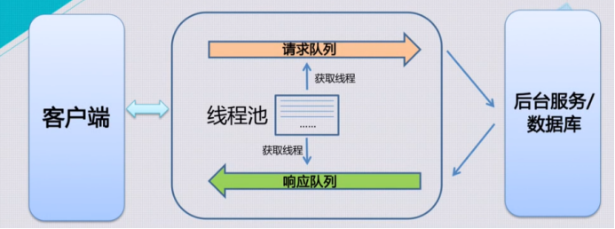
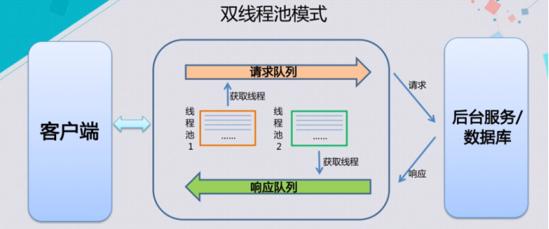
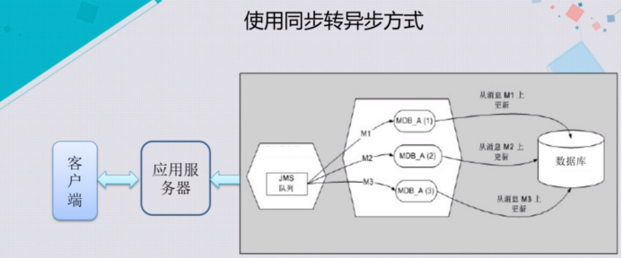
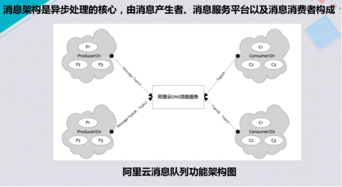

# 超实用高并发优化技巧：同步转异步

### 同步转异步处理

内容介绍:

一、同步转异步

二、双线程池模式

三、使用同步转异步的方式

四、消息架构

### 一、同步转异步
1、本次课学习另外一种常见的提高应用并发度的架构设计思路。把它简单的归结成同步转异步，就是在互联网应用所面临的一些场景是大量的用户同时来访问，比如阿里淘宝的天猫双十一，在春节摇红包，这些都是大量的用户同步访问同一个系统，用户的请求可能是每秒钟几百万，甚至达到千万级别，这么大的请求过来，如果每一个请求都处理时间非常长的话会对整个系统造成致命的损害。主要的表象是服务器夯机，或者是停止响应，这在以往的一些互联网应用大家都会或多或少的有所听闻。从技术层面去分析，主要是因为应用层出现的问题。

2、下面介绍在应用层是什么样的原因可能会导致整个系统的瘫痪，或者叫宕机。看下面一副图

这个图是一些常见的应用服务器，比如经常提到的 Tomcat，这些应用服务器实际上都是以线程池模式来运行的，所谓线程池模式，就是只要有一个客户端，有一个浏览器点击了一个页面，或者点击了一次提交，它就会发起一次请求到应用服务器。应用服务器的请求队列里面就会放入一个请求，这个请求就会从线程池里面申请一个线程，来进行后续的处理。这个线程接收到请求以后，进行的后续处理通常就是从数据库中或者是缓存中取到一些数据，或者更新一些数据，更新完以后，最后的结果被放入响应队列，响应队列也会从线程池当中申请一个线程，申请到线程以后，再根据队列的优先级将返回的响应数据，最终返回给客户端，客户端用户就能看到最终的结果。

3、比如他看了一个商品的价格，或者他下的订单是否已经完成。如果这个线程池只有一个，当大量的由并发的过来以后，请求队列就会申请很多线程。通常为了保护这台服务器物理资源，线程池通常是有一定上限的，比如说500，比如说1000。如果请求队列将这1000个线程全部消耗掉，并且持续进行的后续处理，虽然他可能响应完了，但是因为响应队列无法从线程池中再获取新的线程，所以客户端那边的提线就是服务器无法再响应它的上次点击的动作。

### 二、双线程池模式
1、所以，单线程池模式很容易导致线程阻塞的问题，如果不用其他的技术手段解决这个问题，可以用另外一种方式进行缓解，就是双线程池模式。

2、具体的场景和刚才介绍的场景是一样的，

就是有成百上千，甚至百万千万的请求过来以后，把请求队列的线程池和响应队列的线程池分为两个。这样即便线程池1的线程被消耗光，但线程池2还有线程，所以响应还可以回到最终的客户端，只不过请求队列可能因为大量的请求过来以后，在一定时间内处理不完，在队列内可能会有一些堆积，但是整体通过双线程池还是在一定程度上可以缓解阻塞的情况，但是因为受限于线程池的大小，如果每次请求的时间消耗的比较长，实际上用户的体验还是不够好的。

### 三、使用同步转异步的方式
1、最终解决这个问题，可能需要架构上的一些调整，使用的方法就是同步转异步的方式，看下图

灰色部分是一些异步的处理，就是通过控制用户的请求进来的速度，来对整体的并发度进行控制。举例，比如在进行大型的电商网站设计的时候，一个交易是由多个环节组成的，比如在网站上下了一个订单，这个订单当应用服务器接收好以后，会把业务逻辑做后续的处理。比如说它要做支付，然后做扣减库存，然后再制作一份物流订单。如果把整个的应用逻辑按照刚才的同步模式，单线程池模式也好，或者是双线程池模式也好，如果用同步的模式处理它，因为这一个逻辑运行下来可能就需要几百毫秒，甚至可能一个处理就要几秒，那么整个应用的并发度是无法提升的。

2、所以对于大型的电商网站，会把业务逻辑拆成同步和异步的两种类型，比如支付这个环节非常重要，一定要在这一次请求当中给客户一个反馈，告诉客户他的支付是否成功，就把这个环节放在同步环节，剩下的刚才说的扣减库存、产生物流订单这些环节，都可以异步的处理。这样每一个请求过来，同步处理的速度会非常快，可能几十毫秒就能把一个请求处理掉，这样就可以大大的增加应用的并发度。从上图中可以看到，这样就需要应用服务器后面有一个队列机制来保证后续的操作。从这个图上结合刚才的例子，基本的逻辑就是应用服务器会处理掉接到一个请求后会拿到一个线程，首先处理支付的业务，然后把订单信息传到消息队列中，消息队列就会把消息传递到后续的业务处理模块中。业务处理模块比如说有物流订单的处理模块，有扣减库存的处理模块，这些模块就可以异步的在后台逐步消化订单数据。

3、有了这样一个架构以后，除了提高了前端的响应速度和体验效果以外，其实也可以控制后端的并发度，就是可以控制比如说扣减库存的速度，以及产生物流订单的速度。因为后台的数据库压力承载能力也是有限的，所以通过控制业务逻辑处理的速度，就可以在一定程度上避免后台数据库出现一些瘫痪的情况。

### 四、消息架构
1、通过同步转异步的架构，能够很好的解决大的并发处理过来以后的整体的控制。整个同步转异步的核心就是消息架构，消息架构里面会有这样几个部分组成。

第一就是消息的产生者，比如刚才应用服务器接到客户下的订单，那应用服务器就是消息的产生者；第二就是消息服务平台，也就是说这些消息会被存放到或传递到消息服务平台中。通常情况下，会以队列或者主题的形式，通常称为 q 或 topic 这两种类型存在，消息平台对应的另外一方就是消息的消费者，比如说库存的扣减模块和物流订单产生模块，这些都是消息的消费者，或者是订阅者。

2、整个数据的流向就是当消息产生者产生了信息，存放到消息平台中，消息消费者就可以获取到这些信息，然后进行后续的处理。因为消息平台只需要保证这些消息的持久性，也就是说只要这个信息被消息产生者存放到消息平台后，这个数据永远不会丢失，采取各种技术手段进行保障。当消费者把数据取走以后，这个信息可以被消息平台移除掉，在被取走之前一定要保证数据的可靠性。

3、在阿里云也有数据的产品，有一个叫消息队列产品。在上面开创这样一个服务非常简单，只要录入一个消息的名字，后续就可以通过应用往这个队列里面写入需要传递的业务数据，然后后续处理应用模块可以订阅这个队列，这样后续的数据到达以后，后续处理模块就可以把数据取出，进行处理。到这就可以理解，通过同步转异步这样一个模式，可以大大加快应用的处理速度，在单位时间内，相同的计算资源状况下就可以处理更多的请求。这样的架构在阿里巴巴的淘宝天猫中被广泛的应用，可以更好地服务于购物的一些客户。

> 更新: 2025-04-20 22:39:00  
> 原文: <https://www.yuque.com/aaron-wecc3/dhluml/fewopn70fpganieg>