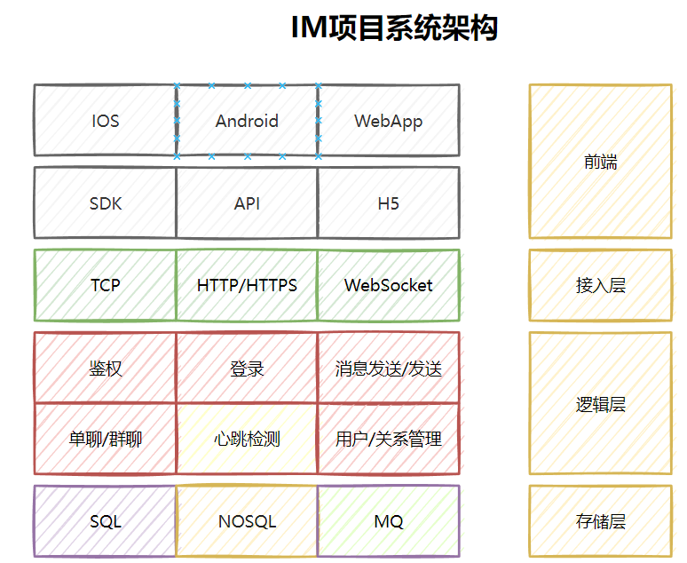
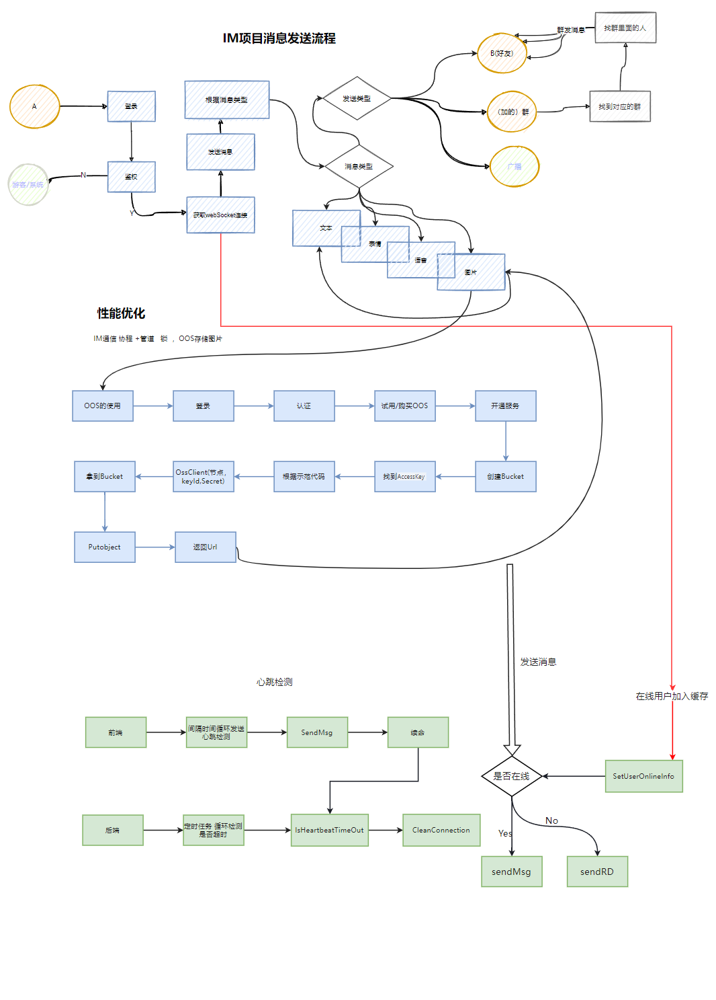

# 轻松上手WebSocket及时通信

# 轻松上手WebSocket及时通信


最近想起之前一个及时通信系统项目，是关于订阅推送的，当粉丝订阅了大V或者说作者发布的内容被评论和点赞之后，对应的用户会受到通知，当然，本身系统用户并不多，所以直接采用的是轮训的方式，由前端这边定时向后端发起接口请求，获取消息推送，无疑呢，此种方式也可以解决问题，但是大部分请求基本无用，白白浪费带宽和网络资源。


今天给大家分享下，如何快速让微服务中加入  前后端通过websocket实现消息推送的方式。


**WebSocket**是一种在单个[TCP](https://baike.baidu.com/item/TCP/0?fromModule=lemma_inlink)连接上进行[全双工](https://baike.baidu.com/item/%E5%85%A8%E5%8F%8C%E5%B7%A5/0?fromModule=lemma_inlink)通信的协议。WebSocket通信协议于2011年被[IETF](https://baike.baidu.com/item/IETF/0?fromModule=lemma_inlink)定为标准RFC 6455，并由RFC7936补充规范。WebSocket API也被[W3C](https://baike.baidu.com/item/W3C/0?fromModule=lemma_inlink)定为标准。


WebSocket使得客户端和服务器之间的数据交换变得更加简单，允许服务端主动向客户端推送数据。在WebSocket API中，浏览器和服务器只需要完成一次握手，两者之间就直接可以创建持久性的连接，并进行双向数据传输。


当然，前端这块，主要采用原始的js通过websocket的方式获取消息，在微信公众号和支付宝小程序开发中都有相应的onWebSocekt方式，有兴趣的同学可以自行学习。


废话不多说，开始啃代码。


1、pom.xml


```plain
<!--websocket-->
        <dependency>
            <groupId>org.springframework.boot</groupId>
            <artifactId>spring-boot-starter-websocket</artifactId>
        </dependency>


        <!--thymeleaf-->
        <dependency>
            <groupId>org.springframework.boot</groupId>
            <artifactId>spring-boot-starter-thymeleaf</artifactId>
        </dependency>
```


2、application.yml


```plain
server:
  port: 8080


spring:
  thymeleaf:
    cache: false # 开发时关闭缓存,不然没法看到实时页面
    mode: HTML # 用非严格的 HTML
    encoding: UTF-8
    servlet:
      content-type: text/html
```


3、WebSocketServer，实现前后端的长连接


```java
package com.cookie.server;

import org.slf4j.Logger;
import org.slf4j.LoggerFactory;
import org.springframework.stereotype.Component;

import javax.annotation.PostConstruct;
import javax.websocket.*;
import javax.websocket.server.ServerEndpoint;
import java.io.IOException;
import java.util.concurrent.CopyOnWriteArraySet;
import java.util.concurrent.atomic.AtomicInteger;

/**
 * @Author : cxq
 * @Date : 2020/8/31 15:50
 */

// 前端通过该连接与后端保持交互
@ServerEndpoint(value = "/server")
@Component
public class WebSocketServer {

    @PostConstruct
    public void init() {
        System.out.println("websocket 加载");
    }
    private static Logger log = LoggerFactory.getLogger(WebSocketServer.class);
    private static final AtomicInteger OnlineCount = new AtomicInteger(0);
    // concurrent包的线程安全Set，用来存放每个客户端对应的Session对象。
    private static CopyOnWriteArraySet<Session> SessionSet = new CopyOnWriteArraySet<Session>();


    /**
     * 连接建立成功调用的方法
     */
    @OnOpen
    public void onOpen(Session session) {
        SessionSet.add(session);
        int cnt = OnlineCount.incrementAndGet(); // 在线数加1
        log.info("有连接加入，当前连接数为：{}", cnt);
        SendMessage(session, "连接成功");
    }

    /**
     * 连接关闭调用的方法
     */
    @OnClose
    public void onClose(Session session) {
        SessionSet.remove(session);
        int cnt = OnlineCount.decrementAndGet();
        log.info("有连接关闭，当前连接数为：{}", cnt);
    }

    /**
     * 收到客户端消息后调用的方法
     *
     * @param message
     *            客户端发送过来的消息
     */
    @OnMessage
    public void onMessage(String message, Session session) {
        log.info("来自客户端的消息：{}",message);
        SendMessage(session, "收到消息，消息内容："+message);

    }

    /**
     * 出现错误
     * @param session
     * @param error
     */
    @OnError
    public void onError(Session session, Throwable error) {
        log.error("发生错误：{}，Session ID： {}",error.getMessage(),session.getId());
        error.printStackTrace();
    }

    /**
     * 发送消息，实践表明，每次浏览器刷新，session会发生变化。
     * @param session
     * @param message
     */
    public static void SendMessage(Session session, String message) {
        try {
//            session.getBasicRemote().sendText(String.format("%s (From Server，Session ID=%s)",message,session.getId()));
            session.getBasicRemote().sendText(message);
        } catch (IOException e) {
            log.error("发送消息出错：{}", e.getMessage());
            e.printStackTrace();
        }
    }

    /**
     * 群发消息
     * @param message
     * @throws IOException
     */
    public static void BroadCastInfo(String message) throws IOException {
        for (Session session : SessionSet) {
            if(session.isOpen()){
                SendMessage(session, message);
            }
        }
    }

    /**
     * 指定Session发送消息
     * @param sessionId
     * @param message
     * @throws IOException
     */
    public static void SendMessage(String message,String sessionId) throws IOException {
        Session session = null;
        for (Session s : SessionSet) {
            if(s.getId().equals(sessionId)){
                session = s;
                break;
            }
        }
        if(session!=null){
            SendMessage(session, message);
        }
        else{
            log.warn("没有找到你指定ID的会话：{}",sessionId);
        }
    }
}
```


4、WebSocketController,主要实现消息群发和一对一发送


```java
package com.cookie.controller;

import com.cookie.server.WebSocketServer;
import org.springframework.web.bind.annotation.RequestMapping;
import org.springframework.web.bind.annotation.RequestMethod;
import org.springframework.web.bind.annotation.RequestParam;
import org.springframework.web.bind.annotation.RestController;

import java.io.IOException;

/**
 * @Author : cxq
 * @Date : 2020/8/31 16:19
 */

@RestController
@RequestMapping("/webSocket")
public class WebSocketController {


    /**
     * 群发消息内容
     *
     * @param message
     * @return
     */
    @RequestMapping(value = "/sendAll", method = RequestMethod.GET)
    public String sendAllMessage(@RequestParam(required = true) String message) {
        try {
            WebSocketServer.BroadCastInfo(message);
        } catch (IOException e) {
            e.printStackTrace();
        }
        return "ok";
    }

    /**
     * 指定会话ID发消息
     *
     * @param message 消息内容
     * @param id      连接会话ID
     * @return
     */
    @RequestMapping(value = "/sendOne", method = RequestMethod.GET)
    public String sendOneMessage(@RequestParam(required = true) String message,
                                 @RequestParam(required = true) String id) {
        try {
            WebSocketServer.SendMessage(message, id);
        } catch (IOException e) {
            e.printStackTrace();
        }
        return "ok";
    }
}
```


5、index.html接收后端发送的消息及展示


```java
<!DOCTYPE html>
<html lang="en" xmlns:th="http://www.thymeleaf.org">
<head>
    <meta charset="UTF-8">
    <title>websocket测试</title>
    <script src="http://libs.baidu.com/jquery/2.0.0/jquery.min.js"></script>
    <style type="text/css">
        h3,h4{
            text-align:center;
        }
    </style>
</head>
<body>

<h3>WebSocket测试，客户端接收到的消息如下：</h3>

<textarea id = "messageId" readonly="readonly" cols="150" rows="30" >

</textarea>


<script type="text/javascript">
    var socket;
    if (typeof (WebSocket) == "undefined") {
        console.log("遗憾：您的浏览器不支持WebSocket");
    } else {
        console.log("恭喜：您的浏览器支持WebSocket");
        //实现化WebSocket对象
        //指定要连接的服务器地址与端口建立连接
        //注意ws、wss使用不同的端口。我使用自签名的证书测试，
        //无法使用wss，浏览器打开WebSocket时报错
        //ws对应http、wss对应https。
        socket = new WebSocket("ws://localhost:8080/server");
        //连接打开事件
        socket.onopen = function() {
            console.log("Socket 已打开");
            socket.send("消息发送测试(From Client)");
        };
        //收到消息事件
        socket.onmessage = function(msg) {
            $("#messageId").append(msg.data+ "\n");
            console.log(msg.data  );
        };
        //连接关闭事件
        socket.onclose = function() {
            console.log("Socket已关闭");
        };
        //发生了错误事件
        socket.onerror = function() {
            alert("Socket发生了错误");
        }
        //窗口关闭时，关闭连接
        window.unload=function() {
            socket.close();
        };
    }
</script>

</body>
</html>
```


6、启动项目，访问页面看效果


访问 localhost:8080,网页展示如下


多看几个页面，页面展示内容都一样，同时后端控制台打印消息如下


接下来，使用postman，依次调用一对一消息推送和群发消息


一对一：http://localhost:8080/webSocket/sendOne?message="这是一条单个消息"&id=1


群发消息：http://localhost:8080/webSocket/sendAll?message="这是一条群发消息"


页面展示如下：


更多功能




项目流程图：





> 更新: 2024-05-17 20:45:50  
> 原文: <https://www.yuque.com/aaron-wecc3/dhluml/marvm9pwdsuvc7sg>