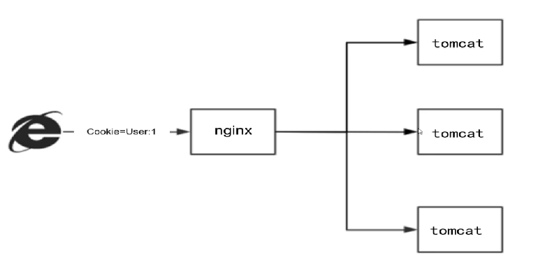
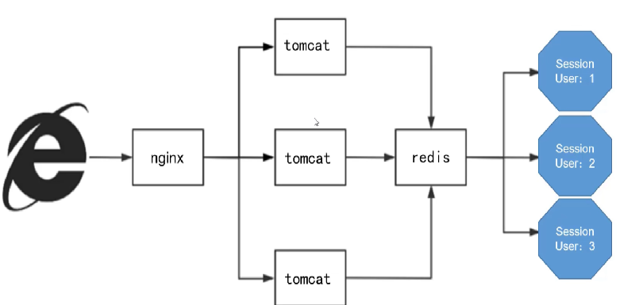

# 阿里是如何设计RESTful风格API

## 什么是RESTful
+  RESTful是一种网络应用程序的设计风格和开发方式，基于HTTP，可以使用XML格式定义或JSON格式定义
+ RESTful适用于移动互联网厂商作为业务接口的场景，实现第三方OTT调用移动网络资源的功能，动作类型为新增、变更、删除

## RESTful接口的命名规范及语义格式
### 基于HTTP协议URL对外暴露
+     标准格式

> http(s)://域名:端口[/版本]/资源1[/子资源2/...../子资源n][路径变量]<font style="background-color:#FBDE28;"></font>
>

+    多版本控制

> GET http(s)://xxxxxx.com/v1.1/blog/article/10
>

+    数据查询采用复数

> GET http(s)://xxxxxx.com/v1.1/blog/articles?categoryld=10
>

+    反面典型

>  GET http(s)://xxxxxx.com/article/select_by_id?id=1 （不安全）
>

### 使用XML或JSON格式定义
+ 正确案例

```java
{
	"id": 1,
	"number": "1234567890"
}
```

+ 错误案例（不要包含任何展现）

```java
phoneNumber:<h1>id:1</h1><h1>number:1234567890</h1>
```

### 根据不同行为使用不同请求方式
+ 代表查询主键为1的电话号码

:::info
GET  <font style="color:rgb(102, 102, 102);">localhost:8080/api/v1/phoneNumbers/1</font>

:::

```java
{
	"id": 1,
	"number": "1234567890"
}
```

+ 代表新增主键为2的的电话号码 

:::info
POST  <font style="color:rgb(102, 102, 102);">localhost:8080/api/v1/phoneNumbers</font>

:::

```java
请求体
{
	"id": 2,
	"number": "1234567890"
}

响应体
{
	"code": "200",
	"message": "success"
}
```

+ 代表更新主键为2的的电话号码 

:::info
PUT <font style="color:rgb(102, 102, 102);">localhost:8080/api/v1/phoneNumbers/2</font>

:::

```java
请求体
{
	"number": "1234567891"
}

响应体
{
	"code": "200",
	"message": "success"
}
```

+ 代表删除主键为2的电话号码

:::info
DELETE  <font style="color:rgb(102, 102, 102);">localhost:8080/api/v1/phoneNumbers/2</font>

:::

```java
{
	"code": "200",
	"message": "success"
}
```


| 请求方式 | 操作 | 行为 |
| :---: | :---: | :---: |
| GET | SELECT | 从服务器取出资源 |
| POST | CREATE | 在服务器新建一个资源 |
| PUT | UPDATE | 在服务器更新资源 |
| DELETE | DELETE | 在服务器删除资源 |


## RESTful接口的设计规则与注意事项
### 幂等性
当多次重复请求时，接口能保证与预期相符的结果

+ **无幂等性**

```java
//查询工资
  Double oldSalary=employeeService.getEmployeeSalary(1);
//更新工资
boolean updated = employeeService.updateEmployeeSalary(employeeId, oldSalary+newSalary);
//更新语句
@Update("UPDATE Employees SET salary = #{salary} WHERE employee_id = #{employeeId}")
int updateSalary(@Param("employeeId") int employeeId, @Param("salary") double salary);
```

> 注意：在分布式环境下，为了保证消息的高可靠性，客户端往往会采用重试或者消息补偿的形式重复发送同一个请求，那在这种情况下这段代码就会出严重问题，每一个重复请求被发送到服务器都会让该员工工资加500，最终该员工工资会大于要求实际应收工资
>

+ 幂等性

```java
//查询工资
  Double oldSalary=employeeService.getEmployeeSalary(1);
//更新工资
boolean updated = employeeService.updateEmployeeSalaryByVervion(employeeId, oldSalary+newSalary,version);
//更新语句
@Update("UPDATE Employees SET salary = #{salary},version=#{version}+1 WHERE employee_id = #{employeeId} and version = #{version}")
int updateSalaryByVervion(@Param("employeeId") int employeeId, @Param("salary") double salary,@Param("version") int version);;
```

> 解决方法： 乐观锁设计在工资表额外增加一个version的字段，代表当前数据的版本，任何对该数据修改操作都会让version字段值+1，这个version的数值要求附加在请求中。
>
> //此时Update方法除了id条件外，还得加Version判断update employee set salary=500,Version=1 where employee_id=1 and Version=0
>

### 标准化的响应结果集
> 在标准化的响应结构中：要包含code（服务器处理结果）、message（返回的消息内容）两项，此外data属性是可选项，包含从响应返回的额外数据，如查询结果、新增或更新后的数据。在语义层面，也要遵循相同的规则：如 服务器处理成功，code固定等于0，如果遇到异常情况，企业内部要遵循统一的code命名标准
>

```java
{
  "code":"0",   //服务器处理成功
  "message":"success", //服务器返回的消息
  "data":{             //返回的信息
     "name":"张三",
     "age":30
   } 
}

```

### 接口设计采用无状态方案
+ **完整性**<font style="color:rgb(13, 13, 13);">：每个请求都应该包含执行操作所需的所有信息，比如用户身份认证信息、参数以及必要的路径信息。服务器不会存储关于客户端之前请求的任何信息。</font>
+ **独立性**<font style="color:rgb(13, 13, 13);">：服务器不应保留任何客户端的状态信息。这使得每个请求都成为独立的、自包含的操作，这样每个请求就可以由任何服务器处理，提高了系统的可伸缩性和可靠性。</font>
+ **会话状态的外部化**<font style="color:rgb(13, 13, 13);">：如果需要维护状态（如用户登录会话），状态应该由客户端负责维护，并在每次请求时发送到服务器。通常，这可以通过cookie、认证令牌或其他在请求中发送的安全机制实现。</font>

#### 两种方案：
+ 客户端存储认证数据：前端使用存储介质存储用户数据，需要加密，通常方法使用JWT加密或其他



+ 后端统一存储状态数据：在服务器后端，将这些状态数据统一存储，所有节点访问同一个数据源，后台挂载一个Redis集群，对用户数据存储，既可以避免前台传输的数据泄露问题，还可以保证数据的全局存储，有效保证了数据的去状态化，缺点是架构复杂度增加




> 更新: 2024-04-21 17:47:14  
> 原文: <https://www.yuque.com/aaron-wecc3/dhluml/udsr3aaz2z3stfb1>