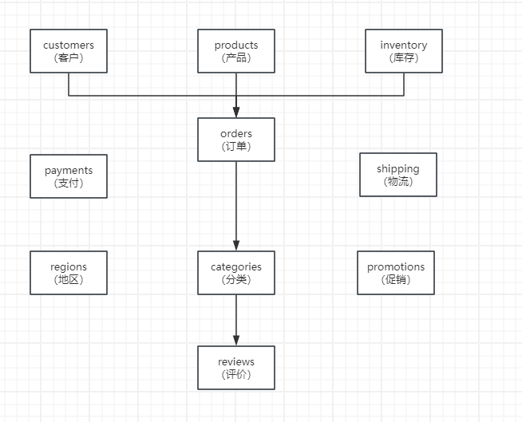
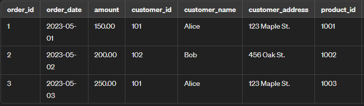

# 非常牛逼，200毫秒干到10毫秒，利用MySQL JSON特性优化千万级订单表

# 场景描述
在一个电商平台中，为了生成一份详细的销售报告，需要从多个表中获取数据。这些表包括订单、客户、产品、库存、支付、物流、地区、分类、促销、和评价等信息。假设需要从以下10个表中获取数据：



orders（订单）

customers（客户）

products（产品）

inventory（库存）

payments（支付）

shipping（物流）

regions（地区）

categories（分类）

promotions（促销）

reviews（评价）

# 业务需求
生成一份报告，包含每个订单的详细信息，包括订单ID、客户姓名、产品名称、库存状态、支付方式、物流信息、客户地区、产品分类、促销活动、以及客户评价等。

# 查询示例
为了获取这些信息，我们需要进行多表关联查询。查询语句可能如下所示：

```sql
SELECT 
    o.order_id, 
    c.name AS customer_name, 
    p.name AS product_name, 
    i.stock_status, 
    pay.payment_method, 
    s.shipping_status, 
    r.region_name, 
    cat.category_name, 
    promo.promotion_name, 
    rev.review_content
FROM 
    orders o
JOIN 
    customers c ON o.customer_id = c.customer_id
JOIN 
    products p ON o.product_id = p.product_id
JOIN 
    inventory i ON p.product_id = i.product_id
JOIN 
    payments pay ON o.payment_id = pay.payment_id
JOIN 
    shipping s ON o.shipping_id = s.shipping_id
JOIN 
    regions r ON c.region_id = r.region_id
JOIN 
    categories cat ON p.category_id = cat.category_id
JOIN 
    promotions promo ON o.promotion_id = promo.promotion_id
JOIN 
    reviews rev ON o.review_id = rev.review_id;

```

# 效率问题
1. **表的数量多**：以上查询涉及10个表的关联，每个表都有自己的数据量，如果每个表的数据量较大，关联操作会非常耗时。
2. **全表扫描**：在没有索引的情况下，查询需要对每个表进行全表扫描，导致查询时间显著增加。
3. **数据处理复杂**：每个订单需要从多个表中获取关联信息，导致查询需要处理大量的数据和复杂的连接操作。
4. **性能瓶颈**：由于查询需要大量的计算资源和内存，当数据量非常大时，数据库服务器可能出现性能瓶颈，影响系统的整体性能。


# 解决方案一 : 反范式设计
<font style="color:rgb(77, 77, 77);">一个版本，这个1.0呢，就是</font>**<font style="color:rgb(77, 77, 77);">采用反范式设计，基于宽表，也就是我们典型的空间换时间</font>**<font style="color:rgb(77, 77, 77);">，可以看到刚才我们处理慢的一个主要思路呢，就是一个数据表要查询多次才能获得完整的信息。那如果我们把这些数据都。综合到一个宽表里边儿，也就是我们反范式表是不是就可以了呢？</font>



其实这个思路非常的好，我们可以比如说把所有的属性呢，以列的形式在这儿呢，都进行体现出来

## 弊端
在当前的这个宽表中呢，包含了所有可能会出现的属性，哪一个属性有数据，我们就提取哪一个，但是针对宽表呢，在我们日常工作中啊，并不太推荐使用，有两个原因 :

+ **它的字段一多以后，字段的动态填充和减少是要锁表的，尤其在数据量一大的时候，比如现在我们针对某一个类型又有一个新的属性，你一旦添加列的时候，整个这个表就锁了。 对于我们的维护非常的不方便.**
+ **数据查询的时候非常麻烦,难以基于动态列的方式来进行了提取数据**
+ **作为宽表还有一些不能解决的问题，难以体现出一对多的关系**

# 解决方案二 : mysql5.7后Json特性
## 一、创建表
```sql
CREATE TABLE wide_table (
    id INT AUTO_INCREMENT PRIMARY KEY,
    data JSON
);
```

## 二、插入数据
```sql
INSERT INTO wide_table (data) VALUES 
(JSON_OBJECT('order_id', 1, 'order_date', '2023-05-01', 'amount', 150.00, 'customer', JSON_OBJECT('customer_id', 101, 'customer_name', 'Alice', 'customer_address', '123 Maple St.'), 'product', JSON_OBJECT('product_id', 1001, 'product_name', 'Widget', 'product_price', 50.00), 'inventory', JSON_OBJECT('stock_status', 'In Stock'), 'payment', JSON_OBJECT('payment_method', 'Credit Card'), 'shipping', JSON_OBJECT('shipping_status', 'Shipped'), 'region', JSON_OBJECT('region_name', 'North'), 'category', JSON_OBJECT('category_name', 'Electronics'), 'promotion', JSON_OBJECT('promotion_name', 'Spring Sale'), 'review', JSON_OBJECT('review_content', 'Great product!'))),
(JSON_OBJECT('order_id', 2, 'order_date', '2023-05-02', 'amount', 200.00, 'customer', JSON_OBJECT('customer_id', 102, 'customer_name', 'Bob', 'customer_address', '456 Oak St.'), 'product', JSON_OBJECT('product_id', 1002, 'product_name', 'Gizmo', 'product_price', 75.00), 'inventory', JSON_OBJECT('stock_status', 'In Stock'), 'payment', JSON_OBJECT('payment_method', 'PayPal'), 'shipping', JSON_OBJECT('shipping_status', 'Delivered'), 'region', JSON_OBJECT('region_name', 'South'), 'category', JSON_OBJECT('category_name', 'Gadgets'), 'promotion', JSON_OBJECT('promotion_name', 'Summer Sale'), 'review', JSON_OBJECT('review_content', 'Excellent!'))),
(JSON_OBJECT('order_id', 3, 'order_date', '2023-05-03', 'amount', 250.00, 'customer', JSON_OBJECT('customer_id', 101, 'customer_name', 'Alice', 'customer_address', '123 Maple St.'), 'product', JSON_OBJECT('product_id', 1003, 'product_name', 'Thingamajig', 'product_price', 100.00), 'inventory', JSON_OBJECT('stock_status', 'Out of Stock'), 'payment', JSON_OBJECT('payment_method', 'Credit Card'), 'shipping', JSON_OBJECT('shipping_status', 'Processing'), 'region', JSON_OBJECT('region_name', 'North'), 'category', JSON_OBJECT('category_name', 'Tools'), 'promotion', JSON_OBJECT('promotion_name', 'Winter Sale'), 'review', JSON_OBJECT('review_content', 'Very useful!'))),
(JSON_OBJECT('order_id', 4, 'order_date', '2023-05-04', 'amount', 300.00, 'customer', JSON_OBJECT('customer_id', 103, 'customer_name', 'Charlie', 'customer_address', '789 Birch St.'), 'product', JSON_OBJECT('product_id', 1004, 'product_name', 'Doodad', 'product_price', 125.00), 'inventory', JSON_OBJECT('stock_status', 'In Stock'), 'payment', JSON_OBJECT('payment_method', 'Debit Card'), 'shipping', JSON_OBJECT('shipping_status', 'Shipped'), 'region', JSON_OBJECT('region_name', 'East'), 'category', JSON_OBJECT('category_name', 'Home Appliances'), 'promotion', JSON_OBJECT('promotion_name', 'Autumn Sale'), 'review', JSON_OBJECT('review_content', 'Works great!'))),
(JSON_OBJECT('order_id', 5, 'order_date', '2023-05-05', 'amount', 175.00, 'customer', JSON_OBJECT('customer_id', 104, 'customer_name', 'Dave', 'customer_address', '321 Pine St.'), 'product', JSON_OBJECT('product_id', 1005, 'product_name', 'Whatsit', 'product_price', 60.00), 'inventory', JSON_OBJECT('stock_status', 'In Stock'), 'payment', JSON_OBJECT('payment_method', 'Credit Card'), 'shipping', JSON_OBJECT('shipping_status', 'Shipped'), 'region', JSON_OBJECT('region_name', 'West'), 'category', JSON_OBJECT('category_name', 'Kitchenware'), 'promotion', JSON_OBJECT('promotion_name', 'Holiday Sale'), 'review', JSON_OBJECT('review_content', 'Very practical!'))),
(JSON_OBJECT('order_id', 6, 'order_date', '2023-05-06', 'amount', 220.00, 'customer', JSON_OBJECT('customer_id', 105, 'customer_name', 'Eve', 'customer_address', '654 Elm St.'), 'product', JSON_OBJECT('product_id', 1006, 'product_name', 'Contraption', 'product_price', 85.00), 'inventory', JSON_OBJECT('stock_status', 'Out of Stock'), 'payment', JSON_OBJECT('payment_method', 'PayPal'), 'shipping', JSON_OBJECT('shipping_status', 'Processing'), 'region', JSON_OBJECT('region_name', 'Central'), 'category', JSON_OBJECT('category_name', 'Electronics'), 'promotion', JSON_OBJECT('promotion_name', 'Spring Sale'), 'review', JSON_OBJECT('review_content', 'Highly recommended!'))),
(JSON_OBJECT('order_id', 7, 'order_date', '2023-05-07', 'amount', 190.00, 'customer', JSON_OBJECT('customer_id', 106, 'customer_name', 'Frank', 'customer_address', '987 Cedar St.'), 'product', JSON_OBJECT('product_id', 1007, 'product_name', 'Gadget', 'product_price', 70.00), 'inventory', JSON_OBJECT('stock_status', 'In Stock'), 'payment', JSON_OBJECT('payment_method', 'Debit Card'), 'shipping', JSON_OBJECT('shipping_status', 'Delivered'), 'region', JSON_OBJECT('region_name', 'North'), 'category', JSON_OBJECT('category_name', 'Gadgets'), 'promotion', JSON_OBJECT('promotion_name', 'Summer Sale'), 'review', JSON_OBJECT('review_content', 'Fantastic!'))),
(JSON_OBJECT('order_id', 8, 'order_date', '2023-05-08', 'amount', 210.00, 'customer', JSON_OBJECT('customer_id', 107, 'customer_name', 'Grace', 'customer_address', '456 Spruce St.'), 'product', JSON_OBJECT('product_id', 1008, 'product_name', 'Widget Pro', 'product_price', 80.00), 'inventory', JSON_OBJECT('stock_status', 'In Stock'), 'payment', JSON_OBJECT('payment_method', 'Credit Card'), 'shipping', JSON_OBJECT('shipping_status', 'Shipped'), 'region', JSON_OBJECT('region_name', 'South'), 'category', JSON_OBJECT('category_name', 'Electronics'), 'promotion', JSON_OBJECT('promotion_name', 'Spring Sale'), 'review', JSON_OBJECT('review_content', 'Very satisfied!'))),
(JSON_OBJECT('order_id', 9, 'order_date', '2023-05-09', 'amount', 230.00, 'customer', JSON_OBJECT('customer_id', 108, 'customer_name', 'Henry', 'customer_address', '789 Fir St.'), 'product', JSON_OBJECT('product_id', 1009, 'product_name', 'Gizmo Max', 'product_price', 90.00), 'inventory', JSON_OBJECT('stock_status', 'Out of Stock'), 'payment', JSON_OBJECT('payment_method', 'PayPal'), 'shipping', JSON_OBJECT('shipping_status', 'Processing'), 'region', JSON_OBJECT('region_name', 'East'), 'category', JSON_OBJECT('category_name', 'Gadgets'), 'promotion', JSON_OBJECT('promotion_name', 'Summer Sale'), 'review', JSON_OBJECT('review_content', 'Good value!')));

```

### 三、查询数据
```sql
SELECT 
    JSON_UNQUOTE(data->'$.order_id') AS order_id,
    JSON_UNQUOTE(data->'$.order_date') AS order_date,
    JSON_UNQUOTE(data->'$.amount') AS amount,
    JSON_UNQUOTE(data->'$.customer.customer_name') AS customer_name,
    JSON_UNQUOTE(data->'$.product.product_name') AS product_name,
    JSON_UNQUOTE(data->'$.inventory.stock_status') AS stock_status,
    JSON_UNQUOTE(data->'$.payment.payment_method') AS payment_method,
    JSON_UNQUOTE(data->'$.shipping.shipping_status') AS shipping_status,
    JSON_UNQUOTE(data->'$.region.region_name') AS region_name,
    JSON_UNQUOTE(data->'$.category.category_name') AS category_name,
    JSON_UNQUOTE(data->'$.promotion.promotion_name') AS promotion_name,
    JSON_UNQUOTE(data->'$.review.review_content') AS review_content
FROM 
    wide_table;


explain SELECT 
    JSON_UNQUOTE(data->'$.order_id') AS order_id,
    JSON_UNQUOTE(data->'$.order_date') AS order_date,
    JSON_UNQUOTE(data->'$.amount') AS amount,
    JSON_UNQUOTE(data->'$.customer.customer_name') AS customer_name,
    JSON_UNQUOTE(data->'$.product.product_name') AS product_name,
    JSON_UNQUOTE(data->'$.inventory.stock_status') AS stock_status,
    JSON_UNQUOTE(data->'$.payment.payment_method') AS payment_method,
    JSON_UNQUOTE(data->'$.shipping.shipping_status') AS shipping_status,
    JSON_UNQUOTE(data->'$.region.region_name') AS region_name,
    JSON_UNQUOTE(data->'$.category.category_name') AS category_name,
    JSON_UNQUOTE(data->'$.promotion.promotion_name') AS promotion_name,
    JSON_UNQUOTE(data->'$.review.review_content') AS review_content
FROM 
    wide_table where data->'$.region.region_name'='North';
```

### 四、虚拟列
```sql
ALTER TABLE wide_table 
ADD COLUMN region_name VARCHAR(255) AS (JSON_UNQUOTE(data->'$.region.region_name')) VIRTUAL;


CREATE INDEX idx_region_name ON wide_table(region_name);

```

## 优点
### 1. 提高查询性能
+ **减少 JOIN 操作**：将多表数据存储在一个 JSON 列中，可以避免复杂的多表 JOIN 操作，从而提高查询性能。
+ **降低查询复杂度**：在查询数据时，只需要读取一个表的一个列即可获取所有相关信息，大大简化了查询逻辑

### 2. 灵活的数据结构
+ 动态模式：JSON 列可以存储任意结构化数据，使得表结构更具灵活性，可以方便地应对字段的增加或修改，而无需修改数据库表结构。
+ 易于扩展：新增字段时，只需在插入或更新数据时添加对应的 JSON 键值对，而无需修改表的定义

#### 示例：
插入包含新字段的数据：

```sql
INSERT INTO wide_table (data)
VALUES 
(JSON_OBJECT(
    'order_id', 2,
    'order_date', '2023-05-02',
    'amount', 200.00,
    'customer', JSON_OBJECT(
        'customer_id', 102,
        'customer_name', 'Bob',
        'customer_address', '456 Oak St.',
        'customer_phone', '123-456-7890'  -- 新增字段
    ),
    'product', JSON_OBJECT(
        'product_id', 1002,
        'product_name', 'Gizmo',
        'product_price', 75.00
    ),
    ...
));

```

### 3. 简化数据存储
+ **统一的数据存储**：将相关数据集中存储在一个 JSON 列中，使得数据的存储和管理更加简单。
+ **减少表之间的依赖**：在一个表中存储所有相关信息，减少了表之间的依赖性，降低了数据管理的复杂性。

#### 示例：
传统多表结构：

```sql
-- 多个表的定义和依赖关系
CREATE TABLE orders (...);
CREATE TABLE customers (...);
CREATE TABLE products (...);
...

```

使用 JSON 特性后的结构：

```sql
CREATE TABLE wide_table (
    id INT AUTO_INCREMENT PRIMARY KEY,
    data JSON
);

```

### 4. 数据传输和序列化
#### 好处：
+ **便于数据传输**：JSON 格式的数据便于在前后端之间进行传输，尤其适用于 Web 应用。
+ **便于序列化和反序列化**：JSON 数据可以方便地进行序列化和反序列化，适用于与其他系统或服务进行数据交换。

#### 示例：
在 Web 应用中传输数据：

```sql
{
    "order_id": 1,
    "order_date": "2023-05-01",
    "amount": 150.00,
    "customer": {
        "customer_id": 101,
        "customer_name": "Alice",
        "customer_address": "123 Maple St."
    },
    ...
}

```

# 总结
使用 MySQL 5.7 的 JSON 特性，可以有效地解决多表多列场景下的数据查询性能问题，同时简化数据结构，增加灵活性，便于数据的传输和管理。这种方法特别适用于需要处理复杂数据结构的应用场景。


> 更新: 2024-05-12 16:57:09  
> 原文: <https://www.yuque.com/aaron-wecc3/dhluml/xwypdtvn2g6rkgts>