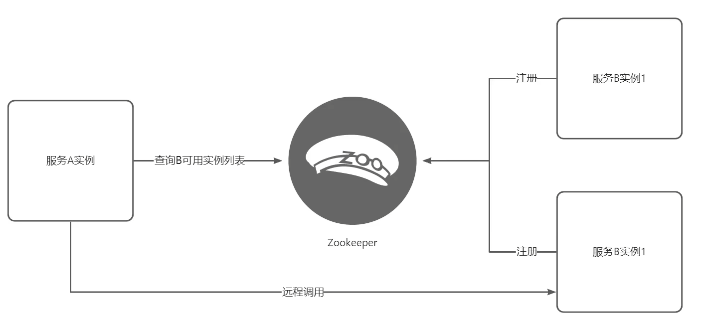
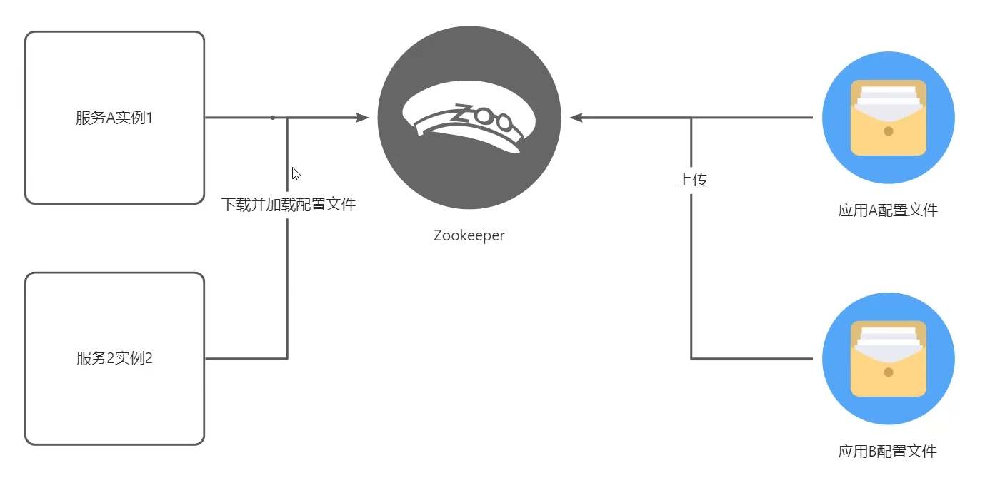
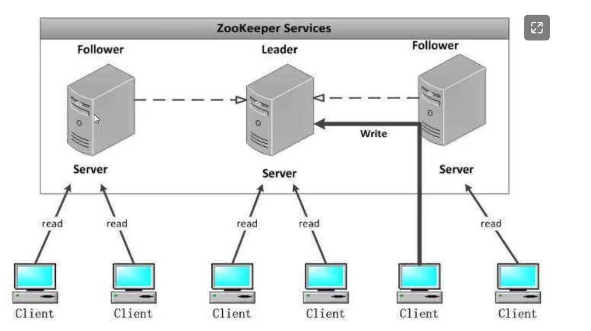
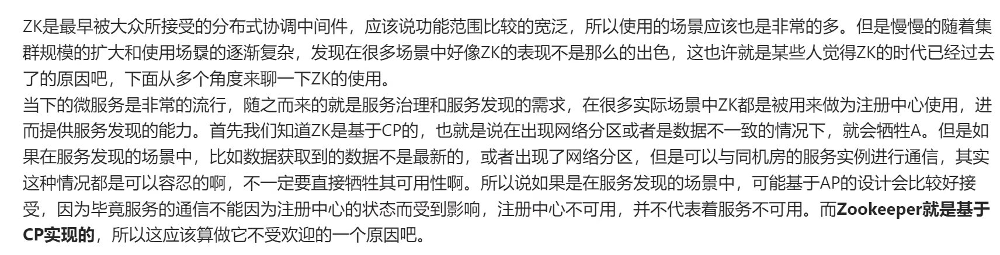
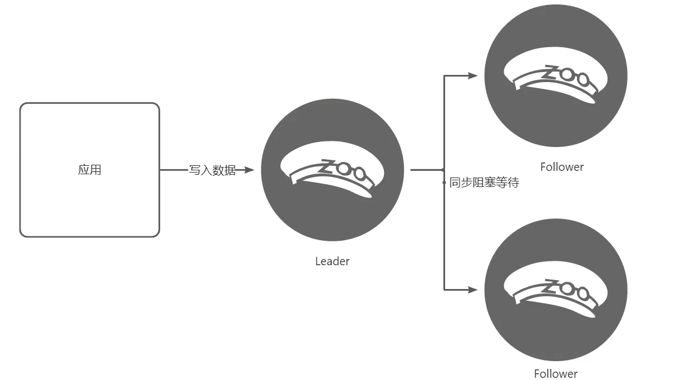
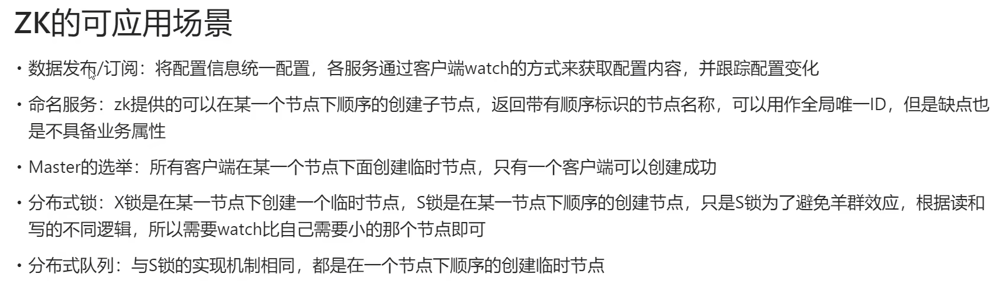

# 高并发微服务架构为何都在放弃 Zookeeper

## 背景：
目前主流的微服务与高并发的程序都在放弃zk

比如，Kafka，Facebook，RocketMq等都在转研自己的配置管理中心。

要明白为什么？首先我们来看看

### ZK是做什么的
很多人对zk的基本认识就是一个分布式协调中间件。主要做为注册中心，配置中心。

注册中心：

配置中心：

### 那为啥不受待见了呢？
架构图如下：

> 更新: 2024-07-07 23:25:36  
> 原文: <https://www.yuque.com/aaron-wecc3/dhluml/ggtxz1u0gq08nf6c>